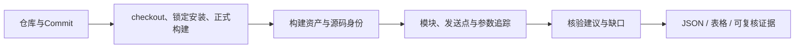

# Frontend API Extractor（白盒）

独立的前端源码仓库API提取工程：输入仓库与固定Commit，按锁文件正式构建，分析产物、嵌套模块及关联源码，交付URL、Host、Query/Path/Body/Header参数和JS/源码证据。

当前为设计阶段，无可运行CLI或服务；不能将黑盒已有离线提取当成本仓已实现。浏览器插件、登录态采集、接收器不在本仓开发。

## 工程边界

- Python负责任务、checkout、构建、资产与结果编排；Node/Babel/jshound为静态分析基线，固定版本后验证。
- 独立依赖、测试、发行和计划；未来共享核心使用固定包/协议，不依赖另一个仓库的相对目录。
- 正式构建失败必须报错，不静默降级为源码扫描成功；不执行业务产物或提取API。
- 优先恢复业务调用，沿相关wrapper/SDK链深入；资产、模块与函数深度分开。
- Agent为独立可选增强，结构建议必须有AST/绑定证据，无模型不阻塞确定性分析。

## 文档

[需求](docs/requirements.md)、[架构](docs/architecture.md)、[分析设计](docs/analysis.md)、[验收](docs/testing.md)、[唯一计划](docs/plan.md)。

## 迁移来源

从js-security的frontend-api-extractor子目录导出，原始Commit及逐文件SHA-256见[migration-source.json](migration-source.json)。新仓重新建立独立历史；原提交历史仍保存在原仓，未重写或删除。

本地独立仓库已建立。目标远端为`luohaijiang789/frontend-api-extractor`、默认私有；GitHub创建请求返回Forbidden，因此远端尚未创建/推送。成功创建后执行`git push -u origin main`，再核对远端HEAD。
