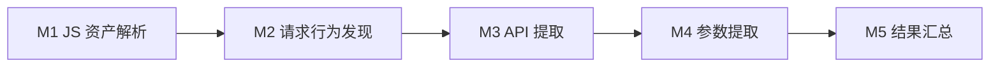

# 前端 API 与请求参数自动化提取

**输入一个前端代码仓，提取该仓库及可分析 JS 依赖中能够识别的网络请求 API 和发送参数，形成可追溯的 Excel API 资产表。**

项目起于阿里云美国独立站的前端 JS 数据跨境排查。第一阶段先完成数据发现与提取，不做 Host 筛选、敏感性识别、风险分级或合规判断。

总体采用一套白盒与两套黑盒入口：代码仓分析、现有插件真实请求采集、网站 JS 收集后静态提取，共用结果模型，尽可能补齐请求与参数。见[总方案与 Excel 交付](docs/API资产收集总方案.md)。

## 第一阶段范围



- 必须支持 fetch、Axios、XHR、Beacon，及常见请求封装与基本跨文件参数追踪；WebSocket、Pixel、Form 纳入发送发现。
- 前端 JS/TS、组件脚本及引用 JS 参与分析。外部 JS 默认最多获取三层，可配置；不克隆依赖整仓、不安装整包或执行目标代码。
- 调用关系只追到还原 API 与参数所需的范围，不做完整 Source→Sink 溯源。
- 输出 Host、URL/表达式、Path、Method、Query/Header/Body/路径字段、JS 来源、代码位置、调用关系与未解析原因。
- 地址未知与参数结构未知分开记录。可展开字段保留，未知部分明确标记，不承诺运行时参数 100% 完整。

## 从哪里开始

| 文档 | 用途 |
|---|---|
| [总方案与 Excel 交付](docs/API资产收集总方案.md) | 三入口互补、三层定义、统一 Excel 列与证据 |
| [网站 JS 收集方案](docs/网站JS收集方案.md) | 第二种黑盒入口：采集部署脚本，静态发现未触发请求 |
| [GitHub 调研](Temp/GitHub方案调研.md) | 现成项目、已读源码、能力边界和待验证题 |
| [白盒方案](docs/白盒方案.md) | 冻结的 M1～M5 范围、开发内容、技术边界与输出 |
| [白盒 Checklist](docs/白盒Checklist.md) | 准备、开发、路线验证与验收 |
| [黑盒方案](docs/黑盒方案.md) | 已确定有效的浏览器插件采集方案，辅助反查与验证 |
| [技术探索](Temp/README.md) | 候选路线、难点与已有参考资料 |
| [项目原则](AGENTS.md) | 后续工作的范围约束 |

黑盒提供页面、接口、参数和调用栈；白盒独立发现代码中的请求，再用黑盒核对字段与调用位置。黑盒不是白盒运行的必要输入。

## 当前状态与目录

尚未实现白盒扫描器或实测覆盖率；下一步讨论 M2～M4 的轻量分析实现与 AI 辅助方式。

```text
js-security/
├── README.md / AGENTS.md   # 目标与项目约定
├── docs/                  # 主方案、Checklist、黑盒方案
├── Temp/                  # 技术探索与参考资料索引
├── references/            # 后续参考材料
├── src/                   # 后续实现，当前为空
└── tests/                 # 后续验证样例，当前为空
```

修改后检查、提交并推送远端。业务代码和原始流量的存放、以及代码可发送给模型的范围，在接入时明确。
