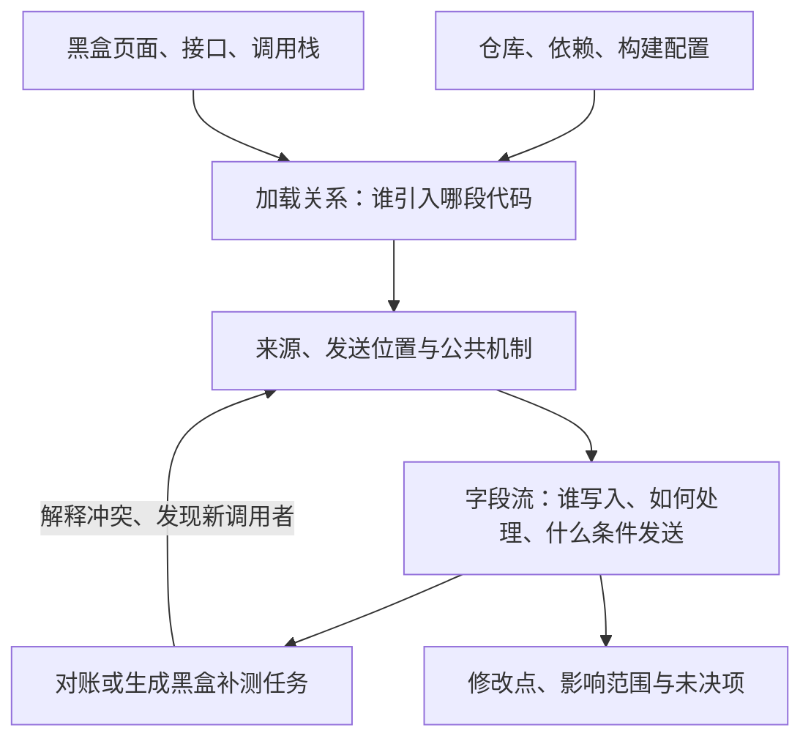

# 白盒思路：先找代码边界，再追字段路径

**建议路线：资产与加载关系 → 发送位置 → 字段流与公共机制 → 黑盒对账 → 整改。** 当前只设计，不编写扫描器、不运行第三方代码。

范围已明确：只分析前端 JS 及其引用 JS，默认拉取三层；其他语言、服务端和依赖整仓不展开。已有 HTML/配置等仅作辅助材料。

每段思路的落地卡点、遗留出口和验收统一见[问题台账](难点与待解问题.md)，不以“后续用 AI 解决”作为处理结论。

## 1. 三份材料一起看

| 材料 | 查什么 | 不足时怎样处理 |
|---|---|---|
| 仓库 | JS/TS/JSX/TSX、组件脚本、HTML/模板、请求封装、依赖锁文件、构建与发布配置 | 语法/框架不支持、模块未解析分别登记 |
| 构建与外部代码 | 已有 bundle、source map、chunk/模块清单、依赖实际文件、远程入口与配置 | 未取得实现时只能确认调用/加载边界，不能猜内部行为 |
| 黑盒既有输出 | 页面、接口、头/query/body、发起脚本与调用栈 | 与仓库版本不符时分开记录，不强行对应 |

单仓是组织边界，不能直接当执行边界。依赖和远程脚本可作为该仓应用的关联材料；其他仓库内部及后端转发先交接，不无界扩展。

## 2. 先画两类关系

加载关系解决“实现在哪”；字段流解决“数据去哪”。函数调用图可辅助定位，但不能替代字段分析。第一版可用带引用的表记录，不预设图数据库。

## 3. 外部和嵌套代码怎么处理

| 情况 | 建议动作 | 交付边界 |
|---|---|---|
| 多层封装、别名导入、重导出 | 解析实际模块与符号，沿参数/返回值及对象副作用追踪 | 每条连接指向文件/符号；动态分派不确定时保留候选 |
| 已有包依赖、workspace | 结合锁文件、实际解析路径、浏览器入口找到对应 JS | 只读相关前端 JS，不自动安装整包或克隆依赖仓 |
| HTML/模板中的 CDN、内联脚本 | 查模板、构建注入、加载 URL 与全局对象使用 | 取到对应脚本文本后再分析；只拿到 URL 不称已审代码 |
| 动态 import、懒加载 chunk | 查表达式候选、构建清单与实际加载结果 | 静态候选与本次运行实例分别保留 |
| externals、微前端、远程模块 | 查全局映射、remote entry、暴露模块和运行配置 | 宿主代码不是远程实现；登记外部责任方与缺口 |
| 动态 script、标签管理、远程配置 | 查创建/插入位置、配置读取与可切换的目的地 | 记录快照/时段，不能用一次加载代表所有配置 |
| 压缩、混淆或缺 map | 优先匹配原始产物/map；否则从可识别 API、常量、输入输出边界调查 | 格式化不是恢复源码；不承诺还原所有语义 |
| eval/Function、解码执行、WASM 调用边界 | 查 JS 中的生成/调用位置和数据输入输出 | 不拉取非 JS 实现；内容缺失或不支持时留下断点 |

上述属于待处理场景，不表示目标站实际采用这些机制。webpack 与 map 的资料依据见[参考 R05/R06](参考资料.md)。

外部资产最少记录：`引入位置 → URL/包/全局名称 → 版本或内容哈希 → 获取时间/配置 → 取得与解析状态 → 依赖它的路径`。同 URL 内容变化不能覆盖旧证据；递归发现有范围和停止条件。取材料只读，不因审查而自动执行安装脚本、构建插件或未知代码。

## 4. 字段路径怎样记录

审查单位是“某次调用条件下，某个字段进入某个载体”，而不是只列一个域名或 API。

| 记录项 | 要回答什么 |
|---|---|
| 身份 | 应用/commit、实际脚本与配置、运行环境、关联黑盒请求 |
| 来源与写入 | 字段最初从哪里读到，经过哪些追加/覆盖、别名或对象引用 |
| 处理与状态 | 原值/复制、已知派生、控制依赖、不透明变换分别标记 |
| 时间与条件 | 角色/区域/开关、请求匹配、安装顺序、入队与 flush/重试 |
| 最终载体 | query/header/body/资源 URL/消息；序列化后保留哪些字段 |
| 依据与断点 | 文件/函数/位置、每段传递依据、支持/反驳/未知 |
| 整改 | 真实控制位置、受影响调用者、旁路与业务验证 |

两条线并行：从发送参数反查来源；从 URL、身份、存储、DOM、错误、请求/响应与业务状态追用途。前者避免一开始标记全仓所有变量，后者补未关联黑盒请求的路径。

本项目关心数据传递，不只关心漏洞中的“攻击者可控输入”。不能只沿用漏洞工具默认 source/sink；转义、编码、哈希等也不能一律设成阻断传播的安全处理。先查字段和用途，再结合业务分类，不只凭字段名挑敏感来源。

公共封装/SDK 建机制记录：参数、闭包/全局/存储输入，返回值及对象/请求/队列副作用，生效条件和证据。复用前核调用者、版本、配置差异；不能假设任意函数都“输入原样到输出”。

假设示例：业务只传 orderId，封装追加 pageUrl，SDK 再加 riskToken。三个字段分别追来源和写入者；发送调用栈不必包含所有历史写入动作。若 pageUrl 在最终序列化被删除，应缩窄出站主张；若只转为 token，不能直接断言原值可恢复或已经匿名。

## 5. 工具和 Agent 怎样配合

| 工作 | 优先方式 | 验收 |
|---|---|---|
| 枚举语法、导入和发送候选 | 解析器/规则提供可重复索引 | 命中位置、解析失败、未解析模块可回查 |
| 跨函数/属性追踪 | 比较现有数据流引擎与局部定向追踪 | 正反例、缺边、错误连接和成本有记录 |
| 未知封装/SDK 理解 | Agent 读取相关实现和调用者，提出机制摘要 | 引用原文；模型推断不直接升级为已证实边 |
| 黑盒反查 | 按脚本/位置、接口与字段组合定位候选 | 版本、字段变换和条件相容，不靠名称相同确认 |
| 反例与补测 | Agent 草拟，人工或独立预期核对 | 能区分解释，结果会改变主张 |

同一 Agent 顺序承担不同任务即可先试；不用角色数量证明结论可靠。任务输入限定主张、材料和允许动作，缺实现时返回断点。源码、网页和 SDK 文本是分析对象，不能作为 Agent 操作指令。工具/模型的数据外发方式也需符合项目的处理边界。

CodeQL、Semgrep、Babel 与 AI 论文各自解决不同层，未选型；能力和许可/部署边界须核对，不能默认任一工具开箱即查清本项目透传。[参考 R01～R07](参考资料.md)

## 6. 第一轮怎样证明这条路可行

- [ ] 选一条黑盒请求，确认页面/调用栈与仓库或产物版本的对应；再独立找一条源码候选。
- [ ] 追清公共封装与 SDK 的字段写入链，至少有一个成立例和一个过滤/互斥反例。
- [ ] 定位同机制其他调用者，给黑盒一个新的可执行触发条件。
- [ ] 指出一个真实修改点、可能绕过的路径和必要业务复验。
- [ ] 记录未解释字段、未取得代码、未支持语法及未验证条件；不把它们算通过。

候选状态使用：有代码支持、被反证、待取实现/配置、待黑盒验证；运行观察单独关联。达到已支持/反驳，或留下具体材料缺口时结束该任务，不让 Agent 无限重猜。
