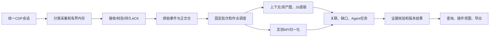

# 系统与工程架构

产品边界以[总览](../../docs/overview.md)为准；本文件定义一个插件和统一后端的工程组织。具体完成状态只在[计划](plan.md)。以下区分当前实现和目标，不要求用空文件模拟模块完成。

## 1. 技术与部署

| 层 | 技术 | 当前实现/决策 |
| --- | --- | --- |
| 生产插件 | TypeScript、Vue 3、Vite、MV3/CDP | browser-extension/；同会话收请求和JS，独立租约待抽取 |
| 接入服务 | Python 3.10+标准库http.server | receiver.py、0.0.0.0:8379；不为重整引入新框架 |
| 元数据/正文 | SQLite + 服务端内容寻址文件 | 不可变事件、上传回执、正文与URL映射；按实际协议 |
| 编排/输入适配 | Python | stream.py、cli.py；离线ingest已有，持续作业待实现 |
| JS核心 | 固定jshound Python/Node/Babel | engine-lock.json固定Commit；不修改第三方子模块冒充增强fork |
| Agent | Python编排、可配置模型适配器、受限证据工具 | 未实现；提供方/模型待配置，设计见agent.md |
| 结果/导出 | Python JSON/CSV；Excel目标 | 当前文件级候选，精确绑定、Excel及HTTP结果回传待实现 |

服务器可由IP/端口或域名访问。现有标准库入口提供HTTP，HTTPS可由部署层终止；不把HTTPS或手动令牌作为当前联调前置。固定code仅匹配协议，当前不提供完整用户/多租户身份体系。不自动部署未知地址。

## 2. 代码组织

```text
js-security/
  browser-extension/                   # 唯一生产插件、独立npm依赖与测试
    src/recorder.ts                     # 原请求采集/生命周期
    src/js-capture.ts                   # JS、上下文及加载事件
    src/remote-capture.ts               # 分块、事件、持久ACK与重试
    src/asset-index.ts                  # 分类计数/轻量已发送索引，不含正文
    src/JSCapturePanel.vue              # 配置服务器、进度和源码视图
  backend/
    server.py                          # 生产增量接收入口
    pyproject.toml
    src/website_js_extractor/
      receiver.py                      # 分类HTTP、SQLite、正文及持久确认
      stream.py                        # 已收事件→归一化输入→离线分析
      assets.py / capture.py           # 静态资产与旧输入适配
      collection.py / acquisition.py   # 引用图；显式CLI补取
      engine.py / worker.py            # 固定引擎及子进程隔离
      results.py                       # 候选、字段、JSON/CSV
      cli.py / service.py              # 命令及旧/v0兼容
    tests/                             # Python及本地HTTP集成
    docs/
  docs/                                # 跨工程边界、迁移和统一交付
  references/                          # 固定参考源码、实验
  legacy/js-capture-extension/          # 旧独立插件，不参与生产构建
```

目标新增scheduler/、agents/、query/等应在对应工作包实现时创建，当前没有这些模块。包名保留website_js_extractor，目录迁移不顺便改wire schema、数据库格式或已存对象。

## 3. 处理管线



当前C/D、显式离线E/F/G及文件导出已有实现；自动E、Agent、完整I/J待实现。接收ACK与analysis状态是两条状态链，不能等待模型完成才确认上传。

### 接收与分类

继续capture-stream-2：api_request、js_source、page_context、script_load、task。服务端先校验类别、对象长度、schema与事件身份，落原始证据后再派生。未知新类别按协议拒绝，不能默默当API。完整独立Gap流作为下一协议能力，不假称已有。

### 输入固定与增量

调度目标：按project/scan的已持久事件水位生成不可变manifest，包含事件ID、object_id、上下文版本、预算、核心和模型版本。一次run只读manifest；运行中新增事件进入下一批。完成失败/取消记录处理到的资产和未处理项。

首版调度允许有界合并窗口触发离线核心，必须如实声明可能全量重算；随后用依赖图维护受影响模块与缺依赖待补集合，不能把每个脚本全量重跑称为增量索引。重启依据持久作业恢复；重复任务键绑定输入/配置/核心版本。

### 去重与版本

内容哈希存储和观察ID分别存在。当前项目+URL“已发送”标记可跳过正文读取，但不能保证部署更新后内容不变；进入正式增量分析前需引入作用域失效/版本验证，并验证同URL换版、跨服务地址和跨任务旧标记。绝不以URL索引推断同版事实。

### 证据和Agent

实测请求是真实观察；静态结果当前是文件级候选；模型输出是hypothesis。关联可为matched/static-only/observed-only，不能从相同路径直接推断同调用点。Agent提出可验证结构，核验器检查固定正文、range、绑定和对象身份；失败保留建议/缺口，不覆盖原证据。

## 4. 插件会话与失败隔离

生产只允许一个会话拥有者。当前Recorder持有连接，JS消费者复用；后续SessionBroker提供acquire/subscribe/command/release租约，不能重复attach。根tab、子session、连接epoch、导航与执行上下文分开；裸scriptId/requestId不能跨目标关联。

暂停/停止一个消费者不关闭另一消费者所需连接。各队列按字节有界，JS队列满不阻断API采集；无法恢复时记录缺口。最后租约释放前有界排空，晚到事件不能写入已冻结批次。独立租约当前仍未完成，须单独回归。

DevTools/其他扩展占用时不抢占。无磁盘远端模式无法保证离线/退出零丢失；旧请求本地任务保留兼容，不因远端失败静默切本地保存正文。

## 5. 完成后的演示

在真实Chrome加载唯一插件→填写服务器地址→正常操作→后端看到五类持久事件/正文→生成固定分析批次→确定性提取与Agent受限任务→插件查看分来源API与证据→导出。必须包含断线、未知基址、同URL换版、重复ACK和模型失败反例。当前只能演示接收与显式离线提取，不宣称整链已交付。
