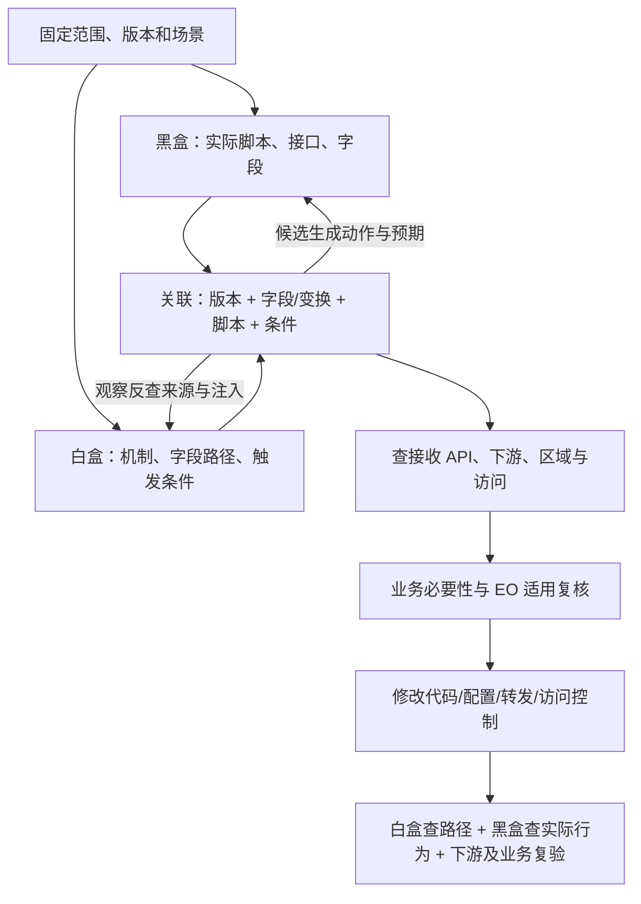

# EO 14117 前端 JS 排查整改：团队交流方案

> 2026-10-21 交流稿 · v2。当前完成方法设计与公开 SDK 静态样本研究；业务扫描、整改和验收尚未开始。

## 1. 本次要决定什么

**目标：查清范围内前端 JS 采集、直传、隐式注入及后续转发/访问路径，解决其中 EO 14117/DSP 相关问题。**

| 会上决定 | 必须写下的结果 |
|---|---|
| 查哪个业务 | 应用、域名、代码/部署版本、流程、角色、排除项 |
| 谁负责 | 牵头、黑盒、白盒、前端、后端/云、业务、隐私/法务接口人 |
| 先准备什么 | 仓库/配置、账号/场景、部署对应、下游入口、证据与 AI 使用条件 |
| 首轮交付什么 | 一次双向往返、一张可定位整改卡、复验或明确阻塞、剩余范围 |
| 什么时候对账 | 材料到位时间、首次对账时间、阻塞升级负责人 |

建议首个试点选一个美国业务 Web/H5 应用，先查公共错误上报，再查 SDK 注入业务 API。其他 JS/SDK 仍登记，暂未深查的明确留账。

## 2. 查三条链，交付三类结果

| 链路 | 需要查到哪里 | 最容易漏掉什么 |
|---|---|---|
| 浏览器直传 | 来源字段 → SDK/封装 → 请求 → 接收方 | 完整 URL、错误上下文、回放、像素、后台发送 |
| 业务 API 透传 | 来源/token → 拦截器注入 → 本方 API → 日志/风控/队列 | 同域请求里的隐式字段、后端再转发 |
| 接收后处理与访问 | 存储/复制/备份 → 主体/人员/权限/密钥 | 首跳在美国，但后续发生其他地区处理或访问 |

最终结果按以下格式交付：

| 结果 | 最少内容 |
|---|---|
| 可整改 | 字段与路径、证据、真实修改位置、影响范围、业务约束、负责人、复验 |
| 待核实 | 缺什么事实、谁提供、怎样取证、会改变哪个决定 |
| 覆盖缺口 | 缺失资产、未触达场景、未支持机制、版本差异及其影响 |

**EO 判断所需事实：** 数据类别/数量与时间口径、交易关系、主体及访问能力、适用例外/条件。技术侧取证，隐私/法务复核；详见 [Checklist E01～E09](项目Checklist.md)。请求去了某个域名、本方域名或使用 token，都不足以单独完成判断。

## 3. 怎么查：黑盒与白盒相互发现、相互验证

| 工作 | 执行者做什么 | 交给下一方什么 |
|---|---|---|
| 黑盒独立发现 | 走场景，观察实际资源、接口和载荷，不只过滤已知 SDK | 场景、请求、字段路径、脚本/发起线索、版本与证据 |
| 白盒独立发现 | 从来源、发送点和拦截器追机制、对象/字段与配置 | 条件、变换、发送点、代码位置和候选路径 |
| 黑盒 → 白盒 | 问“这个请求中的字段由谁加入” | 来源解释、注入配置、其他受影响调用者 |
| 白盒 → 黑盒 | 给出前提、动作、预期字段/目标、反例、观察要求 | 实际支持、差异或明确未验证原因 |
| 后端/云侧 | 沿具体 API/字段追日志、转发、存储与有效访问 | 下游事实及证据缺口 |

两边都有不等于自动匹配；两边都没发现也不能当作全覆盖。关联层负责解释分歧：

| 分歧 | 下一步 |
|---|---|
| 黑盒有，白盒没解释 | 查远程脚本、构建注入、生产版本、拦截器和静态遗漏 |
| 白盒有，黑盒没看到 | 查触发、采样/开关、角色、死代码、观察窗口与能力 |
| 字段/目标不一致 | 查过滤、序列化、加密、批处理、请求改写与配置差异 |

## 4. 要准备哪些材料，谁提供

| 提供方 | 必备材料 | 缺失影响 |
|---|---|---|
| 前端/发布 | 仓库、commit、bundle/source map、发布对应、SDK 初始化/远程配置 | 无法解释生产行为或定位修改 |
| 业务/测试 | 路由与旅程、角色账号、合成数据、异常/离开/重试场景 | 页面和状态触发不到 |
| 后端 | API 归属、字段接收、日志/队列/转发、存储入口 | 只能停在浏览器首跳 |
| 云/供应商 | 处理区域、复制/备份、主体、子处理者、有效权限与密钥/映射 | 无法确认后续处理与可访问关系 |
| 业务/隐私/法务 | 字段用途、允许范围、主体/交易材料、规则口径与复核人 | 不能决定必要性或关闭 EO 问题 |
| 工具/安全 | 观察环境、受限证据存储、模型和源码/流量使用边界 | 无法可靠观察或安全共享材料 |

启动条件：有明确范围、负责人、可用仓库或网站入口、证据保管方式。缺下游材料可先做技术调查，但相关主张保持待核实。完整准备清单见 [P01～P13](项目Checklist.md)。

## 5. 重点查什么，改哪里

| 对象 | 具体查点 | 优先评估的控制位置 |
|---|---|---|
| 显式/自动埋点 | 事件对象整体透传、完整 URL、默认上下文、扩展属性 | 事件构造/schema、采集范围 |
| 错误/RUM | breadcrumb、堆栈上下文、请求/响应内容、凭据 | 公共 logger、入队前过滤 |
| 回放/DOM | 表单、动态节点、遮罩失效、敏感页面 | 采集允许范围、遮罩、页面禁用/隔离 |
| 风控/指纹/token | 输入、稳定范围、生命周期、账号共现、映射持有方 | SDK 配置、输入/接口范围、身份和留存 |
| 请求注入 | 默认头、fetch/XHR 包装、匹配过宽、包装顺序 | 拦截器/匹配规则、API 接收与日志 |
| 队列/Worker/Beacon | 退出后 flush、账号切换、离线重试、备用路径 | 队列身份与状态、清理、备用发送 |
| 标签/远程配置 | 仓库外新脚本、目的地切换、后台发布 | 脚本与配置发布、允许范围和变更复核 |
| API/SSR/BFF | 运行上下文、后续风控调用、日志、复制、境外访问 | 字段接收、转发、区域、权限与密钥 |

具体字段：账号/会话/设备标识、凭据、联系信息、位置、金融/健康等敏感信息、搜索/自由文本、URL、DOM 和请求响应。按来源与用途分类，不能只看名字；未知 token 不猜明文。

## 6. 用一个例子说明交付

以下为假设业务场景；只有 SDK 注入能力有[公开 Baxia 样本](../docs/03-案例/Baxia/公开SDK静态核查.md)依据，未在真实网站观察：

| 步骤 | 得到的事实或任务 |
|---|---|
| 黑盒创建合成订单 | 观察到 `POST /api/order/create` 带 `header.bx-ua` |
| 白盒反查 | 核对目标版本的 SDK 包装、注入载体及 `checkApiPath` |
| 白盒扩展调用者 | 发现导出接口也可能匹配，生成新增黑盒场景 |
| 黑盒补测 | 有对应角色则验证；无权限留缺口 |
| 后端调查 | 查该头是否写日志、转风控、落库，补主体/区域/访问事实 |
| 决策与整改 | 业务确认非必要接口后评估收窄匹配，必要链路保持 |
| 双侧复验 | 排除接口不再带、必要接口正常，重试/备用发送与下游同步检查 |

每张整改卡必须填：**路径与条件｜证据｜修改位置｜覆盖与旁路｜业务影响｜负责人｜复验结果｜残余任务**。

## 7. 牵头人怎样推进

| 阶段 | 牵头动作 | 阶段完成证据 |
|---|---|---|
| 启动 | 定范围、版本、角色；落实材料和接口人 | 范围表、材料/阻塞清单、负责人 |
| 独立发现 | 分配黑盒场景和白盒机制，统一记录引用 | 请求/字段观察、代码路径、覆盖缺口 |
| 对账 | 展示未解释请求、未验证候选、版本冲突；派后端任务 | 至少一次完整往返及明确未结项 |
| 整改 | 确认必要性、控制点、业务约束与修改窗口 | 可执行整改卡及变更记录 |
| 复验 | 组织两侧、下游和业务验证，交隐私/法务复核 | 证据齐全的结案或有负责人的阻塞 |
| 扩展 | 按未覆盖应用/机制推进，识别重复工作再工具化 | 下一批范围、任务与增量复核条件 |

需要帮助最多的四处：测试补长尾角色与异常场景；前端补生产配置/脚本对应；后端/云侧补首跳以后事实；隐私/法务补适用口径与供应商资料。每个阻塞都要落到人和材料，不能只写“待确认”。

## 8. AI 做什么，工具先建设什么

| 环节 | AI 输出 | 验收 |
|---|---|---|
| 白盒理解 | 封装/SDK 候选、字段路径、搜索线索 | 代码/配置引用支持判断 |
| 黑盒归组 | 接口/事件结构、语义建议、场景建议 | 可回查请求，不猜不透明内容 |
| 双向关联 | 候选映射、反查/验证任务、差异解释 | 版本、变换、条件和反例核对 |
| 整改与复核 | 控制点、影响归组、复验规格 | 修改点存在、覆盖旁路、人工确认业务和 EO 判断 |

先人工跑通接口，再建设 `blackbox/`、`whitebox/` 的提取与执行能力，`correlation/` 的关联契约，`ai-agents/` 的任务辅助。源码和流量仅在团队批准的数据处理范围内使用；模型输出不直接变成事实或生产变更。

## 9. 会中直接填写

| 待定项 | 决议 | 负责人 | 到位/复核时间 |
|---|---|---|---|
| 试点应用、版本、流程和角色 | 待填写 | 待指定 | 待约定 |
| 仓库/配置、测试账号与观察环境 | 待填写 | 待指定 | 待约定 |
| 后端/云侧及供应商材料 | 待填写 | 待指定 | 待约定 |
| EO 口径、复核人、用途约定 | 待填写 | 待指定 | 待约定 |
| 证据与 AI 使用边界 | 待填写 | 待指定 | 待约定 |
| 首条往返、整改与验收 | 待填写 | 待指定 | 待约定 |
| 首次对账与阻塞升级 | 待填写 | 待指定 | 待约定 |

验收直接使用 [Checklist](项目Checklist.md)。执行细节分别见[白盒怎么做](白盒怎么做.md)、[黑盒怎么做](黑盒怎么做.md)；后续工程入口见 [workstreams](../workstreams/README.md)。
