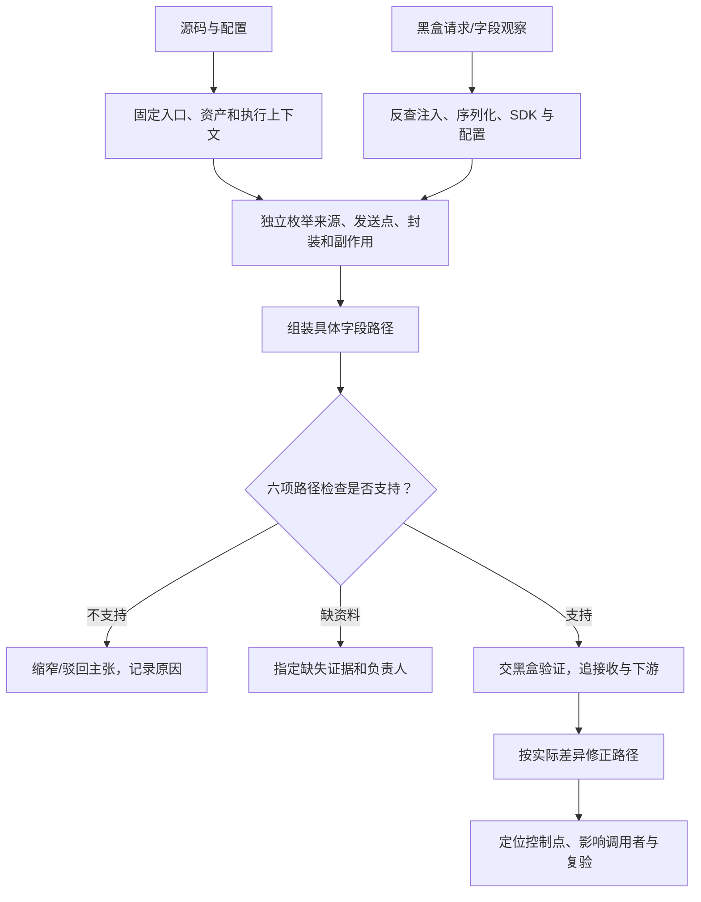

# 白盒怎么做

> 目的：定位 EO 14117/DSP 前端采集与透传相关的代码、配置和修改点。当前为操作方法，未执行真实业务审计。

**输入：仓库/配置，可选黑盒观察。输出：字段路径、验证任务、下游交接、整改卡。** 项目级任务统一在 [Checklist W01～W09](项目Checklist.md)跟踪。

## 1. 开工前勾选

- [ ] 应用、commit、部署环境已固定；不能对应生产的部分已标明。
- [ ] 可读取源码、锁文件、构建/发布资料、SDK 初始化与可取得的远程配置。
- [ ] 已有路由/角色/旅程；缺失材料有提供人。
- [ ] 确认后端接口人、受限证据位置和 AI 可用材料范围。

拿不到生产配置仍可查源码；“配置未知”必须留在具体路径中。

## 2. 按什么顺序查

| 步骤 | 怎么操作 | 必须留下的产物 |
|---|---|---|
| ① 资产 | 查启动/HTML、路由、依赖锁文件、构建注入、动态加载、iframe、Worker/SW；对照部署脚本 | 文件/脚本、版本/哈希、加载者、浏览器/SSR/Edge 上下文、缺失项 |
| ② 机制 | 从来源向下、发送点向上、SDK/拦截器看副作用，三路合并候选 | 机制、输入/输出、配置、触发条件、证据位置 |
| ③ 字段 | 反查发送参数 → 序列化 → 对象合并 → 调用者 → 来源；再正查来源的其他用途 | 来源/变换/载体/目标、条件、时序和未知边 |
| ④ 校验 | 对每条路径完成下一节六项检查；不成立的边不能拼接 | 支持/反驳/待补证及具体理由 |
| ⑤ 往返 | 解释黑盒观察，扩展同机制调用者；给黑盒明确场景 | 观察映射、验证任务、返回差异 |
| ⑥ 整改 | 选真实控制点，枚举主路径/旁路和业务约束 | 修改规格、影响明细、下游交接、复验 |

### 重点从哪里找

| 对象 | 搜索/追踪入口 | 下一步 |
|---|---|---|
| 数据来源 | location/query/hash、referrer、DOM/表单、身份对象、Cookie/存储、错误、请求响应、指纹特征 | 标记具体属性与语义，追向所有用途 |
| 发送/跨边界 | fetch、XHR、sendBeacon、WebSocket、资源 URL、form/location、postMessage、Worker 消息 | 找参数构造、发起上下文和接收端 |
| 公共包装 | track、logger、RUM、request 封装、默认上下文、插件 | 展开导入、调用、spread/Object.assign、字段补全 |
| 隐式注入 | 拦截器、默认头、全局 API 包装、SDK 初始化 | 解析匹配规则、载体、覆盖及包装顺序 |
| 异步/远程 | 队列、定时器、重试、备用发送、SW、标签/配置加载 | 查身份变化、持久化、flush 和配置取值 |

搜索只定位候选。字段/端点可能拼接、改名或由 schema 生成；没搜到字面量时继续查生成、构建与远程入口。

## 3. 每条路径必须通过的六项检查

| 检查 | 要看什么 | 会否定原结论的例子 |
|---|---|---|
| 对象实例 | 读取对象是否真传到发送对象 | 同名变量实际是不同实例 |
| 字段/载体 | 属性如何进入 header/query/body/消息 | 只发送 product.id，未发送 user.id |
| 联合条件 | 角色、区域、开关、匹配能否共同成立 | 把美国分支来源与中国分支发送拼在一起 |
| 时间 | 读取/入队/身份变化/flush 的顺序与绑定 | 队列内保存原值，修改当前对象没有清理旧事件 |
| 序列化 | toJSON、replacer、白名单及最后一次改写 | 字段入对象后被过滤，不支持原值出站结论 |
| 运行归属 | 浏览器/SSR、实际配置和加载版本 | 服务端 fetch 被误当浏览器直传 |

编码/哈希/token/加密记为变换，既不自动视为匿名，也不据此断言其中包含原值。

## 4. 具体记录示例：完整 URL 进入错误载荷

以下文件名、行为与条件均为假设；真实案件要补 commit、符号、行号及证据引用。

| 路径段 | 检查位置 | 需要取得的证据 |
|---|---|---|
| 来源 | `router/callback.ts` | 回调路由是否可能含合成凭据，URL 是否仍保留 |
| 构造 | `telemetry/error.ts` | `event.page ← location.href`，是否再过滤 |
| 入队 | `telemetry/queue.ts` | 保存的是副本还是引用；身份切换与旧队列处理 |
| 序列化 | `telemetry/transport.ts` | `page` 最终是否进入请求，toJSON/replacer 是否改变 |
| 发送 | 同上及回退实现 | 端点取值、条件、fetch/Beacon/重试分别走哪里 |

最终应填成：

| 记录 | 示例内容 |
|---|---|
| 主张 | 回调页错误分支下，完整 URL 可经 `event.page` 进入错误请求体；生产是否触发待黑盒 |
| 整改位置 | 事件构造点，入队前只构造业务允许字段；检查旧队列、重试和备用发送 |
| 验证 | query/hash 分别放合成标记，触发允许的错误并覆盖 flush、重试；检查实际载荷 |
| 未知 | 生产配置、接收后的主体/区域/留存待补证 |

**反例处理：** 若实际序列化已删除 `page`，驳回或缩窄该出站主张；入队前是否仍有不必要存储另查。

## 5. SDK 注入与黑盒反查怎么落地

### 收到“订单请求多了 bx-ua”

| 顺序 | 查什么 | 留下什么 |
|---|---|---|
| 1 | 观察对应脚本/哈希与仓库是否相容 | 匹配或版本差异 |
| 2 | 字段字面量、默认头、序列化、请求拦截、SDK 包装 | 写入点及导入/调用证据 |
| 3 | URL 匹配、参数载体、开关、包装顺序 | 该业务 API 是否真的受影响 |
| 4 | 同机制的其他调用者 | 新候选及其条件差异 |
| 5 | API 接收、日志与后续风控调用 | 下游代码，或带字段/入口的后端任务 |

找不到源码时查部署 bundle、远程标签、动态配置与构建注入；仍未定位就保留“观察未解释”。token 内部不透明时先解释输入/注入/传输，向供应商补稳定范围、映射/密钥、主体与处理资料，不等待完整反混淆才交付已知部分。

### 发给黑盒的验证任务

| 必填项 | 填写要求 |
|---|---|
| 主张与证据 | 路径 ID、版本、代码/配置位置，具体字段到具体载体 |
| 前提与动作 | 页面/角色、身份/同意、开关/采样，操作与错误/flush 顺序 |
| 预期与反例 | 哪接口应有/不应有哪字段，已知变换是什么 |
| 观察要求 | frame/Worker/发送载体、时间窗口依据、重试/回退 |
| 返回状态 | 符合、差异、未触发、不可观察、失败、限定场景未见 |

黑盒未观察到先核前提与观测能力，不能自动把代码路径判为误报。

## 6. 整改与 EO 交接

| 当前证据 | 可推进的动作 | 仍需确认 |
|---|---|---|
| 冗余原始字段路径成立 | 评估源头最小化、字段 schema、限制公共封装 | 用途、业务影响、实际部署验证 |
| SDK 匹配超出已确认用途 | 评估收窄页面/接口/输入范围 | SDK 是否有真实控制、必要风控回归 |
| 同域业务 API 透传成立 | 查接收、日志、转发、队列与存储 | 主体、区域、有效访问、历史处置 |
| 不透明 token/配置缺失 | 提交有目标的实验或供应商任务 | 不能猜明文、当前端点或 EO 结论 |

EO 数据口径、主体/交易、例外和适用控制由[Checklist E01～E09](项目Checklist.md)接续；白盒提供字段、条件、接收入口和证据。

## 7. 本轮完成条件

- [ ] 资产/版本、机制、字段路径和缺失项可回查。
- [ ] 关键路径完成六项检查，反例能改变结论。
- [ ] 至少一条黑盒观察得到解释或有依据的断点；同机制调用者已扩展。
- [ ] 验证任务能直接执行，返回差异已更新路径。
- [ ] 整改给出真实位置、影响范围、旁路与业务复验。
- [ ] 下游/EO 未结项有负责人和待取证内容。

AI 辅助搜索、封装理解、路径与任务草拟；人工核对证据和反例。实现入口：[whitebox](../workstreams/whitebox/README.md)。配套：[黑盒怎么做](黑盒怎么做.md)。
