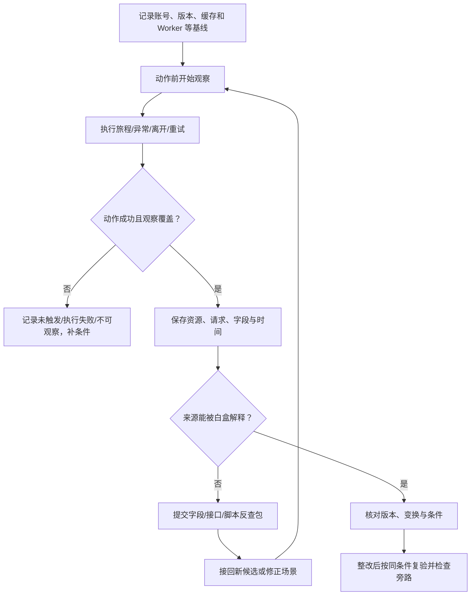

# 黑盒怎么做

> 目的：观察 EO 14117/DSP 前端相关的实际采集/发送行为，反查白盒并验证整改。当前为操作方法，未执行真实网站测试。

**输入：网站、账号、场景，可选白盒任务。输出：场景记录、脚本/接口/字段观察、反查任务、复验。** 项目级任务统一在 [Checklist B01～B08](项目Checklist.md)跟踪。

保留独立观察快照：先依据业务旅程和实际资源发现，再把白盒候选转成定向任务。高影响线索可以立即共享，但记录来源，避免两侧都只验证同一份清单。

## 1. 开工前勾选

- [ ] 域名/环境、允许动作、账号角色和测试窗口明确。
- [ ] 已准备合成数据、登录/退出/关键业务与异常场景。
- [ ] 浏览器、观察工具和配置版本已记录；证据存受限位置。
- [ ] 用受控正例确认拟查载体能被观察，已知盲区已登记。
- [ ] 可取得实际脚本/发布线索；无法对应源码版本的另列任务。
- [ ] 相关 frame/Worker/SW 的附着时点、载体和解析完整性已校准；主页面正例不代表其他上下文可见。

原始请求可能带凭据与个人数据，报告仅放脱敏结构或合成标记；共享 AI 材料须符合已确认边界。

## 2. 单个场景的执行流程

| 步骤 | 执行动作 | 必须留下的产物 |
|---|---|---|
| ① 基线 | 固定环境/账号/版本，记录 Cookie/缓存/Worker 状态，不默认全部清空 | 场景 ID、前置状态、观察配置 |
| ② 独立发现 | 不限定已知 SDK 域名；动作前观察，执行后覆盖已知等待/flush | 实际资源、请求、动作时间线 |
| ③ 解析 | 展开头/query/body/消息及可解析事件，保留原请求引用 | 端点/事件/字段结构与未知载荷 |
| ④ 对照 | 围绕问题改变一个主要因素，保留未干预基线 | 输入差异、请求差异、噪声与干预说明 |
| ⑤ 往返 | 未知字段交白盒，按返回条件补场景 | 反查包、候选任务、实际返回状态 |
| ⑥ 复验 | 固定改后版本，重放目标与必要业务场景，补旁路 | 字段/请求变化、业务结果、未覆盖项 |

## 3. 场景与采集范围

### 先填场景表，再执行

| 场景 | 重点观察 | 完成证据 |
|---|---|---|
| 加载/刷新/SPA 路由 | 新脚本、配置请求、自动事件、页面信息 | 路由变化及关联请求 |
| 登录/退出/账号切换 | 身份字段、旧标识、队列、业务 API 注入 | 身份转换成功及前后记录 |
| 搜索/表单/核心业务 | 自由文本、对象整体、业务请求 | 合成输入与实际提交结果 |
| 错误/失败/重试 | 错误上下文、请求响应、备用发送 | 异常确实触发及对应时序 |
| 等待/离开/后台 | 定时队列、Beacon、Worker/SW | 窗口依据、上下文及延迟请求 |
| 同意/开关/角色差异 | 自动采集范围、撤回后的队列、权限页 | 状态/角色与场景实际执行结果 |

组合按业务与白盒条件选择。无权限、未触发、执行失败均留账；未执行页面不能靠已测页面替代。

### 用待证条件规划场景，而非无限扩页面

| 待证条件/边 | 应增补的场景 | 不足以替代它的观察 |
|---|---|---|
| 错误/采样触发 | 可确认错误进入指定分支，记录采样与配置 | 只刷新首页或反复等待 |
| 队列身份与清理 | A 入队 → 退出 → B 登录 → flush，检查存储与载荷归属 | A 单次登录主流程 |
| 生命周期/离线 | 入队 → hidden/离开，或离线 → 恢复 → 重试 | 普通点击及页面结束就停止采集 |
| 匹配/覆盖顺序 | 匹配与排除接口、包装器前后顺序的相应条件 | 同端点一次成功请求 |
| 版本/远程配置 | 固定每次实际脚本、配置和 SW 状态，分组调查 | 只保存构建号 |
| 观察能力 | 相应 target/载体/解析的受控正例与失败记录 | 另一 frame 的 fetch 正例 |

同前提场景可以合并，但需要保存每个主张被哪条动作和观察验证。低频/未知采样率下不承诺重复固定次数就排除行为；预算到点留范围与缺口。两两组合不能替代有状态的事件顺序。

### 每个场景收什么

| 对象 | 最少记录 | 易漏点 |
|---|---|---|
| 资源 | URL、脚本哈希/版本、加载者、frame/Worker 与配置 | 仓库外标签、动态代码、SW |
| 接口 | 方法、端点、重定向、发起线索、请求/响应状态 | 本方业务 API、非 fetch、备用路径 |
| 字段 | 载体、字段路径、类型、脱敏或合成表示、解析状态 | 头/query、批量事件、Cookie/referrer |
| 时序与状态 | 动作时间、身份/同意/网络、缓存与队列差异 | 离开后发送、账号切换、离线重试 |

按拟查机制核实 fetch/XHR、Beacon、WebSocket、像素/资源、表单/导航、消息与 Worker 的观察能力。初始脚本执行前没有开始观察，必须登记时间缺口。

为每次执行填写以下观察能力表，不把工具宣称支持当作本次有效采集：

| 能力项 | 需填内容 | 未满足时怎样处理 |
|---|---|---|
| 上下文与时间 | run/target/frame/Worker 身份，附着和结束时刻，脚本启动时刻 | 未覆盖时段/上下文明确留缺口 |
| 载体 | fetch/XHR、Beacon、WS 帧、表单/导航、消息等本次相关项 | 分项标支持/不支持，不用 fetch 替代其他载体 |
| 原始采集 | 头/query/body/帧、请求身份、失败/重定向与原始引用 | 缺失/截断/文件省略标部分或缺失 |
| 解析 | 编码、解析器版本、事件/字段映射与错误 | 完整/部分/不透明分开；解析失败不当空内容 |
| 校准与干预 | 同类已知正例、预期/实际、错误，Hook/配置改动 | 无对应正例时限制阴性结论 |

multipart 文件或被截断内容不可按空载荷通过；解析失败和采集缺失必须区分。

## 4. 把抓包变成可反查的记录

同一端点可装多类事件，一个请求可批量发送。归组时保留方法、路径、事件结构、脚本与上下文差异；拆事件后保留原请求和顺序。

下面是一条**假设观察**，仅演示记录格式：

| 字段 | 填写示例 |
|---|---|
| 案件/场景/观察 | CASE-01 / S-ORDER-01 / OBS-01 |
| 环境与版本 | 测试环境；发布号、脚本哈希待实际填写 |
| 动作 | 测试账号创建合成订单，操作时间与结果留记录 |
| 请求 | 会话 RUN-01 内请求 R-07；POST /api/order/create |
| 载体与字段 | header.bx-ua；字符串；值不在普通报告中保存 |
| 发起线索 | 关联脚本哈希、可取得发起栈、frame；无法取得的明确未知 |
| 事实 | 拟记录实际请求是否发出及响应状态，不据此推断落库 |
| 待查 | 谁注入、匹配哪些接口、token 来源及后端怎样处理 |

可解析编码需保留变换与原始引用；不透明/解析失败写未知。token 随输入变化只提示依赖假设，仍需排除随机、时间、缓存和状态差异。

**事实阶段单独记录：** 应用调用/入队、浏览器排队、发送前/网络事件、响应/接收证据、下游落地。Beacon true 只表示接受排队；单个 requestWillBeSent 不能证明传输成功。记录失败、重定向、SW/缓存来源及载荷完整性，再限定结论。[判定依据与阶段表](../docs/01-方法体系/前端数据采集与跨境透传审计体系总方案.md)

一个请求的发起脚本不等于所有字段的写入者。按字段保留原始引用、变换链与待归因内容，不因为 body 来自业务就忽略 SDK 添加的头。

## 5. 接白盒任务，怎样设计一个具体实验

**假设目标：验证回调页错误上报是否包含完整 URL。**

| 实验项 | 填什么 |
|---|---|
| 前提 | 白盒指定版本、错误分支、采样/开关、发送方式与队列条件 |
| 输入 | query 和 hash 分别放两个不同的合成标记，不放真实凭据 |
| 动作 | 动作前开始观察 → 进入回调页 → 用允许方式触发错误 → 覆盖已知 flush/离开/重试 |
| 观察 | 预期错误接口及回退接口，检查事件的 page/query/hash 等候选字段和载体 |
| 对照 | 不带标记场景；必要时增加不触发错误场景，核对自动上报差异 |
| 窗口 | 按已知队列/定时器确定；无依据时明示有限窗口 |
| 结论 | 若标记进入实际请求，支持对应字段发送；来源仍要结合版本、路径/变换证据确认 |

阻断脚本、调采样、改配置、Hook/断点均作为干预/灰盒实验单列，记录与基线的差异。测试开关下触发不等于生产发生；CORS 响应不可读也不等于数据未发送。

### 对照实验要能排除什么

1. 写明待证主张和竞争解释：原值进入载荷、派生变化、纯时间/随机变化或只是事件触发。
2. 每个字段/运行使用可区分的合成标记；不要复用同一标记到多个来源后再猜来源。
3. 保存未干预基线与对照的身份、配置、缓存/存储、时序；按实际机制选择重新建会话或保留队列，不机械重置。
4. 改输入可能改变缓存键、路由或业务分支；若这些无法保持相容，记录限制，不把包变化直接称为字段因果传播。
5. 对 Hook/阻断/开关实验，检查是否改变了目标行为或使必要功能停止；只有确认过的干预条件可支持相应结论。

### 按六种状态返回结果

| 状态 | 判定依据 | 下一步 |
|---|---|---|
| 符合预期 | 条件成立，观察符合字段/变换/目标预期 | 与白盒核对关联范围 |
| 出现差异 | 字段、目标、变换或时序不同 | 回查分歧边 |
| 前提未满足 | 角色/采样/异常/开关等没有满足 | 补条件或保留候选 |
| 无法观察 | 上下文/载体/载荷不受支持 | 补观察能力，不能判无行为 |
| 执行失败 | 动作未成功完成 | 先修执行问题 |
| 限定场景未观察到 | 已说明条件、窗口与能力内未见 | 查剩余前提，不自动驳回源码路径 |

## 6. 向白盒与下游分别交接

| 接收方 | 要交什么 | 要求对方回答 |
|---|---|---|
| 白盒 | 观察 ID、场景、方法/端点、字段路径、合成/脱敏样本、脚本/发起线索、时间/版本 | 来源、变换、注入、配置、其他调用者 |
| 后端 | 具体 API/字段、场景时间、可用请求关联、待证主张 | 接收后是否记录、转发、落库、复制 |
| 云/供应商/隐私 | 已知接收链、数据与变换、区域/访问待证项 | 主体、处理/访问、密钥/映射及 EO 所需事实 |

例：观察创建订单多出风险头 → 白盒定位公共注入 → 找到导出接口也可能匹配 → 黑盒补导出场景。字段同名或域名相同只用于生成关联候选；至少完成一次这种往返。

IP、CDN 和首跳不单独证明最终处理/存储或法律主体；EO 后续判断按 [Checklist E01～E09](项目Checklist.md)交接。

## 7. 整改复验与本轮验收

复验规格应来自整改目标：期望哪个字段/接口变化、哪些必要行为保留、哪些下游措施生效。仅“请求变少”或“合成标记搜不到”都不足以证明全部字段与旁路已处理。

复验至少配对一个目标阴性和一个业务正向结果，例如敏感字段不再进入事件，同时诊断所需事件仍正常产生/接收；若功能全停，不能判为兼顾业务的有效修复。对过滤、token 变换或新端点核查新表示与用途，不能只搜索原值。

- [ ] 改前/改后版本、配置、角色、动作和主要实验条件可比较。
- [ ] 检查目标字段/请求实际变化；有变换时核查新表示与用途，不能只搜原值。
- [ ] 补查异常、离开、重试、旧队列、iframe/Worker 等相关旁路。
- [ ] 必要接口与登录/风控/交易/诊断功能正常。
- [ ] 新差异已回白盒，下游整改已交相应团队核验。
- [ ] 资源/接口/字段均能回查场景与证据；未知载荷没有按空内容通过。
- [ ] 未触达、未触发、失败、不支持、未解释和下游未知分别留账。
- [ ] 独立/定向来源、观察能力表、载荷完整性与事实阶段可回查；相关[反例](../docs/01-方法体系/前端数据采集与跨境透传审计体系总方案.md)已改变任务或验收。

AI 辅助接口归组、字段语义建议和场景生成；实际观察不得由模型补写。实现入口：[blackbox](../workstreams/blackbox/README.md)。配套：[白盒怎么做](白盒怎么做.md)。
