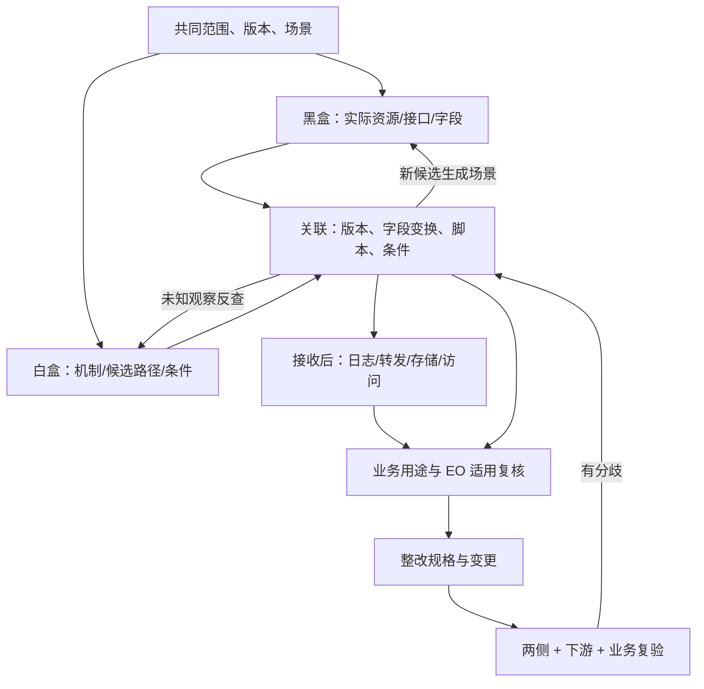

# 双向排查的模块与接口

**输入是业务网站/代码/配置，输出是可执行整改与有负责人的未结项。** 本文只定义模块交接；具体步骤使用[白盒](../../deliverables/白盒怎么做.md)、[黑盒](../../deliverables/黑盒怎么做.md)，目的见[项目约定](../../AGENTS.md)。

## 1. 闭环

## 2. 模块契约

| 模块 | 接收 | 输出 | 出错/缺资料 |
|---|---|---|---|
| 范围与资产 | 仓库/网站/发布资料 | 案件、资产、运行上下文与对应关系 | 取得/解析/版本缺口 |
| 黑盒发现 | 场景，或白盒验证任务 | 实际观察、字段/接口结构、未执行项 | 未触发、失败、不可观察分别记 |
| 白盒分析 | 源码配置，或黑盒反查包 | 机制、字段路径、条件、证据断点 | 不能解析或配置未知形成任务 |
| 双侧关联 | 路径与观察 | 候选/确认/冲突映射、新调查任务 | 不能用同名/同域强行拼链 |
| 下游取证 | 具体 API/字段/场景/待证问题 | 接收、日志、转发、留存、主体与访问事实 | 跨仓/供应商缺口指定接手方 |
| 决策与整改 | 事实、用途约定、适用复核 | 控制点、影响路径、业务约束、复验规格 | 不冒充批准或自行关闭生产功能 |
| 覆盖与变更 | 所有对象的版本与依赖 | 剩余范围、失效主张、重验任务 | 历史观察保留，当前适用性更新 |

两侧均可先开始独立发现，黑盒不必等待白盒。只有 URL/只有源码时交付对应范围的结果，缺少另一侧不能靠推理补成事实。

## 3. 共享对象

| 对象 | 表示什么 | 必须可追溯到 |
|---|---|---|
| 案件/资产 | 范围、角色、源码/脚本/配置身份 | 输入和版本 |
| 机制 | 公共封装/SDK 的读取、变换、注入、队列与发送效果 | 文件、符号/配置、未知实现 |
| 路径 | 机制在某调用者/条件下对具体字段的作用 | 对象/属性、条件、时序和各边证据 |
| 观察 | 某场景实际脚本、请求、字段与状态 | 会话/场景、请求/上下文与原始证据 |
| 关联/主张 | 哪条路径解释哪次观察，证明了什么 | 匹配理由、反证、版本兼容性 |
| 任务 | 缺什么、怎样补、谁接、何时结束 | 未完成主张及结果 |
| 用途/整改 | 允许行为、实际差异、修改与验收 | 约定来源、影响路径与复验 |

请求身份带运行/会话范围；一个请求可对应多个事件，一段机制可影响多个接口。字段血缘与根因整改分别归组，不能用告警条数代替影响范围。

## 4. 三种差异的固定出口

| 差异 | 调查顺序 | 允许的结果 |
|---|---|---|
| 只有黑盒 | 实际脚本/版本 → 生成/注入/序列化 → 配置/静态模型 | 找到来源，或保留未解释观察 |
| 只有白盒 | 前提/角色 → 开关/采样 → 时序/观察能力 → 死代码/版本 | 得到运行证据，或保留有界候选 |
| 两边冲突 | 版本相容性 → 字段变换/过滤 → 动态配置/备用路径 | 缩窄、修正或驳回具体主张 |

匹配只表示两侧关系；读取、影响输出、原值发送、接收可关联、实际使用分别判定，依据见[取证规范](../01-方法体系/前端数据采集与跨境透传审计体系总方案.md)。

## 5. Agent 接入与建设验证

Agent 接收同样的任务包，输出同样的证据与状态。先由一个协调流程加人工复核执行；编排、停止和评估见[Agent 工作](../../workstreams/ai-agents/README.md)。

- [ ] 一个独立黑盒观察能反查代码/配置，并扩展其他调用者。
- [ ] 一个白盒候选能变成可执行场景，运行差异能修正原主张。
- [ ] 一个共同根因能形成修改点与影响明细，而不是重复告警。
- [ ] 旧版本、互斥条件、序列化过滤和观察失败不会被拼成确定事实。
- [ ] 具体下游/EO 缺口可交接，缺资料时不阻断所有已有结论。

以上待实际试点验证。早期推导完整保留在[研究归档](../90-历史稿/早期体系与架构研究.md)。
