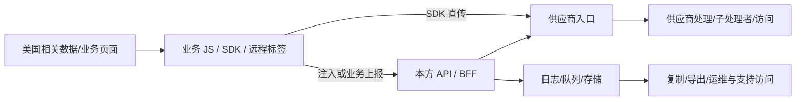

# 美国业务场景：从 JS 到接收、留存与访问

> 场景设计，不是某个阿里云网站/账号的审计发现。前端公开样本证据见[Baxia 核查](../03-案例/Baxia/公开SDK静态核查.md)。

## 1. 要贯通的链

各节点区域、主体和有效访问单独取证。美国首跳、TLS、云资源名或 token 不决定最终处置。

## 2. 下游接手表

| 前端交什么 | 下游查什么 | 预期证据 |
|---|---|---|
| 方法/端点、具体字段/头、场景与时间 | API/BFF 接收、转发、字段默认注入 | 对应代码与部署配置、可用请求关联 |
| 字段/派生标识与流转线索 | 日志、队列、数据湖/对象存储、报表 | 路由、保留、复制/导出及相容记录 |
| 接收端、供应商服务/配置版本 | 实际处理主体、区域、子处理者 | 服务配置、合同与供应商材料 |
| 数据与存储/服务身份 | 谁能读取、导出或取得密钥/映射 | 有效权限/信任条件、人员/组织关系、数据面记录 |
| 拟整改路径和用途 | 能否删字段、限接口、改区域/访问 | 业务约定、真实控制点与复验结果 |

缺访问日志不证明未访问；有权限不证明已经读过。供应商声明注明来源与适用版本，不能替代目标环境行为。

## 3. 典型问题与处置链

| 问题 | 先定位 | 控制与复验 |
|---|---|---|
| 完整 URL 错误直传 | 回调字段 → logger/SDK → 序列化 → 请求 | 入队前最小化，验异常/重试/Beacon |
| 风险头透传业务 API | SDK 匹配/包装 → 具体调用者 → API | 按用途收窄，查日志/转发并回归风控 |
| 美国落地但其他主体可读 | 存储/复制 → 有效身份与密钥/映射 | 核验处理/访问限制及历史副本 |
| 远程配置换端点 | 配置来源/发布权 → 生效版本 | 控制允许范围、失败策略和发布变更 |

## 4. 本场景关闭条件

- [ ] 首跳、下游和访问没有被混成一个国家字段。
- [ ] 每个未知节点有接手人和所需材料。
- [ ] 数据口径、主体/交易、例外和适用控制经责任团队复核。
- [ ] 代码/配置、接收后和业务复验支持整改目标。
- [ ] 历史副本、残余未知和未覆盖应用明确交接。

逐项任务统一见[Checklist E01～F06](../../deliverables/项目Checklist.md)，更早场景草案见[研究归档](../90-历史稿/早期体系与架构研究.md)。
