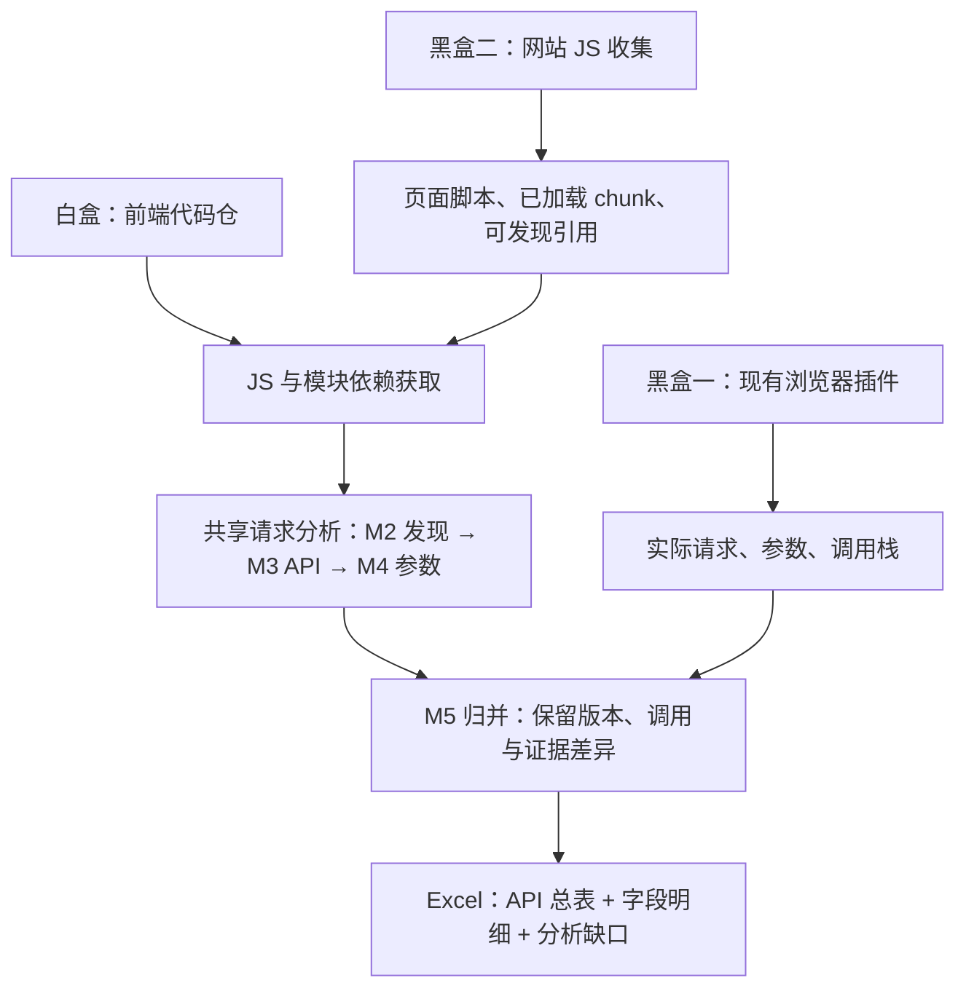

# 前端 API 资产收集：总方案与 Excel 交付

**最终效果：给一个前端代码仓，分析其中的前端 JS 及最多三层引用 JS/SDK，提取能够识别的请求 Host、API 和参数，交付一份 Excel。** 有网站环境时，再用两种黑盒入口补充，尽可能减少遗漏。

第一阶段只发现与提取，不做 Host 筛选、风险识别或合规判断。这里的“所有”指当前取得代码和已支持机制中能够识别的请求；缺代码、未解析调用和未知字段必须展示。

## 1. 一套白盒、两套黑盒，共用结果模型

| 入口 | 能补什么 | 主要边界 |
|---|---|---|
| 白盒代码仓 | 未触发页面的发送路径、封装与配置、字段构造 | 仓库未必对应线上版本；外部实现可能缺失 |
| 黑盒一：插件真实流量 | 某次运行实际发出的 URL 和字段，验证注入与动态值 | 未触发路径不可见，采集缺口要保留 |
| 黑盒二：网站 JS 收集与静态分析 | 无源码仓时读取部署脚本；寻找脚本中尚未触发的请求 | 没收集到的懒加载/登录态脚本仍会漏；混淆与缺配置影响参数还原 |

黑盒二从网站获取输入，但提取过程是静态分析，结果属于“代码候选”。下载 JS 的网络请求不等于执行了 JS 内声明的 API。

三种入口可独立使用；代码仓扫描不强制先登录网站。白盒模块见[白盒方案](白盒方案.md)，插件方案见[黑盒方案](黑盒方案.md)，新增入口见[网站JS收集方案](网站JS收集方案.md)。

## 2. 三层 JS 的统一口径

- 白盒仓内已有 JS 为第 0 层；向外取得引用 JS 为第 1 层，继续引用到第 3 层为止。
- 网站模式中，入口页面直接引用/直接执行的脚本为第 1 层；其加载的脚本为第 2 层，再下一层为第 3 层。页面内联代码为第 0 层。
- `max_js_fetch_depth` 默认 3、可配置；本轮按 3 层执行。页面访问深度、函数调用追踪预算均独立配置。
- 页面直接与间接引用同一文件时按最短已知引用路径计算。运行观察不能确认父脚本时标深度未知，不自动当作浅层绕过限制。
- 超深度、未知地址、获取失败和解析失败保留记录。模型不知道的深度与代码绝不能计入“已完整分析”。

## 3. 最终交付：api_assets.xlsx

**用户主要看“API 总表”这一张大表。** 一行对应一个请求调用上下文；可筛选 Host、路径、方法、来源、完整性。相同 API 不同调用先保留多行，避免把参数并集当作单次发送。

| 列组 | 必须保留的列 |
|---|---|
| 请求身份 | 记录 ID、关联 API 组 ID、发送机制、Method |
| 目标 | Host、完整 URL 或表达式、Path、地址解析状态 |
| 参数 | Path 参数、Query、Header、Body/消息字段；嵌套字段使用路径表示 |
| 结构状态 | 各载体完整性、未展开部分、可能覆盖/删除、失败原因 |
| 代码定位 | 仓库、Commit、文件、行列、业务调用点、发送点、调用关系 |
| JS 资产 | 本地/SDK/外部 JS、脚本 URL、内容哈希、引用链、深度 |
| 证据 | 仓库静态 / 网站 JS 静态 / 插件实测、页面与场景、版本关联状态、证据 ID |

Host 是必需输出列，但允许未知；相对 URL 缺页面基址时不能猜 Host。未知 Method 不默认 GET；WebSocket 消息不适用 HTTP Method。纯 URL 字符串命中作为候选，不能混成已确认请求。

为防止一个单元格塞不下或丢掉嵌套信息，同一工作簿附两张明细表：

- **参数明细**：请求记录 ID、载体、字段路径、值表达式/脱敏观察、构造位置、条件、已知/未知状态。一字段一行。
- **分析缺口**：关联文件/请求、未取得 JS、未解析调用、未知对象、深度截断及影响。尚未发现 API 的资产缺口也能记录。

保留 `analysis.json` 作为可机器处理的证据底稿。Excel 不放敏感原值或整段超长源码；超长内容通过证据 ID 关联，不静默截断。外部字符串作为文本导出，避免被当作公式。

## 4. 如何尽可能收全

1. **资产互补**：仓库依赖、网站脚本与插件调用栈互相补充 JS 线索；按来源、哈希和版本记录，不强行合并错版内容。
2. **发现互补**：结构化发送识别为主，URL 字符串工具补候选；无 Host 字面量的发送点也保留。
3. **字段互补**：静态追构造，插件核对实际字段；一次运行补到的字段保留场景，不提升全部静态路径的完整性。
4. **缺口定向处理**：优先分析影响多个请求的公共封装、SDK 和未知对象，AI 辅助补模型；遇到无法获取的实现仍如实记录。

验收分别统计脚本获取/解析、样本请求召回、参数提取和未知项；不把三路结果简单相加当覆盖率。当前没有真实仓库或实测结果，不生成虚构资产 Excel。

## 5. 接下来的工作顺序

- [ ] 冻结 Excel 字段与三类证据标记。
- [ ] 对白盒 M2～M4 做跨文件封装、拦截器与 SDK 参数样例验证。
- [ ] 验证网站 JS 收集入口，确保 JS 下载后能进入同一分析引擎。
- [ ] 用同一试点的源码、网站脚本和插件记录对照，生成第一份真实 Excel。

GitHub 候选能力和实测题记录在 [Temp 调研](../Temp/GitHub方案调研.md)，工具选型尚未完成。
