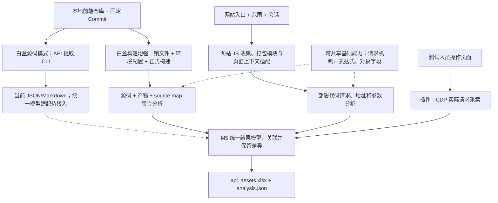

# 前端 API 与请求参数收集总方案

**通过一套白盒、两套黑盒收集前端请求资产，分别保留静态候选和实际观察，统一交付 `api_assets.xlsx`。** 三路可独立运行，有多路输入时再关联对照。

项目服务于前端 JS 数据跨境排查。第一阶段只提取 Host、URL、Method、请求字段、代码依据及未知项，不做 Host 筛选、敏感性识别、风险分级或合规判断。

## 1. 三路分工与状态

| 方案 | 输入 | 产出及价值 | 当前状态 |
|---|---|---|---|
| 白盒：前端代码仓扫描与构建增强 | 固定版本源码；构建增强另需锁文件和环境配置 | API/参数候选、源码位置、条件和未知项；构建模式再关联产物 | 源码 CLI 与 npm/Docker 构建关联首版已实现；纯 bundle/统一交付待扩展 |
| 黑盒一：浏览器实际请求采集 | 当前浏览器各窗口 HTTP/HTTPS 网页、测试人员业务操作 | 特定场景实际发送的地址、字段和可取得调用栈 | 已按用户要求实现自研 MV3 初版；真实 CDP 样例已测，MV3 现场与性能验收待完成 |
| 黑盒二：网站 JS 静态分析 | 网站入口、访问范围、必要登录会话 | 部署脚本中的请求候选；无源码时仍可分析 | 待 PoC；先用 Burp/Yakit 与 JS 提取，再补结构分析 |

黑盒一是三路中唯一的实际请求证据来源，可由现成插件、HAR/代理或 Vespasian 等采集，但只能证明已触发且成功观测的请求。网站 JS 下载成功不等于脚本中的 API 已经执行。静态定位到发送行为，也不等于该路径运行过。

三个具体方案分别见：

- [前端代码仓JS请求API采集](前端代码仓JS请求API采集.md)（白盒）。
- [JS 请求采集浏览器插件](JS%20请求采集浏览器插件.md)（黑盒一）。
- [网站 JS 收集与静态分析](网站%20JS%20收集与静态分析.md)（黑盒二）。

## 2. 前端代码仓 API 提取能力

0.8 已增加 GitHub 地址→固定版本→npm/Docker 构建→source-map 关联分析→CSV/Markdown 的首版流程，见[范围](../frontend-api-extractor/docs/repository-pipeline.md)与[GDB 请求表](../frontend-api-extractor/docs/gdb-build-pilot.md)。这不表示任意仓库、Webpack 原生解包或远程 SDK 已完整支持。

白盒提供两种显式模式：源码模式直接分析固定版本本地代码，构建增强模式再利用目标环境产物恢复常量、生成代码和 source map。源码模式不以构建为前提；构建增强失败时保留该模式失败，不改称源码成功。

现有实现位于 [frontend-api-extractor](../frontend-api-extractor/README.md)，可配置文件入口、语义层、路径别名、调用深度和执行/候选预算；支持多框架脚本及常见 HTTP 客户端。输出方法、URL、Query/Body/Headers、源码位置、调用链、条件和诊断。真实源码试跑与限制见[记录](../frontend-api-extractor/docs/alibaba-real-world.md)，外部仓库仅留链接。

后续统一前端应将“前端代码仓扫描”列为任务入口：记录仓库地址/Commit 和本地 checkout，提供扫描范围与预算配置，查看接口/参数/代码证据/诊断并导出结果。当前仓库获取与版本校验由调用者负责，CLI 已可用；统一界面、任务调度、analysis.json/Excel 适配尚未实现。

## 3. 两路静态分析：阶段相同，复用待验证

白盒采用 M1 资产解析、M2 请求发现、M3 地址提取、M4 参数提取、M5 结果汇总。网站 JS 分析沿用这些阶段的职责，但不预设 M2～M4 可直接使用同一实现。

| 能力 | 可共享的候选基础 | 白盒专用适配 | 网站 JS 专用适配 |
|---|---|---|---|
| M2 请求发现 | fetch/XHR/Axios 等机制、实例与封装模型 | 源码模块与构建后模块对应 | 打包模块、压缩别名、chunk/远程模块 |
| M3 地址提取 | 表达式、拼接、配置合并 | 真实构建替换结果、源码配置来源 | 已替换常量、页面基址、运行时注入配置 |
| M4 参数提取 | 对象字段、覆盖、传参、序列化模型 | 源码跨文件构造与产物调用对应 | 打包代码调用关系、SDK、压缩代码适配 |

白盒源码模式先利用源码恢复模块、业务位置和请求候选，缺失运行时配置显式留为未知。构建增强模式以可重复构建为前提，进一步利用真实产物解析环境变量、生成代码和条件编译。网站部署代码可能压缩、混淆、漏收登录后 chunk 或缺少运行时配置，两者仍需不同适配。

先用同一项目的源码、本地构建产物和线上同版产物对照，再决定共享核心和专用适配的边界。当前统一的是结果模型，不承诺单一引擎能覆盖全部输入。

## 4. 获取范围分别定义

| 入口 | 本轮范围 | 超范围处理 |
|---|---|---|
| 白盒源码 | 本地仓库内匹配文件；依赖实现不在范围内时留未知 | 默认不额外下载外部 JS，不运行目标构建 |
| 白盒构建增强 | 仓库源码、已安装构建依赖和本次产物为第 0 层；产物直接引用的外部 JS/SDK 为第 1 层 | 第一层外部脚本继续引用的文件不再获取，记录引用及影响 |
| 网站 JS | 页面内联脚本为第 0 层，页面直接外链脚本为第 1 层，继续引用至第 3 层 | 第 4 层及以后记录截断；父链未知则标深度未知 |
| 插件 | 当前浏览器自动接入的 HTTP/HTTPS 网页及可观测关联上下文中的真实请求 | 不按 JS 引用层数限制；采集范围和缺失另行记录 |

`max_js_fetch_depth` 是额外获取外部脚本的上限：白盒构建增强为 1，网站 JS 为 3；源码 CLI 默认不额外获取外部脚本。它不限制包管理器按锁文件安装构建依赖，也不限制仓内函数、文件或内部 chunk；页面遍历和分析预算另设。

## 5. 三路关联与统一交付

- 来源分别标记为“仓库静态 / 网站 JS 静态 / 插件实测”，不能相互替代。
- 同 URL/Method 可建立待核对关联，但不足以证明版本、调用位置或参数结构相同。
- 静态发现路径后可提出定向测试线索；插件发现静态漏项后，可按栈反查缺脚本、缺模型或动态构造。
- 一次实测不能提升所有静态分支的完整性；参数并集不能表示每次都发送的字段。
- 地址解析、参数结构、采集状态分别记录；资产缺口即使未关联到请求，也必须输出。

工作簿包含 API 总表、参数明细、分析缺口，证据底稿保存为 `analysis.json`。行粒度、字段和状态以[交付约定](结果模型与Excel交付.md)为准。

## 6. 下一步

后续阶段与逐项验收统一见[前端 API 提取迭代路线与验证](前端API提取迭代路线与验证.md)。先固定基准和逐调用证据，补字段改写/hook，再推进封装、打包模块与 SDK，随后接入插件黑盒二与统一交付；AI 字段释义单独验收。

现有插件、Burp/Yakit 及 jshound/Vespasian 等工具继续作为独立采集/对照来源，保留固定版本、现场和性能缺口。统一任务前端与第一份可回查 Excel 随证据协议接入，不作为分析核心验证的前提。

详细执行项见[验证计划](验证计划.md)。源码 CLI 已有自动化测试和指定真实源码范围试跑，插件已有局部验证，分别保留对应模型和范围；尚不代表整体任务前端、统一交付、全仓覆盖或 MV3 现场验收通过。
