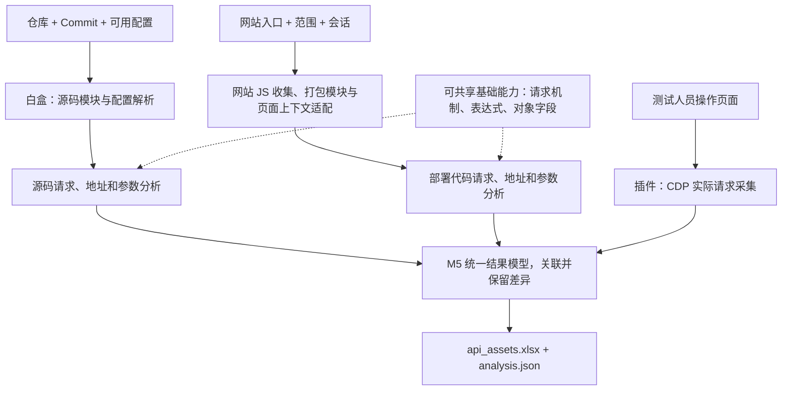

# 前端 API 与请求参数收集总方案

**通过一套白盒、两套黑盒收集前端请求资产，分别保留静态候选和实际观察，统一交付 `api_assets.xlsx`。** 三路可独立运行，有多路输入时再关联对照。

项目服务于前端 JS 数据跨境排查。第一阶段只提取 Host、URL、Method、请求字段、代码依据及未知项，不做 Host 筛选、敏感性识别、风险分级或合规判断。

## 1. 三路分工与状态

| 方案 | 输入 | 产出及价值 | 当前状态 |
|---|---|---|---|
| 白盒：代码仓静态分析 | 前端仓库、固定 Commit、可取得配置 | 请求候选、参数构造和调用位置；补未触发代码路径 | 待开发；工具及分析路线待验证 |
| 黑盒一：插件实际请求采集 | 指定标签页、测试人员业务操作 | 特定场景实际发送的地址、字段和可取得调用栈 | 待开发；原理与方案清晰，需实现及验收 |
| 黑盒二：网站 JS 静态分析 | 网站入口、访问范围、必要登录会话 | 部署脚本中的请求候选；无源码时仍可分析 | 待开发；采集及部署代码分析待验证 |

插件是三路中唯一的实际请求证据来源，但只能证明已触发且成功观测的请求。网站 JS 下载成功不等于脚本中的 API 已经执行。静态定位到发送行为，也不等于该路径运行过。

## 2. 两路静态分析：阶段相同，复用待验证

白盒采用 M1 资产解析、M2 请求发现、M3 地址提取、M4 参数提取、M5 结果汇总。网站 JS 分析沿用这些阶段的职责，但不预设 M2～M4 可直接使用同一实现。

| 能力 | 可共享的候选基础 | 白盒专用适配 | 网站 JS 专用适配 |
|---|---|---|---|
| M2 请求发现 | fetch/XHR/Axios 等机制、实例与封装模型 | import/export、别名、源码模块解析 | 打包模块、压缩别名、chunk/远程模块 |
| M3 地址提取 | 表达式、拼接、配置合并 | 环境变量、构建替换规则、模块配置 | 已替换常量、页面基址、运行时注入配置 |
| M4 参数提取 | 对象字段、覆盖、传参、序列化模型 | 源码跨文件传参、组件调用关系 | 打包代码调用关系、SDK、压缩代码适配 |

未编译源码结构更清楚，但缺环境变量、生成代码或依赖时，最终地址和载荷可能未知。部署代码包含部分构建结果，但压缩、混淆、漏收 chunk 和运行时配置缺失也会影响分析。

先用同一项目的源码、缺配置源码和构建产物对照，再决定共享核心和专用适配的边界。当前统一的是结果模型，不承诺单一引擎能覆盖全部输入。

## 3. 获取范围分别定义

| 入口 | 本轮范围 | 超范围处理 |
|---|---|---|
| 白盒 | 仓库已有代码为第 0 层；直接引用的外部 JS/SDK 为第 1 层，只向外获取一层 | 第一层继续引用的代码不再获取，记录引用及影响 |
| 网站 JS | 页面内联脚本为第 0 层，页面直接外链脚本为第 1 层，继续引用至第 3 层 | 第 4 层及以后记录截断；父链未知则标深度未知 |
| 插件 | 指定标签页及可观测关联上下文中的真实请求 | 不按 JS 引用层数限制；采集范围和缺失另行记录 |

`max_js_fetch_depth` 是按入口设置的获取上限：白盒为 1，网站 JS 为 3。它不限制仓内函数/文件追踪；页面遍历和分析时间/节点预算独立设置。已有仓库代码不会因为 import 跳转较多而被视为外部多层依赖。

## 4. 三路关联与统一交付

- 来源分别标记为“仓库静态 / 网站 JS 静态 / 插件实测”，不能相互替代。
- 同 URL/Method 可建立待核对关联，但不足以证明版本、调用位置或参数结构相同。
- 静态发现路径后可提出定向测试线索；插件发现静态漏项后，可按栈反查缺脚本、缺模型或动态构造。
- 一次实测不能提升所有静态分支的完整性；参数并集不能表示每次都发送的字段。
- 地址解析、参数结构、采集状态分别记录；资产缺口即使未关联到请求，也必须输出。

工作簿包含 API 总表、参数明细、分析缺口，证据底稿保存为 `analysis.json`。行粒度、字段和状态以[交付约定](结果模型与Excel交付.md)为准。

## 5. 下一步

1. 确认结果模型，准备同一试点的源码、构建产物、配置及人工预期。
2. 验证白盒核心请求链和缺配置降级，判断两路静态能力的可复用范围。
3. 开发插件采集原型并验收关键边界；验证网站 JS 收集及打包代码适配。
4. 分别导入三类真实结果，完成第一份可回查的 Excel。

详细执行项见[验证计划](验证计划.md)。当前没有扫描器或插件的验收结果，不发布覆盖率或虚构资产表。
