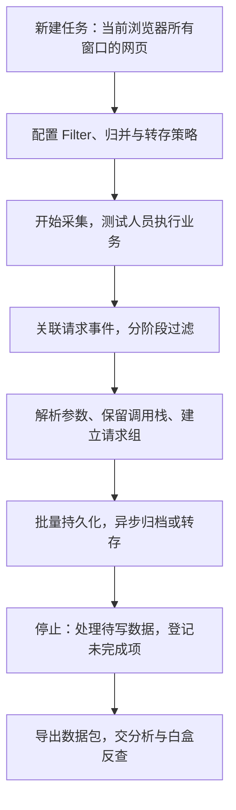

# JS 请求采集浏览器插件

本文件描述黑盒一需要达到的浏览器采集规格。用户于 2026-10-22 明确要求参考 EASYapi 与 maksimu/openapi-devtools 实现自己的插件；当前已有 MV3 初版源码，安装、功能对照、实测结果及待验收边界见[插件开发与安装](插件开发与安装.md)。Burp/Yakit 仍可作为实测采集对照，不再作为启动自研的前置条件。更新：2026-10-22。

本文保留采集、过滤、归并、持久化和导出的详细规格；浏览器边界及性能参数须在目标 Chrome 版本验证。总体分工见[总方案](API资产收集总方案.md)，跨来源输出见[结果模型与 Excel 交付](结果模型与Excel交付.md)。

## 1. 目标与边界

**测试人员正常执行业务，插件自动采集页面关联的接口、参数和调用栈，输出可供白盒反查的数据。**

| 项目 | 约定 |
|---|---|
| 业务范围 | 阿里云美国独立站相关官网、产品文档和管理控制台的集测环境 |
| 使用人员 | 集成测试、安全测试、后续数据分析人员 |
| 产品形态 | Chrome 插件，Manifest V3 |
| 核心能力 | 自动采集、统一过滤、去重归并、本地持久化、自动转存、标准化导出 |
| 职责分工 | 测试人员触发场景；插件记录数据；后续人员清洗、识别敏感字段、标注 JS 归属并开展治理 |
| 本插件不承担 | 跨境风险判定、合规结论、AI 分析、JS 自动归属、整改管理 |

页面覆盖依赖测试人员执行的场景。浏览器级采集可在零网页时启动等待，跳过浏览器内部页与扩展页；动态附加前的首次导航开头可能无法观测，须登记缺口。单页关闭或附加失败不应终止其他页面采集。任务中区分实际采集、规则排除、无法观测与异常丢失，不将不完整任务标成全量成功。

## 2. 使用流程与功能编号



| 编号 | 模块 | 首版要求 |
|---|---|---|
| F01 | 请求采集 | 页面、接口、头/query/body、发起脚本与可取得的调用栈 |
| F02 | 统一 Filter | 单搜索框、多字段、多值、正则、排除、括号与 OR；空框保存全部请求 |
| F03 | 查询兼容 | 旧版 Filter 自动转写为搜索语句、即时预览、错误阻止与版本留痕 |
| F04 | 去重归并 | 精确归并、动态参数归一化、原始/聚合视图 |
| F05 | 本地存储 | IndexedDB 持久化、历史任务、容量管理 |
| F06 | 自动转存 | 本地文件分片；可选内部服务或阿里云 SLS 批量转存 |
| F07 | 请求查看 | 实时列表、详情、搜索、分页或虚拟列表 |
| F08 | 数据导出 | JSONL 主格式、CSV、请求组与完整任务数据包 |
| F09 | 性能与恢复 | 有界队列、批处理、限并发、告警与恢复 |
| F10 | 任务管理 | 新建、开始、暂停、恢复、停止、状态与统计 |

以上是自研插件启动后的首版 P0 要求，也是现成工具 PoC 的对照表；内部服务是可选部署组件。WebSocket 增强采集及其他协议扩展不作为默认 HTTP 采集能力。

## 3. F01：采集范围与字段

### 3.1 范围

| 维度 | 规则 |
|---|---|
| 浏览器范围 | 新任务统一采集当前浏览器所有窗口中的 HTTP/HTTPS 网页，动态纳入新打开或导航到的网页，不要求用户选择或管理标签页；记录 Tab ID 用于追溯。旧任务未记录范围模式时仅兼容原指定集合，不采集历史浏览记录 |
| 页面上下文 | 记录所属页面与可观测子框架；无法归属的请求保留未知，不强行套用当前页面 |
| HTTP/HTTPS | Fetch、XHR（含常见 Axios 请求）、Beacon、Script、Image/像素、Document/iframe、Stylesheet、Font、其他可观测请求 |
| WebSocket | 增强模式采集握手及出站消息帧，消息与所属连接关联 |
| 不可取得内容 | 调用栈、头、body 等缺失时分别标记原因；不得标成完整采集 |

### 3.2 请求记录

| 字段 | 内容与要求 |
|---|---|
| `scan_id`、`request_id` | 任务与请求身份；浏览器原始请求 ID 保留所属会话/target，重定向保留跳次 |
| `timestamp` | 请求时间，统一采用带时区的标准时间表示 |
| `tab_id`、`frame_id`、`target_id` | 标签页、框架和可取得的执行目标身份 |
| `page_url`、`referer` | 所属业务页面与实际 HTTP Referer，分别保存 |
| `request_url`、`domain`、`pathname` | 原始完整 URL、目标主机名、路径；归一化结果另存 |
| `method`、`resource_type` | 请求方法与类型 |
| `status_code`、`request_state` | 可取得的响应状态；请求进行中、完成或失败及错误原因 |
| `request_headers` | 可取得的请求头及浏览器返回的原始值；字段名始终完整，字段值按任务选择完整保存或超长截断 |
| `query_params` | Query 名称和值，保留同名参数的多个值 |
| `request_body`、`content_type` | JSON、Form、URL-encoded、文本等；保留表示类型与解析结果 |
| `response_headers`、`response_headers_raw` | Chrome 可观测的响应头；ExtraInfo 可用时保存其头集合及原始头文本，保留 Set-Cookie、CORS、CSP、缓存策略等分析依据 |
| `response_body`、`response_content_type` | 请求完成后通过 `Network.getResponseBody` 读取；JSON 解析、文本保留原文、二进制以 Base64 保存，并记录编码与截断状态 |
| `response_metadata` | 状态文本、MIME、协议、远端 IP/端口、缓存与 Service Worker 来源、传输字节数、Timing、TLS 安全信息、IP 地址空间及可观测的 Cookie 阻止原因 |
| `initiator_url`、`initiator_stack` | 发起 JS 地址与可取得的调用栈；保留脚本 URL、函数、行列、同步帧、异步父段 `description`、`parent` 与未解析的 `parentId`，不能将未解析父链当作不存在 |
| `initiator`、`initiator_parent_id`、`initiator_parent_match`、`initiator_relation` | 受保护的 Network Initiator 元数据及已解析的父请求关系；区分重定向、精确 request ID、唯一 URL 推定、歧义、缺失与无关系，不能用任意同 URL 请求补链 |
| `capture_status` | 分别记录请求头/正文、响应头/正文/元数据、调用栈和页面归属的完整、部分、缺失、不支持或不可解析状态及原因 |

新建任务提供“保存字段”复选区，请求头、Query 参数、请求体、响应头、响应体、响应元数据、页面来源、发起信息与关系链、Request call stack 默认全部勾选，并支持全选或取消全选。请求 ID、时间、URL、Method、资源类型、状态码和请求状态属于定位记录所需的基础字段，始终保存。插件先用完整的浏览器可观测请求数据执行 Filter，再在写入 IndexedDB、导出和转存前移除未勾选字段；响应体未勾选时不执行昂贵的 CDP 正文读取。对应采集状态写为“任务未选择保存”，不计为采集缺口。旧任务缺少字段列表时按全部勾选兼容；已明确保存旧字段列表的任务不自动新增响应字段。

未解析不等于空 body；截断、大小限制和二进制编码均须显式标记。经授权保留原始表示时，同时保存解析结果与原始记录的关联。响应正文仅在成功完成后读取；失败、取消、重定向跳次、尚未结束、浏览器缓存已清理或 CDP 不支持的响应保留缺失原因。自动截断模式对请求和响应正文使用同一任务上限；完整保留模式不主动截断。

### 3.3 同步与异步调用栈

仅启用 Network 事件不能预设可取得与 DevTools 相同深度的调用栈。每个已附加会话在采集请求前配置 `Runtime.enable`、`Runtime.setMaxCallStackSizeToCapture({size:200})`；先设置 `Debugger.setSkipAllPauses({skip:true})`，成功后才启用 Debugger 并设置异步捕获深度 `32`，避免连接配置窗口触发业务暂停；同时配置不在异常处暂停。不能保证跳过暂停时须关闭 Debugger，保留 Runtime 同步采集与事件已有信息并标记异步栈降级原因。

对 CDP 内联 `parent` 直接保留；只有 `parentId` 时，在对应 debugger 会话通过 `Debugger.getStackTrace` 有界补取。保留 `description` 作为异步边界，例如 `Promise.then`、`await`，不把多段链压缩为一条无说明的帧列表。

当前解析预算为最多 `33` 个栈段（当前段 + 32 层异步父段）、总计 `400` 帧、单条 `1,200ms`、最多 `4` 个并发读取；同步 `200` 帧和异步 `32` 层是请求浏览器采用的捕获参数，不是所有页面的完整性保证。会话不可用、超时、预算耗尽、循环引用或命令不支持时保留已有栈与未解析引用，并在 `capture_status.stack` 写明原因。只有已返回链在模型预算内解析完毕时才可标完整，不能由模型补写浏览器没有返回的历史。

详情使用 Chrome DevTools Initiator 面板的两个分区：`Request call stack` 按行显示函数名与 `脚本:行:列`，保留浏览器返回的异步边界；`Request initiator chain` 显示请求 URL 的上游与下游关系，当前请求突出显示，其他已保存节点可打开详情。为避免 Filter 排除静态资源后打断关系链，被排除请求只保留原始 URL 和父关系的紧凑节点，不保存请求头、正文或调用栈，并计入任务存储容量；紧凑节点不可打开详情。script ID、debugger ID 和父链内部 ID 保留在原始数据，不放入主视图。

请求发起链优先使用重定向身份和 Initiator 的 request ID 精确关联；普通脚本发起关系只有在同一标签页、调试会话和 loader 内 URL 候选唯一时才允许推定。多个同 URL 候选标记歧义，不猜测父请求。链按父请求索引查询，默认最多展示 `200` 个节点；关系候选未观测、尚未落盘、超出限制或旧版本未保存关系时显示缺口原因。

详情展示必须保留分段及缺失说明。验收按同一受控请求比较同步帧数、异步段描述、段内帧数、未解析引用及可验证的请求关系，不能仅比较 DevTools 屏幕行数。实测对照见[调用栈验证记录](插件界面与交互改进.md#调用栈采集与分段展示)。

## 4. F02/F03：统一 Filter

### 4.0 默认交互

界面只使用一个过滤搜索框，空框表示保存全部请求。裸词匹配 Request URL；字段和值使用 `字段:值`，多个条件必须用英文分号 `;` 分隔并同时满足，同一字段的逗号值表示任选一个，前缀 `-` 表示排除，`/表达式/i` 表示忽略大小写的正则，`字段:?` 表示字段存在。括号和 `OR` 表示任选条件，带空格的值使用双引号。

界面在搜索框旁直接说明语法、字段与完整示例，并即时显示条件摘要和错误。非法条件不得启动、预览或应用。页面不再提供三段式编辑器、高级 JSON 编辑器或模板管理区；旧版 Scope / Include / Exclude、嵌套组及否定规则在载入时自动转写为等价搜索语句，无法安全解释的损坏数据必须明确报错，不能静默覆盖。应用只影响之后收到的请求。

### 4.1 规则语义

搜索语句统一表达页面、请求和排除条件：`;` 为 AND，`OR` 为任选，`-` 为排除，括号控制组合范围。页面字段使用 `page:`、`page-domain:`、`referer:`，请求字段使用 `url:`、`domain:`、`path:`、`method:`、`status-code:`、`resource-type:`、`initiator:`、`extension:`；内容字段使用 `query.参数名:`、`header.请求头名:`、`body.JSON路径:`。

`resource-type` 必须填写 Chrome CDP 返回的资源类型，采用完全匹配，不能填写业务概念 `API`、内容格式 `JSON` 或俗称 `Beacon`。常见接口使用 `XHR`、`Fetch`，`navigator.sendBeacon()` 通常为 `Ping`，CORS 预检为 `Preflight`；其他可见值包括 `Document`、`Script`、`Stylesheet`、`Image`、`Media`、`Font`、`TextTrack`、`EventSource`、`WebSocket`、`Manifest`、`Prefetch`、`SignedExchange`、`CSPViolationReport`、`FedCM`、`Other`。浏览器新增值按原值记录。界面使用说明须列出这些值、含义和示例，并提示用户以请求列表“类型”列的实测值为准。

底层继续使用原有 Filter 规则树执行，保证旧任务语义不变；界面只展示规范化后的搜索语句。旧规则转写后内部组路径或操作符名称可以规范化，但对请求的命中、排除和无法判定结果必须等价。

| 情况 | 行为 |
|---|---|
| 空配置 | Scope 未配置表示全部已授权页面；整体无规则时保留授权范围内请求 |
| 未到齐字段 | Pending，等待必要事件；不是直接按“不存在”判断 |
| 最终无法取得 | 记无法判定；匹配留存模式默认保留并标记，避免静默当作不命中 |

### 4.2 字段与匹配方式

| 过滤维度 | 支持字段 |
|---|---|
| 页面与来源 | Page URL、Page Host、Referer、Initiator URL |
| 目标 | Request URL、Request Domain、URL Path、Path Extension |
| 请求属性 | Method、Resource Type、Status Code |
| 请求内容 | Query 参数、Header、Body 字段；内容规则明确判断名称、存在性或值 |

支持 Contains/Equals/Starts With/Ends With/In/Regex 及其否定形式、Wildcard、Exists/Not Exists；提供 Contains Any 等多值匹配，以及区分/忽略大小写选项。非法正则或规则须报错，不能悄悄忽略。

- 域名按精确主机名或真实子域边界匹配，不能用字符串包含替代。
- 后缀按 pathname 匹配，避免 query 干扰；`.js`、`.png` 等排除规则由任务选择，不作为强制默认。
- `extension:` 的值不带点；Header 名称不区分大小写，Query 参数名、JSON 路径和表单字段名区分大小写。
- `status-code` 在请求终态才确定；依赖尚未取得的完整 Header 或 Body 时保持 Pending，终态无法取得再记无法判定。
- 过滤掉资源或请求意味着该部分不进入匹配留存结果，导出须保留规则和排除统计。

示例：

```text
page-domain:alibabacloud.com; (page:idp-cloud OR referer:idp-cloud); -extension:png,jpg,js,css; -url:/\/heartbeat/i
```

### 4.3 执行与版本

| 阶段 | 操作 |
|---|---|
| 轻量初筛 | 使用已知页面、URL、方法、类型等；仅在逻辑上已确定不命中时提前排除 |
| 详细匹配 | 按需获取头/query/body；依赖状态码的规则等待响应或终态 |
| 落盘决定 | 最终匹配后按留存模式处理，未知和失败单独统计 |

过滤页支持当前列表预览，并明确显示规则是否已应用。空框恢复保存全部请求；采集中修改查询会生成新的底层配置版本。

| 留存模式 | 行为 |
|---|---|
| 匹配留存（默认） | 只保存命中及无法判定记录；另保留排除计数与原因 |
| 全量留存 | 保存全部授权范围内的可观测请求；Filter 仅控制查看和导出 |

采集中修改规则须保留生效时间和版本；单条请求按接收时固定的规则版本完成判断，新规则不补回此前未保存的数据。

## 5. F04：去重与归并

**默认保留原始请求，归并只建立分析视图。**

| 模式 | 行为 |
|---|---|
| 不去重 | 每次请求分别保留 |
| 精确归并 | 按声明的请求字段比较，保存每次出现记录与次数 |
| 智能归并（默认） | 精确归并加显式配置的动态参数归一化 |
| 仅代表记录 | 用户主动选择的有损模式；保留代表请求和差异摘要，提示无法恢复每次请求 |

归并键至少考虑 Method、Domain、规范化 Path/Query、必要的头/body 差异；同 Path 不等于相同请求。发起 JS 是否必须相同可配置；不同时仍保留各条原始栈与页面关系。

| 配置 | 要求 |
|---|---|
| 动态值 | 可指定 Query/JSON 字段及 UUID 路径段，将值替换为占位符 |
| 候选名单 | `timestamp`、`ts`、`_t`、`requestId`、`traceId`、`nonce`；候选不代表无条件忽略 |
| 关键值 | UID、CNA、AccountID、TenantID、Token、业务资源 ID 默认不忽略 |
| 顺序 | 可忽略普通 Query 顺序与 JSON 对象字段顺序；同名参数、数组等有序内容不能直接排序抹平 |

例如 `/api/log?timestamp=1792500001` 可按配置归为 `/api/log?timestamp={TIMESTAMP}`。原始记录及归一化规则版本仍可回查。完整保留模式可按原值比较；自动截断模式中的超长值已不可完整比较时，只能建立候选分组，不能据此判定原请求精确相同。

请求组展示：组 ID、代表请求、归一化 URL、次数、首末时间、变化字段、关联 request ID；支持原始/聚合视图切换。分组记录不替代原始请求导出。

## 6. F05/F06/F08：存储、转存与导出

### 6.1 存储和转存

| 方式 | 要求 |
|---|---|
| 本地持久化 | IndexedDB 默认开启，保存任务、请求、分组、错误与待转存进度 |
| 本地分片文件 | 按数量、大小、时间或停止动作触发，写入浏览器允许或用户授权的目录 |
| 内部接收服务 | 可选 HTTPS 地址、授权方式、批次大小、间隔、压缩、重试与保留策略；仅允许批准的接收服务 |
| 阿里云 SLS | 可选 STS 临时凭证签名或 WebTracking 匿名写入；配置 Endpoint、Project、Logstore、Topic、Source、批次与间隔 |

内网接收服务须按唯一 Batch ID 幂等处理，确认持久化后才标记转存成功。失败保留本地待转存记录，有界重试，恢复后续传。自动删除已转存本地记录须显式开启，不能默认清理证据。

SLS 将常用字段平铺用于检索，并将完整记录写入可重组的 `record_json_chunk`；大记录使用 SHA-256、分片序号和总数标识。投递语义为至少一次，下游须以 `transfer_batch_id + request_id + record_chunk_index` 去重。STS 凭证不得进入任务配置、IndexedDB 和导出包；WebTracking 要求用户明确接受公网匿名写入与脏数据风险。

文件归档与服务转存分别记录状态；触发下载不等于文件已完成。文件失败、被取消或目录不可写须保留待处理项。浏览器多文件下载、目录授权行为在目标企业 Chrome 版本验收。

| 配置 | 初稿建议值，可调整 |
|---|---|
| 本地持久化 / 自动文件归档 | 开启 / 开启 |
| 文件归档间隔 / 分片大小 | 5 分钟 / 20 MB |
| 内部转存 / 批次大小 | 可选开启 / 200 条 |
| SLS 转存 / 批次策略 | 可选开启 / 100 条 / 2 MB / 10 秒；HTTP 上限 3 MB |
| 失败重试 | 3 次，指数退避；耗尽后保留待处理状态 |
| 本地保留 | 7 天或任务配置；到期不得绕过未转存与证据保留约定 |
| 停止任务 | 停止纳入新请求，继续处理在途请求的关联事件；达到可配置等待上限后标记未完成项，再完成写盘/归档，服务转存另记状态 |

Cookie、认证 Token、URL 参数、URL 用户信息、fragment 与请求体不按名称脱敏。任务提供“完整保留”和“自动截断”两个选项。完整模式不截断可观测字段值或请求正文；自动模式保持字段名完整，仅将超过 64K 字符的字段值以及超过任务字节上限的正文保存为首尾片段，并写入原始长度标记。历史任务中已有的 `[REDACTED]` 只按历史值展示，不能恢复；旧任务缺少保存方式时按自动模式兼容。

### 6.2 标准数据包

```text
EO_SCAN_<日期>_<任务ID>/
├── scan_manifest.json       # 任务、版本、配置、统计、完整性与分片清单
├── requests_0001.jsonl      # 原始请求记录，可继续分片
├── request_groups.jsonl     # 分组及原始请求关联
└── capture_errors.jsonl     # 失败、缺失与中断记录
```

| 导出项 | 规则 |
|---|---|
| 格式 | JSONL 为主，CSV 用于人工分析，任务级 JSON 可选 |
| 范围 | 全部已保存请求、当前 Filter 结果、请求组、指定请求或整个历史任务 |
| 可追溯性 | Schema、插件/浏览器、Filter、归一化与留存策略版本；任务起止、标签页、配置生效时间和中断记录 |
| 字段质量 | 缺失/截断/解析状态、请求与栈关联均保留；历史脱敏状态继续可见；不得只导出去重代表值并称完整数据 |
| 大数据 | 分批或流式导出；CSV 嵌套值使用 JSON 字符串，防止公式注入 |

## 7. F09：高请求量与异常恢复

```text
CDP 事件 → 身份关联/轻量过滤 → 有界队列 → 限并发获取内容
        → 完整匹配/归并 → 批量写入 IndexedDB → 异步转存
```

采集、解析、写盘、转存、UI 分开执行。不逐条刷新界面，不全量加载历史记录；去重使用增量索引，正文限制大小与解析深度。

### 7.1 初始参数

以下是初稿建议值，**须经压测校准，不是平台性能保证**。

| 参数 | 初值 |
|---|---|
| 批量写入 / 写入间隔 | 200 条 / 1 秒 |
| 普通正文读取上限 | 1 MB/条；超限标记部分或跳过 |
| 待处理队列 | 2,000 条或约 16 MB，任一先到即触发保护 |
| UI 更新 / 同屏行数 | 1 秒 / 50～100 行 |
| 文件分片 | 20 MB |
| 存储预警 | 配置上限的 80% |

### 7.2 异常出口

| 异常 | 必须动作 |
|---|---|
| 队列积压、读取慢 | 限并发、减小处理负载、告警；达到硬上限暂停采集 |
| IndexedDB 失败、空间不足 | 记录错误和时间，保留可恢复数据，暂停或停止 |
| 转存不可用 | 有界重试，保留本地数据与批次进度 |
| 调试断开、标签页关闭 | 标记中断窗口及原因，保留任务；恢复后不能把中断时段算已采集 |
| 扩展后台重启 | 从持久化状态恢复任务/批次；未落盘部分标记可能缺失 |

“背压”仅控制插件内部处理，不能承诺让业务请求等待插件。无法保存的事件须记录可核对的丢失计数或未知时间窗口；不承诺平台绝对零丢包，不允许静默丢弃后标完整。

## 8. F07/F10：界面、任务与统计

| 界面 | 必需内容 |
|---|---|
| 管理标签页入口 | 点击浏览器工具栏插件图标直接打开；展示任务、状态、授权标签页、策略、计数、暂停/恢复/停止与导出入口 |
| 请求记录 | 实时列表、分页/虚拟列表、原始/聚合切换、搜索；点击后在可见侧栏展示参数、请求头、正文、调用栈与原始数据 |
| Filter 设置 | 单搜索框、分号多条件、字段、多值、排除、正则、括号与 OR；即时摘要、预览、错误阻止和旧规则转写 |
| 存储与转存 | 占用、归档/服务设置、进度、错误与重试 |
| 历史任务 | 名称、起止时间、请求数、配置版本、完整性、转存状态、导出与删除 |

任务状态区分未开始、采集中、暂停、处理中、已结束。暂停/中断的时间窗口留账；采集结束与转存完成分别显示。关闭管理标签页不应改变任务状态。

统计分开显示：已观测、Pending、命中、排除、无法判定、已持久化、分组数、各渠道已转存/待转存/失败、本地占用、队列长度、异常及已知丢失。不将这些不同阶段的计数混成一个“完成率”。

## 9. 技术组件与统一结果交接

### 9.1 初稿技术选型

| 组件 | 方案 |
|---|---|
| 扩展 / UI | Manifest V3 / Vue 3 + TypeScript |
| 采集 | `chrome.debugger` + CDP Network；关联可取得的 target/框架信息 |
| 过滤 / 归并 | TypeScript 规则引擎 / 规范化与 Hash 指纹 |
| 数据 / 配置 | IndexedDB / `chrome.storage.local` |
| 文件 / 服务 / SLS | `chrome.downloads` 或授权文件访问 / HTTPS 批量转存 / SLS LOG 签名或 WebTracking |

MV3 后台生命周期、debugger 会话维持与中断、子目标可见性需按目标 Chrome 版本落实；恢复状态不能只放在全局变量。具体 API 兼容性以实现和验收记录为准。

### 9.2 导出与三路关联

**任务/页面 → 请求 ID → URL/方法/参数 → 发起脚本/调用栈 → 采集与截断状态。**

插件独立输出标准 JSONL 包；后续由汇总模块导入统一结果模型并生成 Excel，不要求插件自身执行静态分析或直接生成 Excel。每次观察保留任务、请求、会话及重定向身份，分组不能替代原始记录。

两路静态分析可据此反查字段构造、封装、SDK 注入与发送条件；发现新路径后返回页面/操作/条件供插件定向补测。调用栈缺失仍可保留接口参数线索，不能由模型补写调用栈。源码/部署版本线索可取得时一并附带，同 URL 不自动认定同版。

实测只描述该次可观测请求，不能代表全部运行路径；请求发送失败或头/body 不完整时，保留实际状态，不将“插件实测”理解为服务端一定收到全部字段。

## 10. 验收 Checklist

下面全部为待执行验收要求，不代表能力已经实现或测试通过。测试结果须附 Chrome/插件版本、测试环境和缺失记录。

### 10.1 Filter 与归并

- [ ] T01～T05：多页面域名、多目标域名、Contains Any、多值排除、嵌套 AND/OR/NOT 与配置一致。
- [ ] T06～T08：pathname 后缀不受 query 干扰；Referer 为空可正确处理。
- [ ] T09：查询修改可追溯到版本与生效时间，不影响既有原始记录。
- [ ] T10～T13：相同请求 100 次计数准确；时间戳、UUID、JSON 字段顺序按配置归并。
- [ ] T14～T15：UID/CNA 不默认忽略；同 Path 不同业务 body 不错误归并。

### 10.2 性能与稳定性

以下为初稿建议压测基线；记录测试机器、Chrome 版本、请求/正文大小和保存策略。

- [ ] T16：100 请求/秒持续 30 分钟，浏览器与插件不崩溃，发送/采集/保存情况可核对。
- [ ] T17：500 请求/秒持续 60 秒，队列有界，超限告警与缺失记录明确。
- [ ] T18：单任务 100,000 条记录，可分页查询、分批导出。
- [ ] T19～T21：大 body 限制、写盘失败、空间不足有明确状态与保护动作。
- [ ] T22：刷新、SPA 跳转不错误结束任务；采集缺口可追溯。

### 10.3 转存与恢复

- [ ] T23～T24：按时间/大小分片，文件完成情况可确认。
- [ ] T25～T27：服务持久化确认、断网留存、恢复重试及批次幂等有效。
- [ ] T28：停止后已接收数据处理完成；未完成写盘/转存不被标成功。
- [ ] T29：异常重启后已落盘数据保留，待转存进度可恢复。

### 10.4 补齐核心数据与交接验收

- [ ] T30：受控请求的页面、头/query/body、脚本/调用栈可对应；与已知预期核对，缺失有原因。
- [ ] T31：多标签、iframe、重定向的请求身份不混淆；验证 Worker/子目标可观测边界，无法采集时标记；不采集未授权标签页。
- [ ] T32：Pending、字段无法取得与真正不存在分别处理；复杂规则不因过早初筛漏掉请求。
- [ ] T33：原始请求可从请求组回查；有损模式、正文截断与历史脱敏状态在导出中可识别。
- [ ] T34：本地包和服务转存保留浏览器可观测原值及截断标记；CSV 导出不触发公式执行。
- [ ] T35：导出包能进入统一结果模型并回查原始请求；至少一条记录能辅助静态定位，新增路径可供插件定向补测。

## 11. 交付与后续范围

| 首版交付 | 内容 |
|---|---|
| 可用插件 | 安装包、源码、构建与安装说明 |
| 使用与数据约定 | Filter/归并/转存配置、JSONL/CSV 字段、原值留存、截断与本地保存说明 |
| 验收记录 | 功能结果、压力测试、环境版本、限制与未完成项 |

后续按需要扩展：特殊协议、跨任务比较、查询共享、统一存储与清洗/标注平台对接。

**首版验收重点：采集数据能用于白盒反查；高请求量下运行稳定；过滤可解释；归并不丢关键差异；转存可恢复；输出可追溯。**
