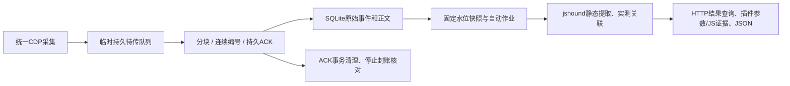

# 根目录后端与统一插件架构

## 当前运行链

| 工程 | 技术/目录 | 职责 |
| --- | --- | --- |
| 主后端 | 根server.py、src/website_js_extractor/；Python 3.10+ | 接收、校验、分类账、作业、查询/导出 |
| 生产插件 | browser-extension/；TypeScript/Vue/MV3 | 唯一会话、采集、临时持久化、补传、证据和结果展示 |
| 存储 | SQLite WAL/FULL + 浏览器IndexedDB严格事务 | 原始事件和正文在后端；未确认内容临时存在浏览器 |
| 分析核心 | 固定jshound Python/Node/Babel | 静态引用与文件级候选，不执行站点JS |

## 模块与生命周期

插件Recorder掌握当前会话，JSCapture消费JS/上下文/加载事件，RemoteCapture先写delivery-outbox，再按流序号发送。入队与ACK的状态更新串行，确认事务同时删除正文和更新分类账，防止崩溃后“正文消失但账目未确认”。存储失败保留内存并暂停，超限显式拒绝/记缺口。

恢复先从对应服务器/项目/任务读取唯一持久传输流，校验pending数量与条目匹配，重传旧序号/上传ID，幂等消除已保存但ACK丢失的数据，再附加新页面。接收端封账后允许旧事件同内容重试，不接纳新序号。

URL索引只作展示且区分服务器/项目/分类，不再用于跳过取源。每个JS解析观察单独读源，正文在服务器按哈希去重；同URL更新、跨页面、跨服务器不复用错误对象。

接收器receiver.py只在SQLite事务完成后ACK；transport序号、事件ID、正文引用与流账目一起提交。结束时seal核对客户端计数与服务端持久序列/分类/字节/对象，任一不符返回409，客户端不结束任务。

自动作业jobs.py与ACK解耦：2秒静默合并，连续事件最多等待10秒进入单作业队列；封账触发立即排队。每次固定事件水位并备份数据库，删除该任务水位之外的事件再调用离线ingest。后续输入进入下一轮。状态持久化，重启标记中断并根据持久事件重建待分析任务。

结果输出原始核心记录、API清单、参数/JS证据与Gap；/analyses分页作业及/result读取固定结果。输入临时备份在分析结束删除，报告持有其规范化正文证据。当前仍按批次重算，未实现依赖增量索引；Agent、精确调用绑定、Excel仍未完成。

## 失败边界

无效ACK、数据库异常、缺块/冲突、接收端不支持新账目、封账不符均阻止“传输完成”。浏览器缺正文、未附加/暂停窗口、配额/预算/队列超限记录捕获缺口；完整传输与完整采集分开。硬件损坏、用户清理站点数据和Chrome从未提供的内容不在零丢失声明内。

不执行下载JS、不调用提取API、不自动外发模型。旧legacy插件、StaticExplorer导入页、capture_scripts独占RPC、/v0配对服务已删除。CLI的HAR/目录/固定输入重放仍是有用的分析调试入口。
