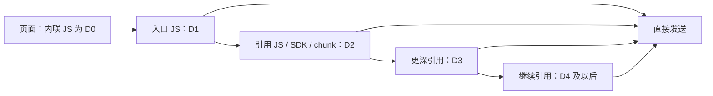
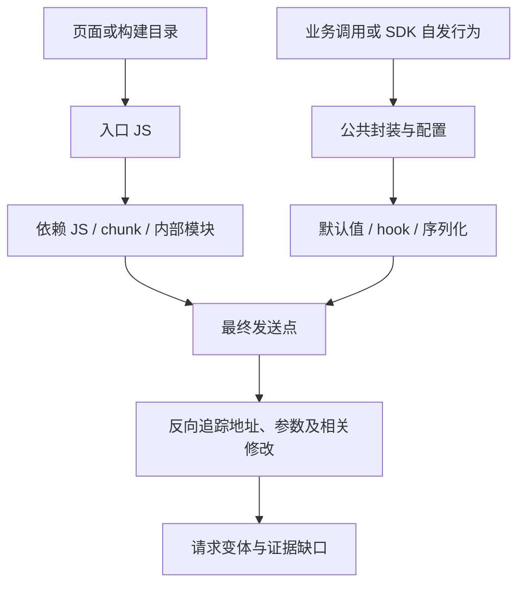

# JS 提取范围、分层与分析起点

本设计由黑盒二和白盒共同使用，先在黑盒二验证。目标是从可取得的 JS 中恢复 URL、请求参数、Host、对应 JS 文件；当前定义分析范围，不表示能力已实现。

## 1. 要找哪些请求

“原生”在这里指业务代码直接请求，统一称为“直接请求”，避免与浏览器原生 API 混淆。下面是覆盖场景，可以叠加，不是互斥的 API 分类。

| 场景 | 示例 | 要恢复的内容 |
| --- | --- | --- |
| 直接请求 | 业务 JS 直接调用 fetch/XHR/Axios/beacon | 发送位置、地址、参数 |
| 依赖自发请求 | 埋点、监控或第三方 SDK 自行上报 | 依赖内部发送点及可确定的配置；不要求必须有业务调用者 |
| 跨层调用 | 业务 JS → 公共 client → SDK → 发送函数 | 各层绑定、实参和实际请求变体 |
| 请求加工 | 默认值、拦截器或 SDK 增加/覆盖/删除字段 | 各阶段结构、实例归属、可确定顺序和最终候选 |

同一个 SDK 可以既自行上报，又接收业务参数，并在发送前追加字段。业务/公共库/第三方归属作为有依据的来源信息记录；不能因为是依赖、埋点或外部 Host 就跳过。

首批发送机制为 fetch、XMLHttpRequest、Axios 和 Navigator.sendBeacon。WebSocket、资源型上报及其他机制单独记录类型与支持状态；普通 URL 字符串、前端路由或不明 request() 调用只能作为线索，不能直接算确认 API。

## 2. JS 究竟有几层

**引用可以继续到任意层，没有天然的“三层结束”。** 三层是当前黑盒二的获取预算，不是网站结构或请求追踪的上限定义。

每层都可能有请求，也可能只有配置或转发逻辑。SDK 不固定属于第二层：它可能被页面直接加载，也可能已打包进入口文件。

| 维度 | 定义 | 例子及处理 |
| --- | --- | --- |
| 脚本获取深度 D | 页面到独立 JS 资产的已知引用边数 | 内联 D0，直接外链 D1，继续引用 D2/D3；黑盒二当前最多获取 D3 |
| 打包内部模块关系 | 同一或多个 chunk 内的模块导入/导出关系 | 一个 app.js 内可有大量模块；不因同文件而只分析顶层 |
| 函数追踪深度 | 实参和返回值经过的调用/封装层数 | 同一个 JS 内也可有五层 wrapper；预算独立设置 |
| 请求加工阶段 | 请求构造、默认值合成、hook 和序列化等变换 | 属于值和副作用追踪，不能算作多下载一层 JS |

另行记录页面发现深度和执行上下文。iframe 是独立页面上下文，Worker 是独立脚本执行上下文；发现它们不能重置整个任务的预算或抹掉父链。

黑盒二保留多父、循环、最短已知路径及深度未知状态。D3 指向 D4 时记录引用和未获取原因，不宣称 D4 没有请求。白盒对构建目录全部 JS 建清单，不能套用网站三层预算而跳过本地已有文件；外部资源按明确范围与预算获取。

## 3. 从哪里开始找 JS

| 起点 | 黑盒二 | 白盒 |
| --- | --- | --- |
| 初始输入 | 网站入口、允许页面范围、必要会话 | 固定 Commit 后正式构建的产物目录及构建配置 |
| 初始资产 | HTML 内联脚本、script src/module、已取得加载记录中的 JS | 产物目录全部 JS，以及 HTML、manifest、runtime 等索引 |
| 扩展线索 | import/export from、动态 import、chunk 映射、脚本注入、Worker/importScripts、iframe 页面脚本 | 已有产物间引用，以及允许获取的外部静态依赖 |
| 上下文 | 页面最终 URL、base、内联配置、import map、frame/Worker 归属 | 构建替换值、部署配置（若提供）、source map 和源码关联 |

modulepreload、manifest 或加载记录提供发现线索，但引用、预加载不等于已执行。加载记录缺少父链时标为深度未知，不能自动当 D1 绕过预算。source map 是生成资产的辅助证据，不作为新的线上请求来源重复计数。拿不到部署上下文时，相对 API Host 可以保持未知。

种子从页面/目录取得，后续沿资产引用图展开；请求分析覆盖已取得资产中的未执行分支，不以点击过哪些页面作为唯一分析范围。

## 4. 路由与位置要分清

| 对象 | 常见位置 | 分析用途 |
| --- | --- | --- |
| 页面路由 | router 配置、框架路由清单、路由组件的动态 import | 发现懒加载资产，关联可能的页面；路由路径本身不是 API |
| 脚本地址/引用 | script 标签、import、runtime chunk 表、Worker 创建点 | 找 JS 和父链；脚本 CDN Host 不是 API Host |
| 请求地址/路径 | 发送调用实参、client 配置、baseURL、URL 构造表达式 | 还原 URL 与 Host，动态段保留模板和条件 |
| 业务调用位置 | 组件、事件处理、初始化函数或 SDK 定时逻辑 | 追踪参数来源与触发条件；未知时不编造调用者 |
| 最终发送位置 | fetch、XHR.send、Axios 等绑定到发送机制的调用 | 标识发送点与对应构建 JS；Axios 内部传输调用与业务调用需关联去重 |
| 配置/修改位置 | client 创建、defaults、拦截器注册、对象写入与序列化 | 还原追加、覆盖、删除及加工顺序 |

相对脚本引用按模块/资源解析规则处理；相对请求按所属执行上下文处理。不能一律相对于脚本所在 CDN 路径拼接。页面路由归属可能有多个或未知，不能强行给每个请求分配唯一页面。

## 5. 两条链一起保留

资产发现沿引用关系向前展开；请求恢复从发送点向后追踪来源，再按有证据的顺序合成修改。两者通过资产、模块和绑定身份连接，不按每个入口重复展开整个程序。

每条请求至少关联：输入版本/快照、页面或构建上下文、发送 JS/哈希/位置、资产父链、可确定的调用链、地址与参数来源、修改阶段、条件和缺口。同一个发送点接受不同调用者参数时保留请求变体，不把参数并集伪装成一次发送；不同 client 的配置不能串线。

## 6. jshound 对照起点

本轮仅静态阅读锁定版本 `f34f9c5dcfa0f30816a66881ea9a8d8573c24f05`，没有运行效果验收。下面是已定位的代码入口，不表示已满足上述全部设计。

| 代码位置 | 本轮观察 | 下一步核验 |
| --- | --- | --- |
| `jshound/cli.py::_inputs` | 区分 URL 与本地目录输入 | 两路输入能否共享资产与结果协议 |
| `jshound/fetch.py::collect`、`document_refs`、`js_imports`、`chunk_candidates` | 有页面资源、模块引用与 chunk 收集逻辑 | 三层预算、父链、执行上下文和缺失记录 |
| `jshound/analyze.py::js_files`、`_build_module_index` | 有目录资产枚举和跨文件模块索引逻辑 | 内部模块、跨文件 wrapper、调用者和实例隔离 |
| `jshound/js/static_ast.js` | JS 静态分析入口之一 | 用冻结样本核验四项信息及请求加工能力 |

参考源码见 [jshound](../references/repos/jshound/)。下一步先按“直接、依赖自发、多层调用、请求加工”四类建立人工预期，再对固定输入运行基线；实现顺序见[黑盒二计划](../website-js-extractor/docs/plan.md)。
