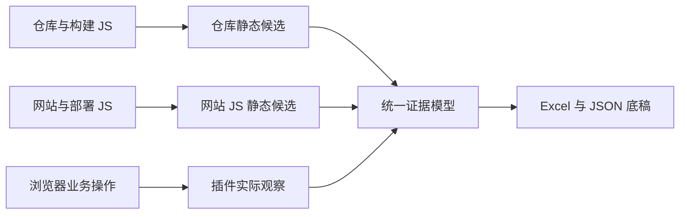

# 前端 API 资产收集总览

项目通过一套白盒、两套黑盒收集前端请求资产，统一交付 `api_assets.xlsx` 和 `analysis.json`。第一阶段只提取 Host、URL、方法、请求参数、JS/代码位置和未知项，不做 Host 筛选、敏感性识别、风险分级或合规判断。

## 三路职责

| 方案 | 输入 | 主要结果 | 当前入口 |
| --- | --- | --- | --- |
| 白盒：前端代码仓 | 固定 Commit、锁文件、构建配置和构建 JS | URL、参数、Host、对应 JS 文件及静态证据 | [Frontend API Extractor](../frontend-api-extractor/README.md) |
| 黑盒一：浏览器实测 | 测试人员操作页面时的可观测网络活动 | 实际请求、载荷、页面上下文和可取得调用栈 | [浏览器插件](../browser-extension/README.md) |
| 黑盒二：远端处理与网站 JS 静态分析 | 黑盒一提供的JS、真实请求和加载证据（亦支持固定资产重放） | 分析服务产出的请求候选、脚本引用链和缺口 | [网站 JS 提取器](../website-js-extractor/README.md) |

三类证据分别保留来源，黑盒一统一采集、黑盒二处理其数据；已有资产可离线重放，多路证据按依据关联：

插件实测只能证明特定场景中实际观察到的请求；静态分析可以发现未执行分支，但不能证明运行时发生。下载到 JS 不代表其全部请求已经还原。相同 URL/方法也不足以证明代码版本、调用位置和参数结构相同。

## 当前主线

用户确认的[API 发现与统计讨论结论](api-discovery-decisions.md)约束后续设计：白盒利用业务源码和依赖结构，优先提取明确业务请求，再沿相关封装与 SDK 深入；网站 JS 黑盒统一分析部署脚本，不要求区分业务/第三方，以底层发送点所在 JS 为主要定位。最终提供接口汇总及调用位置明细，候选与覆盖缺口单列；不能将发现数量称为已覆盖全部 API。

白盒当前主线已经收敛为：**仓库 → 固定版本 → 正式构建 → 嵌套 JS 分析 → URL、参数、Host、JS 文件**。旧实现已经删除，当前处于架构和基线设计阶段；具体状态只在[提取器实施计划](../frontend-api-extractor/docs/plan.md)维护。

当前实施顺序调整为黑盒二优先：先验证网站 JS 收集、嵌套引用及请求分析核心，再由白盒接入固定仓库的正式构建资产。两路都以 jshound 为分析基线，避免分别实现分析器；白盒的构建、环境追溯和源码关联仍需独立验收。最新职责为直接增强黑盒一，黑盒二只作远端后端；当前统一在 website-js-extractor/ 开发验证，后端源码、测试、依赖、命令行、统一链路设计及[唯一计划](../website-js-extractor/docs/plan.md)均在同一工程；已有[命令行分析入口](../website-js-extractor/docs/plugin.md)和[插件/本机服务原型](../website-js-extractor/docs/plugin.md)；构建和自动化链路已验证，真实 MV3 被当前企业策略阻止，接下来先现场核验和补抓；共享会话/数据链路只完善方案，本轮不迁移运行代码，浏览器、HTTP 协议和精确绑定仍分别验收。显式 HTTP 补取只用于命令行，产品采集由插件负责，本机服务不接管补抓。

## 证据和边界

- 仓库静态、网站 JS 静态、插件实测分别保留来源，不互相覆盖。
- Host、URL、参数结构和采集状态分别表示；某一项未知不抹去其他已知项。
- 未获取资产、解析失败、预算中断、动态配置和模型缺口必须进入缺口表。
- 不主动调用提取出的 API，不自动提交业务表单，不把候选发现变成漏洞扫描。
- 外部源码、依赖、构建产物和完整报告只放 `work/`，Git 中保留配置、预期、哈希和链接。

统一记录和工作簿语义见[交付协议](delivery.md)，三路对照和现场门槛见[联合验证](validation.md)。工程内部用法与历史资料由各自目录维护，根 `docs/` 不再重复版本报告或实现清单。

黑盒二长期目标更新为[持续采集与远端增量处理](../website-js-extractor/docs/architecture.md#6-持续采集与远端处理目标未实现)：正文按哈希存储，页面/请求/加载栈观察分别保留，浏览器使用有界内存直传，不将JS/远端任务请求内容落本地盘，远端接收不等待停止采集。统一插件与v1分块接收/持久ACK/查询已实现，接收数据可通过显式离线`ingest`生成静态候选和实测/静态API清单；接收端自动持续分析和真实MV3现场仍未验收。

最新职责不再维护第二个生产插件：增强browser-extension的真实请求/JS/加载证据采集与上传，website-js-extractor负责远端接收、存储、关联和持续静态分析。保留旧独立原型作迁移回归，原始证据/用户数据不先删除。
