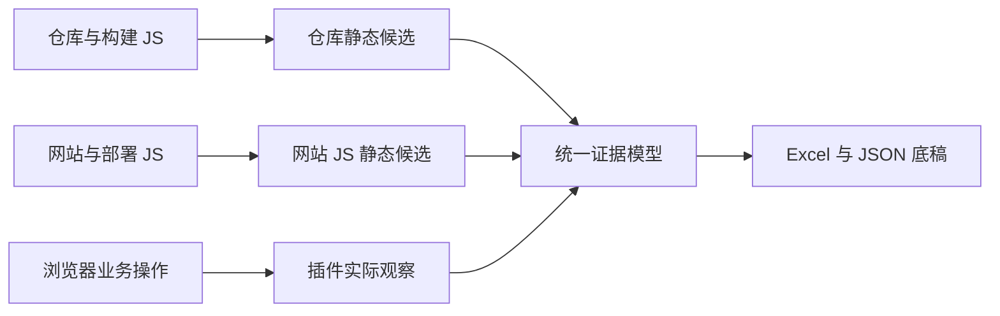

# 前端 API 资产收集总览

项目通过一套白盒、两套黑盒收集前端请求资产，统一交付 `api_assets.xlsx` 和 `analysis.json`。第一阶段只提取 Host、URL、方法、请求参数、JS/代码位置和未知项，不做 Host 筛选、敏感性识别、风险分级或合规判断。

## 三路职责

| 方案 | 输入 | 主要结果 | 当前入口 |
| --- | --- | --- | --- |
| 白盒：前端代码仓 | 固定 Commit、锁文件、构建配置和构建 JS | URL、参数、Host、对应 JS 文件及静态证据 | [Frontend API Extractor](../frontend-api-extractor/README.md) |
| 黑盒一：浏览器实测 | 测试人员操作页面时的可观测网络活动 | 实际请求、载荷、页面上下文和可取得调用栈 | [浏览器插件](../browser-extension/README.md) |
| 黑盒二：网站 JS | 网站入口、访问范围、会话和部署脚本 | 部署代码中的请求候选、脚本引用链和上下文 | [网站 JS 分析](site-analysis.md) |

三路独立运行，有多路输入时再关联：

插件实测只能证明特定场景中实际观察到的请求；静态分析可以发现未执行分支，但不能证明运行时发生。下载到 JS 不代表其全部请求已经还原。相同 URL/方法也不足以证明代码版本、调用位置和参数结构相同。

## 当前主线

用户确认的[API 发现与统计讨论结论](api-discovery-decisions.md)约束后续设计：白盒利用业务源码和依赖结构，优先提取明确业务请求，再沿相关封装与 SDK 深入；网站 JS 黑盒统一分析部署脚本，不要求区分业务/第三方，以底层发送点所在 JS 为主要定位。最终提供接口汇总及调用位置明细，候选与覆盖缺口单列；不能将发现数量称为已覆盖全部 API。

白盒当前主线已经收敛为：**仓库 → 固定版本 → 正式构建 → 嵌套 JS 分析 → URL、参数、Host、JS 文件**。旧实现已经删除，当前处于架构和基线设计阶段；具体状态只在[提取器实施计划](../frontend-api-extractor/docs/plan.md)维护。

当前优先实现黑盒二，不等待白盒。按[详细设计](site-analysis-design.md)已完成[离线原型](../site-js-analyzer/README.md)的目录/HAR 导入、内部字段保留与候选预览；现在可离线构图或显式开启受控串行递归补取/恢复，API 精确位置、并发与正式统计继续按阶段实施。请求识别和值追踪可复用，输入与上下文适配分别维护；状态见[黑盒二计划](site-analysis-plan.md)。

## 证据和边界

- 仓库静态、网站 JS 静态、插件实测分别保留来源，不互相覆盖。
- Host、URL、参数结构和采集状态分别表示；某一项未知不抹去其他已知项。
- 未获取资产、解析失败、预算中断、动态配置和模型缺口必须进入缺口表。
- 不主动调用提取出的 API，不自动提交业务表单，不把候选发现变成漏洞扫描。
- 外部源码、依赖、构建产物和完整报告只放 `work/`，Git 中保留配置、预期、哈希和链接。

统一记录和工作簿语义见[交付协议](delivery.md)，三路对照和现场门槛见[联合验证](validation.md)。工程内部用法与历史资料由各自目录维护，根 `docs/` 不再重复版本报告或实现清单。
