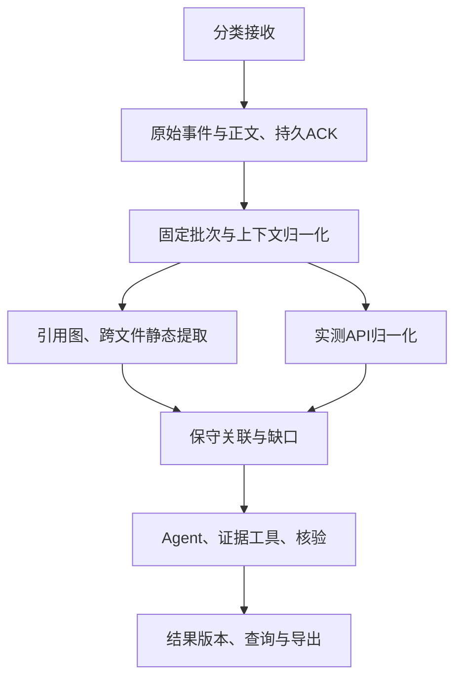

# 仓库边界与端到端职责

2026-11-04确认两套独立工程：白盒仓库、黑盒采集分析仓库。黑盒只有一个生产插件，后端是同一产品的服务端，不再以黑盒一/二表达两个产品。

| 工程 | 输入 | 负责 | 边界 |
| --- | --- | --- | --- |
| frontend-api-extractor（独立Git） | 仓库、Commit、锁文件、构建配置 | 正式构建、产物/源码关联、仓库静态提取 | 本地独立，GitHub创建受阻，见[迁移](whitebox-migration.md) |
| browser-extension/ | 浏览器可观察活动 | 收集、分类、有界传输、状态与结果展示 | 唯一插件，不在浏览器做完整静态分析或Agent推理 |
| backend/ | 分类事件、JS正文与固定版本 | 存储、去重、关联、调度、提取、Agent、导出 | 接收/离线提取已有，持续调度及Agent待实现 |

白盒独立依赖、版本、测试和计划；不引用本仓相对目录作为运行依赖。需要共享核心时使用固定版本包/协议，不复制另一套AST分析器。

## 用户操作

1. 指定服务器启动后端，插件填写`http://IP:8379`或HTTPS域名。
2. 开始统一任务，接入所有窗口HTTP/HTTPS网页；用户正常登录和操作。
3. 分类事件和正文增量上传；分块校验、持久ACK，待传/已发/缺口分别展示。
4. 后端按固定版本提取与关联；当前需显式ingest，自动调度待实现。
5. 配置模型后，Agent对缺口调工具、提出结构建议并核验；当前未实现。
6. 查看实测、静态候选、已核验结论和未解决项，分别计数和导出。

## 分类上传

保持当前capture-stream-2，不为每类数据配置另一个IP。分类是服务端处理职责，不是把三套不兼容上传器拼在一起。

| 信息类 | 当前category / 数据 | 后端用途 |
| --- | --- | --- |
| API实测 | api_request；URL/Method、参数、请求/响应头体、状态、栈、重定向、字段选择 | 请求归一化、次数、参数样例 |
| JS正文 | js_source；表示、script身份、URL、object_id | 内容寻址、静态提取、版本/观察关联 |
| 页面/执行上下文 | page_context；tab/frame/target/session、导航/执行代次、基址 | Host解析、上下文隔离 |
| JS加载证据 | script_load；Network、initiator、可得同步/异步栈 | 加载链和父边；不是API发送栈 |
| 任务与缺口 | task及现有状态/缺口字段 | 预算、停止、未确认项与完整性；独立完整缺口流待实施 |

“所有信息”指这些范围内可取得证据，不承诺历史正文、未执行路径的动态数据或无限存储。权限、预算、队列满与缺失都记录原因。

## 后端处理

接收与分析/模型耗时解耦；ACK只证明保存，不表示分析完成。模型失败、限流或未配置不阻塞接收，也不提升候选。实测、静态、Agent假设分开，Agent只读固定版本。

细节见[模块规格](../backend/docs/modules.md)、[计划](../backend/docs/plan.md)、[交付](delivery.md)、[Agent](../backend/docs/agent.md)。
