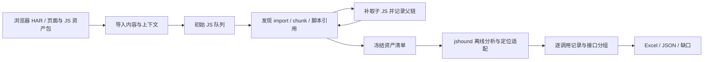

# 黑盒二：网站 JS 递归收集与 API 提取设计

状态：已按[执行计划](site-analysis-plan.md)开始实施；[S1 独立离线原型](../site-js-analyzer/README.md)已可运行，后续递归、精确定位和正式 Excel 尚未完成。用户当前优先实现黑盒二，不等待白盒。依据见[讨论结论](api-discovery-decisions.md)，进度与验收见[实施计划](site-analysis-plan.md)。

## 1. 目标与首版入口

用户打开并登录网站、正常访问需要覆盖的页面，导出含响应正文的 HAR；工具导入页面与 JS，继续发现和获取脚本引用的 JS，统一提取 API。交付 URL、Host、Method、参数、发送点所在 JS，以及接口统计和缺口，不要求区分业务或第三方。

首个可用版本采用 **HAR/已保存资产包 + 独立本地分析器**：利用现有浏览器取得登录后的正文，同一输入可以离线复现，先验证递归和提取效果，不先重写采集器。HAR 是种子，不代表全部 JS，也不默认具备补取受保护脚本的会话。之后增加公共入口 URL 与浏览器直接交付资产包，输入适配器复用同一分析链。

网页正常运行可能自然触发请求；分析器只补取有依据的静态资产，不主动调用提取出的 API 或自动提交表单。HAR 中实际请求与静态发现分开，不计入本路静态接口数。

## 2. 复用开源能力

目标和常见 API 侦察工具相同，应复用。部分工具已经递归发现 JS；固定版 jshound 已有逐轮 chunk/import 获取。新增重点是父链/深度、会话输入、精确定位、字段保留和统计，不宣称递归本身是独有能力。

| 组件 | 复用方式 | 本项目补充 |
| --- | --- | --- |
| 浏览器 Network/HAR | 接收 HTML/JS 响应正文，不新建采集内核 | 缺正文、Base64、页面/Worker 上下文与内容版本 |
| jshound `f34f9c5dcfa0f30816a66881ea9a8d8573c24f05`，MIT | `chunk_map` 等引用发现、`analyze_with_paths` 目录分析 | 父边和位置、深度队列、原始 URL/上下文映射、归并前记录 |
| BurpAPIFinder `1f298590fa03` | 端点线索对照，接受已有 Burp 导出 | 不采用默认主动爬取流程；用户反馈 bug 仍未修复 |
| 自有任务与结果层 | Python 管理资产、HTTP 获取、引擎适配、Excel/JSON | 不再自研一套 JS 解释器；有量化差距再增强 Node/Babel 链 |

核查入口：[jshound API](../references/repos/jshound/jshound/__init__.py)、[递归获取](../references/repos/jshound/jshound/fetch.py)、[输出转换](../references/repos/jshound/jshound/export/requests.py)、[Burp 提取与排队](../references/repos/BurpAPIFinder/src/main/java/burp/IProxyScanner.java)。本轮核对固定源码，没有新增准确率实测；子模块初始化见[说明](../references/repos/README.md)。

原生引擎内部会归并记录，常用请求导出会丢部分字段、将路由候选转成 GET。因此不能只包装 CLI 输出就宣称有逐调用证据。基线阶段检查归并前记录，必要时在可访问增强 fork 暴露位置与来源；保留原始类型、`query_schema`、嵌套 `body_schema`、Header 和未知表达式。历史导出差距见[评估](../references/网站浏览器挂载与动静态联合采集评估.md)。

最新[开源能力试验](../references/blackbox2-experiment/README.md)已运行 6 项工具并验证受控递归/压缩样例：jshound 为当前最合适基线，jsluice 作独立对照。内部 4 个 Query 字段未进入常用 JSONL，故结果适配优先读内部记录；公开真实 bundle 的动态结果与耗时另列，不用受控 13/13 代替真实站点验收。

## 3. 输入与资产快照

| 输入 | 处理要求 |
| --- | --- |
| HAR | 请求/最终 URL、页面关联、时间、状态、响应类型、正文及编码；缺正文单列，不当作已取得脚本 |
| HTML | 页面 URL、实际 document base、内联 JS、script src/type、modulepreload、import map |
| 本地资产包 | 原始 URL 到文件映射、哈希、执行上下文；仅有裸 JS 时仍分析，页面基址未知 |
| 补取配置 | 页面范围、静态资产允许来源、深度、文件/字节/时间预算，均与结果中的 API Host 分开 |
| 会话（按需） | 显式的本地会话或后续浏览器获取适配；不自动把 HAR Cookie/Authorization 复制到 CDN 或新域名 |

已观察资源先入库；补取默认限入口同源，已观察或配置的 CDN 可加入资源范围，重定向后的来源重新检查。无补取配置时可只离线分析，引用记为尚未获取。401/403 留鉴权缺口，不认定文件不存在。

正文按内容哈希保存；同名文件不覆盖，同 URL 不同正文保留版本。相同正文可以复用解析，但页面、基址、会话来源与版本关系分别保留。同 URL 已有多个版本而子文件版本无法关联时，保留候选关联，不能任意选择后宣称同版。

## 4. 引用发现与递归算法

每个已取得 JS 同时提供请求分析输入和下一轮引用线索。已被浏览器加载不代表第一层。

| 引用形态 | 获取依据 | 未知处理 |
| --- | --- | --- |
| 静态 import/export、字面量动态 import | AST/模块说明符和 import map，相对目标按模块最终 URL 解析 | 未映射裸包名不猜网络地址 |
| Webpack runtime/chunk 表 | 复用 `chunk_map` 明确映射、publicPath 与父脚本位置 | publicPath 不确定保留候选，不能仅凭 HTTP 200 选版本 |
| Vite/Rollup import/preload 表 | 按引擎已支持的映射恢复，每个新文件继续扫描 | 不支持 runtime 留类型和缺口 |
| `script.src` 与动态插入 | 可静态确定的脚本目标，保留表达式与位置 | 仅文本像 `.js` 的线索不默认下载 |
| Worker、`importScripts` | 可确定目标时取脚本，并建立独立执行上下文 | 动态目标保留；不主动注册 Service Worker |
| source map | 明确 `sourceMappingURL`，优先用 `sourcesContent` 定位 | 不遍历任意源码 URL，不计作执行 JS 引用层 |

深度规则：内联 JS 为 0，页面直接外链 JS 为 1，子引用为 2，再引用为 3。默认 `max_js_fetch_depth=3`，可配置；第 3 层仍分析并登记第 4 层边，不主动补取第 4 层。已在 HAR 中取得的深层脚本照常分析，保留真实父链。未知父链不伪装第一层，可分析正文，默认不从该节点主动扩展；后续恢复父链再调度。页面深度、内部模块层数与函数追踪深度分开。

工作队列：

1. 导入已有正文、URL 版本和上下文，建立资产与引用边。
2. 按最短已知父链调度资产，提取确定引用和候选线索。
3. 确定引用经过 URL、范围、深度及预算检查；已有对应快照资产则关联，否则获取并验证状态/响应类型/正文，200 登录 HTML 不当 JS 成功。
4. 新文件继续入队；循环/重复复用解析和获取结果，但保留所有父边。更短父链晚到时重新评估超深度子边。
5. 队列耗尽或预算停止后冻结输入。每条边明确标已取得、复用、超深度、范围外、鉴权/网络失败、解析失败或动态未知。

预算初值建议：并发 4、最多补取 1,000 个文件、单文件 20 MiB、总获取正文 500 MiB、获取总时长 10 分钟；单次 HTTP 超时 30 秒，短暂网络/5xx 最多重试 2 次。这些是待压测调整的配置，不是能力承诺；超限不截断后假装完整。导入、解析和分析另设文件/时间/内存预算，保存部分结果与恢复点，报告最终配置。

资源解析要区分语义：模块 import 按模块 URL，经典脚本动态插入按文档基址等实际规则，不能统一拼到父 JS 所在目录。

## 5. 提取顺序与支持边界

对冻结集合执行离线目录分析，保留跨模块能力；每条结果映射回原始脚本。不按同名函数或变量猜跨文件关联，不按单文件分析割断真实绑定。

| 阶段 | 方法 | 结果 |
| --- | --- | --- |
| 发送点识别 | fetch/XHR/sendBeacon/Axios 及可核验 wrapper，识别实例和别名 | 底层机制、绑定证据、原始 JS 哈希及行列/偏移 |
| 地址恢复 | 常量、模板、拼接、baseURL、实例默认值、已知配置、调用实参 | URL/Host/Method 和逐项状态，未知保留表达式 |
| 参数恢复 | 分 Query/Path/Body/Header，分析对象、展开、JSON/FormData/URLSearchParams 和已建模改写 | 字段路径、来源、条件、结构与值状态，未知 spread 不抹掉已知字段 |
| 封装深入 | 模块绑定与函数摘要，关联调用方实参与发送点 | 同一 `send(url,data)` 的多个调用分别保留；动态分派/预算停止记缺口 |
| 候选保留 | 普通路径、路由或未核验封装线索 | 单列候选，不伪造 Method 或底层发送位置 |

相对 fetch 按执行页面请求基址，不能拼到脚本 CDN；Worker 使用对应上下文。共享脚本用于多个页面时分别还原，缺上下文则 Host 未知。Method 只在发送机制已确认时按其语义取默认值，未知 wrapper 不默认 GET。

原始压缩文件位置是主要证据，美化或 source map 位置附加保存。`app.js → sdk.js → fetch` 的发送点属于 sdk.js，上层调用可取得时关联，无法取得不补造。

不运行下载 JS 来枚举接口，不模拟全应用执行，不让 AI 猜 URL/参数。复杂混淆、动态配置、运行时解密输出部分结果与缺口。WebSocket/EventSource 等其他机制单列支持状态，不默默漏掉或混成 REST。静态已定位表示代码中存在发送行为，不表示线上实际发生。

## 6. 记录与统计

| 对象 | 必需内容 |
| --- | --- |
| Task/Context | 输入哈希、页面/Worker 基址、工具 Commit、配置、阶段/停止原因 |
| Asset | 原始/最终 URL、正文哈希、类型、执行上下文、获取/分析状态 |
| AssetEdge | 父子资产、引用位置/类型/表达式、最短深度、获取决定与原因 |
| RequestOccurrence | `site-js-static`、发送点、调用上下文、条件、URL/Host/Method、参数与逐项状态 |
| ApiGroup | 分组键、成员 ID、规则版本、参数与地址变体 |
| Gap | 关联资产/请求、原因、影响和可继续动作 |

精确重复按资产内容身份、原始发送位置、调用上下文及条件/请求变体去重，保留执行上下文；没有位置时不伪造精确身份。底层记录不被接口汇总覆盖。

首版分组键为**已解析 scheme/authority + 已知 Method + 有证据的路径/路径模板**，限本任务版本范围。路径大小写/尾斜杠/编码不随意改变，只按真实表达式生成占位符，不一律将数字路径改成 ID。Query 字段和固定值保留变体，路径级分组不代表业务含义相同；GraphQL/RPC 附有证据的 operation/service/method 视图。

Host/Method/路径不完整的记录留在未解析区，不与具体接口强并。报告分别提供：接口分组数、调用上下文数、唯一发送位置数、每个 JS 的接口关联数、候选数、地址/参数不完整数，以及按深度新增的资产和首次发现接口组数。跨文件同一接口只算一组，各 JS 关联分别保留，各文件计数之和不等于接口总数。

无已知分母时只报“已发现资产中取得/分析多少”，不报告全站覆盖率。缺口可仅关联资产，因为未获取代码中的 API 尚未被发现。

## 7. 工程与输出

建议独立 `site-js-analyzer/` 工程，不向浏览器插件混入 Python/引擎依赖，不恢复已删除白盒旧服务。增强核心先建立可访问 fork，再锁定可拉取 Commit。

目标命令（未实现）：`site-js-analyzer analyze --har session.har --config task.json --out work/site-scan/`。同一资产快照可离线重放。后续浏览器直接接入需协调黑盒一的 CDP 调试连接所有权，不能两路竞争同一会话。

交付 `analysis.json`、`api_assets.xlsx` 和资产快照清单。Excel 包含统计概览、API 总表、参数明细、JS 资产、引用关系和分析缺口；候选可明确筛选并单独统计。正文和长证据通过哈希/ID 回查，遵循[交付约定](delivery.md)。

顺序：冻结原生基线 → 递归补取 → 位置/字段适配 → 统计交付 → 浏览器直接接入。分别量化新增脚本贡献、分析能力提升和重复候选，不用候选数量增长替代效果验证。
