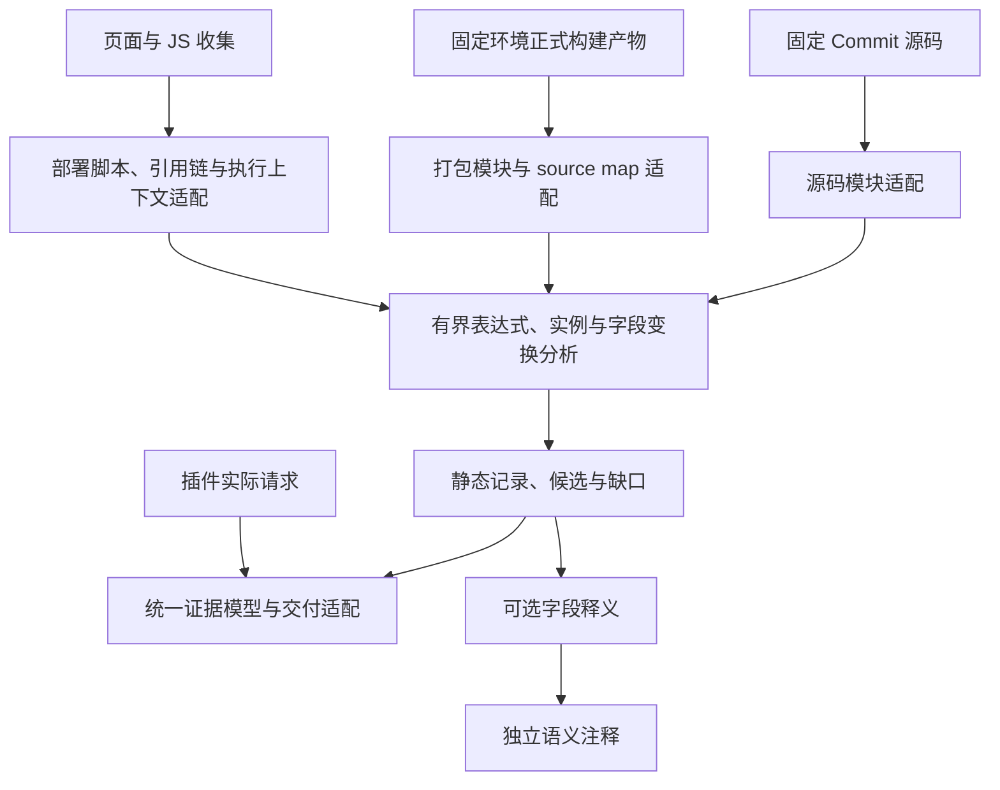

# 前端 API 提取：后续迭代与验证

设计日期：2026-10-28（Asia/Shanghai）。最初基于提取器 0.5.0 设计，后续按版本推进。当前已完成项与待办统一维护在[实施清单](前端API提取实施清单.md)，完成一项勾选一项；本文保留详细设计与验收规则。总边界沿用[总方案](API资产收集总方案.md)，记录粒度沿用[交付约定](结果模型与Excel交付.md)。

## 1. 判断依据与目标

设计时（0.5.0）99 项自动化测试通过，以下为当时问题基线。同一 Nacos 13 文件默认扫描已能定位 23 个发送位置，但 globalLib.js 和 ServiceList.js 仍预算中断；API 层相对 URL 的 Host 未知，请求 hook 后状态未知。OSS Browser 的 STS/RAM endpoint 与操作参数目前仅人工确认，HTTP 请求未自动恢复。ESM 压缩对照通过不等于 Webpack 已支持。证据见[预算复跑](../frontend-api-extractor/docs/budgets.md)、[站点与公开样本](../frontend-api-extractor/docs/aliyun-sites-analysis.md)。

后续分别回答五个问题：请求在哪里发送；Host/URL 如何构造；各载体有哪些字段；业务入口如何连接到发送点；哪些信息仍未知。接口数量只作清单统计，不作准确率或覆盖率。

优先级：先建立可重复基准，再补字段改写与 hook，随后打通封装、打包模块及 SDK，最后把已经验证的能力接入插件。AI 字段释义在字段证据稳定后独立接入，不阻塞确定性提取。

## 2. 架构与复用边界

这是目标分层，复用程度逐项由源码/产物对照决定。当前 CLI 依赖 Node 文件系统与 TypeScript compiler API，不能假定直接放进 Chrome 扩展就能运行。

建议先定义离线资产包与结果导入协议：插件/采集端导出脚本及 manifest → CLI 或受控分析进程 → 导入静态结果。验证后再选择浏览器 Worker、打包后的引擎或本地分析服务。黑盒二的产品入口仍在插件中，分析实现不强绑插件进程。

manifest 至少记录内容哈希、原始/最终 URL、页面与执行上下文、父引用及位置、获取层数、获取/截断状态和可用运行配置。源码另保留仓库/Commit。多父链全部保留，最短已知深度用于限额；父链未知不伪装第一层。

引用 URL 与请求 URL 使用不同基址：模块 import 按模块地址，页面资源按页面实际基址，窗口中的相对请求按文档执行上下文，Worker 等另建规则。CDN 脚本 Host 不能替代 API Host。

## 3. 迭代顺序和交付门槛

阶段按依赖推进，不预先承诺发布日期。每个阶段拆成可独立回归的小 PR，冻结基准后再实现；未通过门槛不扩大支持声明。

| 阶段 | 实施内容 | 首批样本 | 完成门槛 |
| --- | --- | --- | --- |
| P0：基准与证据协议 | 固定样本 manifest、人工预期、差异报告；确定调用/字段/缺口 ID 与兼容策略 | 已有 Nacos、GDB、OSS；自写反例 | 一条命令复跑相同范围；逐项显示新增/丢失/变未知，不能只比较数量 |
| P1a：对象字段变换 | 属性赋值、别名、展开、删除、条件覆盖、未知键；保留构造与改写位置 | 自写跨文件封装；OSS BaseHttp 的 opt.url/headers | 条件与别名不串值；未知覆盖显式降级；不同调用互不污染 |
| P1b：请求 hook | Axios 实例关联、注册顺序与实际执行顺序、use/eject 的可确定子集、同步回调字段变换、常见序列化 | Nacos utils/request.js | 按条件保留 username/accessToken/Content-Type 与 body 变换依据；未建模路径仍未知 |
| P2：封装与业务链 | jQuery ajax 适配；受限 call/apply、静态中间件 reduce；普通类实例与 AngularJS 显式 DI 映射分开提交 | Nacos globalLib/ServiceList；GDB 页面；OSS BaseHttp | API 层、页面链路分别验收；入口实参到发送位置可回查；同名普通方法不误报 |
| P3：打包模块 | 先覆盖固定 Webpack 5 runtime/模块注册表、模块 ID/导出、publicPath 与 chunk 文件名映射；随后补 Webpack 4 | 自写正式 Webpack 分块产物；再选独立公开项目 | 真正 bundle/split/minify 后能定位深层 sink；缺 chunk、未知 runtime 有缺口，不退化为“无接口” |
| P4：SDK 与地址 | 初始化→实例→操作→序列化模型；先 endpoint/operation/输入字段候选，再恢复 HTTP | OSS Browser 的 STS、RAM，再评估 OSS | 候选不冒充 HTTP sink；确定规则与版本后，Host/method/path/载体与受控参考发送一致 |
| P5：黑盒二与交付 | 网站 JS 资产协议接入插件；静态/实测双视图；统一 analysis.json 和 Excel 适配 | 受控多层站点，随后获准的真实站点 | 引用深度、上下文、版本和缺失可回查；三类证据不混淆；旧插件采集回归通过 |

AI 释义可在 P1 后作为独立小版本推进，验收规则见第 7 节。统一记录协议从 P0 开始，不等到 P5 才处理；任务前端不作为核心分析验证的前提。

### P1 的最小实现范围

建立可追踪的字段变换序列：`构造 → 赋值/删除/合并 → hook → 序列化 → 发送候选`。每步保存源位置、载体、字段路径、条件、输入输出及模型缺口。未知对象不能被解释成空对象；无法解析的 hook 不能被略过。

先支持直接可定位的 Axios 实例与有限同步 hook。静态已知注册/执行次序才可顺序求值；条件注册、eject、异步 hook 或隐藏的全局改写不能确定时保留分支和缺口。不默认“注册顺序就是执行顺序”，并用两个 hook 写同一字段的反例核查。

序列化适配按库与版本建规则。JSON、表单编码、URLSearchParams、FormData 的字段与重复键语义分别处理。自定义 replacer、加密或未知变换保留输入证据，但最终载荷结构保持未知；不把加密前 username 宣称为线上字段。

Host 从明确配置、客户端默认值、函数参数及可取得的运行配置中恢复；环境分支保留条件。源码模式不执行仓库配置脚本。无法取得页面/运行配置时，相对 URL 的 Host 留未知。

### P2～P4 的难点控制

先连通一条有独立预期的封装链，再扩大到其他库。显式声明客户端与真正进入实现是两种依据，配置命中不能冒充 DI/类实例自动推导。对象、闭包或生命周期暂不支持时保留资产候选。

Webpack 第一版只适配识别出的 runtime 形态，不执行目标 runtime，也不暴力枚举 chunk ID。可确定映射才生成引用边；模块 ID 按构建版本隔离。source map 用于辅助位置与版本核查，不作为所有目标必需条件。后续混淆支持按“字符串表/常量解码/间接调用”等具体模式逐项验证，不承诺通用解密或控制流还原。

SDK 先输出“配置 endpoint＋操作＋输入字段”的独立候选，并附版本和初始化位置。只有匹配受支持的协议模型或可追踪实现后才生成 HTTP 请求记录；不能假定 method=POST、path=/。签名、默认参数、路径编码及重复 Query 均需独立校验。

预算暂不盲目加大。确有缺口由预算导致时，再评估函数级任务拆分、摘要缓存或中断后第二轮重试；共享总上限不能被重试绕过。摘要缓存必须包含实参、条件、相关状态及模型/版本，不能只按函数名复用。

## 4. 验证材料：五层证据分开

| 层次 | 材料与做法 | 能证明什么 |
| --- | --- | --- |
| L1 语义样例 | 少量自写多文件正例与反例，预期独立写定 | 某个支持模型是否正确，未知是否诚实 |
| L2 构建变体 | 同一自写应用生成源码、ESM 压缩、Webpack 4/5 分块；固定工具版本和构建参数 | 模型对压缩/模块变化的适配，不外推任意混淆 |
| L3 公开源码 | 固定 Commit、文件集合、配置、哈希及人工标注 | 所选业务样本的提取表现，不代表当前线上部署 |
| L4 受控运行 | 自写应用与本地接收器；固定场景、配置和期望请求 | 已执行场景的实际地址/字段，用于核对静态候选 |
| L5 真实站点 | 获准页面及其实际引用 JS；记录会话、时间、内容哈希及缺失 | 特定采集快照的资产与候选，不代表全站或全版本 |

静态引擎在 L1～L3 仍不执行目标业务。L4 只运行自写受控应用；SDK 参考验证使用单独编写的驱动、固定 SDK 和测试凭据，限定本地接收器/离线 transport，禁止外连真实业务服务。构建真实项目时按独立构建增强模式执行锁文件和正式命令，不混称源码扫描成功。

阿里云站点此前因环境 CONNECT 403 未取得页面。目前可先完成 L1～L4；网络未开放时 L5 记阻断，不用开源代码结果替代线上验收。网站模式仍最多获取 3 层脚本，白盒构建增强只额外获取 1 层；本地已有文件追踪不消耗外部获取层数。

材料分三组：已有样本作为回归集；新特性使用开发集；另外冻结一组未用于调规则的验证样本。验证集参与修复后即转入回归集，并补充新的验证样本。不得在看完全部结果后挑选“容易命中”的文件计算总体准确率。

## 5. 指标及比较口径

先按受支持范围完整标注一个有限切片，再计算分母。独立 AST 枚举只提供指定 receiver/语法的调用点清单；未知别名、SDK 和其他发送机制需要人工补标。当前 23/23 是历史限定结论，不能作全仓分母。

| 指标 | 比较单位与分母 | 失败例子 |
| --- | --- | --- |
| 发送点发现 | 标注切片中的真实发送位置；TP/标注发送点数，另报误报数与精确率 | 把普通对象 get、SDK 输入或 URL 字符串当成 HTTP sink |
| Host/地址恢复 | 已匹配调用中有明确参考答案的 Host、method、path/Query；逐项报准确、错误、未知数 | 将 CDN Host 当 API Host；跨条件拼出不存在的地址 |
| 字段恢复 | 同一调用、载体、阶段、条件下的字段路径；精确率 TP/(TP+FP)，召回 TP/(TP+FN) | 把 Header 当 Query；将删除字段保留；把加密输入算最终字段 |
| 业务链连接 | 人工标注的入口→封装→发送点及实参关系；连通数/应连通数，另报错误连接 | 同名函数串绑、把未关联资产标成已调用 |
| 状态可信度 | 已知未支持/中断/缺依赖样例中被错误标为完整的数量 | 空输出掩盖预算中断；忽略未知 hook |
| 资产获取 | 已发现引用中成功、失败、超深度、未知父链及版本分布 | 未加载 chunk 被当成不存在；不同版本覆盖 |
| 成本 | 相同机器、输入、工具/模型、缓存条件下的耗时、峰值 RSS、求值步数 | 换扫描范围后声称性能提升 |

字段值动态不等于字段名未知；两者分别评分。模板 Host、具体 Host 和未知 Host 分开，模板不能算具体域名恢复成功。未知字段集合/spread 单独记缺口，不能从召回率分母里静默删除。

多来源按版本、上下文和位置关联。同 URL 的不同调用不合并评分；同一接口两个分支的字段并集不能与某一次请求比较。压缩前后按源码/产物映射及人工锚点比较存活的逻辑发送点，不能按行号直接匹配。

构建可能删除死代码或替换环境分支：先核对实际存活逻辑，再比较源码与产物。运行观察只验证已执行分支；静态发现未执行的真实候选不能因此算误报，运行未观察也不能证明没有该接口。

## 6. 每次发布的验证流程

1. **固定基准**：登记范围、输入哈希/Commit、依赖/构建工具、配置、模型/Schema 版本、预期与已知缺口。预期由人工语义和参考行为制定，不从分析器输出反写。
2. **先写失败样例**：复现本次缺口，并加入邻近反例，如同名普通函数、两个 client、条件覆盖、未知键、缺 chunk、顺序相反的 hook。
3. **实现最小模型**：每个新增字段/地址/关联必须有代码依据，未知部分继续保留；新协议先增量适配，不破坏旧 CLI 消费者。
4. **跑局部与全量回归**：保留当前全部回归，再添加本轮有效用例；同版源码、压缩/分块、独立验证集分别出结果。文档变更只做链接与口径检查，不重复无关测试。
5. **生成差异报告**：列出新增、丢失、变未知、错误关联、预算变化；每个差异关联样例和原因。数量上涨或下降都需解释。
6. **受控交叉核查**：对本轮涉及的载体和分支，用本地接收器/参考序列化验证。若改插件，再独立验收目标 Chrome 的采集与资源限制。
7. **发布**：小 PR 附范围、数据和遗留缺口；检查通过后合入 main，核对远端/工作区一致。外部源码、工具和原始报告不提交。

硬门槛：受支持的自写样例全部符合预期；同名/错实例等反例无误报；预算不超限；已知不完整样例没有错误“完整”声明；旧用例没有未解释回归。真实样本不预设缺乏依据的统一百分比承诺，先冻结每轮目标切片和验收清单，再以 TP/FP/FN 原始计数评审。

性能单独用固定的百/千/万文件自写材料和公开切片观察，记录冷/热状态及峰值内存；先建立基线，再决定回归阈值。新增语义可能增加开销，不能用求值步数减少代替耗时/内存改善证明。测试通过不等于真实站点、全仓或所有框架通过。

## 7. AI 字段含义识别

AI 输入只使用已经允许处理的最小代码片段、字段路径、上下文名称、注释和变换证据；采用显式启用、范围配置与必要值脱敏，不默认外发整仓。运行记录模型/提示词版本。

输出是独立注释：释义、支持片段、置信说明、是否需人工复核。不得凭字段名补造 Host、接口、必填性、真实字段或最终载荷；不得改变静态解析状态。若 AI 建议某个解码/模型规则，必须先用确定性实现和独立反例验证。

用人工标注并与开发样本分离的字段集，评价释义正确率、证据是否支持、无依据推断数、拒答/未知比例和人工复核耗时；加入缩写、多义词、同名异义、压缩变量名等样例。最终是否接受释义由业务语境复核，AI 自报置信度不能充当校准指标。

## 8. 持续执行与完成标记

逐项执行、状态和证据集中于[前端 API 提取实施清单](前端API提取实施清单.md)，避免多个文档维护相互冲突的勾选。0.8.2 已完成限定范围的 P0 同版对照锚点、手工基准和差异报告；整体 P0 仍待外部切片人工标注、独立验证集、统一 ID 与性能基线。下一优先项为清单 P0-04。

0.6 对象改写、0.7 有限同步 hook、0.8 仓库自动构建/请求表、0.8.1 部署上下文补全均已交付；不代表对应阶段所有模型完成。每轮验收仍需解释字段/地址的来源、改写、载体以及无法证明的断点。
