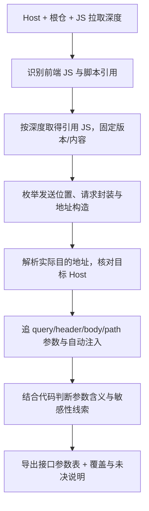

# 白盒第一版：按 Host 提取接口与参数

**输入目标 Host 和一个代码仓，找出使用该 Host 的请求接口，提取参数、参数含义和敏感性线索，整理成一张可回查代码的表。**

范围依据：用户已明确第一版目标；下文细化默认值、提取口径和异常处理。当前仅方案设计，未实现扫描器。业务背景见 [README](../README.md)，已有[黑盒结果](黑盒方案.md)可辅助定位与核对。

## 1. 输入与范围

| 输入 | 约定 |
|---|---|
| `target_host` | 必填主机名，例如 `api.example.com`；默认精确匹配，子域匹配显式开启 |
| `repository` | 一个本地仓库或有权读取的仓库地址；固定 commit |
| `max_js_fetch_depth` | 引用 JS 的递归拉取深度，默认 3，可设 0 只看本仓已有 JS |
| JS 获取范围与预算 | `js_fetch_allowlist` 限定获准来源；JS 数量、总体积、超时和分析预算可配，试点校准；未配置来源时只记录外部引用、不自动访问 |
| 运行配置 | 可选环境/区域、构建参数、页面基址、已有依赖与发布资料，用于解析动态 Host |
| 黑盒结果 | 可选页面、请求、参数和调用栈；辅助反查，不作为单仓扫描的必备前提 |

第一版只查前端 JS 经接口传递数据的路径，服务 EO 14117 相关合规排查。只递归取得所引用的 JS，不拉取其他语言实现、服务端代码或整个依赖仓。深度限制只用于 JS 获取，**不用于截断本仓函数调用或字段追踪层数**。已有 HTML/配置等仅辅助发现 JS、解析地址，不扩展成其他代码审查。

## 2. 怎样找到使用目标 Host 的接口



| 情况 | 处理 |
|---|---|
| 完整 URL | 按 URL 的主机部分比较，不做简单字符串包含；保留原地址与端口信息 |
| baseURL + 相对接口 | 追配置、请求实例与封装的地址解析规则，不能机械拼字符串 |
| 常量、拼接、环境变量 | 尽量求出地址或条件候选；记录环境/分支，不能混用互斥配置 |
| 只有 `/api/...` | 根据真实基址解析；拿不到页面/请求实例配置时标待核实，不能默认归到输入 Host |
| Host 出现在注释、文档、字符串值或响应示例 | 只作搜索线索；没有进入发送目标的依据就不列为确认接口 |
| 未知动态 Host | 保留待核实发送位置及缺失表达式/配置，不算目标命中，也不算排除 |

不能只搜索 Host 字面量：Host 可能在根仓配置，接口和发送实现在外部包；也可能在封装中被替换。检查 fetch/XHR/请求库、Beacon、资源 URL、WebSocket 等相关发送入口；识别不到的 SDK/API 明示未支持，不自动视为查完。

## 3. 参数提取与含义判断

| 参数对象 | 要提取的内容 |
|---|---|
| Query、Body | 字段路径、嵌套对象/数组结构、类型线索、值的来源表达式 |
| Header | 业务显式字段、默认头、拦截器和 SDK 追加字段，分别追写入者 |
| Path | 模板或拼接中的动态段，例如 `/users/{userId}` |
| 公共上下文 | 对象合并、默认值、共享状态及最后覆盖/删除、序列化/过滤 |
| 动态对象/不透明载荷 | 已知字段照常记录；未知键、整体透传、编码/token 标明未解析部分 |

接口参数以**最终可能发送的结构**为目标，不只抄函数签名或请求对象的第一版。遇到无类型对象整体传递，应返回“字段未提取完整”，不能写“无参数”。不导出凭据等真实敏感原值，用类型、脱敏表示或来源表达式描述。

参数含义依次参考：字段构造与读取位置、业务类型/schema、注释/接口资料、调用上下文；AI 可解释并给引用。只有名字时写“名称推测”，无法判断写“未知”。

敏感性先标类别和依据：如认证凭据、账号/设备/租户标识、联系信息、位置、自由文本或其他业务数据。编码、哈希、加密和 token 不直接等于匿名；这些是待核查线索，不单独生成 EO 违法结论。

## 4. 一张表怎样交付

**主表采用一行一个参数，同一接口可占多行，便于筛选敏感字段。** 同接口不同调用点、条件或字段结构保留差异，不能合并丢失。

| 列 | 内容 |
|---|---|
| 根仓 / JS 文件或脚本 / 版本 | 任务所属仓、字段与发送实现所在的 JS 及 commit/内容哈希 |
| 接口 ID / Host / 端口 / 方法 / 路径 | JS 发起地址及其参数，保留模板与未确定表达式；运行重定向/最终目的地另附证据 |
| 调用位置 / 生效条件 | 文件、函数、行号、环境/开关/角色等必要条件 |
| 参数位置 / 参数路径 / 类型 | query/header/body/path；如 `body.user.email` |
| 参数来源 / 处理 | 读取或写入位置、变换、自动注入与过滤 |
| 参数含义 / 判断依据 | 业务含义、代码/资料引用；区分有依据、名称推测、未知 |
| 敏感类别 / 依据 | 如认证凭据、联系信息、可关联标识或待判断；不能只给无解释的分数 |
| 结果状态 / 完整性 / issue_id | Host 判断、参数完整性、含义依据、敏感性各自标记；关联具体未决项，运行证据另附引用 |

假设表格示例，不是目标仓库的发现：

| Host | 接口 | 参数 | 含义 | 敏感性线索 | 依据/状态 |
|---|---|---|---|---|---|
| api.example.com | POST /collect | body.pageUrl | 当前页面完整 URL | URL 可能携带业务或身份信息 | `event.pageUrl = location.href`；需核最终过滤 |
| api.example.com | POST /collect | header.riskToken | 不透明风险标记，内部含义未知 | 待核关联能力与用途 | SDK 注入有依据，内部实现缺失 |

无参数的接口仍占一行；“已确认无参数”“参数未知”分别标记。可用 CSV/表格导出；覆盖说明同时列实际分析资产、拉取失败、超深度、解析失败、动态地址和未知字段，不能把未决记录隐藏在零命中里。

## 5. 引用 JS 拉取：默认三层，可配置

按需要取得的外部 JS 引用边计数，**本仓已有 JS 为第 0 层**：

```text
本仓 main.js [0]
└── 引用 a.js [1]
    └── 引用 b.js [2]
        └── 引用 c.js [3，拉取并分析]
            └── 引用 d.js [4，不拉取，登记超深度]
```

本仓已有前端 JS 文件之间的 import 不消耗拉取深度。外部获取只取得 JS 文件或脚本文本：

| 来源 | 获取约定 |
|---|---|
| 本地模块 / 已有依赖 | 读取其中前端实际引用的 JS；配置/锁文件辅助定位，不递归审其他语言或服务端实现 |
| CDN / 动态脚本 / 远程模块 | 取得对应 JS 内容，记录 URL、哈希、时间、加载者和深度；继续跟随其中 JS 引用 |
| 指向包或其他仓的引用 | 能定位对应版本的具体 JS 时按文件取得；只知道包/仓地址时登记待定位，不自动克隆整个仓或安装整包 |

同 JS 资产同版本去重、循环引用停止；按最短已知引用层数判断是否可展开，避免先走深路径导致合法浅路径漏拉。同 URL 不同内容分别保存，依赖名称或类型声明不替代实际 JS。

三层是 JS 获取预算，不保证代码已齐全。另设 JS 数量、总体积、超时等上限；超限、无权限、网络失败和版本缺失分别返回状态。只读取得内容，不执行安装钩子、构建脚本或远程代码。

## 6. 问题、未决输出与实施关卡

具体落地问题集中维护在[问题台账](../Temp/难点与待解问题.md)：32 项预计卡点，逐项记录误判方式、第一版处理、补证材料和验收。以下问题会直接限制交付结论：

| 卡点 | 第一版必须怎样返回 | 关闭需要什么 |
|---|---|---|
| 引用 JS 超深度、取不到或不是有效 JS | 已知接口照常提取，列缺失引用及影响；不能判参数齐全 | 对应 JS/版本取得后重跑受影响路径，或明确保留残余项 |
| Host 依赖未知运行配置 | 列条件候选/未知发送点，不伪装目标命中或已排除 | 相容配置或能证明目的地址的代码/黑盒证据 |
| 动态对象、SDK、覆盖顺序无法追清 | 已知字段保留，剩余字段与写入关系标部分/未知 | 具体 JS 实现、机制模型或对应受控观察 |
| 参数名不能解释业务含义 | 标名称推测/未知，敏感性不能默认为否 | 来源/上下文证据、字段字典或业务确认 |
| 分析预算耗尽或部分语法不支持 | 导出已得结果、停止位置与受影响范围 | 补能力/材料/预算后定向重验 |

### 状态不能只给一个“成功”

| 维度 | 状态口径 |
|---|---|
| 任务执行 | 正常结束 / 异常结束；正常结束不等于所有问题已解决 |
| JS 范围 | 声明范围内已处理 / 部分缺失；列取得、解析、超深度及失败资产 |
| 目标 Host | 静态支持 / 条件候选 / 未知 / 有依据排除 |
| 参数完整性 | 声明分析边界内完整 / 部分 / 未知 / 已确认无参数 |
| 参数含义 | 有依据 / 名称推测 / 未知 |
| 敏感性 | 有依据的类别或线索 / 有依据不属当前筛查类别 / 未知 |

零目标命中也要导出未知 Host 的发送点和 JS 缺口。已知字段未见敏感线索，不能替代未解析字段的判断；“完整”只针对明示范围/条件，不宣称穷尽 JS 的全部可能运行。

实施依次通过 **G0 材料与定义 → G1 JS 取得/Host 定位 → G2 参数/含义 → G3 可交付性**。每阶段要有问题台账规定的凭据；工具选型和工期由试点结果决定，不以文档完成替代扫描效果。

## 7. 第一版验收

执行勾选、能力现状、覆盖度和遗留状态以 [白盒 Checklist](白盒Checklist.md)为准；下列为方案验收要求，不代表已完成。

- [ ] 给定 Host，直接 URL、封装 baseURL、常量拼接能定位到请求及调用位置。
- [ ] 相似域名、注释中 Host、其他 query 值中的 Host 不误报；相对地址与动态配置不被强行判定。
- [ ] 提取嵌套字段、默认头、公共上下文和 SDK 注入；最终删除的字段不误写成确定发送。
- [ ] 每个参数有含义依据或明确未知，不透明 token 不猜内部内容。
- [ ] 深度 0/1/3 只控制引用 JS 的取得；不下载其他代码，不克隆整仓/安装整包，循环、重复和内容版本差异处理正确。
- [ ] 外部实现缺失、超深度、Host 未确定或字段未展开，均有可回查的未决说明。
- [ ] 至少用一条已有黑盒记录核对接口/参数，差异能定位到版本、条件、实现或解析缺口。
- [ ] [问题台账 V01～V16](../Temp/难点与待解问题.md)有独立预期与结果，P0 无法完成的项不会被错误标为完整/无参数/无风险。

下一步需要选定试点仓和 Host，再用少量真实路径决定解析/数据流工具与 Agent 分工；尚未开始实现。[Temp 探索区](../Temp/README.md)保留完整难点与参考。
