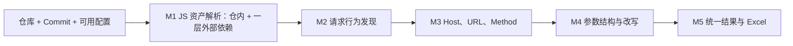

# 白盒：前端代码仓静态分析

**输入前端仓库和固定 Commit，不要求编译或执行目标代码，分析仓内代码及直接引用的一层外部 JS/SDK，输出请求与参数候选。** 当前仅设计，工具和效果尚未验证。

## 1. 输入、流程与边界

必需材料是代码仓与 Commit；可选材料包括环境配置、模块别名、锁文件、依赖实现、构建说明和生成文件。缺少辅助材料不阻断整个分析，受影响结果分别降级。类型声明不能代替依赖实现。

只追还原请求和参数所需的关系，不建设全仓通用调用图，不做完整 Source→Sink 溯源。仓内跨函数、跨文件追踪保留；时间、节点和上下文预算另设，耗尽时记录中断位置。插件和网站环境不是白盒运行前提。

## 2. M1：JS 资产解析

**动作：** 识别 JS/TS、JSX/TSX、组件脚本、HTML 内联/引用脚本，读取可用配置与锁文件，定位本地模块和直接外部依赖。

**开发内容：** 文件与脚本清单、import/export/require 与别名解析、依赖入口定位、按文件获取、版本/引用关系记录。

| 层级 | 处理 |
|---|---|
| 第 0 层：仓库已有代码 | 正常分析；跨文件引用不消耗获取深度 |
| 第 1 层：本仓直接引用的外部 JS/SDK 文件 | 能定位版本与实现时获取，分析独立发送及与业务调用的关系 |
| 第 2 层及以后：第一层文件继续引用的代码 | 暂不获取；登记引用目标/表达式、父文件位置、跳过原因和可能影响 |

`max_js_fetch_depth = 1`。不同直接引用均可属于第一层；同一文件按最短已知引用路径计算。仅因第一层又 import 了同包文件，不能将后者自动视为第一层。已在仓库提供的代码作为现有资产分析，并保留其第三方来源。

**问题与边界：** 缺包入口、生成模块、动态地址、版本不明和解析失败均记录缺口；不递归克隆依赖仓、不安装整包、不执行目标代码。只下载 SDK 不算完成分析。若 SDK 将发送委托给未取得内部模块，则保留 SDK 调用线索，不推断不存在请求。

**产出：** 文件/版本/内容哈希、引用链、配置可用性及获取/解析缺口。缓存代码解析结果时，请求结论仍区分配置和调用上下文。

## 3. M2：请求行为发现

**动作：** 找出发送操作，识别其 API 绑定、实例和可静态定位的封装。函数名 `request`、`report`、`track` 仅是线索。

**开发内容：** 发送机制模型、实例关联、导入绑定、封装摘要及有限调用追踪。

| 机制 | 首版分析目标 | 未解决时 |
|---|---|---|
| fetch、Axios、XHR、Beacon | 标准用法、实例与配置；XHR 的 open/header/send 关联同一实例 | 标记未支持重载、未知实例或改写 |
| 自定义封装 | 可确定目标的转发、配置对象与返回 client 模式 | 保留入口、实参和断开的调用关系 |
| SDK | 取得实现且机制受支持时，提取独立发送和业务关联调用 | 缺实现或机制未知单列候选 |
| WebSocket、Pixel、Form | 纳入发送发现，按机制区分连接/消息、URL 参数和表单字段 | 不强行套成 HTTP JSON 请求 |

**问题与边界：** 工厂、重导出、同名函数、全局替换、复杂动态分派可能无法确定；Worker 保留独立执行上下文。URL 字符串命中与未定位发送实现的调用单列待确认候选。

**产出：** 发送点、业务调用点、机制、实例、条件、发现依据和未确认原因。Host 不作为排除条件。

## 4. M3：地址与方法提取

**动作：** 从发送点连接常量、配置、baseURL 和调用参数，恢复 Host、URL/表达式、Path、Method。

**开发内容：** 有限表达式求值、跨文件绑定、实参/形参替换、返回值追踪、实例默认项及已知改写分析。

**问题与边界：**

- 支持字面量、已知拼接、模板中的已知部分和可读静态配置；不同 client、分支及调用者分开处理。
- `process.env`、`import.meta.env`、构建替换只在有对应配置和语义依据时解析；不凭变量名或示例配置猜环境。
- 缺基址时仍保留 Path；不把 SDK 下载域名当请求 Host，不用源码文件路径代替页面 URL。
- 未知拦截器可能改写地址时保留初始表达式与缺口；Method 默认值必须有机制依据。

**产出：** 地址各已知部分、方法、推导依据、适用配置/条件及解析状态。地址未知不阻断参数分析。

## 5. M4：参数提取

**动作：** 提取 Query、Header、Body、路径变量与消息字段，追踪必要的构造、传参、覆盖、删除及序列化。

**开发内容：** 对象/数组结构、基本跨过程传参、spread/assign、请求默认项、拦截器及常见序列化模型。

| 场景 | 处理原则 |
|---|---|
| 跨文件 `report(data) → client.post` | 连接调用方对象、形参和发送点；隔离不同调用者 |
| 已知对象展开/合并 | 按可确定顺序处理覆盖 |
| 未知 spread、动态键、别名副作用 | 保留已知字段和未展开表达式，注明可能覆盖/增删 |
| 拦截器与 SDK 附加字段 | 仅纳入确定实例、可理解注册顺序与实现；其余降级 |
| JSON、URLSearchParams、FormData | 保留嵌套、数组与重复键；考虑序列化过滤 |
| 自定义编码、加密、复杂回调 | 保留表达式和未支持操作；加密前结构仅作关联说明 |

**问题与边界：** 字段曾被构造，不等于最终一定发送。`{userId: user.id, ...extra}` 中 extra 是未知展开部分，不是名为 extra 的网络字段；userId 可能被覆盖。浏览器自动 Cookie/Referer 不声称能由源码完整枚举。

示例：若调用为 `client.post('/report', {userId: user.id})`，但 client 配置缺失，可记录 POST、路径和调用处字段；最终 Host、Header 和序列化后 Body 按各自证据标记未知或部分，不将调用参数冒充最终载荷。若连 client 的发送绑定也未确认，则整条还需标为待确认调用候选。

**产出：** 载体、字段路径、值表达式、构造/发送阶段、条件、改写位置及未知部分。字段值动态不自动代表结构未知。

## 6. M5：汇总与交付

每个静态请求调用上下文独立保留；同 API 的调用可以关联，不能把字段并集当每次载荷。缺依赖可能隐藏尚未发现的请求，因此资产缺口独立输出。

统一使用“仓库静态”证据类型，并保留 Commit、文件行列、调用/发送位置和模型范围。Excel、JSON 与完整性语义集中见[交付约定](结果模型与Excel交付.md)。

## 7. 候选路线与遗留问题

优先试验 AST/符号解析、有限跨过程追踪与请求机制模型；与 Grep+AI、CodeQL 在同批样例上比较，不预先承诺工具效果。AI 可辅助提出未知封装模型，但需代码位置、正反例验证，不能凭解释提升完整性；代码发送范围在接入时明确。

第一层 SDK 内部依赖、缺构建配置/生成代码、复杂副作用和不透明 SDK 均为明确遗留点。与网站 JS 分析共享哪些能力，按[验证计划](验证计划.md)对照决定；候选工具资料见 [Temp 调研](../Temp/GitHub方案调研.md)。
