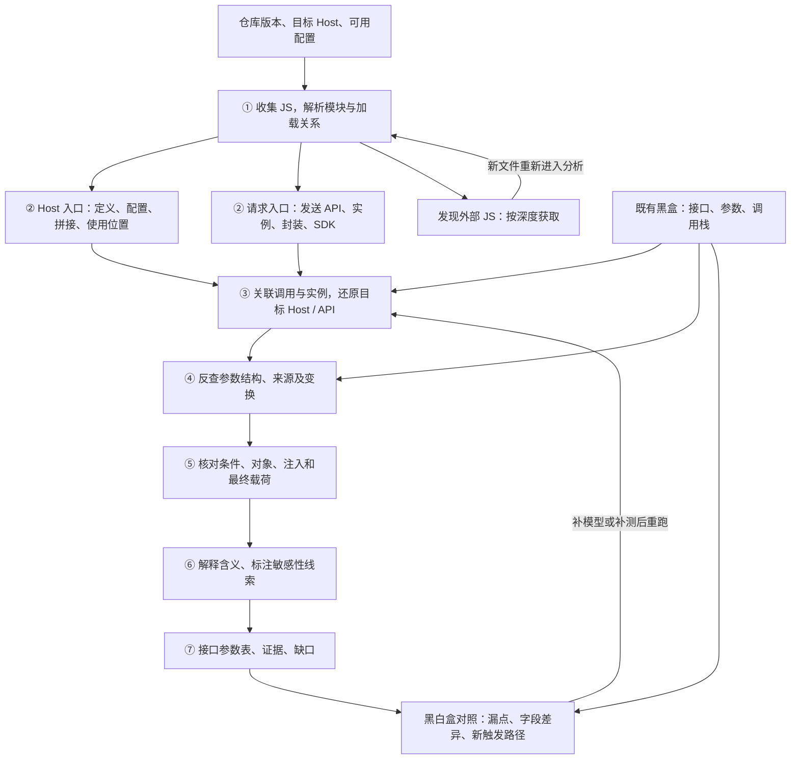

# 前端 JS 透传白盒方案

**输入一个 Host 和一个代码仓，找出哪些前端请求会发往该 Host、发送什么参数、参数从哪里来，并给出可回查的代码证据。** 用于阿里云美国独立站的跨境数据排查与整改。

本文是待开发的技术设计，尚未实现扫描器或验证覆盖率。黑盒插件采集接口、参数和调用栈的方案已确定有效。

## 1. 第一版交付边界

必需输入是**目标 Host、仓库路径及版本**。美国部署配置、页面基址、构建产物和黑盒记录可补充；缺失时保留受影响的条件，不阻断其他代码分析。

- 分析前端 JS/TS、组件内脚本及引用 JS。已有 HTML、配置、锁文件辅助解析，不扩展到后端审计。
- 引用 JS 的获取深度 `max_js_fetch_depth` 默认 3，可配置；不限制仓内函数或数据流追踪层数。
- 输出**接口参数表、证据链、分析缺口**。接收地区和内部策略结论需另有事实输入，不能由 Host 匹配直接推导违法。
- 先完成一个仓库的端到端分析。多仓调度、全量地区库、通用 Agent 平台后续再做。

目标 Host 默认精确匹配规范化后的 hostname；子域匹配必须显式开启。保留原始 URL、协议与端口，不用字符串包含匹配。目标 Host 也不能充当缺失的页面基址。

## 2. 总体流程：两路发现，同一条证据链

**Host 搜索提供线索，全仓请求发现补召回。** 不能因文件里没有域名字符串就跳过它；未知目的地址的发送点单列待判定，不能从结果中消失。

分析单位是“**某个业务调用，在某组配置/条件下，通过某个发送点产生的请求**”。相同 API 的不同调用先分别分析，最后才做展示归并，避免把不同实例、区域或事件参数拼成一个请求。

## 3. 各阶段怎么分析、需要开发什么

### 3.1 收集 JS，连上模块与外部依赖

建立文件清单，解析 import/export、require、组件脚本、HTML script、动态加载与 SDK 引用。结合模块别名、锁文件和已有构建信息找到实际实现；类型声明只能辅助理解，不能当发送实现。

**开发内容：** 文件与版本清单、脚本提取、模块解析、外部 JS 获取队列。每条引用保留来源位置、目标、深度、获取/解析状态。

外部 JS 优先取已有同版制品或可用快照，其次按允许来源获取具体文件；不克隆依赖整仓、不安装整包、不执行目标代码。浏览器脚本内容快照属于可增补输入，不假定现有插件已经提供。下载需约束来源、重定向、大小和超时。

仓内模块跳转不增加获取深度；取得的外部 JS 再引用外部文件时增加一层。按最短已知引用路径计算深度，循环引用去重；后发现更浅路径时重新检查此前被深度截断的下游。获取限制与分析超时/节点预算分别配置。

**会卡在哪里：** 动态脚本地址、未提供的 npm 实现、微前端远程入口、混淆 bundle 和缺失 source map。取到文件也不代表能接上业务调用。

**处理与边界：** 能解析的文件继续进入同一分析流程；缺实现、深度截断、获取失败和解析失败分别列出，并关联受影响的调用。相同内容可复用解析结果，但语义结果还需绑定模块解析、配置、调用上下文和模型版本。

**产物：** JS 清单与依赖关系；回答“分析了哪些代码，哪些位置仍缺代码”。

### 3.2 分别发现 Host 线索和发送行为

Host 侧收集字面 URL、配置项、字符串拼接、baseURL、SDK endpoint/region；请求侧独立扫描发送 API 和它们的包装。二者共享文件位置与符号关联。

**开发内容：** Host 候选索引、请求候选索引、请求机制适配。`track`、`report` 等名字只能作为线索，需要连接实现或匹配有依据的 SDK 模型后才能认定发送行为。

首轮重点打通 fetch、XHR、Axios、sendBeacon 和试点仓实际使用的公共封装/SDK。Image.src、WebSocket、表单、资源加载等也应登记候选；尚未实现其参数分析时明确标记。Worker 本身是执行上下文，应继续检查其 JS 内部发送行为。脚本资源加载请求与脚本主动上报分别记录。

**会卡在哪里：** API 别名、重导出、工厂返回 client、全局替换、SDK 不透明，以及同名业务函数误报。

**候选办法：** Grep/结构规则快速定位，AST 绑定或 CodeQL 连接引用和调用，AI 辅助识别未知封装。具体组合由第 4 节试验决定。

**产物：** 发送位置、业务调用候选、实例/封装关系、未确认机制；仅文本命中保留为线索，不进入已关联接口清单。

### 3.3 把 Host 连到真实接口

从发送端反查 URL、baseURL 与最后改写；从 Host 定义正向找使用位置。两侧在**同一个客户端实例、同一次调用上下文**相遇后，才建立 Host—API 关联。

**开发内容：** 地址求值、实参/形参及返回值连接、实例识别、请求库配置合并模型。保留有限候选值与分支条件，不能把所有候选任意组合。

| 地址来源 | 需要分析什么 | 缺材料时如何输出 |
|---|---|---|
| 常量、拼接、配置 | 表达式值及部署替换值 | 保留尚未求出的片段与定义位置 |
| baseURL、公共 client | 实例配置、调用参数、优先级及覆盖 | 指明未识别实例或缺失模型 |
| 区域/租户分支 | Host 与条件的对应关系 | 条件命中，不能标美国环境必然执行 |
| 相对路径、远程配置 | 页面基址或配置读取链 | 目的地址待定，列所需运行值 |
| 拦截器/SDK 改写 | 发送前生效的最终地址 | 初始地址已知、最终地址待定 |

**会卡在哪里：** 查到变量引用不等于还原数据流。对象别名、动态方法、跨文件副作用和未知库内部逻辑，都可能使引用链中断或误连。

**处理与边界：** 区分“已有源码但引擎暂不支持”与“源码没有运行值”。前者补模型或换分析方法，后者补配置/黑盒证据；AI 不能凭空给值。

**产物：** 方法、路径、Host、成立条件和地址证据。确定命中、条件命中、目的地址待定分别输出；已确定不匹配的请求保留在索引中，不混入目标 Host 的结果表。

### 3.4 追请求参数：结构与来源分别分析

从目标请求的 query、header、body、path 向前追构造位置，再追变量、调用实参、对象属性及最初数据来源。先列已知字段，不以“能否求实际用户值”作为提取成功条件。

**开发内容：** 各载体字段提取、嵌套/数组路径、对象合并与属性传播、函数输入输出摘要、来源与变换链。数据流/污点路径可帮助找来源，但字段枚举、覆盖顺序和最终结构仍需额外建模。

| 代码形式 | 应得到什么 | 尚不能确认什么 |
|---|---|---|
| `{uid: account.id}` | 字段 uid、来源 account.id | account 未追清时，不能只凭名字认定身份含义 |
| `{...common, event: name}` | event 与 common 中可展开字段 | 未知 spread 的字段集合及可能覆盖 |
| `{[key]: value}` | key 的有限候选或动态键表达式 | 无运行值时不能编造固定参数名 |
| `send(payload)` | 沿调用者回溯 payload 的构造 | 多个调用者不能合并成一个实际对象 |
| `encrypt(payload)` | 输出载荷及可见的加密前来源 | 明文字段不能冒充网络上独立传输的字段 |

JSON、URLSearchParams、FormData、数组批量事件按各自构造规则处理。保留重复键、数组元素形状和序列化前后关系；不把一切强转成 JSON。

**会卡在哪里：** 引用别名、动态键、整体对象透传、回调/闭包、循环构造、跨脚本全局对象和不透明编码。

**处理与边界：** 输出“已知字段 + 未展开部分 + 缺口位置”。已知字段值动态不等于结构未知；黑盒补到的结构标为该次运行观察，不反写为全场景静态事实。

**产物：** 每个字段的载体、路径、来源、变换和证据；字段结构完整性、来源追踪状态、语义确定性分别记录。

### 3.5 检查最终发送内容与路径是否成立

沿候选链核对对象身份、分支约束及写入顺序。特别检查公共 header、SDK context、拦截器、删除/覆盖、序列化过滤，以及异步队列保存的是引用还是副本。

**开发内容：** 对象写入与变更记录、条件关联、请求机制模型；无法精确判断的边显式保留。此阶段可与地址和参数追踪交替执行，不要求先生成一条“完整链”再验证。

**关键反例：** `const b = a; enrich(b); send(a)` 中，b 的写入可能影响 a；而 `const b = {...a}` 后改 b 的顶层属性，不应自动算到 a；浅拷贝中的嵌套对象仍可能共享。只有引用查找不足以区分这些行为。

**会卡在哪里：** 动态安装拦截器、互斥分支错误拼接、全局可变状态、队列旧副本、账号切换和重试。首版不承诺通用时序证明。

**处理与边界：** 字段分别标明确定保留、条件保留、已移除或状态待定。浏览器自动附带的 Cookie/Referer 单独记录运行观察及相关代码配置，不能伪称已由源码枚举完整值。

**产物：** 可支持的发送路径、被排除的错误关联、影响结论的未决条件；源码构造过某字段不等于最终发送它。

### 3.6 解释参数含义与敏感性

结合数据来源、构造代码、业务用途和可用字段字典解释含义。优先检查身份/设备标识、认证信息、位置、用户输入、用户信息接口响应再次上报等线索。

**开发内容：** 可配置分类规则、语义证据引用、待复核输出；允许 AI 阅读相关代码给出解释建议。

**会卡在哪里：** 缩写、自由文本、字段组合、哈希和 token。字段名相似不足以确认内容；编码、哈希和加密也不自动意味着无敏感数据。

**处理与边界：** 每个解释附来源，名称推测与已追到业务来源分别标明。不确定项按潜在影响安排复核，不能因“未知”统一降为低风险。

**产物：** 参数含义、敏感性线索、判断依据和待补材料。接收方与地区核实作为后续合规输入，本阶段不自动给法律结论。

### 3.7 汇总与黑盒互证

先保留独立白盒结果，再用页面、请求 URL/方法/参数、调用栈反查。能取得版本、构建产物或 source map 时进一步定位；不能确认版本一致时只建立候选关联。

**开发内容：** 黑盒导入、请求归一化、调用位置关联、字段差异比较、表格导出。匹配不依赖敏感字段原值；接口相同但有多个代码来源时保留多个候选。

| 对照结果 | 下一步分析动作 |
|---|---|
| 黑白盒均有，字段一致 | 记录已观察场景与对应代码，不扩展为全部场景已验证 |
| 黑盒有、白盒没有 | 沿调用栈查外部 JS、动态地址、未识别封装和扫描缺口 |
| 白盒有、黑盒没有 | 提交页面/入口、事件、配置与分支条件，安排定向触发 |
| 同接口字段不同 | 查版本、调用者、SDK 注入、过滤、序列化及采集缺失 |
| 两边均未发现 | 仅说明当前范围未发现，不计算“全部接口已覆盖” |

**产物：** 可复核的接口参数表、黑白盒差异、补测条件。修复时定位到地址配置、字段构造或注入点，再用同一白盒样例及对应黑盒场景复核。

## 4. 分析引擎与 Agent 如何分工

推荐先验证“跨文件 Host—调用—字段证据链”这一段，其他模块围绕同一结果结构接入。下列为候选实现，不是已选定技术栈。

| 路线 | 适合先试什么 | 必须验证的短板 |
|---|---|---|
| Grep + AI 定向阅读 | 线索发现、未知封装理解、快速产出候选表 | 无域名字面量时的召回、上下文完整性、证据准确性与重复运行一致性 |
| AST + 定向分析 | 结构、绑定、常量、字段和代码位置提取 | 自建/复用调用、别名、副作用与库模型的成本；AST 不自动提供这些能力 |
| CodeQL 自定义查询 | 跨函数/跨文件流与公共模型复用 | 自定义请求和参数查询、字段结构/条件精度、建库与查询成本 |
| 分阶段组合 | 简单场景轻量处理，对具体缺口追加分析 | 新增了哪些可靠结果；不能让前级检索漏点阻断后级扫描 |

各路线的能力依据与成本讨论见[路线讨论](../Temp/白盒思路.md)及[参考资料](../Temp/参考资料.md)。ts-morph 可作为 AST 路线中的绑定与引用候选；是否足够承担核心关联需实测。其他规则工具只在能补具体缺口时引入，避免先把所有工具接入。

**Agent 的工作单位是一个具体缺口：** 例如“这个 SDK 的 endpoint 如何进入发送函数”“这个字段在哪里被追加”，不是无边界阅读全仓。

Agent 输出必须有文件版本、位置、条件和未解部分；不能用生成的解释代替证据。任务限制相关上下文、耗时与重试次数，失败返回缺口。源码如需发送外部模型服务，接入前明确允许范围；可优先使用企业批准的部署。

## 5. 用一个例子检查方案是否真的有用

假设 `config.ts` 按区域提供 baseURL，`http.ts` 创建 client 并注入 `x-device-id`，`report.ts` 封装 `/events`，`page.ts` 传入 `{uid: account.id, ...extra}`。目标 Host 为示例域名 `collect.example.com`。

分析结果应把配置、实例、封装和调用连起来，并保留 extra 未展开这个事实。下面只是预期格式，不是已扫描结果。

| 接口 / 条件 | 载体与字段 | 来源 / 含义 | 结论与证据 |
|---|---|---|---|
| POST collect.example.com/events；配置选择该 Host 时 | body.uid | account.id；身份含义待追 account 来源 | 构造字段已知，值动态；page → report → client；extra 可能覆盖 uid |
| 同上，同一调用 | header.x-device-id | client 拦截器读取的设备标识来源 | 与该实例关联且拦截器生效时附加；指向 http 的写入位置 |
| 同上，同一调用 | body 的未展开部分 | extra | 结构不完整；保留构造位置，继续追调用者或对照黑盒 |

不能把 extra 当空对象；不能把其他 client 的 header 拼进来；其他区域分支应保留自己的地址与条件。若拦截器还会重写目标，Host 结论也必须重新检查。

**输出结构保持精简：**

- `api_parameters.csv`：一调用上下文、一参数一行；包含请求标识、Host/方法/路径、条件、载体/字段、来源、含义、敏感性线索、代码位置和黑盒关联。
- `analysis.json`：保存请求、字段、脚本、依赖、证据和缺口的关联。证据含文件版本/哈希、行列、表达式与关系；打包代码保留原始及可用映射位置。
- `summary.md`：关键发现、分析范围、无法确定的部分及补测/补料动作。

CSV 中给未展开对象保留专门的“分析缺口”行，明确它不是实际参数。没有可提取字段的请求也不能从表里消失。`analysis.json` 分开记录**地址状态、结构状态、来源状态、语义依据、运行观察**，不用一个笼统置信分数代替。

## 6. 开发顺序与试点验收

### 第一步：准备同一套比较材料

取得一个目标仓版本、目标 Host、可用美国配置和黑盒样本。人工标注代表性调用及反例；缺配置也应有“正确返回未知”的预期。具体任务见[Checklist](白盒Checklist.md)。

### 第二步：比较核心关联能力

先用“配置 → client → 跨文件封装 → 调用参数 → 注入/覆盖”的小样例比较三条路线，再用试点仓的一个真实封装复验。记录漏接口、错连实例、漏字段、错来源、未知原因、耗时和模型适配量；不只比较谁能生成报告。

**选择依据：** 核心正反例表现、真实封装适配成本和证据可复核性。若采用组合，必须说明它补回了单路线的哪些缺口。

### 第三步：按模块打通单仓闭环

依次落实 JS 获取/模块解析、双入口索引、地址关联、字段追踪与校验、语义解释、黑盒对照和导出。首批实际接口贯穿所有模块；外部 JS 获取后也走完整链路，不能只做到下载成功。

### 第四步：公布实测边界，再决定扩展

分别报告：已发现 JS 中获取/解析成功数、人工真值接口召回、输出接口准确性、字段与来源准确性、已有黑盒样本的解释情况，以及未展开部分。各项注明分母；无法枚举所有运行 JS 或接口时，不给“全站覆盖率”。

**当前遗留重点：** 运行时地址、SDK 不透明实现、动态属性与副作用、复杂异步时序、构建/部署版本对应。这些问题可能需要运行材料或专项模型，不能靠调大递归深度统一解决。

试点前需要团队补充的材料集中在三项：**实际请求封装/SDK 版本、美国发布配置与源码对应、含调用栈的代表性黑盒记录**。技术选型和覆盖目标待比较结果确定；更详细的候选思路与难点放在 [Temp](../Temp/README.md)，本文作为开发讨论主线。
