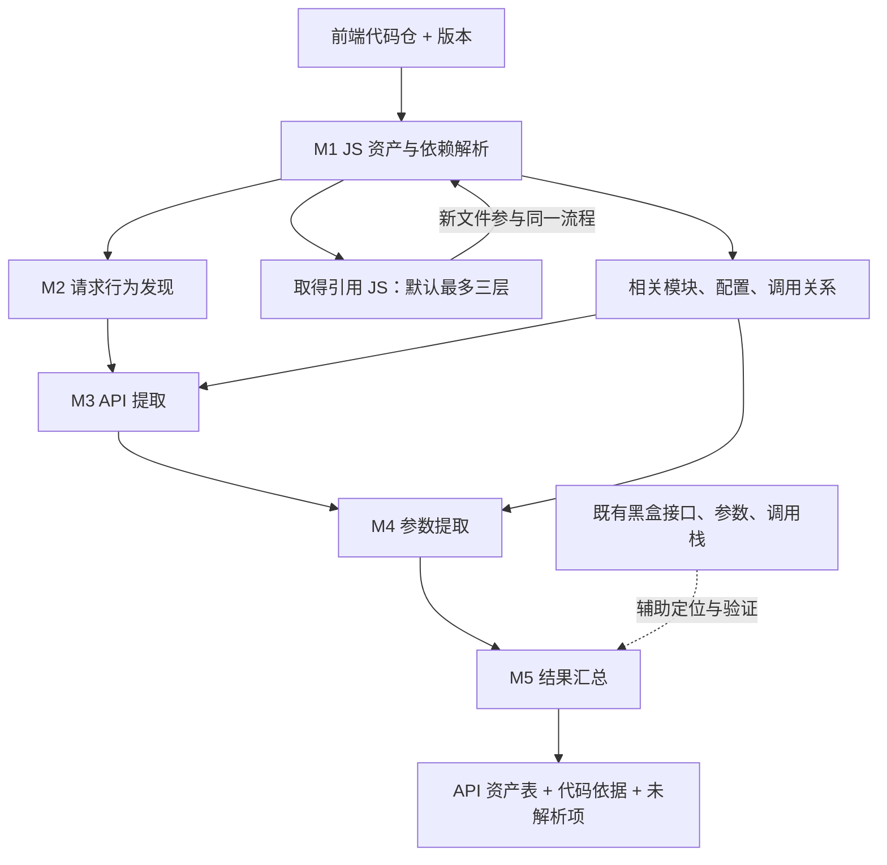
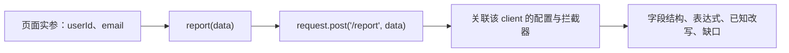

# 前端 API 与请求参数自动化提取：第一阶段方案

**输入一个前端代码仓，输出该仓库及可分析 JS 依赖中，能够识别的网络请求 API 与发送参数。** 第一阶段冻结为 M1～M5，不做 Host 筛选、敏感性识别、风险分级或合规判断。

这是轻量级 JS 请求行为分析工具，可结合 AI。调用关系围绕请求地址与参数构造按需追踪；不建设全仓通用调用图，不要求完整 Source→Sink 溯源。当前仅设计，尚未实现或测得覆盖率。

## 1. 流程与交付

仓库是必需输入；部署配置、构建产物及黑盒记录为辅助材料。Host 自然保留在 URL 中，不作为扫描入口或排除条件。相对 URL 缺基址时照样输出 Path 和参数。

首版交付工具及结构化结果；平台化、多仓调度与后续风险分析不进入本轮开发范围。

## 2. M1：JS 资产解析

识别 JS、TS、JSX/TSX、Vue 脚本、HTML 内联/引用脚本，以及第三方 SDK、动态加载与外部 JS。配置和锁文件用于定位实现，不作为独立审计对象。

**需要开发：** 文件清单、脚本提取、import/export/require 解析、模块别名解析、外部 JS 获取与依赖记录。每个文件保留仓库/Commit 或 URL/内容哈希及引用位置。

- 仓内已有 JS 为深度 0；外部 JS 获取深度默认 3，可配置。仓内函数/模块跳转不消耗这个深度。
- 只取得引用 JS 文件或使用已有同版制品；不克隆整个依赖仓、不安装整包、不执行目标代码。
- 按引用路径去重和计算深度；发现更浅路径后重新检查曾被截断的下游。
- 新取得 JS 继续进入 M2～M5，既查它独立发出的请求，也尝试关联业务对它的调用。

**主要卡点：** 动态脚本地址、包入口无法定位、缺失实现、打包/混淆模块、版本不一致。类型声明不是发送实现；拿到 JS 也不等于已连上调用关系。

**处理边界：** 能取得就分析；不能取得或解析则保留引用位置与原因。限制下载来源、重定向、大小和超时。运行脚本内容快照可作为补充，不假定现有黑盒插件已经提供。

**产出：** JS 资产清单、依赖关系、获取/解析缺口。相同内容可缓存解析结果；请求结论还需考虑配置、模块解析、调用上下文与模型版本。

## 3. M2：请求行为发现

全范围扫描可能发送数据的操作，再识别包装这些操作的函数、实例及 SDK。`request`、`track`、`report` 等名称仅是线索，不能仅凭函数名认定网络请求。

**需要开发：** 请求模式识别、API 绑定判断、客户端实例识别、封装摘要。摘要描述哪个入参提供地址、参数，以及函数内部如何调用发送 API。

| 机制 | 首版要求 | 未解决时保留什么 |
|---|---|---|
| fetch、Axios、XHR、sendBeacon | 必须提取标准用法；XHR 关联同一实例的 open/header/send | 未识别重载、实例或改写位置 |
| 自定义 Request 封装 | 支持静态可定位的常见转发、配置对象和返回 client 模式 | 封装入口、实参、断开的调用边 |
| SDK 自动请求 | 有实现且机制可识别时提取；自动初始化也参与发现 | 缺实现或未知内部发送机制 |
| WebSocket、Pixel、Form | 纳入发送行为发现，按各自载体记录 | 地址、消息或表单结构的未知部分 |

WebSocket 建连与消息发送分开，消息没有 HTTP Method 时记“不适用”；Pixel 参数在 URL 中，Form 保留 action/method 与可解析字段。Worker 是独立执行上下文，继续分析其中的发送代码。资源加载与主动接口请求保留不同类型。

**主要卡点：** 导入别名、重导出、工厂函数、全局替换、跨脚本 SDK 和同名函数误报。

**产出：** 发送点、业务调用候选、发送类型及关联实例。只有名称命中而未连到发送行为的调用单列候选，不能算已确认 API。

## 4. M3：API 提取

从发送位置反查 URL/Path/Method，连接变量、配置、baseURL 与调用参数。仅追与请求构造相关的关系，不要求枚举全仓所有函数调用。

**需要开发：** 有限表达式求值、基本跨文件绑定、实参/形参替换、返回值追踪、请求实例配置合并。输出原表达式与推导依据。

**首版必须解决：** 字面量、常量拼接、模板中的已知部分、静态配置、导入/重导出、可确定调用目标的跨文件封装。不同 client、调用者和区域分支分别保留，不能任意配对地址和参数。

**主要卡点：** 远程配置、缺页面基址、动态函数选择、发送前改写、SDK 内部地址生成。

**处理边界：** 能解析多少保留多少。例如 baseURL 未知但 Path 为 `/report`，仍输出该 API；最终地址受未知拦截器影响时同时保留初始地址和改写缺口。Method 的默认值须有对应机制模型，不能对所有调用默认 GET。

**产出：** URL 或表达式、Path、Method、条件、调用链与地址解析状态。地址未知不会阻断 M4。

## 5. M4：参数提取

提取 Query、Header、Body、路径变量、嵌套字段和数组元素结构，并回查构造这些参数所必需的变量与函数调用。

`report({userId: user.id, email: user.email})` 应得到两个字段及值表达式。只为确认字段结构时，不需要继续追 `user` 最早来自哪次接口响应，也不解释字段敏感性。

**需要开发：** 对象/数组结构提取、基本参数传递、对象展开/合并、常见序列化、请求默认值和拦截器模型。字段发现和最终写入检查一起进行。

| 场景 | 首版边界 | 超出边界的输出 |
|---|---|---|
| 跨函数、跨文件传参 | 静态可确定调用目标时，连接实参、形参和返回值 | 保留调用位置与未展开对象 |
| 对象展开/assign | 展开已知对象，按可确定顺序处理覆盖 | 未知 spread 及可能被覆盖的字段 |
| Axios 默认项、拦截器 | 关联确定实例、静态注册及可理解的字段写入/删除 | 安装条件、顺序或副作用未知时标部分 |
| SDK 自动附加字段 | 有源码且走已支持构造方式时纳入；常用 SDK 可补模型 | 不透明内部行为不猜测字段 |
| JSON、URLSearchParams、FormData | 按机制提结构，保留重复键及嵌套/数组路径 | 自定义编码、二进制载荷保留表达式 |
| 回调、队列、动态分派 | 简单可确定关系按需支持 | 复杂时序、反射、动态执行记未知 |

**主要卡点：** 对象别名、副作用、条件删除、未知 spread、自定义序列化。首版无需解决任意程序的数据流，但已发现可能影响载荷的未建模操作必须降低完整性状态。

例如 `{userId: user.id, ...extraData}`：记录已知字段 userId、extraData 的未展开部分，并指出 userId 的最终值可能被覆盖。未知 spread 不是名为 extraData 的线上参数；只有 `{payload: extraData}` 才存在真实字段 payload。

**产出：** 字段路径、载体、值表达式、构造/改写位置与未展开部分。加密前结构可作为关联说明，不能冒充网络上的独立明文字段。浏览器自动 Cookie/Referer 单列运行机制或观察，不声称静态枚举完整。

## 6. M5：结果汇总

**需要开发：** 请求记录标识、展示归并、字段差异保留、代码证据索引、未知项导出。以调用上下文保留原始结果，再按 API 建立汇总视图。

同 Path 不等于同 API；同 URL/Method 的不同调用也可能有不同参数。合并字段保留所属调用、条件和出现差异，不能把字段并集写成每次都发送的结构。

下面是展示示例，并非扫描结果。“—”表示模型范围内确认无显式字段，“?” 表示未知。

| API | Method | Query | Header | Body | 参数结构状态 |
|---|---|---|---|---|---|
| /api/user | GET | id | Authorization | — | COMPLETE_WITHIN_MODEL |
| /api/report | POST | — | Content-Type | userId、event、page | COMPLETE_WITHIN_MODEL |
| /collect | POST | — | ? | payload(*)、timestamp | PARTIAL |

`payload(*)` 表示实际字段 payload 的内部结构未展开。完整 URL/表达式、仓库与 Commit、JS 来源/版本、文件行列、调用/发送位置、条件和失败原因在详情中保留。

**地址与参数状态独立记录：**

- 地址：已解析 / 部分解析 / 未知；Host 未知可以同时有已知参数结构。
- 参数按载体记录：`COMPLETE_WITHIN_MODEL` / `PARTIAL` / `UNKNOWN`；汇总不能掩盖某个载体未知。
- `COMPLETE_WITHIN_MODEL` 仅表示已追踪路径和支持模型内结构已解析；附模型/范围，不代表所有运行时参数。字段值动态不自动使结构变为部分。

输出 `api_assets.csv` 供查看，`analysis.json` 保存调用、字段、依赖、证据和缺口关系。不能因没有提到字段就漏掉整条请求。资产缺口单独保留：未知依赖可能藏有尚未发现的 API，不能靠已发现请求的完整性状态代替。

## 7. M2～M4 的技术实现：下一轮讨论重点

建议先验证**AST/符号解析 + 有限跨过程追踪 + 请求机制模型，AI 辅助未知封装**这一候选路线。它符合轻量目标，但还未完成选型；应与 Grep+AI、CodeQL 在同一批样例上比较开发成本和提取效果。

| 能力 | 实现需要回答的问题 |
|---|---|
| 请求发现 | 如何识别真实 API 绑定、实例与封装，避免名称匹配漏报/误报？ |
| 基本调用追踪 | 如何连接导入、形参/实参、返回值，并隔离不同调用上下文？ |
| 字段还原 | 如何表达已知字段、覆盖、动态键、未展开对象及序列化？ |
| 请求机制模型 | 如何描述 Axios/XHR/SDK 的配置、状态和自动注入？ |
| 有限分析 | 如何设置节点/时间预算，命中预算后保留准确的中断原因？ |

AI 读取具体未解调用及相关定义、调用者和配置，提出关系或模型候选；经位置核验与正反例验证后复用。AI 不伪造动态值，不凭解释把 PARTIAL 升为完整。代码发送给模型的范围需符合项目允许的处理方式。

先打通“跨文件 report(data) → request.post → 字段输出”，再加入实例隔离、拦截器、未知 spread 和外部 SDK。黑盒作为已有验证输入，帮助发现遗漏，不作为扫描运行的必需前提。

材料准备、比较样例与验收见 [Checklist](白盒Checklist.md)。当前不承诺百分比覆盖；只在人工标注样本与明确代码范围内统计召回、误报、字段准确性、未解析量和成本。
