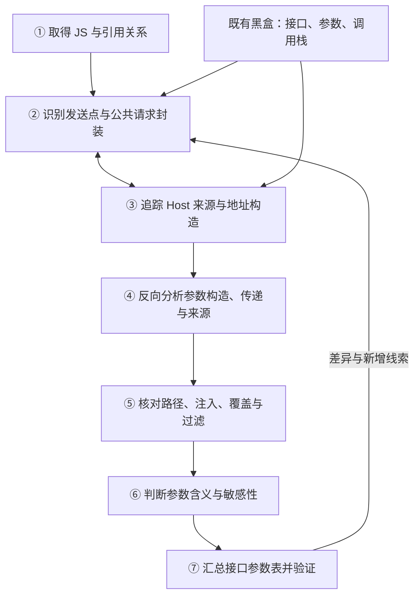
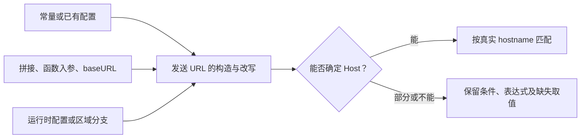

# 白盒 V1：分析流程与待验证方案

**目标：输入 Host 和一个代码仓，分析前端 JS 发往该 Host 的接口、参数、来源、含义和敏感性线索，汇总成表。** 当前只梳理方案，未开发、未选定分析引擎。

范围：本仓前端 JS 及其引用 JS；递归拉取深度默认 3、可配置，不限制仓内函数嵌套。其他代码不展开，已有配置/HTML 可辅助定位。

## 1. 整体分析流程

Host 搜索和发送点识别需要相互补充。不能提前排除“没有 Host 字符串”的文件：配置可能在 A 文件，发送实现在 B 文件。

## 2. 分阶段分析

### 2.1 JS 获取与依赖解析

找到前端 JS、导入和动态加载位置，按引用关系取得深度内的 JS。

**问题点：**

- 包名、模块别名不一定能直接定位到具体 JS；构建后的 chunk 还可能需要模块映射。
- 动态脚本地址、拉取失败或三层以外的实现，会使代码范围不完整。

**候选方法：** 静态引用提取、已有构建配置、黑盒实际脚本线索。只按文件取得引用 JS，不克隆依赖整仓；拉取后仍需解析代码关系。

**产物：** JS 集合、引用关系、实际拉取深度与缺失实现。

### 2.2 发送行为识别

识别 fetch、XHR、Beacon、请求库、公共封装和 SDK 请求改写，找到真正发送的位置。

**问题点：**

- API 可能改名、跨文件封装，或由工厂返回 client；搜函数名会漏，也会误连同名函数。
- 全局包装、实例默认配置、非 fetch 载体，可能不在业务调用处直接可见。

**候选方法：** Grep/模式检索收集线索，AST 绑定或 CodeQL API/调用关系连接实现，AI 辅助理解未知封装；需比较各自召回和适配成本。

**产物：** 发送点、请求实例/封装、业务调用位置及尚未识别的调用。

### 2.3 Host 来源与地址分析

从发送 URL 向前追 Host、路径、baseURL、配置和最后改写，判断是否指向目标 Host、在什么条件下成立。

**问题点：**

- Host 可能不以完整字符串出现，而是来自配置、环境变量、拼接或跨文件传参。
- 相对地址缺基址、远程配置缺实际值、区域分支和发送前改写，都可能导致漏报或错误匹配。

**候选方法：** 常量/表达式分析、跨文件数据流、请求库模型、已有配置快照和黑盒对照。区分“工具没追到已有值”与“源码根本没有运行值”；不能只换工具就认为后者已解决。

**产物：** 接口 Host/路径、来源依据、成立条件，或仍未确定的地址部分。

### 2.4 参数数据流分析

从 query/header/body/path 反向追踪字段构造、函数传参、对象合并及最初来源。

**问题点：**

- `uid: account.id` 的字段名已知，值可能未知；`{...payload}` 或动态键则连字段集合也可能未知，两类问题需分开。
- 对象引用/副作用、跨文件调用、闭包/回调、动态数组和编码载荷，使参数无法直接从调用入参抄出。

**候选方法：** AST 定向追踪、CodeQL 数据流/属性模型、AI 辅助封装语义、schema 或黑盒参数结构补充。先比较能提取多少可靠结构、能追到多远，不预设单一路线。

**产物：** 字段位置/路径、来源表达式、传递关系，以及未展开对象或动态部分。

### 2.5 路径有效性检查

检查前面关联出的链路是否成立，以及字段最终是否仍在发送结构中。

**问题点：**

- 同名不同对象、互斥分支可能被误拼成一条路径。
- SDK 后加字段、最后覆盖/删除、序列化过滤、重试和旧队列副本，会改变实际载荷。

**候选方法：** 对象/条件/机制模型、正反例和定向运行观察；重点比较最后写入、过滤和安装顺序的处理能力。

**产物：** 有依据的路径、被反驳的关联，以及尚未确认的条件或时序。

### 2.6 参数含义与敏感信息分析

结合字段来源、构造代码、用途和注释，解释业务含义并标注敏感性线索。

**问题点：**

- 普通名称、自由文本、字段组合可能隐藏敏感信息，仅靠关键词不够。
- token、哈希和密文不能凭名字判断内部内容、关联能力或是否匿名。

**候选方法：** 字段规则、业务资料、AI 上下文解释；比较解释是否有依据、推测是否合理。AI 不补造代码里未提取出的字段。

**产物：** 参数含义、敏感类别/线索及依据；含义未知与提取不完整分别保留。

### 2.7 结果汇总与验证

一参数一行汇总，关联业务调用与发送位置，再用人工样例和已有黑盒请求核对。

**问题点：**

- 同接口不同调用可能具有不同参数和条件，直接归并会丢信息。
- 黑白盒版本错配、调用栈缺失、只展示已知字段，可能掩盖错误关联或未解析部分。

**候选方法：** 统一请求/字段结构，保留条件与原始位置；用同一组预期比较不同路线，针对真实差异补模型。

**产物：** Host、方法、接口、条件、参数位置/路径、来源、含义、敏感性线索、代码位置、未解部分。

## 3. 技术路线与下一步

保留 **Grep+AI、AST 定向分析、CodeQL 自定义查询**，以及分阶段组合方案。它们不完全互斥，也都尚未验证适合本项目。比较表见[技术路线讨论](../Temp/白盒思路.md)，具体漏点见[技术问题清单](../Temp/难点与待解问题.md)。

- [ ] 用相同的配置/动态 Host、跨文件封装和动态参数样例比较，不只测简单请求。
- [ ] 记录接口漏报/误报、字段缺失/错连、代码依据，以及模型适配和执行成本。
- [ ] 用既有黑盒请求核对，也保留白盒独立发现，避免只解释已知请求。
- [ ] 根据比较结果选择各环节的实现方法，再细化开发模块；当前不估算覆盖率。

比较题集见[Checklist](白盒Checklist.md)。
