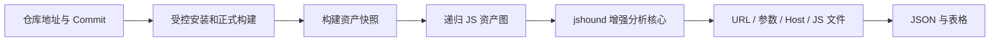

# Frontend API Extractor

输入一个前端代码仓库，固定版本并完成正式构建，从构建产物及其嵌套引用中提取：

1. URL
2. 请求参数
3. Host
4. 对应的 JS 文件

当前处于**重新设计阶段**，没有可运行版本。旧实现、测试、样例、基准和配置已经删除；历史内容仍可从 Git 记录中查看，但不会继续影响新架构。

## 目标流程

新实现以 [jshound](https://github.com/AmbitSecurity/jshound) 为分析基线，优先复用其资产发现、打包器识别、模块索引和请求恢复能力。仓库构建、源码与产物关联、精确 JS 位置、企业封装适配、静态核验和 AI 辅助由本项目补充。

## 文档

| 文档 | 内容 |
| --- | --- |
| [需求](docs/requirements.md) | 输入、四项输出、边界和完成标准 |
| [架构](docs/architecture.md) | 系统分层、数据协议、嵌套 JS 和技术选择 |
| [分析设计](docs/analysis.md) | Host、URL、参数、封装、混淆和 AI 的处理方法 |
| [测试与验收](docs/testing.md) | 样本、指标、性能和发布门槛 |
| [实施计划](docs/plan.md) | 分阶段 Checklist；实现并验证后才打勾 |

实现开始前，需求、架构、分析设计和第一批冻结测试输入必须先评审完成。
