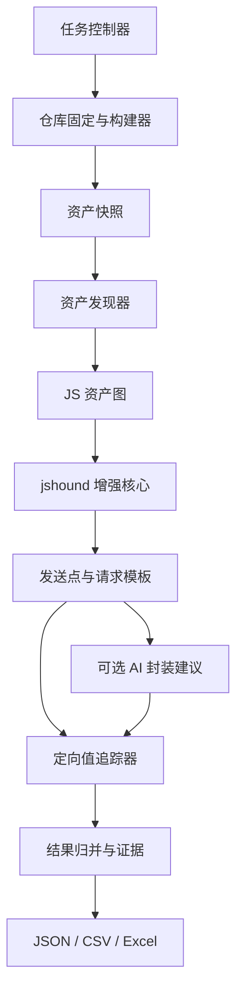

# 架构

## 1. 设计原则

- 以构建产物为交付依据，以源码和 source map 补充解释。
- 资产发现与请求值还原分离，避免为了找到深层 chunk 模拟整个应用。
- 从发送点反向追踪四项必要信息，不做无目标的全程序模拟执行。
- 复用 jshound 已有能力，通过可访问 fork 增强；不复制第二套解析器。
- 每个阶段使用稳定 JSON 协议，内部语言可以按效果选择。
- 简单请求优先产出，复杂请求进入有界精查队列。

## 2. 总体分层



| 模块 | 职责 | 不负责 |
| --- | --- | --- |
| 任务控制器 | 配置、阶段、进度、退出状态、缓存索引 | JS 语义 |
| 仓库与构建器 | 固定 Commit、受控安装、正式构建、日志 | 将构建失败包装成成功 |
| 资产发现器 | HTML/manifest/runtime/chunk/import/worker 引用 | 请求参数还原 |
| jshound 增强核心 | 打包器识别、模块索引、请求和封装候选 | 把所有候选视为确定接口 |
| 定向值追踪器 | URL、Host、参数和相关配置的反向数据流 | 模拟完整页面生命周期 |
| 结果层 | 身份、证据、未知、去重、表格 | 猜测缺失值 |
| AI 适配器 | 建议陌生 client/参数映射、字段释义 | 绕过静态核验直接写确定结果 |

## 3. 技术选择

第一版采用 **Python 控制层 + jshound 的 Python/Node 分析链**：

- jshound 已实现页面/目录输入、Webpack/Vite 等 chunk 发现、跨文件模块索引、wrapper 收集及请求结构输出。
- Python 负责仓库任务、构建、资产队列、缓存和结果编排，减少重复跨语言封装。
- Node/Babel 继续承担 JavaScript AST 解析与 jshound 静态分析。
- 暂不引入 Go/Rust；只有剖析证明独立热点且协议稳定后再考虑。

增强代码维护在可访问的 jshound fork，固定上游 Commit、补丁 Commit 和许可证。主仓库通过子模块或明确版本依赖引用，不内嵌修改后的第三方源码。

## 4. 资产图

资产节点使用 `source + canonical URL/path + content hash` 标识。内容相同可以共享解析结果，但不同 URL、构建归属和父链不能丢失。

发现队列的种子包括：

- 构建目录全部 `.js/.mjs/.cjs`；
- HTML 的 script/modulepreload；
- manifest、service worker 清单和打包 runtime；
- source map 中关联的生成资产。

每条边记录父资产、子引用、类型、源码位置、解析基址、深度和状态。工作队列持续到没有新资产或达到明确的文件、字节、网络、时间边界。循环和重复只复用分析，不重复抓取。

获取深度、打包器内部模块层数、函数追踪深度是三个独立概念，分别统计。动态表达式无法求值时保存未解决边及其父资产。

## 5. 分阶段数据协议

核心对象保持少而稳定：

```text
Task       仓库、Commit、构建配置、阶段状态
Asset      JS 身份、哈希、来源、source map、解析状态
AssetEdge  父子引用、类型、位置、状态
SendSite   发送机制、JS 位置、绑定和候选置信度
Request    URL、Host、方法、参数载体、条件和阶段
Gap        失败/未知原因、影响对象和证据
```

内部状态不能借用可能与业务字段冲突的字符串键。候选 ID、发送点 ID、请求变体 ID 和 API 分组 ID 分开；缺少行列时不能伪造调用点身份。

## 6. 缓存和性能

- 资产内容哈希缓存解析与模块索引。
- 函数摘要键包含代码版本、绑定、参数抽象值、this、相关闭包/实例/hook 状态和模型版本。
- 摘要保存返回值、相关字段写集、请求模板和未知副作用；复用时重新关联当前调用位置。
- 入口只决定可达性和业务归属，共享依赖不按入口重新完整解析。
- 预算使用墙钟时间、峰值内存、资产/字节和精查任务数；旧式 AST 步数只作为内部诊断。

## 7. 失败与退出状态

至少区分：构建失败、资产收集不完整、解析失败、分析超限、没有发送点、存在候选但四项不完整、成功产生可用结果。CLI 和 CI 可按所需完整性选择是否放行，不能统一返回 0。
