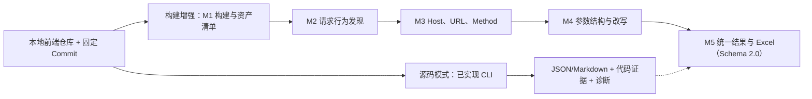

# 前端代码仓JS请求API采集

> 历史记录：保留当时方案、能力与验证，不作为当前进度或能力承诺。当前见[需求](../../goal.md)和[开发计划](../../plan.md)。

**扫描固定版本的前端代码仓，提取 API、参数与代码证据；需要部署环境和产物关联时，再显式选择构建增强模式。** 源码模式已有 [frontend-api-extractor CLI](../../../README.md)，另有 npm/Docker 构建关联首版；0.9 已接统一 Schema/Excel、有限 Webpack4/5 与固定 SDK 模型；完整产物/SDK 恢复仍有限，见[当前验证](../releases/release-0.9.md)。

## 0. 已加入的源码 API 提取能力

调用者将仓库检出到目标 Commit，向 CLI 提供本地路径；它不自动克隆或校验 Commit，不以目标构建成功为前提。支持 JS/TS/JSX/TSX、Vue/Svelte 脚本、ESM/基础 CommonJS、fetch/axios/ofetch/ky 及显式声明的客户端；沿必要的导入、函数封装和参数继续追踪到请求位置。

```bash
cd frontend-api-extractor
npm ci
node src/cli.js /path/to/frontend --out reports/apis.json
```

| 配置维度 | 用途 |
| --- | --- |
| entries/include/exclude | 选择入口与可用于解析的源码文件；未指定 entries 时按库存模式扫描 |
| layers | 自定义页面、hook、service、transport 等语义标注，不按固定目录截断调用链 |
| aliases/clients | 路径别名和无法进入实现的 HTTP 客户端声明 |
| maxDepth/maxSteps/maxCandidates | 分别约束调用深度、求值步数和条件候选/路径数量，与外部 JS 下载层数无关 |

当前 JSON/Markdown 保留 method、url、query、body、headers、调用链、源码行列、conditions 与 diagnostics。它是静态候选，不表示网络上实际发送，也尚未转换为项目统一 analysis.json/Excel。普通类实例工厂、拦截器和复杂页面控制流仍有缺口；源码解析失败、未知依赖或预算耗尽都必须保留。

70 项自动化测试和指定真实源码范围的试跑见[测试说明](../validation/testing-through-0.10.md)与[外部仓库链接/结果](../validation/alibaba-real-world.md)。外部仓库、依赖和扫描产物不纳入 Git。后续统一任务前端接入仓库版本、扫描配置、接口/参数列表、代码证据与诊断导出；当前 CLI 已可独立运行。

分段 URL、隐藏 Host、分散参数和后续 hook 的本轮核查与保守处理见[白盒复杂 JS 分析](../../internals/analysis/complex-js.md)。

## 1. 输入、流程与边界

源码模式的必需材料是本地固定版本代码及所需的扫描配置。构建增强模式另需锁文件、目标环境配置和正式构建命令；私有包凭据、代码生成输入和依赖服务替身也属于该模式输入。构建增强以构建成功为前提；失败时输出日志并终止该模式，不静默切换为源码成功。两种模式的结果和缺口分别记录。



只追还原请求和参数所需的关系，不建设全仓通用调用图，不做完整 Source→Sink 溯源。源码模式直接使用 AST 与必要跨文件追踪；构建增强优先从产物恢复请求，再借助 source map 和源码补充位置。插件和外部网站不是白盒运行前提。

以下 M1～M5 是构建增强与统一交付的目标规格，不代表当前源码 CLI 已实现全部机制。若项目提供本地预览，可在隔离环境中用于加载静态资源和观察启动流量。

## 2. M1：构建与 JS 资产解析

**动作：** 在固定 Commit 上按锁文件安装依赖，注入目标环境配置，执行代码生成和正式构建；随后清点源码、构建产物、chunk、source map、内联脚本和直接外部 JS/SDK。

**开发内容：** 可重复构建记录、源码与产物哈希、source map 映射、chunk/模块关系、外部脚本引用链及工具输入清单。

| 层级 | 处理 |
|---|---|
| 第 0 层：仓库源码和本次构建产物 | 全量纳入；仓内跨文件和构建生成 chunk 不消耗外部获取深度 |
| 第 1 层：页面/产物直接引用的外部 JS/SDK 文件 | 获取实际文件并分析其独立发送及与业务调用的关系 |
| 第 2 层及以后：第一层文件继续引用的代码 | 暂不获取；登记引用目标/表达式、父文件位置、跳过原因和可能影响 |

`max_js_fetch_depth = 1` 只约束构建后另行获取的外部脚本资产，不限制包管理器按锁文件安装完整构建依赖，也不限制构建器生成的内部 chunk。不同直接外部引用均可属于第一层；第一层脚本继续动态引用的外部文件只登记，不再获取。

**问题与边界：** 构建使用项目锁定版本，不自行升级或补猜配置。构建脚本在隔离环境运行并记录网络、副作用和制品；分析阶段不执行产物业务逻辑、不主动访问提取出的 API。外部 SDK 将发送委托给第二层脚本时，保留调用线索和超深度缺口。

**产出：** 构建命令、环境标识、锁文件哈希、制品清单、源码/产物/source map 对应关系、外部引用链及构建/获取/解析日志。

## 3. M2：请求行为发现

**动作：** 找出发送操作，识别其 API 绑定、实例和可静态定位的封装。函数名 `request`、`report`、`track` 仅是线索。

**开发内容：** 发送机制模型、实例关联、导入绑定、封装摘要及有限调用追踪。

| 机制 | 首版分析目标 | 未解决时 |
|---|---|---|
| fetch、Axios、XHR、Beacon | 标准用法、实例与配置；XHR 的 open/header/send 关联同一实例 | 标记未支持重载、未知实例或改写 |
| 自定义封装 | 可确定目标的转发、配置对象与返回 client 模式 | 保留入口、实参和断开的调用关系 |
| SDK | 取得实现且机制受支持时，提取独立发送和业务关联调用 | 缺实现或机制未知单列候选 |
| WebSocket、Pixel、Form | 纳入发送发现，按机制区分连接/消息、URL 参数和表单字段 | 不强行套成 HTTP JSON 请求 |

**问题与边界：** 工厂、重导出、同名函数、全局替换、复杂动态分派可能无法确定；Worker 保留独立执行上下文。URL 字符串命中与未定位发送实现的调用单列待确认候选。

**产出：** 发送点、业务调用点、机制、实例、条件、发现依据和未确认原因。Host 不作为排除条件。

## 4. M3：地址与方法提取

**动作：** 从发送点连接常量、配置、baseURL 和调用参数，恢复 Host、URL/表达式、Path、Method。

**开发内容：** 有限表达式求值、跨文件绑定、实参/形参替换、返回值追踪、实例默认项及已知改写分析。

**问题与边界：**

- 支持字面量、已知拼接、模板中的已知部分和可读静态配置；不同 client、分支及调用者分开处理。
- `process.env`、`import.meta.env`、别名、条件编译和代码生成优先采用本次构建的真实替换结果，并回指对应配置。
- 缺基址时仍保留 Path；不把 SDK 下载域名当请求 Host，不用源码文件路径代替页面 URL。
- 未知拦截器可能改写地址时保留初始表达式与缺口；Method 默认值必须有机制依据。

**产出：** 地址各已知部分、方法、推导依据、适用配置/条件及解析状态。地址未知不阻断参数分析。

## 5. M4：参数提取

**动作：** 提取 Query、Header、Body、路径变量与消息字段，追踪必要的构造、传参、覆盖、删除及序列化。

**开发内容：** 对象/数组结构、基本跨过程传参、spread/assign、请求默认项、拦截器及常见序列化模型。

| 场景 | 处理原则 |
|---|---|
| 跨文件 `report(data) → client.post` | 连接调用方对象、形参和发送点；隔离不同调用者 |
| 已知对象展开/合并 | 按可确定顺序处理覆盖 |
| 未知 spread、动态键、别名副作用 | 保留已知字段和未展开表达式，注明可能覆盖/增删 |
| 拦截器与 SDK 附加字段 | 仅纳入确定实例、可理解注册顺序与实现；其余降级 |
| JSON、URLSearchParams、FormData | 保留嵌套、数组与重复键；考虑序列化过滤 |
| 自定义编码、加密、复杂回调 | 保留表达式和未支持操作；加密前结构仅作关联说明 |

**问题与边界：** 字段曾被构造，不等于最终一定发送。`{userId: user.id, ...extra}` 中 extra 是未知展开部分，不是名为 extra 的网络字段；userId 可能被覆盖。浏览器自动 Cookie/Referer 不声称能由源码完整枚举。

示例：源码调用 `client.post('/report', {userId: user.id})`，构建产物中 client 的 `baseURL` 已替换为目标环境地址时，可联合两边记录最终地址、源码字段和产物依据。运行时仍可能注入的 Header 或拦截器继续按证据标记部分，不把调用参数直接冒充最终网络载荷。

**产出：** 载体、字段路径、值表达式、构造/发送阶段、条件、改写位置及未知部分。字段值动态不自动代表结构未知。

## 6. M5：汇总与交付

每个静态请求调用上下文独立保留；同 API 的调用可以关联，不能把字段并集当每次载荷。缺依赖可能隐藏尚未发现的请求，因此资产缺口独立输出。

统一使用“仓库静态”证据类型，并保留 Commit、文件行列、调用/发送位置和模型范围。Excel、JSON 与完整性语义集中见[交付约定](../../../../docs/delivery.md)。

## 7. 候选路线与遗留问题

首轮优先验证两条成熟路径：用 jshound 分析本地构建目录及 chunk，用 Vespasian 对本地预览或导入流量执行捕获与 JS 静态补漏；再用 CodeQL/Joern 对源码位置、封装和跨文件字段做差异补充。AI 可辅助解释未知封装，但需代码位置和正反例验证。

第一层 SDK 内部依赖、运行时远程配置、复杂副作用和不透明 SDK 仍是遗留点。与网站 JS 分析共享哪些能力，按[验证计划](../../../../docs/validation.md)对照决定；成熟项目和候选组件见[工具评估](../../../../references/README.md)。

## 0.8 构建关联首版进展

新 repository CLI 可从公开 GitHub HTTPS 地址固定版本、按 npm 锁文件安装、在 Docker 执行构建，并关联 source map 应用源码与产物请求位置，输出 CSV/Markdown 和任务底稿。已实际跑通引用阿里云 JS 组件的 GDB Console，见[完整表格](../validation/gdb-build-pilot.md)。其余构建模式目标规格仍不等于已全部实现：远程 JS 获取、通用打包 runtime、SDK HTTP、AI 与统一 Excel 继续留缺口。
