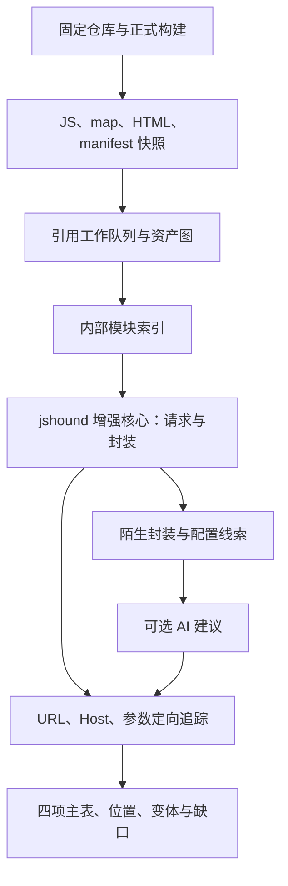

# 技术设计

状态：重构目标已确认，增强核心尚未实现。0.10.0 构建分析仍使用旧分析器；源码 CLI 的 jshound/hybrid 是过渡集成。任务见[开发计划](plan.md)。

## 分工

保留仓库任务、受控构建和交付，以 **jshound 为基础的增强核心**逐步替换旧的逐入口分析。重点是嵌套资产覆盖、绑定与封装还原、精确位置和可控成本，不长期叠加两套重叠引擎。

## 嵌套 JS：资产发现与请求还原分开

### 资产文件图

种子来自构建目录全部 JS，以及产物 HTML、manifest、runtime 中可识别引用。工作队列处理 import/export、动态 import、Worker/importScripts 和已支持打包器的 chunk 表；发现新资产后继续入队。深层 chunk 可以直接分析，无须先模拟入口执行到该文件。

每条边记录父资产、子路径/表达式、引用类型、位置、获取深度和状态。仓内引用核验真实路径；远程地址按引用上下文解析。身份包含来源/路径及内容哈希，相同内容复用分析但保留各 URL/上下文的归属。循环和重复访问不重新下载/分析。

本地遍历与远程获取分别限额。现状：源码模式不下载外链，独立网站收集最多 3 层，build 收集模式最多 1 层，且没有自动接入仓库构建。新流程拟接统一队列，外取深度与访问范围显式配置，默认值经验证确定；不冒充已支持任意深度。

### 打包内部模块图

Webpack module ID/require/chunk loader、Vite/Rollup ESM 等由适配器转换为模块关系。获取深度、内部模块层数、函数追踪深度分别记录。未知 runtime、动态 chunk 名和缺文件形成缺口，不静默丢弃。

### source map 按资产补充

逐资产选择有效映射、内部模块或原始 JS 分析；部分映射也要覆盖剩余内容，修复 A05 的全局互斥选择。源码/产物保留版本与映射依据，一份 map 不能让其他无 map chunk 退出分析。

原始字节和规范化解析输入分别保存哈希；临时路径使用唯一资产 ID，避免 A02 的 Vue/JS 重名覆盖。

## 从发送点追踪必要信息

1. 请求 API/配置形态、导入绑定、客户端实例和模型共同提供发送点；承接用户客户端规则和显式入口。
2. 建共享索引：导出、常量、配置、客户端默认项和函数摘要；保留 AST 节点位置。
3. 只围绕 URL、Host、方法及 Query/Body/Header 追踪相关定义，先处理常量、拼接、对象字段、有限合并和序列化。
4. 封装摘要描述实参如何进入请求、默认配置、条件及字段写集，避免每个页面重复展开依赖。
5. 副作用、hook、闭包及未知调用按受影响字段降级；地址与载体状态、构造处与 hook 后结果分别保存。

jshound 提供识别、索引、客户端与封装恢复基础，其名称启发式和字段归并需要约束，见[开源核对](internals/research/jshound.md)。外部候选不直接升级为确定接口，单一发现器不作为精查的排他门禁。

摘要键考虑模块版本、绑定、实参抽象值、this、相关闭包/配置/hook；只用 AST 节点不安全。复用时重新关联当前调用位置，防止字段串线。不要求模拟完整页面生命周期。

## AI 的位置

给 AI 提供陌生封装及必要定义/配置，要求结构化建议，如客户端参数映射、待追踪字段及字段释义。绑定/AST/模型核验后才参与结果，保留来源；无法验证则待核验，不凭名称补造 Host、URL 和字段。

现有适配器只做字段释义，封装识别尚未实现。无 AI 时基础四项提取仍可独立运行。

## 语言与引擎维护

不限定语言，也不要求为重构更换语言。按同输入的正确性、耗时、峰值内存、依赖和维护成本选择。

| 部分 | 选择原则 |
| --- | --- |
| JS 语法/请求识别 | 优先复用 jshound/Babel，避免重写解析器和已有规则 |
| 构建/收集/调度 | 比较现有 Node 与上游 Python 收集能力；可跨进程复用，统一输入/结果协议 |
| 性能热点 | 先定位，再决定是否用 Python/Go/Rust 等实现独立模块；以测量证明收益 |
| AI/交付 | 对接稳定协议，不绑定解析语言 |

正式增强维护可访问 fork，保留许可证与上游基线；增强提交先推送 fork，再更新引用。当前参考子模块仍固定原版，增强 fork 尚未创建。先对比上游完整工具与当前 worker，决定收集功能复用范围。

## 运行与替换

逻辑分构建任务、资产收集、分析核心和交付；先隔离现有接口，逐步迁移代码，不预建大量空目录。核心输入资产快照/引用关系，输出位置、四项信息、变体与缺口，外层不依赖内部语言。

共享解析和索引，简单请求先输出，复杂请求进入定向队列。分别限制文件/字节/获取、分析时间/内存及候选数；报告阶段进度、停止原因和未覆盖资产。构建耗时与提取耗时独立，求值步数不作为端到端时间上限。

旧分析器迁移期间作对照；比较同输入四项结果、误报和资源后切默认，再清理重复路径。先贯通仓库构建与四项表格，再适配网站/插件；辅助 CLI 的兼容与退出须记录。
