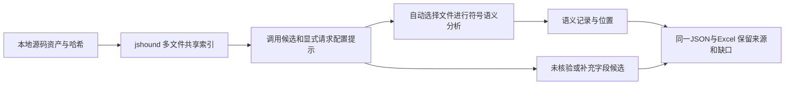

# 0.10：接入 jshound 与按请求候选定向分析

本轮根据真实业务试用反馈调整扫描流程，直接复用固定开源分析器。源码依据、论文参考和采用项见[开源方案核对](open-source-analysis.md)。构建流程、插件现场和内部仓库没有重新验收；插件保持0.7.1。

## 已落地流程



源码 CLI 新增 --engine semantic/jshound/hybrid，默认仍为 semantic。hybrid 对整个 include/exclude 输入集做索引，自动选择命中候选和显式 URL+method/type 配置的文件进行语义分析；配置形态只作选文件依据，不直接计为请求。用户显式 entries 时语义阶段遵循 entries，外部索引候选仍是独立库存，不能当作入口可达。

语义行与外部结果仅在文件、方法、URL模板对应、仅一个静态位置且字段已覆盖时归并关联。新增字段、冲突或未核验结果继续独立保留；raw.json与关联信息可回查，不将字段强塞给另一调用。关联中的 semanticRowIds 指原始报告 rows[*].id，非交付recordId。

jshound候选在Excel明确标“jshound启发式候选（未核验）”，地址/载体保持部分或未知。上游未给行列时保留null，不用文件首行替代。最终结构未知不写成“无字段”，参数值用未知标记，Query和嵌套字段独立保留。

## 固定公开项目实测

[RuoYi-Vue3](https://github.com/yangzongzhuan/RuoYi-Vue3/tree/838965c5a18d2c61b73ec30c6e288057aaa08b63)，Commit 838965c5a18d2c61b73ec30c6e288057aaa08b63。两引擎都读取160个文件，相同资产哈希集摘要 `c88c57b12153f3c879c2ef016f8cbb1fffd9b77ea3871c16aa02c4cccb8529e9`，相同别名和100000求值上限；无手工API目录筛选。第三方目标业务JS和提取出的API均未执行。

| 指标 | semantic | hybrid |
| --- | --- | --- |
| 源码输入/索引文件 | 160 | 160 |
| 语义分区 | 160 | 自动选中20 |
| 语义求值步数 | 77836 | 3298 |
| 语义预算中断分区 | 50 | 0 |
| 交付记录 | 356 | 141：130语义记录＋11外部未核验/补充字段候选 |
| 已有位置/方法/原始URL检查 | 15/15 | 15/15 |
| 已有字段名检查 | 11/11 | 11/11 |
| CLI退出码 | 3（预算未完成） | 0（索引和选中文件处理结束） |
| 统一底稿大小 | 约9.28MB | 约3.37MB |
| Excel大小 | 约471KB | 约109KB |
| 三次端到端耗时中位数 | 4169ms | 4142ms |

耗时没有显著改善，不宣称23.6倍提速。语义步数只计求值器，索引有独立CPU/文件/字节成本，externalEngine.elapsedMs与输入量单列。hybrid没有对其余140个文件进行相同的语义展开，不能把“选中分区无中断”解释为全仓语义完整；两路complete都为false。15个限定调用含7个POST，Host仍依赖运行时。141条记录不是141个经人工确认的独立API。

[小型实测摘要](../baselines/public/ruoyi-engine-comparison.json)保留三轮数值，属于development-benchmark，时间只供观察，不做跨机器精确阈值。原有15位置和11字段仍是开发回归，不当作新盲测。

## 使用和复跑

主仓库根目录先取得已确认的子模块版本，仅需这一个：

```bash
git submodule update --init --depth 1 references/repos/jshound
cd frontend-api-extractor
npm ci
node src/cli.js /path/to/frontend --engine hybrid --config /path/to/source-config.json --out ../work/hybrid/report.json
```

配置继续使用 aliases、clients、entries、scanFiles、maxDepth/maxSteps 等。缺引擎或哈希不符直接报错，不静默切回语义成功。--out仍自动生成report.json.delivery/api_assets.xlsx。输入快照、原始worker输出、日志、引擎与适配器哈希放在 report.json.engines/，保留该目录便于回查。

用固定RuoYi源码做同输入对照：

```bash
node tools/compare-indexed.mjs --source-root /path/to/fixed-ruoyi --config profiles/ruoyi-hybrid.json --manifest baselines/public/ruoyi.json --out ../work/engine-comparison --rounds 3
```

工具校验冻结源码哈希、相同完整资产集合及位置/方法/URL/字段检查，输出comparison.json和每轮原始报告/Excel；明确保留退出3。未提供manifest时不宣称语义预期验证通过。

## 预算、验证和剩余项

索引单文件8MiB、合计32MiB、最多1000文件、argv256KiB、输出32MiB，worker内存上限2GiB、时限120秒。输入截断、解析错误和上游异常使coverage未完成；stderr中固定的去重说明不伪装成解析错误。maxSteps/maxDepth只约束语义阶段。处理生成的*.engines目录时自动排除，避免再次扫描输入快照。

原语义报告新增stats.functionProfile，列出调用次数、涉及入口数、最大深度和inclusiveSteps前30项。inclusive包含子调用，不能将各行相加当总步数。它用于定位热点，没有伪称通用摘要缓存已经实现。

普通测试316项通过；另8项真实固定引擎集成测试通过，包括整仓自动选文件、保留精确位置、目标代码不执行、假客户端保持未核验、Vue/TS、上游静默解析失败、type配置选文件、重复扫描不递归吸入生成物、可复跑对照命令，以及没有HTTP候选时保留已有SDK协议模型。部分测试一项覆盖多个场景。未修改上游代码或子模块指针，不把第三方代码复制进主仓库。

本轮在此公开仓库消除了混合流程的预算饥饿，并减少不相关上下文；原semantic的重复依赖/深度放大仍存在。未知SDK、超过上游模型的封装、动态加密、实时hook和页面生命周期仍有限。完整JS引用图、构建模式自动选引擎、插件UI选引擎、未解析发送点独立集合、分片合并与持久化摘要继续推进；不能把这些标成已完成。
