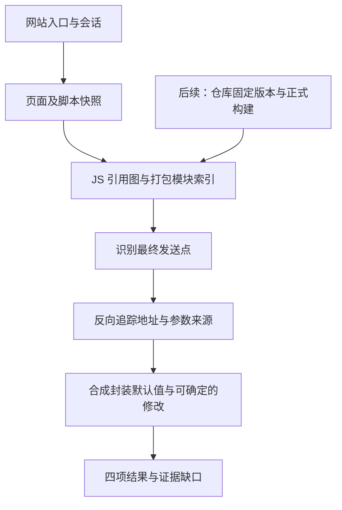

# Website JS Extractor

黑盒二：输入网站入口、访问范围和必要会话，收集部署 JS 及嵌套引用，静态提取 **URL、请求参数、Host、对应 JS 文件**，保留页面上下文、引用关系和未解析项。

当前只有设计文档，没有可运行 CLI。先验证黑盒二的 JS 分析核心，再让白盒接入仓库构建资产；浏览器插件继续独立提供实际请求证据。

## 分析路径

请求可能来自业务代码、公共库或 SDK，也可能跨多层引用和封装，并在发送前被补充或覆盖。分析不能只提取 URL 字符串，也不能只看最终发送调用的字面量。

| 维度 | 分析方式 |
| --- | --- |
| JS 引用 | 建资产图；跟踪 import、chunk、SDK 和 Worker，记录父链与缺失资产 |
| 函数封装 | 从发送点追踪实参、绑定及多层 wrapper，不按入口重复分析共享依赖 |
| 请求加工 | 按实例及可证明的顺序合成 baseURL、默认参数、字段覆盖/删除及同步 hook |
| 页面上下文 | 保存页面基址、内联配置和执行上下文；不把脚本 CDN 当作 API Host |

脚本获取深度默认三层；函数追踪深度、打包器内部模块层数分别统计，不能共用三层限制。动态加载目标、远程配置或副作用无法确定时保留部分结果和缺口。

## 与白盒的关系

共享目标是资产/模块索引、发送点识别、地址与字段追踪、封装摘要和结果协议。先以 jshound 为基线实测，不提前建立两套分析器，也不在验证前冻结共享代码目录。

白盒后续仍需独立完成固定 Commit、锁文件安装、正式构建、环境输入追溯和源码关联。网站侧可能缺脚本、缺 source map 或运行配置；黑盒二通过不代表白盒已经通过。两者用同版构建产物对照验证，结果分别保留“网站 JS 静态”和“仓库静态”来源。

## 文档

- [共享提取范围](../docs/js-analysis-scope.md)：请求场景、JS 层次、发现起点与路由位置。
- [设计](docs/design.md)：输入、获取边界、分析与输出。
- [实施计划](docs/plan.md)：下一步验证和验收门槛。
- [整体边界](../docs/overview.md)与[统一交付](../docs/delivery.md)。

不主动调用提取出的 API，不自动提交业务表单；静态发现不代表请求实际发生。外部脚本、页面快照和完整分析报告放在主仓库 `work/`。
