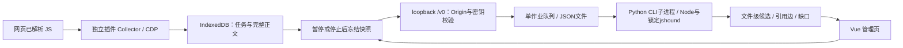

# 工程架构与后续集成设计

本文维护当前实现、组件边界和后续集成接口，不维护进度勾选。当前状态及实施批次只见[计划](plan.md)。本次只整理设计，**不改黑盒一代码、不迁移任务、不合并插件**。

## 1. 当前运行结构



实际实现不是 FastAPI/SQLite：HTTP 使用 Python 标准库；作业在显式 data-dir 的 `<job-id>/input.json`、`job.json`、`analysis.log`、`result/` 保存。分析子进程受预算与取消约束，服务不启用 HTTP 补取，不执行输入 JS。原型重启将未完成作业标 interrupted，不保证服务崩溃后的完整进程恢复。

管理页通过后台消息控制采集；当前也会直接读取同扩展 IndexedDB 的脚本和快照。未来持久化抽象可以收口读取，但不把尚不存在的分页/数据库层当当前实现。

## 2. 当前目录与入口

```text
website-js-extractor/
  extension/                         # npm工程、锁文件、构建与浏览器检查
    src/background.ts                # 消息、目标事件与采集生命周期
    src/capture.ts                   # Collector：独占attach、读取、预算与排空
    src/store.ts                     # IndexedDB任务、正文和快照
    src/client.ts                    # 本机请求与JSON下载
    src/model.ts                     # 原型TS对象与采集上限
    src/App.vue                      # 任务、源码、候选和详情
    tests/
  pyproject.toml                     # 唯一Python包与命令入口
  src/website_js_extractor/
    cli.py / capture.py              # CLI与浏览器冻结输入校验
    service.py                       # /v0、配对校验、持久作业与取消
    assets.py / collection.py        # 资产/上下文与引用图
    engine.py / worker.py            # 固定引擎子进程与原始记录
    references.js / results.py       # AST引用发现、候选与预览导出
  tests/
  docs/
```

可执行入口：`website-js-extractor analyze`、`python -m website_js_extractor serve`，以及 extension 的 build/test/test:cdp/test:ui/test:mv3。准确参数、依赖安装和运行目录只在[使用说明](plugin.md)维护，不发布不存在的 doctor/import/config 命令。

Python 当前最低 3.10；核心要求 Node 18+，插件构建要求 Node 20.19 或 22.12+ 的受支持版本，版本范围以 pyproject/package 为准。Node/Babel 从锁定 jshound 使用，固定 Commit `f34f9c5dcfa0f30816a66881ea9a8d8573c24f05`。增强 fork 尚未接入，不将上游固定版称为已增强 fork。

## 3. 职责和预算来源

| 组件 | 负责 | 不承担 |
| --- | --- | --- |
| 浏览器插件 | 目标、执行上下文、完整源码、持久快照、后续资源补抓及结果视图 | 执行下载 JS、探测 API、在浏览器重写另一套 Babel 核心 |
| 本机服务 | 输入校验、配对、作业隔离/取消、结果与未来导出 | 登录接管、替插件联网补抓、将候选确认为发送事实 |
| Python/Node分析核心 | 对固定正文构图、离线分析、保留原始记录和缺口 | 借浏览器流量次数填静态统计、跨版本猜关联 |
| CLI | 核心调试、固定快照重放、显式受控补取实验 | 取代插件主交付或成为服务隐式联网入口 |

预算有不同口径，不能把某层上限当作全链性能承诺：原型插件/服务的实际值只在[协议](protocol.md#原型预算来源)登记；CLI 参数见[使用说明](plugin.md#命令行调试与重放)；扩大预算需目标机器实测。未落地的容量设想不作为默认配置。

## 4. 后续产品增强边界

以下均为目标，未作为当前事实：统一机器校验 schema、正式 /v1、分块幂等续传、分页、SQLite/内容对象存储、正式 Excel、位置和绑定事实层、增强 fork 与 Windows 发行。只有出现明确容量/兼容需求时才决定是否引入 FastAPI/Pydantic/SQLite；不为换框架重建第二套分析核心。

冻结发现快照 R0→核心返回确定引用→插件验证范围/重定向/深度/预算并补抓→新快照 R1，是后续引用闭环；分析阶段仅处理已接收正文，不自主访问站点或调用业务API。分析和补抓不得修改正在分析的快照。source map 仅附加源码证据，规则见[分析设计](analysis-design.md)。

## 5. 黑盒一集成方案（仅设计）

### 5.1 落点与保留边界

集成目标是在 `browser-extension/` 的同一插件中提供“真实请求”“JS 静态分析”功能。现有 Recorder、请求库和导出保持语义；Node/Python 仍在本工程，不打包进扩展。旧 StaticExplorer 的历史结果只读兼容，不复活删除的后端或复用旧 URL 协议冒充新功能。

| 现有位置 | 后续改造 | 必须保留 |
| --- | --- | --- |
| 黑盒一 `background.ts` 的目标附加、事件队列与控制 | 抽取 `session-broker.ts`，先只供 Recorder 使用 | 当前标签页范围、故障隔离、请求排空、正常/意外分离区分 |
| 黑盒一 `recorder.ts` / `stack.ts` | 注入共享会话命令与事件适配器 | 请求/重定向/调用栈关联、Filter、字段选项、保存和导出 |
| 黑盒一 `capture-scripts.ts` / 旧 capture_scripts 消息 | 新功能不再走旧独占取源路径；需要保留的运行按钮改走 Broker，历史导入只读 | 不通过 Runtime 探测或另一条 attach 路径绕过租约 |
| 本工程 `capture.ts` | 改造成脚本消费者，通过租约订阅，不直接 attach/detach | 完整正文、上下文、哈希、预算、中断和快照语义 |
| 黑盒一 `App.vue` | 新增 `StaticAnalysis.vue` 及客户端适配，替换旧功能入口的运行路径 | 真实请求列表/右侧详情与历史数据可用 |
| 本工程 `store.ts` / `client.ts` | 在宿主新增静态数据仓与 `static-client.ts` | 两类证据分开、快照不变、令牌不进任务/导出 |

以上新文件名均为建议落点，不是已有代码或要求立即创建的目录。

### 5.2 共享会话接口与唯一所有者

未来只允许 SessionBroker 调用 chrome.debugger.attach/detach、配置自动附加和注册底层 debugger 监听器。Recorder 与脚本消费者只能通过适配器申请能力；每个根 tab 同时最多一次附加。子 session 继承根连接的所有权，但单独维护能力、代次与订阅。

建议接口语义如下，正式类型在实施时与测试一起落地，**当前并无此接口**：

```ts
type Consumer = 'traffic' | 'scripts';
interface Lease { id: string; consumer: Consumer; featureTaskId: string;
  tabId: number; connectionEpoch: string; }
interface SessionRef { tabId: number; sessionId?: string; sessionEpoch: string; }
interface DrainResult { brokerEpoch: string; cutoffSeq: number; drained: boolean; }
interface SessionBroker {
  acquire(consumer: Consumer, featureTaskId: string, tabId: number,
          profile: CapabilityProfile): Promise<Lease>;
  subscribe(lease: Lease, listener: (event: SessionEvent) => Promise<void>): () => void;
  command(lease: Lease, source: SessionRef, method: string, params: object): Promise<unknown>;
  release(lease: Lease, options: { drainMs: number }): Promise<DrainResult>;
}
```

`CapabilityProfile` 声明事件白名单、Network/Runtime/Debugger、异步栈深度、正文读取与子目标需求；SessionEvent 携带 brokerEpoch、connectionEpoch、sessionEpoch、seq、tab/session、上下文/导航关联、method 和原参数。子目标命令显式传 SessionRef，不能只凭 scriptId/requestId 猜会话；Broker验证它属于租约的根连接及当前子会话代次。命令需校验租约、当前会话代次及允许方法；普通消费者不得调用 attach/detach、重新设置自动附加或覆盖其他消费者的 domain 配置。只开放所需的只读取源/取正文/取栈等命令；Runtime.evaluate、业务导航/请求重放不在白名单内。

| 情形 | Broker 规则 |
| --- | --- |
| 两种功能同时运行 | 合并所需能力，只有首次申请时附加；第二次申请复用连接并得到独立租约 |
| Debugger/异步栈能力交集 | Debugger启用前确保跳过暂停，不设断点、不暂停业务；栈深度取有界最大需求，不因停止另一消费者重置已有 debuggerId |
| 某功能不需要 Network/Debugger | 不擅自 disable 其他消费者所需 domain；不兼容配置返回明确能力冲突，不能后申请覆盖前申请 |
| DevTools/其他扩展占用 | 返回连接缺口，不分离或夺取对方连接 |
| 最后一个租约释放 | 等受限在途读取排空后才 detach；重复 release 幂等；过期租约不能操作新连接 |

release 将该租约置为 closing，固定 cutoffSeq，停止新事件并有界等待此前事件处理/已登记读取；结果返回是否排空。冻结方还必须等待自身 IndexedDB 提交屏障，超时保存缺口，并用租约/截止点阻止晚到结果写入旧快照。剩余消费者的事件继续分发；只有最后一个租约完成释放才物理分离。

订阅之间不能互相阻塞：按消费者使用有界队列；某队列满只降级/暂停该消费者并记缺口，不丢弃另一队列事件或静默截断正文。若共享进程/存储本身失败，则向所有受影响租约报告同一中断。

### 5.3 生命周期、代次和失败

| 操作 | 请求消费者 | 脚本消费者 / 共享会话 |
| --- | --- | --- |
| 暂停/停止真实请求 | 停止接收该功能的新记录，有界排空原在途请求并释放自身租约 | 脚本仍运行则保持连接；不能被 Recorder 的原 detach 路径关闭 |
| 暂停/停止脚本收集 | 真实请求照常继续，未结束请求不受影响 | 截止订阅、有界排空已接收源码；若请求冻结则保存该截止点快照，再释放自身租约 |
| 取消静态分析 | 无影响 | 只取消指定服务作业，不停止浏览器采集、不删除快照 |
| 导航、子目标创建/关闭 | 保留原请求/hop归属；新文档获得新上下文 | 每个目标/执行上下文带代次；父子事件先路由后分发，不把新页面配置套到旧源码 |
| 意外分离、标签关闭、后台重启 | 按现有规则保留未完成请求与中断区间 | 影响到的两类任务分别记缺口；旧租约失效，不自动把旧任务标为已恢复 |

Broker 分别维护根连接 connectionEpoch、子会话 sessionEpoch 与事件序号，快照截止点为 `(brokerEpoch, seq)`；重启生成新 epoch，不能复用旧租约。导航后仍到达的已知 requestId/scriptId 事件按已记录的关联路由到原观察代次，不能仅按“收到事件时最新导航”重写归属；无法关联则记未知。source ID 包含根 tab、子 session 与连接代次，避免跨目标 ID 撞车。

### 5.4 任务、数据、界面与权限

宿主入口可启动“真实请求”“JS 静态分析”或两者；功能任务分别有 ID/状态，通过宿主任务关联，不把一个暂停布尔值共享给两条链。旧 Scan 缺少模式字段时维持原模式与范围，不自动启用静态分析、不扩采集页范围。新静态消息使用独立命名空间（如 static:start/static:freeze），携带版本、requestId 和 featureTaskId；校验发送者与当前功能任务，不能把旧 start/pause/stop 消息误发给另一条链。状态查询不等待长时间附加/排空；共享串行队列只协调连接/能力变更，不让一个功能控制队列堵住另一个。

静态数据建议先使用宿主扩展内独立 IndexedDB 数据库，保持现有请求库 `js-security-recorder` 版本 2 不变；不做破坏性 schema 迁移。正文内容可按哈希去重，但观察、上下文和版本不可合并。原独立插件的 IndexedDB 隔离于另一个扩展 Origin，**不能假定直接读取**：只提供用户主动导出、校验后导入的迁移路径，原数据不删除。

管理页保留两个明确视图，右侧分别展示请求实测或静态候选证据。按 URL/Host 搜索可以关联展示，但实测次数、静态候选数和正式接口组数不相加。静态分析的服务不可用时，请求采集照常运行，静态正文仍可保存和导出。原请求 Filter/字段选择只作用于实测留存，不能裁剪静态依赖；补抓来源范围与候选 API Host 过滤分开。旧请求导出保持原格式，未来组合包通过独立清单关联两类结果，不把静态记录塞进实测次数。

新分析服务配置与真实请求转存/SLS配置分开，不能复用转存URL或凭证把源码发往错误接收端。集成后需使用黑盒一的扩展 ID 重新配置服务 Origin/配对；旧插件密钥和旧服务配置不自动移植。核对宿主现有 optional_host_permissions，以用户操作触发所需 loopback 授权，不扩大无关站点权限。权限拒绝只影响该服务功能，不停止实测采集。

### 5.5 工作包、验收和回退

| 包 | 前置与实施动作（以后执行） | 必须提供的证据 |
| --- | --- | --- |
| I1 会话层抽取 | 建 Broker 适配器，先只迁移 Recorder；默认功能行为不变 | 黑盒一现有构建/请求/保存/恢复/导出/调用栈回归，且没有第二条 attach 路径 |
| I2 双消费者 | 脚本消费者迁入，独立租约/排空/代次；默认关闭新功能 | 单独/同时运行，分别暂停/停止、导航、队列满、子目标失败、意外分离的状态和调用次数 |
| I3 数据与 UI | 静态仓、导入校验、新服务客户端和工作台接入 | 旧任务/原范围不变，导入损坏/版本冲突拒绝，服务重启/断线及权限拒绝不损坏请求数据 |
| I4 现场与启用 | 允许加载扩展的 Chrome 上跑完整组合矩阵 | 实际 OS/Chrome/扩展版本、快照/日志/导出；声明支持范围后才默认启用 |

组合矩阵见[测试规则](testing.md#3-后续集成验收)。失败时先关闭新功能，保留静态快照和请求数据；不能通过卸载扩展、删库或重置旧任务回退。涉及数据库结构变更时另行设计可恢复迁移；代码回退前验证旧版本能读现有数据。**本轮不进行 I1–I4 的代码改动或开关上线。**

## 6. 持续采集与远端处理目标（未实现）

2026-11-02 的后续讨论明确：插件持续收集、增量发送正文与加载证据，远端承担存储与分析；网页和脚本增长不应要求浏览器保留所有正文或先停止才能分析。下列是待实现约束，不是当前 localhost /v0 能力；本轮仍不集成黑盒一。

### 6.1 正文、观察与加载证据分开

| 对象 | 至少保留 | 去重/关联规则 |
| --- | --- | --- |
| Content | 表示类型、编码、完整字节长度、SHA256、正文 | 在已授权项目范围内按完整正文哈希存一份；URL和文件名不是内容身份 |
| ScriptObservation | 独立ID、采集端/任务、tab/frame/target、连接/导航/执行上下文代次、URL、scriptId、时间、表示来源、contentHash | 相同正文在不同页面/版本/加载发生中仍保留观察；不以正文去重丢调用来源 |
| JSLoadRequest | 所属会话与代次、requestId、重定向hop、loaderId/frameId、原/最终URL、方法、状态/MIME、时间、cache/SW来源、失败 | 请求键包含会话/连接代次+requestId+hop，不能用裸requestId跨目标关联 |
| LoadInitiator / Stack | 原始initiator类型、来源URL/位置、父请求/脚本引用、可得同步栈和异步父链及其来源 | 保留原证据、解析状态及缺失原因；相同栈可去重存储，观察仍独立引用 |
| AssetEdge / Gap | 父子观察、static_import/runtime_initiator等依据、位置、深度依据、未取得/关联歧义 | 多父边全保留；静态推断与浏览器观察不能混成确认执行 |

网络响应正文与 Debugger 源码分开标表示/哈希，不能假定字节相同。关联优先利用会话、frame/loader、URL/重定向、时序、script属性和可验证内容；CDP未给直接关联或同URL多版本时保留候选关联，不能只按URL挑一条。inline/eval/blob/cache/SW脚本可能没有独立加载请求；保留无请求观察和能证明的文档/目标关系，不制造不存在的Network记录。

### 6.2 调用栈与“第几层”

JS加载请求从 Network.requestWillBeSent 保存原始 initiator；有 stack/parent/parentId 时，趁会话有效尽早按正确 debugger/session 路由解析异步父栈（例如 Debugger.getStackTrace），不要等远端分析时才依赖已失效的浏览器ID。Debugger源码观察保留上下文、startLine/startColumn/sourceURL属性等表示依据。预算受限或源会话不可用时记partial/unavailable及原因，不用空数组表示“没有调用者”。

parser、preload、缓存或其他加载不一定有JS栈；已有网页附加前的请求也可能无法补回。调用栈只能保存浏览器提供且预算允许取得的部分，不承诺任意异步全链。JS加载触发栈说明“谁加载这个脚本”，不是该文件内每个API的发送调用栈，更不是未运行代码的动态证明。

“层数”至少分三维：静态资产引用深度D0–D3、浏览器请求initiator/父请求链、函数同步/异步栈层级。分别保存和展示；缺父链为未知，不从栈帧数推导获取深度。静态未触发API仍可由远端分析发现，跨文件解析不因有栈就自动变成精确绑定。

### 6.3 增量传输、可靠缓存与版本

1. 插件维护按字节计的读取、写盘和待传队列；正文读取尽量少并发，尚未确认的正文持久保存。大JS不能靠调大整包JSON限制解决，需完整对象分块传输并校验。
2. 建立服务/项目授权后询问Content是否存在；只上传缺失正文。存在性查询按授权项目隔离，不能作为跨项目探测接口；服务器验证完整长度/哈希并持久提交后确认。
3. 加载观察、请求、栈和边有独立事件ID、批次和序号，幂等重传、乱序可暂存待关联；正文已存在也必须提交新观察。服务先持久化再确认，不以“已收到请求”当完整保存。
4. 客户端按确认的对象/事件水位推进；确认后正文可按本地保留策略回收，未确认对象不得被LRU直接淘汰。服务离线且预算满时对新增静态收集背压/暂停并记录缺口，不能无限积压或假装无损持续。
5. 分析批次固定已提交观察/对象的引用水位，不复制所有正文、不暂停采集；未到依赖保留pending，后到父链/正文触发新修订。导出绑定某一版本，后续修订不覆盖已导出的事实。

断线恢复要核对服务身份、项目、上传对象和确认水位，不能把另一服务器的“已存在”当作当前提交成功。本地任务、远端项目和分析批次的身份分别保留。

### 6.4 远端存储和持续跨文件分析

远端保存按哈希寻址的内容对象、观察/请求/栈/边索引和依赖关系。AST缓存可由正文哈希+解析器版本/选项决定；URL/Host/参数等语义结果还需执行基址、配置/版本和调用上下文，不能按哈希全局共用。

完整文件到达即可排队解析并产出可证明的候选。依赖到达后只使受影响的模块/封装/实例摘要失效并重算；有缺失时保留表达式/缺口，不能拼接不同页面或互斥版本。现有jshound偏整批分析，需验证分批适配和增量索引；不得直接把已归并结果追加进接口总数。

服务与解析队列按任务/项目限制并发、正文/内存/时间和积压，结果分页/按需读取。扩大单文件和总量门槛前，以多MiB单包和更大唯一正文总量验证峰值内存、断传、恢复、缓存与版本隔离；相同文件重复命中缓存不等于不同大包吞吐。

### 6.5 部署与现状边界

插件可预置默认服务地址并保留配置入口，目标使用经认证的HTTPS域名；凭证不内置在安装包、不进入快照。远端会收到用户选择项目范围内的完整站点源码和加载证据，应显示实际目的服务/项目。JS请求元信息不等于默认上传所有业务请求载荷或认证头。

当前client只允许127.0.0.1，当前服务验证loopback Host、扩展Origin及本次密钥，仅接收整份capture快照；它不支持远端地址、对象上传、增量证据或持续结果。不能把现有开发HTTP监听器直接暴露公网当作远端服务；目标接入需要TLS、项目级认证/隔离、输入与资源限额、重试和持久确认设计。相同核心可部署本机作为可选形态，但普通MV3不能自行启动系统服务，自动启动需要已安装的本机配套程序，非当前实现。
