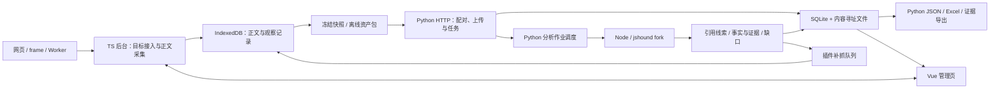

# 工程架构与技术决策

本文规定黑盒二怎样组织和运行；模块实现见[模块规格](modules.md)，采集与分析流程见[整体设计](design.md)，唯一完成状态见[实施计划](plan.md)。现有命令行和分析核心已落在同一 Python 包；以下区分当前代码与后续插件/HTTP 服务目标，不代表全部能力已有实测支持。

## 1. 要交付的产品

先交付可运行的黑盒二 Chrome MV3 插件与本机分析服务，后续将黑盒二直接集成到黑盒一插件。用户启动服务、安装插件，正常操作已登录网页，冻结取得的 JS，在本机生成 URL、参数、Host、对应 JS 文件及证据。服务不可用时，插件仍可采集并导出任务包；恢复服务后导入同一包分析，不重新下载替换正文。

| 交付物 | 内容 | 完成标准 |
| --- | --- | --- |
| 插件 ZIP | manifest、后台、管理页、图标与构建版本 | 解压加载后可采集、冻结、上传、查看和导出；关闭管理页任务仍存在 |
| 本机服务发行包 | Python 服务、锁定 Node 分析核心、依赖锁和启动/自检入口 | 按安装说明可启动、自检和处理离线包，无需修改源码 |
| 任务资产包 | 版本化 manifest、上下文、完整正文、引用和缺口 | 可校验、导入并重复分析；不含配对凭证 |
| 分析交付 | analysis.json、api_assets.xlsx、证据资产包 | 每个确定字段可关联固定正文和位置；失败、候选和未知可区分 |
| 使用与验收材料 | 安装、启动、恢复、升级、边界和样本配置 | 另一台目标机器可按步骤复现限定范围结果 |

首发运行组合暂定 Windows 11 x64 桌面 Chrome 125+；最低 API 基线不等于所有 Chrome 版本已验收，发布注明实际测试版本。Linux 用于开发和自动化，不能替代 Windows MV3 现场验收。跨平台安装器、云端部署和自动更新不进入首版承诺。若试点机器不符合此组合，应在 S0 更新本决策及对应验收矩阵。

集成目标是一个插件内提供真实请求采集和 JS 静态分析，任务/采集组件按需复用，来源与统计仍分开。集成时由共同 CDP 会话层附加目标并分发事件，避免两个分析功能争用同一 target；任务暂停、恢复、快照和结果视图须同时回归。当前命令行是同一核心的调试入口，不作为插件交付的替代品。

当前原型使用本工程标准库 `service.py` 的 loopback /v0 单作业接口；构建和自动化链路已验证，真实 MV3 受策略阻止。下表 FastAPI、SQLite、正式 /v1、分块传输和发行依赖仍是产品目标，不能由原型通过推断完成。

## 2. 技术栈与职责

| 层 | 实施选型 | 负责 | 选择原因 |
| --- | --- | --- | --- |
| 插件后台与采集 | TypeScript、Chrome MV3、chrome.debugger | 目标接入、CDP 事件、采集、补抓调度 | 与浏览器 API 类型对应，可参考黑盒一已使用的技术 |
| 管理页 | Vue 3、TypeScript、Vite 7 | 任务、资产、结果和右侧证据详情 | 与黑盒一一致，独立入口、构建和依赖，不直接挂载旧面板 |
| 插件持久化 | IndexedDB；chrome.storage 只放小配置 | 正文分块、观察记录、快照、待上传块 | 大正文不挤入 chrome.storage；管理页不是状态唯一持有者 |
| 本机 HTTP | Python 3.12、FastAPI、Uvicorn、Pydantic 2 | 配对、协议校验、任务、排队、恢复与查询 | Python 处理编排与导出，类型模型承接协议 |
| 服务存储 | SQLite + 内容寻址文件目录 | 元数据事务、正文、结果和运行记录 | 首版单机运行，不引入独立数据库服务 |
| 分析核心 | Node.js 22.12+ LTS、JavaScript/Babel、锁定 jshound fork | 引用解析、模块索引、绑定与请求定向追踪 | 在现有 AST 核心增强，避免另写 Python JS 分析器 |
| Excel / 资产包 | Python openpyxl、标准 ZIP | 三张表、JSON 和可复核证据包 | 统一结果语义，集中处理长内容及外部字符串 |
| 验证 | Vitest、pytest、真实 Chrome MV3 | 插件逻辑、服务/核心集成与现场能力 | 三层证据分开，不把模拟 Chrome API 当现场验收 |

以上是技术决策；具体依赖版本在对应模块创建时写入锁文件。fork 基于 `f34f9c5dcfa0f30816a66881ea9a8d8573c24f05`，首次执行先保存未经增强的基线。fork 地址、补丁 Commit 和可再分发许可证材料必须在 S2 落定；未完成不得宣称核心可交付。

## 3. 运行架构



首版一个 Python HTTP 进程，分析任务默认单作业执行；作业由 Python 启动受限时长的 Node 子进程。取消和超时必须回收整个作业进程树，保留已提交产物与未完成清单。并发扩展须依据 S2 资源实测，不先使用 Celery、Redis 或独立消息队列。

Node 只读已校验快照和显式上下文，写入本次运行目录；不启动浏览器、不下载 URL、不执行输入业务脚本。引用发现也是静态任务。上游联网收集入口不得由服务分析路径隐式调用。

Python负责调度/校验/持久化，Node负责JS语义；即使上游Python分析入口可调用，也必须经S03适配器记录其启动的全部子进程、预算和版本，不能把一个不透明CLI的“成功退出”当作四项结果正确。

管理页与后台用带版本和 requestId 的扩展消息通信；管理页通过服务适配器读取分析分页，不直接操作数据库。HTTP 服务不调用浏览器 API，不绕过插件范围检查补抓。

## 4. 工程目录

当前 Python 工程已包含 pyproject、src、tests 和 docs；插件、HTTP 路由、契约等未实现部分按阶段创建，不建立空实现。

```text
website-js-extractor/
  extension/                         # 独立 npm 工程与锁文件
    src/background/                  # 启动、任务状态与消息路由
    src/capture/                     # CDP、目标/上下文、正文采集
    src/discovery/                   # 引用队列、范围/深度、补抓
    src/storage/                     # IndexedDB、分块与快照
    src/service-client/              # 配对、续传、状态和结果查询
    src/ui/                          # Vue 工作台及证据侧栏
    tests/                           # 单元、组合、真实 MV3 入口
  pyproject.toml                     # 已有统一 Python 包和命令入口
  src/website_js_extractor/           # 已有分析核心、CLI、引用与结果适配
    cli.py / assets.py / engine.py    # 当前实现
    api/                             # 后续：HTTP 路由、鉴权、错误映射
    tasks/                           # 后续：任务/作业状态、取消和恢复
    storage/                         # 后续：SQLite、正文与 manifest 校验
    export/                          # 后续：Excel、证据资产包
  contracts/
    schemas/                         # JSON Schema 2020-12，协议唯一来源
    examples/                        # 最小正例、反例与期望错误
    generated/                       # TS/Python生成类型，不手工维护第二套协议
  tests/
    fixtures/                        # 主仓自有受控JS、上下文与人工预期
    integration/                     # 跨插件/服务/核心的固定包用例
    manifests/                       # 外部开发集/盲测集版本、哈希、配置
  docs/
```

第三方分析器继续放在根 `references/repos/jshound/` 子模块的可访问 fork，不复制进本工程源码或 `extension/`。Python 适配器通过配置的锁定核心路径启动；发行时将该 Commit 的核心及所需依赖打入服务包，保留许可证与版本清单。

运行数据放用户显式选择的任务根目录，布局为 `metadata.sqlite`、`objects/<sha256>`、`snapshots/<id>/manifest.json`、`runs/<id>/`、`exports/`。上传正文先写临时对象，校验完成后原子提交；SQLite 不塞入所有源码。采集事件与正文分开持久化，记录引用而非复制多份代码。

### 开发入口约定

当前安装/命令行与验证见[使用说明](usage.md)；下表的浏览器和 HTTP 命令仍是后续约定，不能据此宣称可运行。Python 依赖只在本工程根 pyproject 维护，不再创建另一套 service 工程。

| 工程 | 开发/验证入口 | 产物 |
| --- | --- | --- |
| extension/ | npm ci、npm run build、npm test、npm run test:mv3 | dist/可加载插件、单元结果、真实MV3执行记录；test:mv3缺真实Chrome时标未验收 |
| 工程根目录 | 当前 pyproject.toml；后续添加 HTTP 依赖和统一锁文件 | 复用同一 Python 包，锁文件与服务安装需单独验收 |
| 工程根目录 | 当前 python -m website_js_extractor analyze；后续 serve / doctor / import | 启动服务、自检、导入包、对固定snapshot离线分析；参数与退出码随S03提交 |
| contracts/ | 独立package/锁文件、npm run generate、npm test | JSON Schema生成TS/Pydantic类型及共享例子校验；生成器版本锁定 |
| 核心fork | 对锁定Commit运行文档化基线/增强命令 | 上游原始输出、项目事实、版本/配置、时间和内存；命令由S2实测确定 |

CI按协议→插件/服务→受控集成运行；真实MV3现场检查另存实际版本和证据。任何下载外部公开样本的步骤都与离线核心测试分离，不用浮动网页响应充当固定回归输入。

## 5. 模块依赖与边界

| 模块组 | 依赖 | 必须输出 | 禁止代替的职责 |
| --- | --- | --- | --- |
| 协议 C01 | 共享交付语义 | schema、例子、兼容规则 | 不描述浏览器或分析算法内部对象 |
| 插件 E01–E04 | C01、Chrome、IndexedDB | 上下文、资产、引用、快照与缺口 | 不将启发式线索直接确认为 API |
| 服务 S01–S03 | C01、SQLite、文件存储 | 已校验输入、作业、结果查询 | 不接管登录、不自行联网补抓 |
| 核心 A01–A04 | 冻结输入、jshound fork | 引用线索、绑定、请求变体、字段证据 | 不合并不同实例为一次请求，不用 AI 替代证据 |
| 展示/导出 E05、S04 | 项目事实层 | 相同语义的主表、详情、JSON/Excel | 不从原始候选自行提升确认状态 |

模块 ID、目录、输入输出、实现动作和完成条件统一在[模块规格](modules.md)定义。阶段计划引用模块 ID，避免每份文档重复维护完成状态。

## 6. 三条执行链

### 采集与引用闭包

1. E01 建立任务和上下文代次，E02 将正文与来源观察写入 E04。
2. E04 冻结发现快照 R0；S01/S02 校验并提交，S03 调用 A01 输出引用线索。
3. E03 对线索重新核对来源、允许范围、最短已知路径、D3 和预算，取得正文后形成新快照 R1；不修改 R0。
4. 新一轮没有合格新引用、达到预算或用户结束时停止，形成最终快照 F；每轮保留 parentSnapshotId 和停止原因。
5. 对 F 运行 A01–A04；后续发现新资产进入下一快照，不偷偷改变正在分析的 F。

服务离线时 E02 继续观察，E03 仅处理 DOM 声明及已确认的字面量引用；复杂 bundler 静态发现标为等待服务。插件不再带另一套 Babel 分析器。恢复后从已冻结输入补做发现轮次。

### 分析与事实落库

S03 创建带输入哈希和核心版本的 run → A01 建资产/模块索引 → A02 建绑定和发送点 → A03 计算调用摘要与变体 → A04 合成字段及未知 → S03 校验事实与证据引用 → S02 提交结果 → E05/S04 展示和导出。

上游原始 JSON 单独保存。只有通过绑定、位置及上下文核验的记录进入 confirmed；仅按 URL 或方法名推断的保留 candidate。发现线索、上游输出和项目事实层分别落盘。

### 离线、恢复与升级

离线包导入必须校验版本、路径、大小、完整清单及正文哈希，不执行包内文件。服务重启将运行中作业标为 interrupted，新建 run 重试同一 snapshot。插件重启产生新采集代次并保留中断区间。

协议兼容通过 `/v1/capabilities` 返回 schemaVersion、核心版本和支持项。首版只保证当前 schema 的读写；不兼容明确拒绝并保留原包，不能丢字段继续分析。数据库迁移前备份，升级失败保留原数据和可恢复说明。

## 7. 实施门槛与待实测决策

| 决策 | 当前基线 | 冻结前需要的证据 | 阻塞范围 |
| --- | --- | --- | --- |
| 工程、语言与部署形态 | 本文第 1–4 节 | S0 核对目标机器与依赖可安装性 | 正式工程初始化 |
| 浏览器采集可行性 | Chrome 125+、独立 debugger 会话 | S1 真实 MV3 的正文/上下文/冲突记录 | 宣称浏览器覆盖能力 |
| jshound 复用范围 | 固定上游 + 增强 fork | S2 原始基线、逐案例差距与改造验证 | 确定核心工期和公开效果门槛 |
| 发行依赖 | 首版显式安装 Python/Node，发行包锁定应用依赖 | Windows 干净环境安装与自检 | S5 默认发布 |
| 性能上限 | 整体设计的原型预算 | S1 测采集，S2 测分析，冻结目标机和上限 | 宣称大站可用 |

S0 先冻结足够支持原型的最小协议和人工预期；基线试验允许扩充草案，但变更必须更新 schema、例子和测试。S2 完成后冻结正式 v1，才能进入完整产品联调。不以写完本文代替任何实现完成项。
