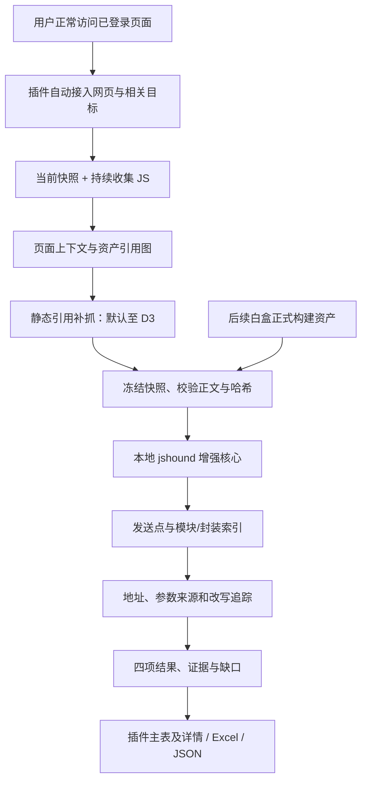

# 黑盒二整体设计

采用“独立 MV3 插件 + 本地 Python 编排/Node 静态分析服务”。以固定版本 jshound 为基线，先验证再增强；设计中的模块均不代表已有实现。

共同的 JS 分层、发现起点、路由和发送位置见[共享范围](../../docs/js-analysis-scope.md)；用户操作与边界见[需求](requirements.md)。

## 1. 总体流程

插件提供浏览器采集与交互，不在 MV3 后台运行完整分析器。分析服务接收冻结的文件与上下文，不接管浏览器登录或业务操作。脚本引用补抓由插件执行，以避免分析服务成为任意 URL 代理。

## 2. 每一步怎么做

| 步骤 | 执行动作 | 本步产物 | 达到的效果 / 失败处理 |
| --- | --- | --- | --- |
| 1 建任务 | 记录任务配置、范围、预算、服务版本和浏览器能力 | Task、配置快照 | 可重复运行；服务离线时进入仅收集模式 |
| 2 接入页面 | 枚举所有窗口 HTTP/HTTPS 网页，持续处理新建/导航；区分 frame、target、context | Context 与连接状态 | 单页失败不终止其他页；动态附加窗口单独留账 |
| 3 读当前脚本 | 读取 DOM 脚本与基址、可取得正文、已解析脚本源码及其上下文 | Asset、正文、哈希和采集方式 | 打开任务前加载过的代码尽量补取；正文不可取得明确失败 |
| 4 持续收集 | 监听后续脚本、导航、iframe/Worker 和加载终态，及时读取正文 | 追加资产版本与观察记录 | 用户操作中新出现脚本可进入后续快照，不覆盖旧内容 |
| 5 建引用图 | 解析 import、chunk 映射、runtime、manifest、Worker 和可确定脚本注入 | AssetEdge、路由线索、待获取队列 | JS 引用层数与内部模块、函数深度分别记录 |
| 6 补抓与闭包 | 在允许范围内 GET 明确脚本引用；新资产继续发现至 D3 或预算停止 | 完整正文或 Gap | 第四层、动态目标、403、缺资源及超限均有原因，不探测 API |
| 7 冻结与传输 | 固定截止序号，等待有界在途项；分块传输、校验哈希、提交不可变清单 | Snapshot 与已验证资产包 | 分析不会混入新导航/新版本；缺块不得当成完整脚本 |
| 8 基线分析 | 对整个快照建模块/绑定索引，识别发送点与实例、wrapper | SendSite、模块关系、候选 | 同名普通函数不直接算网络调用；失败资产有独立状态 |
| 9 定向恢复 | 反向追踪地址/参数来源，按已证明顺序合成默认值、修改和序列化 | Request 变体及字段证据 | 不同调用者/实例隔离，未知只影响相关字段 |
| 10 呈现与增量 | 返回主表、详情与缺口；新快照按依赖关系使缓存失效 | analysis.json、Excel、对照结果 | 结果可回查；相同 URL 不冒充同版或同次请求 |

步骤 5/6 可在采集过程中迭代。第一版允许用户先停止收集再分析，后续支持收集与分析不同快照并行；同一快照始终不可变。

## 3. 插件内部分工

| 模块 | 职责 | 持久化内容 |
| --- | --- | --- |
| 管理标签页 | 新建/开始/暂停/停止/快照/导出；主表与右侧详情 | 通过后台读取状态，关闭不停止任务 |
| MV3 任务控制器 | 页面接入、会话拥有权、子目标事件、重连和预算 | 任务配置、目标状态、事件序号与中断点 |
| 脚本收集器 | 正文、已解析脚本、内联脚本、上下文及来源关联 | Blob/文本、哈希、来源、内容完整性 |
| 引用发现/补抓适配器 | 解析服务返回的引用队列、范围检查、GET 及重定向检查 | 边、尝试次数、深度和失败原因 |
| 本地资产库 | IndexedDB 分块存储、版本关联和任务导出 | 内容哈希索引、引用记录、存储占用 |
| 服务适配器 | 配对、协议协商、分块续传、任务状态和结果分页 | 服务任务 ID、已确认块和结果版本 |

插件权限以 `debugger`、`tabs`、`storage` 为基线；本机服务和静态补抓使用明确的 host permissions，文件导出按实现采用 downloads。首个原型核对实际所需权限，不预先加入 cookies 或任意页面业务执行能力。

## 4. 如何取到 JS

| 来源 | 方法 | 必须保留的限制 |
| --- | --- | --- |
| 后续真实脚本加载 | CDP Network 事件关联终态后读取 response body | 缓存、重定向、正文驱逐、失败和提前附加缺口 |
| 当前已解析脚本 | Debugger.scriptParsed + getScriptSource | 只证明取得解析代码；不是完整网络正文或全部执行证据 |
| 内联和声明引用 | DOM/文档读取 script、基址、import map 和序列化配置 | 当前 DOM 不等于原始 HTML；动态改写与 document 版本要区分 |
| 未加载的静态引用 | 解析 import/manifest/runtime 后，插件在范围内补抓 | 扩展请求不等同页面请求；权限、认证和重定向可能使获取失败 |
| source map | 同版资产声明关联、预算内获取并校验 | 辅助定位，不重复计为新的线上发送点 |
| blob/eval 等已取得代码 | 浏览器能返回时作为观察资产保存 | 无可下载 URL 时用合成身份；不自行执行 eval 或解密 |

Network 正文、Debugger 源码、DOM 片段分别保存表示类型和哈希，只在有证据时关联；同 URL 不直接合并。脚本是否被浏览器观察到、静态发现深度是多少、是否在本轮额外补抓分别记录。已观察的 D4 脚本可以分析，但不能假称 D1，也不自动允许继续抓 D5；父链未知时不凭加载记录展开无界补抓。

当前页面快照与后续加载互补。仅在本任务拥有的调试会话中，开启 Debugger 前配置不暂停策略，不设置断点或改写目标代码；浏览器策略不允许调试时直接列为能力受限。使用 Chrome 125+ flat sessions 作为子目标实现基线；逐目标设置自动附加并处理同进程 frame 的 execution context，不能只接入顶层标签页就声称覆盖全部 Worker。

首版不保证 SharedWorker/Service Worker 等所有独立目标均可归属；逐类验证并展示已覆盖、未覆盖和无法归属状态。与黑盒一或 DevTools 发生连接失败/分离时不主动夺取或关闭对方连接，记录影响页面与时间；其他目标继续工作。

## 5. 地址、字段与请求加工

建立资产/模块索引 → 找发送机制 → 绑定 client/封装 → 反向追踪相关值 → 按有证据的阶段顺序合成 → 输出事实与未知。

- URL：字面量、拼接、模板、new URL、baseURL、条件候选；页面、模块和 Worker 基址分别解析。
- 参数：Path/Query/Body/Header 字段路径、存在状态、值状态、来源和条件；保留嵌套、展开、覆盖、删除与已知序列化。
- 封装：调用实参映射到摘要；支持不同调用者实例化，不把多个请求合成字段并集。
- 加工：区分构造、默认值合成、同步 hook 和序列化后候选；顺序或副作用无法证明时降级，不把构造参数冒充最终线上结构。
- 未知：缺脚本、远程配置、动态属性、运行时解密和未支持 hook 保留影响对象；L0/L1 先验证，复杂混淆单列缺口。

jshound 原始输出独立保存；导出归并若丢失调用/参数差异，不能直接当项目事实层。需要增强的源码放可访问 fork，固定上游与补丁 Commit，不在插件复制另一套 AST 分析器。AI 放在核心验收之后，且不成为首版依赖。

## 6. 数据与本机协议

| 对象 | 最少内容 |
| --- | --- |
| Task | ID、配置、浏览器/服务版本、阶段、预算、停止原因 |
| Context | tab/frame/target/session/context 身份及代次、页面 URL/基址、导航、父上下文和可见性 |
| Asset | 来源 URL/合成身份、上下文引用、表示类型、哈希、字节数、正文状态、获取/观察时间 |
| AssetEdge | 父子资产、引用类型、位置、解析基址、深度、条件和获取状态 |
| Snapshot | ID、截止序号、固定资产/上下文版本、缺块/在途清单、manifest 哈希 |
| SendSite | 发送机制、绑定、构建/部署 JS 位置、来源及核验状态 |
| Request | 发送点、调用变体、四项字段状态、方法、条件、加工阶段和证据 |
| Gap | 原因码、影响对象、阶段、可重试性及证据；不只写一段自由文本 |

事实确定度与结构完整性分开：confirmed/partial/candidate/unknown 表示各项事实依据，参数结构另按共享交付的 COMPLETE_WITHIN_MODEL/PARTIAL/UNKNOWN 表达；字段值未知不等于字段名或结构未知。具体映射在 S0 schema 冻结。

身份分离：资产内容可去重，但 URL/版本/上下文关联不丢；脚本位置必须由 parser range/原文验证。无行列时保持未知，不用 URL 充当唯一发送点。黑盒二不能推断真实 Commit，白盒后续自行补充仓库身份。

协议第一版采用版本化本机 HTTP：`/v1/capabilities` 协商；创建任务；按资产哈希分块提交/确认；提交 snapshot manifest；分析/取消；分页取进度、引用队列、结果和导出。引用发现与最终分析使用同一快照协议的独立阶段，不以非冻结的全局目录为输入。传输可以重复，任务/哈希/块号幂等；正文全部确认后才能提交完整资产。

服务仅监听 loopback，用本机配对凭证验证请求并限制扩展 Origin，不让普通网页提交任务或触发补抓。默认服务不联网；插件自行验证引用来源、深度、大小和重定向范围。凭证不进入导出，Cookie 不作为通用服务参数。具体 JSON schema 和路由在 S0 冻结，不兼容旧探索服务的隐含字段。

## 7. 状态、恢复与性能

收集状态：`created → collecting ↔ paused → draining → stopped`，失败/取消单独记录。快照状态：`assembling → frozen → uploading → analyzing → completed/partial/failed/cancelled`。采集停止不自动取消已提交分析；分析完成不代表收集完整。

任务配置、已存资产、快照及确认块持久化；浏览器重启后任务标为 interrupted，用户恢复后建立新会话代次，保留中断区间。关闭管理页不丢任务。服务重启可重试已冻结快照，失败任务不重新抓取同 URL 偷换输入。

设置文件数、单文件/总字节、并发、补抓重试、墙钟时间、存储与分析内存预算。JS 正文不截断后冒充完整文件；超限记录缺口。处理队列到上限时降低获取并发或停止相关范围，保留未完成清单，不能无限增长内存。

原型预算建议初值如下，属于保护上限而非性能承诺；S1/S2 按目标机器实测后冻结并允许显式配置。

| 预算 | 建议初值 | 达限行为 |
| --- | --- | --- |
| 独立内容 / 总源码字节 | 5,000 项 / 250 MiB | 停止新增正文，保留未处理引用及缺口 |
| 单文件正文 | 20 MiB | 整项标超限，不用前缀代替完整 JS |
| 静态补抓并发 / 超时 / 重试 | 4 / 20 秒 / 1 次 | 失败不无限重试；重定向继续核对范围 |
| 单快照分析 | 10 分钟 / 服务子进程合计 RSS 2 GiB | 有界终止并保存已完成结果和缺口 |

解析缓存按内容哈希、parser/模型版本；值追踪缓存还包含绑定、实参、实例、闭包和上下文依赖。上下文或配置变化要使相关结果失效，相同内容不同页面只共享可复用解析，不共享错误的 Host 结果。

## 8. 工作台与工程目录

工作台包含任务概览、JS 资产与引用图、API 主表、分析缺口。点击资产/API 在可见右侧栏查看正文位置、四项字段、调用链与加工证据。已完成/部分/未知分别显示；不将单一百分比称为全站覆盖率。

未来代码放在本目录：`extension/` 保存插件自身 package/锁文件/src/tests，`service/` 保存任务与 jshound 适配，`contracts/` 保存冻结协议和预期；全部待 S0/S1 核验后创建。共享核心的部署方式以 jshound fork 实测决定，本轮不搭空代码框架。

## 9. 官方依据与待验证项

- [Chrome debugger](https://developer.chrome.com/docs/extensions/reference/api/debugger)：target/context 区别、flat sessions 及非递归自动附加。
- [MV3 生命周期](https://developer.chrome.com/docs/extensions/develop/concepts/service-workers/lifecycle)：应持久化恢复状态；活跃调试会话不替代故障恢复。
- [扩展跨域请求](https://developer.chrome.com/docs/extensions/develop/concepts/network-requests)：后台获取外部资源所需 host permissions。
- [CDP Debugger](https://chromedevtools.github.io/devtools-protocol/tot/Debugger/) 与 [Network](https://chromedevtools.github.io/devtools-protocol/tot/Network/)：脚本源码和响应正文属于不同获取入口；具体能力在目标 Chrome 原型验证。

上述资料支撑接口设计，不替代 MV3 现场验收。现有黑盒一 `capture-scripts.ts`、任务接入和存储实现只作复用候选，需提取边界并测试；旧快照的短时等待与上限不能视为新任务的持续完整采集能力。
