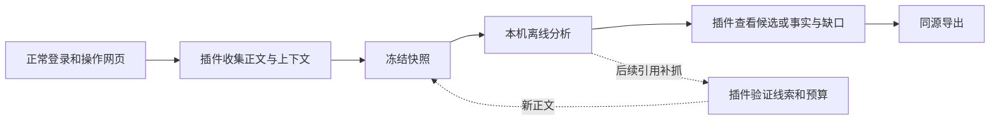

# 黑盒二整体流程

黑盒二的交付物是浏览器插件和本机分析能力；后续集成到黑盒一。本轮只收敛文档，不实施集成。需求见[requirements](requirements.md)，实际路径与共享会话方案见[架构](architecture.md)，算法见[分析设计](analysis-design.md)，状态只见[计划](plan.md)。

## 1. 一条产品路线

现有原型只收 Debugger 已解析源码，输出文件级候选与 JSON；真实 MV3、未加载引用补抓、精确绑定、正式统计和 Excel 是不同待验门槛。HAR/目录/CLI 是辅助输入与重放工具，不再单独定义“首个可用产品”。

## 2. 采集、快照与分析

| 步骤 | 输入 → 输出 | 必须保持的约束 |
| --- | --- | --- |
| 开始 | 用户任务 → 网页/目标与状态 | 自动接入当前及后续HTTP/HTTPS网页；不要求管理标签页；不抢占外部调试连接 |
| 持续采集 | 浏览器源码/上下文 → 完整正文、哈希、观察与缺口 | 不执行输入JS、不自动操作业务；来源未知保留未知 |
| 暂停/停止 | 已接收事件 → 有界排空和持久状态 | 不把半截正文当成功；停止某功能与取消分析是不同动作 |
| 冻结 | 已保存正文 → 不可变快照 | 明确截止范围；后续新增不修改旧快照，离线也能导出 |
| 分析 | 固定快照 → 候选、引用和缺口 | 服务校验大小/哈希/基址，只离线调用同一核心；失败不当空成功 |
| 查看/导出 | 同一分析结果 → 列表、右侧详情、JSON | 字段/版本/缺口同源；候选不改为确认，正文和长字段可回查 |

源码不等于网络原始正文，也不证明实际发送。DOM/Network/Debugger 三入口的表示对照是后续采集工作；iframe/Worker 逐类核验，不能用顶层页面或 CDN 补未知 Host。当前捕获输入总有范围缺口，partial 是有效结果状态，不是“没有API”。

## 3. 后续引用补抓

核心从冻结发现快照返回确定边和候选边；插件只调度确定、范围内、层数和预算允许的静态资源。取得完整正文后形成下一快照并再次发现，直到无合格新增、预算停止或用户结束。循环/多父保留，最短路径晚到可解锁引用；未知父链不伪装 D1，已观察的深层正文仍分析。

模块 URL、文档 base 和 Worker 根基址按各自语义解析，详细规则只在[分析设计](analysis-design.md)维护。重定向逐跳查来源，认证不跨域继承；HTTP 200 登录页不算 JS。服务只返回线索，产品补抓始终由插件负责，不搬用 CLI 的联网入口。

服务离线时仍保存已有观察并导出；后续复杂发现可以等待服务，但不能伪装已完成闭包。不以访问所有路由、重放 API 或运行脚本解密扩大覆盖。

## 4. 数据与交付

当前实际对象、状态、原型路由和预算见[协议](protocol.md)，未来模块要求见[模块规格](modules.md)。同 URL 不构成资产身份；正文内容可去重，原始来源、上下文、时间和版本关系不能丢。未知、候选、确定事实与结构完整性分别表达。

正式交付目标是 URL、参数、Host、最终发送所在 JS，加方法、位置/调用证据、引用和缺口。只有经核验的绑定与位置才能产生正式发送点/调用统计；现有候选预览不得改名为已确认接口数。未来 Excel/证据包沿用同一事实层，遵循[共享交付](../../docs/delivery.md)。

## 5. 本轮与后续分工

本轮仅整理文档。接下来按[计划](plan.md)先现场核验原型，再完成引用闭环。黑盒一集成方案已细化到租约、事件路由、任务、存储、界面、权限和回退；本轮不实施。source map 和复杂封装增强不作为启动插件工作的前置条件，AI 不阻塞任何首版流程。
