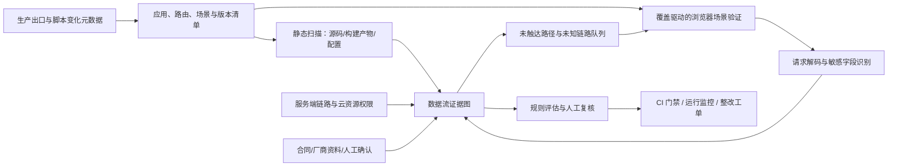

# 全前端数据采集与透传排查方案

> 版本：调研与设计稿 v1，2026-10-15。适用范围先以 Web/H5 为主，架构允许后续加入小程序、Electron 和 App。Baxia 是一个验证样本，不是检测对象白名单。本文依据公开的一手工具文档、研究项目、标准和监管资料；尚未在业务环境验证。

> 2026-10-16：完整体系与最新取舍已合入[主方案 v2](前端数据采集与跨境透传审计体系总方案.md)，本文保留为前期架构与工具资料补充。

白盒优先及 AI/开发 Agent 的详细思路见[配套设计稿](白盒优先与AI-Agent审计设计.md)。

## 1. 建议的产品定位

建设一个**前端数据流持续审计平台**：从页面、脚本和用户动作出发，证明数据进入了哪个请求、哪个服务、哪个下游和谁的访问范围，并对新增或变化的路径设置上线门禁。最终记录单位不是“域名”或“SDK 名称”，而是：

```text
数据来源 → 采集代码/脚本 → 发送机制 → 首跳请求 → 服务端转发/存储 → 最终接收与可访问主体
```

同一条链路同时记录**观察到的行为**、**代码允许的行为**、**云配置允许的行为**和**仍未知的部分**。法律结论由法务/隐私团队结合数据主体、交易性质、接收方、用途、规模及具体规则作出。美国 DOJ 的数据安全计划关注特定数据、交易和受覆盖主体的访问，并非“美国页面发到中国就一律罚款”。[1]

### 最终验收目标：给一个站点或仓库，返回可执行整改清单

分析入口接受以下任一输入，不要求用户先整理 SDK 清单：

| 输入模式 | 系统自动完成 | 能确认的边界 |
|---|---|---|
| **网站 URL** | 浏览页面和关键操作，发现脚本、请求、字段、目标、触发条件；结合公开资料与可用配置定位供应商 | 能证明浏览器实际可见行为。拿不到源码/后台时，无法确认服务端最终落地和每个文件行号；必须标为待核实 |
| **代码仓** | 扫描前端及可见服务端代码、依赖和配置，给出文件/行号、调用链、潜在接收端及修改建议 | 能定位代码可达路径。未运行的分支、远程动态配置和生产流量不能当作已发生 |
| **网站 + 仓库 + 只读云/日志** | 关联页面操作、部署版本、源码调用、首跳请求、服务端转发、数据存储与读取权限 | 形成最完整证据，能区分实际发送、可配置发送和远程可访问 |

输出不是“高危 SDK 列表”，而是一组**按优先级排序的整改项**。每项必须给出：页面/用户动作、脚本或代码位置、字段、请求与下游、适用规则的复核点、观察证据、缺失证据、明确修改动作、负责人建议、修复后验证方法。若网站有 source map 或可关联构建版本，可进一步定位源文件；没有时报告加载脚本 URL、哈希、请求 initiator 与压缩文件偏移。

示例报告项（仅说明格式，非对某站点的结论）：

```text
P1 · 登录页错误上报携带完整 URL，其中含合成邮箱
证据：/login → 点击登录 → script sha256:... → GET /collect?...&query=...
字段：query 中的 email（合成测试值命中）；目标：collector.example
代码：src/telemetry/error.ts:42（网站+仓库模式）；下游：待核实
整改：上报 URL 改为路径白名单；删除 query/referrer 中的个人字段；复核触发条件与告知
验证：重复同一路径，外发请求不含合成 email；服务端日志检索未出现该标记
```

**交付格式**：一份面向业务和法务的 Markdown/HTML 摘要、一份开发可导入的 JSON/SARIF 发现清单、请求/配置证据索引，以及带节点状态的数据流图。报告保留“未覆盖/未知”清单，不能把无法观察到的下游默认为安全。

### 应覆盖的六类典型路径

| 路径 | 例子 | 单靠域名扫描的盲点 |
|---|---|---|
| 浏览器直传第三方 | 像素、`sendBeacon`、分析 SDK、风控遥测 | 请求体加密、动态加载、隐藏在 iframe/Worker 中 |
| 同域业务 API 透传 | 风控 token、设备 ID 附加到登录/下单 API | 首跳域名是自家域名 |
| 业务服务端再分发 | 自家采集网关、Server-side GTM、代理转发 | 浏览器只看到第一跳；Google 文档明确服务端容器可把事件交给不同标签处理[2] |
| 远程配置触发 | 标签管理器、A/B 配置、SDK 灰度脚本 | 仓库中没有最终执行的脚本或目标 |
| 被动泄露 | URL query、referrer、异常日志、会话回放 | 不是显式的 `track()` 调用；Baxia 样本已有 URL 字段进入有条件错误上报的代码[3] |
| 远程访问/跨地域复制 | 数据留在美国，但中国团队有查询权限；OSS/DTS/批量下载 | 没有新的浏览器跨境请求 |

## 2. 总体架构



### 2.1 资产发现：先回答“到底有哪些前端”

建立域名、应用、仓库、部署区域、业务负责人、登录方式和关键用户旅程清单。页面候选入口从**路由配置/构建清单、sitemap、已有 E2E 测试、菜单/权限配置、服务端访问日志和产品关键流程**合并，不依赖爬虫自己“点出来”。每个部署版本收集：`script/src`、动态 import、Tag Manager 容器、Service Worker、iframe、Web Worker、npm/锁文件依赖、脚本实际响应 SHA-256、CNAME/DNS 指向及 CSP 配置。第三方名称和域名标签仅用于**候选分类**，不能代替真实数据流取证。研究已指出，第一方 Cookie 跟踪及 CNAME cloaking 会让只按第三方主机名识别的方案漏报。[4]

资产清单要记录“未扫描、扫描成功、因登录/反爬/页面错误未覆盖”，避免把没有请求误判为没有采集。

### 2.2 浏览器验证：真实流量 + 可控合成数据

**浏览器是验证器，不是唯一发现器。**它能证明“这条路径确实发送了什么”，不能证明“未触发的路径没有采集”。以 Playwright 驱动已知和新发现的用户路径，用 CDP/浏览器事件记录请求 URL、方法、头、body、发起脚本/Frame、重定向、Cookie 与 WebSocket 帧。CDP 的 `requestWillBeSent` 带请求发起信息，并可读取请求体相关字段；Playwright 支持 WebSocket 事件。[5][6]

测试矩阵至少包含：未登录/登录、首次访问/回访、同意前/拒绝/同意后、美国/其他地区的业务配置、桌面/移动视口、正常/异常/风控挑战、页面加载后延迟触发。**地区维度表示测试条件，不以出口 IP 直接认定数据主体法律身份。**

Service Worker 要做双视角：一轮保留它以观察真实行为，一轮禁用它以帮助定位页面原始请求。Playwright 文档说明普通 `route()` 不能拦截由 Service Worker 接管的部分请求；只跑一种模式会漏或误解链路。[6]

**覆盖驱动的场景生成**采用三路补充：

1. **静态引导**：从路由、事件注册、功能开关、SDK 初始化条件、`checkApiPath` 类命中规则和敏感字段到发送点的潜在路径，生成待触发任务。
2. **场景复用与探索**：导入已有 E2E/手工测试录制；对安全的菜单、链接和按钮做有界状态探索，记录登录角色、前置步骤和页面状态。研究显示，复杂交互与特定动作序列会让自动探索空间迅速扩大，因此探索要按风险排序，不承诺自动遍历所有状态。[15]
3. **运行反馈**：用服务端出口日志、部署资源清单、CSP Report-Only 对未批准目标的报告，必要时在经过性能与隐私评估后用低采样浏览器探针收集**脚本哈希和目标域名等元数据**。把生产中出现但测试未见的脚本、端点、字段类别与出口变化送回待测队列；不把 CSP 报告当作完整请求清单，也不默认收原始个人数据。

每轮计算**覆盖差集**：已知路由但未访问、代码发现的发送点但未触发、已加载 SDK 但未覆盖其关键行为、生产出现但预发未见的目标。Playwright 的 JS coverage 可辅助判断某段脚本是否执行，但“代码执行过”也不等于相关数据发送分支已触发。[16] 所有差集保留为待补证据，不能被汇总数字掩盖。

### 2.3 白盒增强：从字段来源到发送点

第一层用轻量 AST 规则快速识别 SDK 初始化、打点包装器、`fetch`/XHR/Beacon/图片/表单/WebSocket、URL/DOM/Storage/Cookie 读取及 token 自动注入。第二层只对高风险候选做跨函数、跨模块数据流追踪。CodeQL 的 JS/TS 库支持全局数据流与 taint path 查询，但官方也说明全局分析会有误报且计算开销更高，适合精查而非对所有代码无差别全跑。[7]

白盒必须同时扫**源码和实际部署产物**：Tag Manager、远程配置、CDN 更新和灰度脚本可能不在业务仓库里。Baxia 样本说明，SDK 可通过包装 `fetch`/XHR 自动向业务请求添加 `bx-*` 参数；只搜显式 `track()` 会漏掉此类透传。[3]

### 2.4 请求解码：通用解析 + 端点适配器

按 URL query、Form、JSON、URL 编码、Base64、压缩、批量事件、嵌套 JSON、已知 protobuf schema 等层次解析。对常见供应商和公司自建接收端建立**版本化端点适配器**，记录解析规则与样本证据。TrackHAR 的公开实现采取“端点适配器 + 已知合成标记匹配”两条路，并明确说明单纯搜索明文或 Base64 会漏掉多层嵌套、混淆和低熵字段。[8]

对不透明 token/加密载荷，输出 `payload_unknown`，在受控测试环境观察加密前输入和发送边界，并索取厂商字段说明。不要根据 token 长度或字段名直接判定“只含设备信息”或“已脱敏”。

### 2.5 服务端和权限：证明首跳之后发生了什么

对自家 API/采集网关接入服务端调用链、出口代理/网关日志、队列订阅、ETL、对象存储复制、数仓导出和人工下载记录。可用 `traceparent` 或内部 request ID 关联前后端，但只在受控信任边界传播；W3C 明确要求追踪头不放个人信息，并提示跨域传播的隐私风险。[9]

灰盒收集云资源配置与读权限：资源实际区域、同步目标、跨账户角色、数据面读/导出操作、境外人员或供应商访问。把“数据已复制到中国”和“中国主体有读取能力”分成两条边。IP 地理位置、CDN POP、资源名称都只是线索，不是最终落地或接收主体的证明。

### 2.6 控制面自身不能制造新的数据问题

扫描任务在数据所在区域执行。中心系统默认仅收事件名、字段类别、服务/区域/主体、代码位置、证据哈希与短期索引；原始 HAR/请求体留在受控区域，脱敏显示、限制权限和留存。合成数据使用独特可识别标记，例如 `audit+case123@example.test`，避免把真实用户数据复制到审计平台。

## 3. 可复用工具调研与取舍

| 方案 | 可复用能力 | 本项目取舍 |
|---|---|---|
| **Playwright + CDP** | 自动操作、请求与 WebSocket 观测、请求发起信息；可直接集成现有测试用例[5][6] | **动态验证器**。场景清单必须由静态资产、现有测试和运行反馈共同提供；需补 Service Worker 双视角 |
| **OpenWPM** | 隐私研究框架，能记录 HTTP 请求/POST body、Cookie 与指定 JS API 调用[10] | 作为研究对照和特殊深挖工具；其文档标明 callstack instrument 当前不可用，不把它当唯一主线 |
| **TrackHAR** | 按端点解码复杂跟踪请求，合成标记匹配[8] | 借鉴/复用适配器设计；它解释请求内容，不解决服务端下游 |
| **CodeQL JS/TS** | 白盒数据流与 taint path[7] | 高风险代码深挖；先用轻量规则缩小范围 |
| **Foxhound** | Firefox fork，浏览器内动态 taint 可追源到 sink[11] | 处理强混淆和关键未知链路的专项工具；运行成本较高，先做小规模验证 |
| **DuckDuckGo Tracker Radar Collector / 数据集** | 第三方请求、Cookie 和脚本行为的候选发现[12] | 用于补充供应商归属与已知 tracker 标签，不能以“没命中名单”判安全 |
| **CSP Report-Only** | 观察违反既定策略的资源/连接尝试[13] | 用于上线后的新增目标预警；它报告的是**策略违规**，不是完整网络清单 |
| **Privado OSS** | 静态隐私数据流分析[14] | 当前公开 README 写明 JS/TS OSS 支持仍待加入，不作为本项目 Web 前端核心引擎 |

**组合建议**：先搭 `路由/代码/配置清单 + Playwright/CDP 验证 + 端点适配器 + 服务端配置/日志 + 覆盖差集` 的可用闭环，再把 CodeQL/Foxhound 用于低可见度、高风险案例。不存在一个现成工具同时覆盖浏览器、混淆载荷、服务端再分发和境外访问权限。

## 4. 证据模型与判定

每条边保存：`source_id`、`operation`、`script_hash`、`build_id`、`initiator`、`request_id`、`destination_resource`、`recipient_entity`、`processing_region`、`fields`、`evidence_id`、`evidence_level`、`policy_version`、`owner`。

| 证据等级 | 例子 | 可以作出的结论 |
|---|---|---|
| 已观测 | 带合成标记的浏览器请求、服务端出口/数据读取日志 | 某次测试或运行中确实发生 |
| 已配置 | SDK 参数、Tag Manager、复制任务、RAM 读权限 | 系统允许发生，需进一步核实是否触发 |
| 代码可达 | 静态调用链、动态脚本分支 | 有潜在路径，需运行时验证 |
| 供应商声明 | 字段清单、处理区域、合同 | 可作为交叉证据，不能替代实测/审计 |
| 推测 | DNS/IP/名称/地理库 | 仅提示进一步检查，不作最终结论 |

策略输出分为：`阻断`、`需法务复核`、`待补证据`、`已批准`。技术检测负责字段、路径、数量和权限事实；规则库按适用法域、敏感类别、接收方和交易类型配置。[1] 潜在影响、各项事实的证据充分程度和调查优先级分别记录，不把缺少运行证据当成降低风险的乘数。详细判定与主张矩阵以[主方案第 9～10 节](前端数据采集与跨境透传审计体系总方案.md)为准。

## 5. 上线预防与持续监测

1. **基线**：每个前端版本登记脚本哈希、远程配置、事件 schema、字段、目标、下游和所有者。
2. **PR/CI**：出现新脚本、新 SDK、目标、新字段、新 `bx-*` 类自动注入、新服务端出口时生成差异；高风险变更进入审核。
3. **预发**：跑固定用户旅程与合成标记，比较“同意前后”和上一个版本的请求；保存可重放证据。
4. **生产**：首先利用服务端出口和部署资源日志；确需覆盖浏览器直传时，评估低采样浏览器探针与 CSP Report-Only。常态只上传字段类别、目标、版本等元数据，监测漂移；必要时在本地区域短期取原始证据。
5. **出站控制**：自建打点由采集网关按 schema 白名单控制；第三方直传采用 SDK 配置、供应商治理、CSP 的 `connect-src`/`img-src`/`script-src` 等约束，并先用 Report-Only 检查误伤。CSP 不能替代服务端出口控制。
6. **批准与复核**：每条例外绑定数据用途、字段、接收方、处理区域、可访问人员、有效期和证据链接；版本或合同变化重新评估。

## 6. 推荐实施顺序

### 第一阶段：白盒资产与数据流清单（当前方案阶段）

先给定业务代码仓与对应部署版本，整理入口、路由、组件、依赖、SDK、远程脚本、请求封装、环境变量、构建配置和服务端 API 映射。以发送点为索引，反向追踪字段来源与触发条件，再向前追踪目标配置、网关和后端下游。对 `fetch`/XHR/Beacon/像素、自动改写请求 API、SDK 自动采集、URL/referrer/Cookie/Storage、表单、异常上报和登录/交易事件分别建清单。源码与部署产物版本不一致时保留两份清单，不把仓库未发现等同于线上不存在。

当前不开发扫描器。拿到业务仓后，先人工梳理其请求封装、路由与构建方式；对高风险路径可使用现有 CodeQL 能力和人工分析补跨函数与跨模块数据流。尤其核查 `axios.create`、拦截器、Service Worker、Worker、`postMessage`、表单提交、远程配置与混淆产物。任何单一方法的零命中都不能作为安全结论。

白盒试点交付物是：①资产与扫描覆盖清单；②每条候选的文件/行列、字段来源、发送点、静态目标、触发条件、可确认与未知环节；③可直接修改的代码建议；④等待灰盒/黑盒补证的队列。Baxia 公开样本用于验证“自动改写请求”这类模式，不代表任何具体业务站点正在跨境传输。

### 第二阶段：证明一条完整链路

选择一个美国业务前端、一个登录或交易旅程、一个风控/分析 SDK（可用 Baxia），将白盒候选与浏览器流量、业务 API 和服务端出口关联。以[Baxia 样本核查](Baxia公开SDK静态核查.md)中 `bx-*` 自动附加路径作为测试用例。产出可复核的“来源 → 请求 → API → 下游/权限”证据图和一个真实整改项。

### 第三阶段：扩成所有 Web/H5 资产

接入应用/域名/路由清单与已有测试，跑高价值场景矩阵；建立已知端点适配器和脚本哈希库；把无法登录、反爬、动态配置、加密载荷及**未触发的静态发送点**统一纳入待补证据队列。不要用“已扫描域名数”代替覆盖率，应用“应用 × 页面/旅程 × 登录态 × 同意态 × 地区配置 × 版本”覆盖矩阵，并报告路由、发送点、脚本版本和生产端点四种覆盖差集。

### 第四阶段：持续控制

把新增脚本/字段/目的地门禁接入 CI，灰盒配置变化纳入告警；业务服务端与数据平台补齐 trace、出口和数据面读取记录。小程序、Electron、App 分别加采集适配器，不直接复用 Web 的网络覆盖结论。

### 试点验收

- 选定旅程的**所有可观察请求**都归属脚本/页面/用户动作，无法归属的列出原因。
- 至少证明一条 SDK 直传或业务 API 透传路径到服务端下游；若无下游，则以日志/配置证明目前止于何处。
- 人为加入一个未登记的敏感字段、一个新的第三方目标、一个新增复制/读取权限，三者均能形成可定位的差异或告警。
- 对加密未知、未覆盖页面和没有数据面审计的服务显式显示空白，不给出“全量合规”结论。

## 参考资料

1. [美国 DOJ Data Security Program](https://www.justice.gov/nsd/data-security)、[合规指南](https://www.justice.gov/opa/media/1396356/dl)。
2. [Google Server-side Tagging 架构](https://developers.google.com/tag-platform/tag-manager/server-side/intro)。
3. [本目录 Baxia 公开 SDK 静态核查](Baxia公开SDK静态核查.md)。
4. [一方 Cookie 与 CNAME 跟踪测量论文](https://arxiv.org/abs/2202.01498)。
5. [Chrome DevTools Protocol Network](https://chromedevtools.github.io/devtools-protocol/tot/Network/)。
6. [Playwright Network](https://playwright.dev/docs/network)、[Service Workers](https://playwright.dev/docs/service-workers)。
7. [CodeQL JavaScript/TypeScript Data Flow](https://codeql.github.com/docs/codeql-language-guides/analyzing-data-flow-in-javascript-and-typescript/)。
8. [TrackHAR 项目与方法](https://github.com/tweaselORG/TrackHAR)。
9. [W3C Trace Context 与隐私要求](https://www.w3.org/TR/trace-context/)。
10. [OpenWPM 配置与仪表能力](https://github.com/openwpm/OpenWPM/blob/master/docs/Configuration.md)。
11. [SAP Project Foxhound](https://github.com/SAP/project-foxhound)。
12. [DuckDuckGo Tracker Radar Collector](https://github.com/duckduckgo/tracker-radar-collector)、[数据模型](https://github.com/duckduckgo/tracker-radar/blob/main/docs/DATA_MODEL.md)。
13. [MDN CSP Report-Only](https://developer.mozilla.org/en-US/docs/Web/HTTP/Reference/Headers/Content-Security-Policy-Report-Only)。
14. [Privado OSS README 与语言支持](https://github.com/Privado-Inc/privado)。
15. [WebExplor 研究：复杂交互与动作序列的探索问题](https://arxiv.org/abs/2103.06018)。
16. [Playwright JavaScript Coverage 文档](https://playwright.dev/docs/api/class-coverage)。
