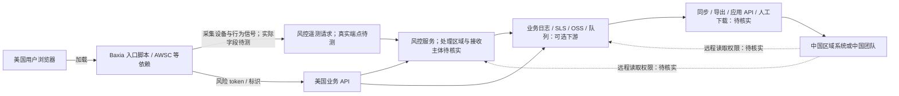

# 前端打点跨境数据流审计方案

> 版本：方案草案 v1，2026-10-15
>
> 示例环境：美国业务前端接入阿里系 **Baxia/霸下风控前端脚本**，风控遥测、设备指纹或风险 token 可能经阿里服务与业务服务处理，并可能由中国团队访问。本文是**参考架构**，不表示任何具体站点或阿里云账户已经发生跨境传输。Baxia 与阿里云公开售卖的“设备风险识别 SDK”不能未经核实就视为同一产品、同一数据项或同一服务端点。[8][9]

公开 CDN 样本的初步证据见 [Baxia 公开 SDK 静态核查](Baxia公开SDK静态核查.md)：2.5.37 版本具备按配置向业务 `fetch`/XHR 请求附加 `bx-*` 风控参数的能力，入口还存在有条件的直接上报路径。这些是代码能力，目标站点是否实际触发仍待运行时验证。

## 1. 目标与边界

### 1.1 要解决的问题

对每一条前端打点，回答六个问题：

1. **采集**：哪个页面、操作和代码/SDK 产生事件？
2. **内容**：实际发出了哪些字段？字段来自哪里，是否可以关联个人？
3. **路径**：浏览器直传到哪里？美国侧接收后写入哪些服务？
4. **访问**：哪些账户、角色、外包商和境外人员可以读取或导出？
5. **规则**：需要按哪些法律、合同或内部政策复核？证据是否足够？
6. **处置**：应删除字段、限制访问、阻断路径，还是批准有条件使用？

交付物是**可复核的数据流图、证据清单、风险队列和上线前控制**。系统只能自动判定技术事实和部分确定性规则；法律适用、交易性质及例外仍由法务/隐私团队签署。

### 1.2 不要采用的简化判断

- `浏览器请求目标是美国域名`，不能证明数据没有从美国服务继续流向中国。
- `SLS/OSS 位于美国区域`，不能证明中国侧没有远程查询、下载或管理权限。
- `目的地 IP 位于中国`，也不能单独证明数据主体、接收方或法律适用范围。
- `已经脱敏/加密`，不能自动排除美国 DOJ 数据安全规则；其指南明确将符合条件的匿名化、假名化、去标识化或加密数据纳入 bulk 数据判断。[1]
- `用户点了同意`，不能替代所有法律条件；例如 DOJ 数据安全计划没有通用的“同意即豁免”。[2]

## 2. 阿里云示例拓扑



**本方案首先审 Baxia，不预设它采用 SLS。**阿里云开发者文章提到 Baxia 引入 `fireye.js`，经 AWSC 获取风控 token，用于防爬、防刷和人机识别；这是确认“存在风控前端采集模块”的线索，并不足以证明具体字段、上报端点、数据落地区域或透传方式。[8] 阿里云另一套公开的 Web/H5 设备风险识别 SDK 文档展示了“前端生成 deviceToken → 业务服务端调用风险识别 API”的可能架构和可选美国端点，但必须先核对项目是否真的使用该产品，不能把其接口直接套到 Baxia。[9]

若业务另将 Baxia token、风控日志或其他打点写入 SLS，阿里云文档说明 SLS WebTracking 可将前端日志发送到指定区域的 Project/Logstore，Project 创建后区域不可更改。[3] 阿里云美国区域包括 US (Silicon Valley) 和 US (Virginia)，具体产品可用性以目标账户和区域控制台为准。[4] OSS 跨地域复制及 DTS 同步也只作为**待检查的下游路径**。[5][6]

### 建议的运行架构

- **美国侧扫描与证据节点**：运行浏览器探针、链路关联器和字段分类器。原始请求体及日志仅在受控的美国侧环境短期保存；对 Baxia 的不透明 token 保留长度、格式、生成上下文和摘要，不假定能从中还原字段。
- **中心控制面**：保存事件名、字段类别、源/目标服务、证据索引、策略版本和审核结论；原则上不接收原始个人数据。控制面部署位置也应纳入评估。
- **采集网关**：对可控的自建打点做 schema 白名单、目的地控制、字段删除和追踪 ID 注入。Baxia SDK 直传不能只靠业务网关过滤，应核查其配置、版本、厂商数据说明和真实流量；风险 token 经业务 API 透传则需要在业务网关与服务端单独控制。
- **只读云资产采集器**：读取 SLS、OSS、DTS、RAM、ActionTrail、网络出口、数据处理任务等配置。先用最小权限；不要求导出生产数据内容。

## 3. 分析方法：白盒、黑盒、灰盒合并

| 层 | 输入 | 检查点 | 主要证据 |
|---|---|---|---|
| 白盒 | 前端/服务端源码、依赖、构建配置、Tag Manager 配置 | Baxia 加载入口、AWSC/风控模块、动态脚本、初始化参数、token 到业务 API 的传递；其他打点及服务端转发 | 文件与行号、调用链、构建版本、配置版本 |
| 黑盒 | 测试环境、测试账号、关键操作路径 | 浏览器真实请求、重定向、请求体、URL、Cookie、第三方 SDK；登录/未登录及同意状态差异 | HAR/网络事件、页面路径、操作步骤、时间戳、请求 ID |
| 灰盒 | 云资源配置、IAM/RAM、审计与数据处理日志 | SLS Project 区域、Logstore、订阅/导出；OSS 复制；DTS 任务；应用服务出口；中国侧角色及远程读取 | 资源 ID、配置快照、权限策略、审计事件、任务运行记录 |

**关联键**：`build_id + event_name + schema_version + trace_id/request_id + cloud_resource_id`。允许一条事件分叉到多个目标。没有统一 ID 时，用时间窗口、字段签名及目标配置辅助关联，但结果标记为推断，不当作已证实的传输。

### 组件实现建议

| 组件 | 实现方式 | 产物 |
|---|---|---|
| `code-scanner` | TypeScript/Babel AST + 可配置的 SDK 调用规则；先支持项目实际使用的框架和封装 | 打点调用点、字段来源、接收端配置 |
| `browser-probe` | Playwright 驱动测试路径，通过浏览器网络事件记录请求；用合成数据作字段标记 | 真实事件和请求证据 |
| `cloud-inventory` | 阿里云 OpenAPI 只读采集；按账户、区域、资源 ID 建快照 | SLS/OSS/DTS/RAM/ActionTrail 配置与权限边 |
| `flow-correlator` | 按请求 ID 优先关联，缺失时按时间、事件名、字段签名和资源配置关联 | 带证据等级的数据流图 |
| `policy-engine` | 版本化规则 + 人工审核状态；规则与扫描器解耦 | 阻断、复核、补证据、批准队列 |
| `ci-gate` | 比较本次与基线的新增事件、字段、目标和权限 | 可定位的构建失败或审核请求 |

扫描器和探针应共享同一份事件 schema，避免“静态分析发现事件 A，运行时叫事件 B”的重复记录。对压缩/加密的请求，优先在测试环境的发送 API 调用前记录字段；无法还原时标为不可见，不能默认通过。全量采样要有速率和留存上限，以免审计本身扩大个人数据副本。

### 3.1 白盒扫描细节

1. 建立入口清单：Baxia 入口脚本、AWSC 等依赖、动态加载器、初始化/回调、token 生成与传递；另列自建埋点、SLS、第三方分析/广告 SDK。
2. AST 分析字段来源、对象扩展、序列化和发送 API；对公共封装函数做跨文件追踪。
3. 服务端继续追踪采集 API 到 SLS、队列、OSS、数仓、HTTP 客户端、定时任务与导出脚本。
4. 识别无法静态解析的动态模板、混淆包或远程配置，交给黑盒验证，不产生“未发现即安全”的结论。

### 3.2 黑盒验证矩阵

用合成身份数据覆盖：首次访问、拒绝/接受可选追踪、注册、登录、搜索、资料修改、支付前流程、风控挑战、异常路径和退出登录。记录 Baxia 脚本加载顺序、风控模块初始化、token 获取时机、遥测上报和业务 API 的 token 字段。对不同地区的测试，只改变测试上下文；**不能用 VPN 出口或 IP 地址直接推断用户法律身份**。

抓取 `sendBeacon`、XHR/fetch、图片请求、WebSocket、重定向及第三方 iframe 的可观察流量。每条请求生成字段清单；证据中默认只保存字段名、类型、长度、分类和脱敏后的样例。对加密/编码的 Baxia 载荷，要在受控测试环境观察其**生成前输入**和网络发送边界；看不见明文字段时标为“内容未知”，不能凭 token 字符串猜出收集项目。原始请求体按审批、短期留存、访问审计处理。

### 3.3 灰盒核查清单

- **Baxia/风控服务**：SDK 版本和来源、初始化配置、实际遥测目标、服务端 token 校验/评分调用、合同中的接收主体、处理区域、下游使用和可访问人员；厂商说明与实测不一致时以差异事项跟进。
- **SLS（仅在链路实际使用时）**：Project/Logstore 区域、WebTracking 配置、消费者、加工/导出任务、查询权限；注意 Project 区域不能直接更改。[3]
- **OSS**：Bucket 区域、跨地域复制、日志投递、对象读取策略和临时授权。[5]
- **DTS/自建同步**：源目标区域、同步对象、任务状态和执行记录；DTS 文档还提示跨境同步须满足源与目标区域的数据安全政策。[6]
- **RAM/STS**：角色信任关系、跨账号授权、长期密钥、可调用的读/导出 API、来自中国侧的运维身份。
- **ActionTrail 与数据面日志**：管理操作、权限变更和可用的数据事件。ActionTrail 的数据事件默认不采集，不能仅凭默认审计记录证明“没人读过”。[7]
- **应用链路**：API 网关、消息队列、数据库同步、报表系统、定时任务及人工下载；这部分往往超出单个云产品审计范围。

## 4. 数据模型与证据等级

一条审计记录建议采用以下结构，原始值不进入中心索引：

```json
{
  "event_id": "checkout_view_v3",
  "source": {"app": "us-web", "route": "/checkout", "code_ref": "src/analytics.ts:42"},
  "field": {"name": "email", "classification": "personal_identifier", "observed": true},
  "edge": {"from": "browser", "to": "sls-project-us/logstore-a", "mechanism": "webtracking"},
  "recipient": {"account": "example-account", "region": "US", "readable_by_cn_role": "unknown"},
  "evidence": {"type": "runtime_request", "artifact_id": "capture-123", "captured_at": "..."},
  "assessment": {"technical_status": "confirmed", "legal_status": "needs_review"}
}
```

证据等级：

- **已观察**：测试流量或审计日志显示实际发送/读取。
- **已配置**：同步、复制或权限配置允许此行为，但未证明已发生。
- **代码可达**：代码存在可执行路径，需运行时验证。
- **推断**：仅由域名、IP 或命名推断。不得据此下最终法律结论。

建议把“数据流向中国”和“中国侧可访问”作为两个不同属性；两者可能同时存在，也可能只存在其中一个。

## 5. 风险判定逻辑

### 5.1 技术判定

先按字段识别：标识符及组合、精确位置、生物识别、健康、金融、基因相关信息、政府相关数据，以及自由文本、URL 和日志中夹带的这些内容。字段分类需要结合可关联性和上下文，不能只靠字段名。

再判断人群、规模、用途、接收主体、合同关系、访问能力、是否存在下游再转发。数量统计采用去重数据主体/设备及滚动时间窗，不用简单事件条数替代。对无法确认的要素输出 `unknown`，禁止自动变成低风险。

### 5.2 法律与政策判定

美国 DOJ 数据安全计划于 2025-04-08 生效，对特定美国政府相关数据及达到门槛的美国敏感个人数据、特定交易和受关注国家/受覆盖主体的访问作出限制；中国含香港、澳门列在其受关注国家范围内。[1][2] 此外，还需按业务实际情况审查 FTC/州隐私法、行业规则、合同与隐私承诺。**本系统不应写死“美国到中国一律违法”，也不应把阈值当成所有隐私义务的安全线。**

规则引擎输出四档：

| 状态 | 含义 | 上线门禁 |
|---|---|---|
| 阻断 | 明确违反已批准的内部禁止规则，或未登记的高敏字段正流向未批准接收方 | 阻断新增链路并启动处置 |
| 法务复核 | 涉及敏感数据、境外接收/访问或交易性质不明 | 审核签署前不能放行新增链路 |
| 待补证据 | 只有代码可达或权限可用，缺少运行证据 | 限期补测/补日志 |
| 已批准 | 用途、字段、接收方、权限、留存和复核日期均已登记 | 持续监控漂移 |

审查记录至少保存：规则版本、证据链接、审核人、批准条件、有效期与复核时间。法律规则应可配置和版本化，定期由法务更新。

## 6. 处置与预防控制

1. **采集前删减**：移除不需要的邮箱、电话、完整 URL、搜索词、自由文本和凭证；对可识别的组合字段做进一步评估。
2. **事件 schema 白名单**：明确允许的事件、字段、类型和用途；未知字段拒收或隔离，不能静默放行。
3. **美国侧网关控制**：按事件/字段/目标控制转发；对确需下游处理的数据先完成审核。网关不应在未经评估时把原始证据再发往中国。
4. **区域与访问隔离**：美国区域保存必要明细，限制中国侧 RAM 角色、跨账号授权、下载和查询；报表优先在美国侧生成经审核的聚合结果。聚合结果也要评估是否仍可识别。
5. **云任务治理**：新增 OSS 跨地域复制、DTS、SLS 订阅/导出、应用批处理任务，进入变更审批与持续配置检测。
6. **审计闭环**：CI 扫描新增打点；预发环境跑关键路径；生产环境对比真实字段与 schema；对权限变更和复制/同步任务变更报警。

## 7. 实施路线与验收

### 阶段 A：一条链路试点

选 1 个接入 Baxia 的美国业务前端、对应的业务 API/风控服务链路和 3～5 条关键用户路径。优先产出“SDK 加载 → 采集/生成 token → 直接上报 → 业务 API 透传 → 风控服务及下游”的证据图；SLS/OSS 仅在确实参与时纳入。再形成字段清单、证据等级、待核实事项和首批整改项。

### 阶段 B：门禁与控制

落地 schema 仓库、CI 差异检查、预发流量回放、美国侧采集网关规则和云资源配置检测。先对新打点启用强门禁；存量问题按风险排期治理。

### 阶段 C：持续运营

接入生产字段漂移、RAM 权限变化、ActionTrail 与服务端出口观测；建立例外审批、到期复核和处置工单。

**试点验收标准**：关键路径上观察到的每条打点都有源代码/SDK、实际字段、首跳接收端、已知下游和访问主体记录；每条跨境或境外可访问链路都有证据等级与处置状态。故意新增一个未登记的敏感字段，应在 CI 或预发验证中被发现，并给出可定位的代码与请求证据。

## 8. 开始实施时需要的材料

- 前端与美国侧接收服务的仓库、构建配置、环境变量样例、打点 SDK 与标签管理配置。
- Baxia 脚本 URL/包版本、初始化代码、风控产品合同或数据处理说明、服务端 token 校验/评分调用文档。
- 测试环境、测试账号、关键业务操作路径；使用合成测试数据。
- 阿里云账户的**只读**资源清单及必要审计查询权限：SLS、OSS、DTS、RAM、ActionTrail、网络出口等。
- 现有数据分类政策、隐私声明、第三方合同/数据处理协议及法务审批流程。

## 参考资料

1. [美国 DOJ Data Security Program 页面](https://www.justice.gov/nsd/data-security)；[合规指南](https://www.justice.gov/opa/media/1396356/dl)。
2. [美国 DOJ FAQ（2025-09-24）](https://www.justice.gov/nsd/media/1415006/dl)。
3. [阿里云 SLS WebTracking 文档](https://www.alibabacloud.com/help/en/sls/use-the-web-tracking-feature-to-collect-logs)。
4. [阿里云 SLS 美国区域示例及同区域 OSS 投递限制](https://www.alibabacloud.com/help/en/sls/create-oss-shipping-tasks-new-version)。
5. [阿里云 OSS 跨地域复制](https://www.alibabacloud.com/help/en/oss/user-guide/cross-region-replication-overview/)。
6. [阿里云 DTS 跨境同步权限与限制](https://www.alibabacloud.com/help/en/dts/user-guide/apply-for-permissions-to-synchronize-data-across-borders)。
7. [阿里云 ActionTrail 功能及数据事件设置](https://www.alibabacloud.com/help/en/actiontrail/product-overview/what-is-actiontrail)。
8. [阿里云开发者社区：Baxia 引入 AWSC/fireye.js 的一线案例](https://developer.aliyun.com/article/1480499)。
9. [阿里云 Web/H5 设备风险 SDK 接入文档](https://www.alibabacloud.com/help/zh/fraud-detection/developer-reference/device-risk-detection-sdk-for-web)；[设备风控服务概述](https://www.alibabacloud.com/help/zh/fraud-detection/developer-reference/device-fingerprint-fraud-detection/)。这是相邻公开产品资料，不能直接当作 Baxia 接口说明。
