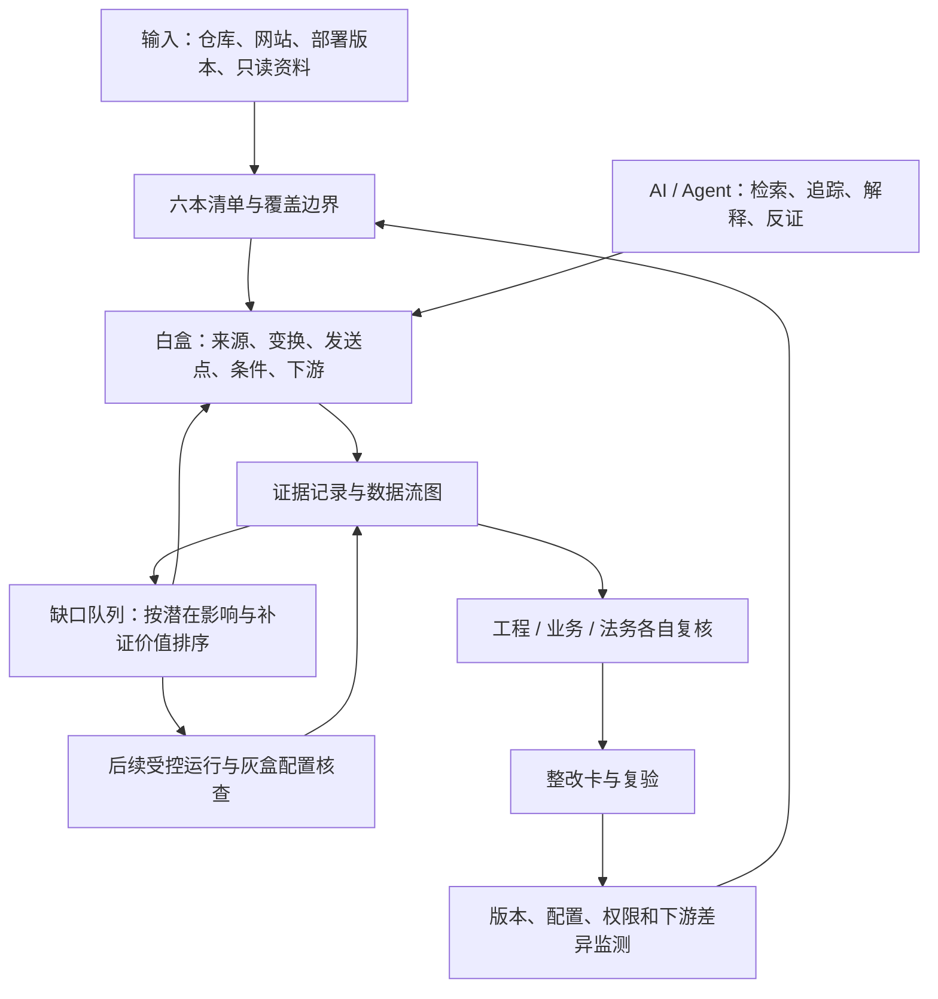

# 前端数据采集与跨境透传审计体系总方案

> 版本：v2.1 讨论稿，2026-10-17。当前只做思路分析、资料核验和方案沉淀。本文为本目录的主方案，既有文档作为专题补充；发生设计分歧时，以本文明确的取舍为准。本文没有对任何真实阿里云美国站、业务仓或云账户完成审计，也没有认定其违规。

> 本次深化：第 5.9～5.11 节展开路径证明与异步状态，第 6.5、7.5 节约束 Agent 推理与覆盖判断，第 8.1～8.3 节处理不透明 SDK，第 9.4～9.5、10.1、11.5 节把结论、时效和整改动作对齐，第 15.3 节补充体系的反向验证。

## 1. 目标、核心判断与当前取舍

最终希望做到：**给一个网站或代码仓，能指出哪些数据采集、发送、透传或远程访问需要整改，解释原因，定位修改位置，并提供复验办法。** 以阿里云美国业务站为典型场景，Baxia 是验证 SDK 自动采集和请求改写的样本之一，分析范围覆盖全部前端采集方案。

建议采用白盒优先：先建立明确版本下的资产与数据流清单，再由 AI/开发 Agent 协助追踪封装、配置和服务端下游，随后按风险补运行证据。最终应形成可审计的工作体系，起步可以是人工、现成工具和一组 Markdown 表格，不要求先建平台、图数据库或多 Agent 集群。

本轮确定六项取舍：

1. **把数据流作为分析单位。** 同一个 SDK 可以有直传、业务 API 透传、异常上报和远程配置多条链；每条链分开取证。
2. **先声明范围，再讨论完整。** 范围包含应用、部署版本、配置、时间、角色和可取得的资料。系统不承诺自动证明整个互联网或任意 JavaScript 程序没有未知采集。
3. **覆盖、影响、证据各自记录。** 无运行证据的高影响路径仍可优先调查；未知不会因为缺少日志变成低风险。
4. **AI 输出必须可回溯。** 每个关键判断引用具体代码、配置、运行记录或厂商文件，保留反证和证据断点。
5. **对必要采集寻找最小整改。** 兼顾风控、登录、支付、可观测性和业务连续性，整改要验证隐私效果与业务效果。
6. **把防复发纳入交付。** 分析一个历史版本只能解决当时的问题，还需覆盖 SDK、配置、权限和下游随时间变化的情况。

## 2. 问题边界：需要证明什么

### 2.1 五个不同的问题

| 问题 | 最低所需证据 | 仅靠前端代码能否确认 |
|---|---|---|
| 页面可能采集什么 | 字段来源、SDK 行为、调用条件 | 可确认一部分，动态配置和封闭 SDK 可能未知 |
| 某次实际发送了什么 | 测试/运行时发送记录，或可信接收日志 | 不能单独确认 |
| 首跳之后去了哪里 | 后端代码、网关/队列配置、出口与存储证据 | 通常不能 |
| 哪个主体能够或实际读取 | 有效权限、身份关系、访问日志、厂商资料 | 不能 |
| 是否需要法律或政策处置 | 上述事实，加用途、人群、规模、主体、合同、适用规则 | 技术分析提供事实，最终法律判断另行复核 |

美国网站向中国发送数据不是一个足以自动认定违法的条件。例如，美国 DOJ Data Security Program 涉及特定数据、交易以及受关注国家或受覆盖主体的访问条件；规则适用需要逐案复核。[美国 DOJ 官方说明](https://www.justice.gov/nsd/data-security)

### 2.2 分开记录五种“地区/主体”

不要用一个 `country` 字段概括：用户/数据主体关联地区、网络首跳接收位置、实际处理与存储区域、法律上的接收主体、能够读取数据的组织或人员。这些可能不同。CDN POP、IP 地理库、域名后缀、云资源名称都只提供线索。

有效访问权限还要结合角色信任、条件、组织边界、密钥和实际身份；一条 IAM/RAM allow 语句不一定等于有效读权限，更不等于已经读过。反过来，没有默认审计记录也不等于没人访问。

### 2.3 三种输入，三种有边界的输出

| 输入 | 能做的主要工作 | 交付时必须说明的缺口 |
|---|---|---|
| 仅代码仓 | 资产、调用链、字段流、SDK 配置和静态目标，定位文件 | 部署是否一致、运行是否触发、远程配置和服务端区域可能未知 |
| 仅网站 URL | 发现可访问页面、实际脚本和请求，定位脚本哈希/偏移 | 未触达页面、源码行号、服务端下游和接收主体通常不完整 |
| 仓库＋部署环境＋只读配置/日志 | 关联代码、构建、请求、下游与权限 | 不透明供应商内部处理及未提供的数据面日志仍需保留未知 |

“给一个 URL 就完成全部判断”可以作为使用入口的便利目标，不能作为证据能力承诺；资料缺失时仍应给出已确认整改项和明确补证任务。

## 3. 分析对象与覆盖地图

### 3.1 数据类别与来源

除邮箱、手机号等显式字段外，还应包括：账户/设备/会话标识、认证凭证、精确位置、健康/金融/生物信息、搜索词与自由文本、完整 URL、referrer、错误上下文、DOM 内容、会话回放、剪贴板/文件相关输入，以及浏览器属性构成的指纹。

字段分类同时依赖名称、类型、来源、使用上下文和组合关系。`data` 可能装着完整用户对象；`id` 可能只是产品编号。记录“已知来源”“语义推断”“需业务确认”，不通过模型猜测填满空白。不以日志事件条数代替受影响人数，设备标识也不直接等同自然人。

变换链记录复制、拼接、掩码、哈希、令牌化、加密、编码、压缩、聚合及缓存。是否仍可识别、可连接或可恢复，需要结合持有方能力与上下文判断。安全漏洞 taint 分析里的 sanitizer 不能直接当成隐私匿名化证明；Base64、JSON、加密或普通哈希也不应自动截断字段血缘。

### 3.2 需要覆盖的行为族

| 行为族 | 典型位置 | 易漏点 | 主要调查办法 |
|---|---|---|---|
| 显式业务埋点 | `track/identify`、事件总线 | 二三层封装、对象扩展字段 | 导入/类型解析，双向数据流 |
| 自动页面与行为采集 | SDK 初始化、自动事件 | 默认开关、SPA 路由切换 | 配置＋SDK 版本画像 |
| 会话回放/DOM 采集 | 回放 SDK、遮罩规则 | 动态 DOM、错误遮罩、敏感文本节点 | 字段语义＋隔离场景验证 |
| 异常与性能上报 | logger、RUM、错误钩子 | URL、堆栈、breadcrumb、请求内容 | 错误路径与上下文构造分析 |
| 风控/设备指纹 | SDK、token 生成 | 派生标识、不透明载荷 | 输入到 token/发送点的血缘 |
| 业务请求自动附加 | fetch/XHR 改写、拦截器 | 业务调用处看不到新增字段 | 注入点、匹配条件与服务端接收 |
| 图片/脚本/iframe 等请求 | DOM、模板、动态创建 | 不走 fetch；URL 携带数据 | 模板/DOM 属性与网络记录 |
| 表单、跳转与链接 | form、location、外链 | POST、query、导航泄露 | 提交对象与跳转目标分析 |
| Worker/Service Worker | 独立线程、后台队列 | 脱离当前页面生命周期 | 消息通道、缓存、发送归属 |
| iframe/微前端消息 | `postMessage`、跨应用 SDK | 中间传递后由另一方发送 | 消息发送和接收双端追踪 |
| 远程脚本和标签管理 | HTML、CDN、GTM 类系统 | 代码仓外更新、配置即发布 | 脚本树/哈希、发布权限、配置版本 |
| 同域采集与 API 透传 | `/collect`、登录/交易 API | 自家域名掩盖后续外发 | 网关→后端→下游追踪 |
| SSR/边缘服务端请求 | Next/Nuxt、BFF、edge | JS 文件里是服务端 fetch | 运行上下文、模块边界、部署位置 |
| 复制、导出和远程读取 | 队列、对象存储、报表、运维 | 不产生浏览器跨境请求 | 云配置、有效权限和数据面日志 |

同页执行的第三方 JavaScript 可能获得页面数据访问能力，远程更新又可能改变其行为；标签管理器的 dataLayer 约定本身不能强制隔离脚本权限。应把“可访问能力”和“实际读取/发送”分开记账。[OWASP 第三方 JavaScript 管理](https://cheatsheetseries.owasp.org/cheatsheets/Third_Party_Javascript_Management_Cheat_Sheet.html)

### 3.3 几个应写入审阅规则的浏览器事实

- 第三方资源加载本身会产生网络请求，不能只查后续 `track()`。实际 Cookie、referrer 等随浏览器和策略变化，不假定一律携带。
- CORS 响应不可读不代表请求没有发出；部分请求不需要预检。需要区分发送尝试、预检、实际请求和响应是否可读。[MDN CORS](https://developer.mozilla.org/en-US/docs/Web/HTTP/Guides/CORS)
- HttpOnly 防止脚本直接读取对应 Cookie；符合条件的请求仍可能由浏览器自动附带。不能把 `document.cookie` 的读取清单当全部 Cookie 出站清单。[MDN Set-Cookie](https://developer.mozilla.org/en-US/docs/Web/HTTP/Reference/Headers/Set-Cookie)
- `Referer` 的实际内容受 Referrer-Policy 限制，URL fragment 不在该头中；SDK 主动读取 `location.href/hash` 再放进载荷是另一条路径。[MDN Referer](https://developer.mozilla.org/en-US/docs/Web/HTTP/Reference/Headers/Referer)、[Referrer-Policy](https://developer.mozilla.org/en-US/docs/Web/Security/Practical_implementation_guides/Referrer_policy)
- 同一个前端仓可以包含浏览器和服务端逻辑。Next.js 的服务端/客户端模块边界及初始渲染机制说明，文件扩展名或一个指令不足以单独决定某次请求从哪里发出。[Next.js 官方文档](https://nextjs.org/docs/app/getting-started/server-and-client-components)

## 4. 整体结构：六本清单、逐边证据和调查队列

六本清单分别是：**应用与版本、页面与条件、脚本与 SDK、发送点与字段、目标与下游、问题与批准记录**。它们可以用表格起步；证据图是表达关系的方法，存储形式之后再选。

每个对象使用稳定标识，但绑定具体版本和观察时间。同一发送封装影响多个页面时，保留一个根因及所有调用范围，避免生成数百份重复工单；同一 SDK 不同配置、实例或地区则不强行合并。

还需要同时维护两种图：**经批准的预期数据流**与**代码/配置/运行证据支持的事实图**。预期图来源于事件目录、业务必要性、合同和内部政策；事实图按证据状态表达。比较两者，可发现未登记字段/目的地、用途扩大、批准路径已停用但 SDK 仍加载、以及配置承诺没有落实的情况。业务方说“我们只收事件名”属于预期，不能代替事实；事实中出现某路径也不代表其必要性已获批准。

## 5. 白盒执行方法：由宽到深，双向交叉

### 5.1 固定范围与版本

记录域名、仓库/commit、构建 ID、依赖锁文件、构建参数、部署区域、运行环境、远程配置版本、脚本哈希和观察窗口。构建来源可借鉴 provenance 的“产物→构建输入”关联方式，但来源可信并不能证明没有采集行为。[SLSA Provenance](https://slsa.dev/spec/v1.2/provenance)

第三方源码、压缩产物、生成文件、隐藏入口不能因为位于 vendor/dist 就永远排除；采用单独分类、预算和去重。测试、demo、文档样例与生产入口也要区分，避免误报但保留对应范围说明。每个解析失败、超时、缺失依赖、忽略目录、缺失 source map 都进入覆盖表。

### 5.2 还原入口、路由与模块图

合并路由配置、文件路由、动态 import、微前端入口、菜单/权限、已有测试和可用访问日志。参数路由先按模板归类，再标注影响采集的参数/角色/地区变化；不用无限 URL 数量充当页面分母。

标明浏览器、服务端、Worker、iframe、构建时五种执行上下文。对动态装载、运行时反射、`eval`、WASM 或没有源码的模块，明确创建边界节点；不能给跨过未知模块的路径写成完整已证明链。

### 5.3 先枚举发送点与改写点

从网络原语、SDK 方法、业务请求封装、拦截器和原生 API 改写开始建立发送清单。既保留最终发送原语，也记录上层语义入口，例如 `submitOrder → requestClient → interceptor → fetch`。由导入/对象来源判断方法含义，避免仅凭 `.post()` 或 `.track()` 命中。

特别关注全局和共享组件：一个错误上报器或请求拦截器可能覆盖大量页面，调查收益通常高于逐页阅读。Baxia 类模式应检查 URL 命中规则、字段插入位置、开关、加载顺序和服务端后续消费，而非只搜 `bx-*` 字面量。

### 5.4 字段流正向与逆向汇合

正向：`来源 → 对象/状态 → 参数/返回值 → 变换 → 消息/队列 → 发送点`。

逆向：`发送参数/URL/header → 构造函数 → 公共上下文/拦截器 → 实际来源`。

对每个业务包装器建立行为摘要：哪些参数流到哪里、附加什么公共字段、默认目标和条件、是否改变执行环境。优先复用现有分析器，对企业自有 API 补模型。全局静态分析能跨越更多函数，但可能产生实际不会发生的路径，并增加资源开销，必须保留模型边界。[CodeQL JS/TS 数据流](https://codeql.github.com/docs/codeql-language-guides/analyzing-data-flow-in-javascript-and-typescript/)

结果区分：语法出现、分析器报告的潜在路径、条件经复核的路径、受控运行确认。遇到动态属性、依赖注入和闭包等难点，不强行连线；转成具体调查任务。把 source 与 sink 全量两两连接既成本高，也会制造噪声。

### 5.5 展开触发条件与目标配置

每条路径记录地区配置、登录态、角色、同意状态、灰度、随机采样、延迟/重试、缓存、异常、风控挑战和页面关闭事件。静态得到的条件先转成可读约束，难以判断组合是否可满足时标记未知，不将“存在函数调用”写成“生产必定触发”。

目标从常量、baseURL、环境变量、相对路径、租户配置、代理、远程配置和重定向逐层解析。未知地址也保留发送点；已知域名不等于已知接收方。目标身份包含协议、主机、端口、路径/服务、租户或资源 ID、版本/时间，避免只按域名合并不同业务。

### 5.6 建立 SDK 行为档案

每个实际版本记录：供应方、来源、哈希、加载关系、初始化配置、自动采集项、触发条件、直传地址、业务请求注入、变换输入、关闭/过滤能力、远程变更能力、文档/合同声明、已验证与未知项。

依赖/SBOM 是入口清单，不能代替行为分析；同样，命中 tracker 名单只提供标签。公开脚本样本不能代表全站配置。SDK 档案按版本与配置复用，遇到哈希、开关、租户、远程配置或供应商声明变化时重新评估。

### 5.7 向后端与数据平台延伸

把前端 API 映射到网关、BFF、controller、SDK 服务端校验、消息队列、日志/对象存储、数仓和导出任务。关联优先使用可信 request/trace ID；仅凭时间相邻或相同字段名的关联保持“推断”。

无法读取其他仓时，交付接口、已知字段、版本、负责人和所需证据清单。无代码不等于无法继续：只读网关路由、出口元数据和云配置仍可约束下游；它们不能证明未知载荷中的全部内容。

### 5.8 由证据断点产生下一步任务

每个任务只解决一个明确问题，例如“确认 US 配置是否启用 SDK 错误上报”“查明 `/risk/check` 是否将 token 写进应用日志”“证明该邮箱值是否进入加密前输入”。任务有输入、预期证据、完成条件、预算和交接方。缺资料或工具失败时返回断点和替代办法，不无限循环调查。

### 5.9 一条字段路径需要通过六项检查

“两个函数能在调用图上连起来”只提供候选路径。要对某个字段形成有依据的静态结论，至少逐项检查：

| 检查项 | 需要回答 | 常见误判 |
|---|---|---|
| 对象与实例 | 是同一数据实例或有证据的复制关系吗？ | 把两个同名 user 或不同请求实例连在一起 |
| 字段与载体 | 精确到哪个属性/数组位置，经过哪些改名？ | 从“对象某字段敏感”推成所有属性都敏感 |
| 条件是否一致 | 来源、变换和发送条件能在同一环境同时成立吗？ | 来源仅在 CN 分支，发送仅在 US 分支，却拼成跨境路径 |
| 时间与生命周期 | 字段在发送前仍存在吗，是否被替换、清除或重新填入？ | 只看删除语句，不看发送前又合入公共上下文 |
| 序列化结果 | 哪些字段真的形成 URL/header/body？ | 对象传入 SDK 就认定其全部字段被发出 |
| 发送归属 | 哪个实例、执行环境、配置和终点实际消费这份载体？ | 浏览器来源与 SSR 发送混连，或不同租户配置混连 |

其中任一项未知，结论保留相应缺口。“条件互斥”可以排除这一条候选路径，不能据此排除该字段通过其他路径外发。

字段级状态建议至少记录：来源类别、属性路径、当前变换、所在实例/上下文、条件、生命周期和已确认的发送载体。这样可以表达“邮箱原文已删除，但其稳定派生标识仍存在”，也能表达“日志路径仍保留原文”。不应只使用全局一个敏感/不敏感标签。CodeQL 的 flow state 提供更细传播状态的建模思路，但本项目的隐私语义仍需单独设计与验证。[CodeQL flow state](https://codeql.github.com/docs/codeql-language-guides/using-flow-labels-for-precise-data-flow-analysis/)

序列化是一个必须检查的边界：JSON.stringify 的 replacer、toJSON 和属性规则可以改变输出；SDK 内部也可能只取部分字段。另一方面，清理后的对象可能被拦截器、getter 或全局上下文重新加入数据。静态解释需要贴近真实序列化过程，不能只数入参对象的键。[MDN JSON.stringify](https://developer.mozilla.org/en-US/docs/Web/JavaScript/Reference/Global_Objects/JSON/stringify)

### 5.10 时间是数据流的一部分

页面和 SDK 往往有队列、重试、缓存与共享状态。一次页面快照无法解释“谁的字段被哪个会话最终发出”。建议为高影响路径补事件顺序，至少记录采集、入队、身份变化、同意变化、配置刷新、发送与接收几个时点；对于未精确确定的异步顺序，保留可能性，不能任意排列成确定事实。

| 场景 | 要核查的机制 | 可能的整改位置 |
|---|---|---|
| 退出后队列 flush | 旧标识是否仍在内存/持久队列，是否随新会话发送 | logout、队列分区与清理、发送前检查 |
| 撤回可选采集授权后重试 | 已缓存事件是否重新判定，哪些用途按业务政策允许继续 | 同意状态机、重试过滤、留存规则 |
| A 用户退出后 B 用户登录 | 设备 ID、账户属性和错误上下文是否串联两人 | identify/reset、缓存与公共上下文 |
| 页面关闭/后台恢复 | Beacon、离线队列或 Service Worker 是否绕过主页面过滤 | 后台发送路径和共享字段策略 |
| 配置从本地区域切换 | 队列事件使用采集时还是发送时的目标/租户配置 | 配置绑定、队列迁移或隔离 |
| 多个 SDK 改写请求 | 改写顺序、旧引用、恢复 API 后哪个包装仍执行 | 初始化顺序、各发送机制的最终构造点 |
| 首次失败与降级 | 加密/SDK 失败后是否改用原文日志或备用端点 | 错误回退和备用路径 |

这些是待调查的模式，不代表业务确实存在缺陷。对于同意、保留和重试，先由业务/隐私政策明确期望行为，再比较实际实现，不能自动认为全部后台发送都应禁止。

### 5.11 将页面数量转换为可核查的机制组

缓解“页面太多”的关键，是识别共享机制及差异，而不只增加浏览器点击量。将路径按执行上下文、SDK 实例与配置、字段构造、目标解析和触发策略分组：例如多个路由共用同一错误上报器，可先查清上报器，再核对每个调用方是否添加不同字段、开关或目标。

代表场景能替代重复运行的前提，是有证据支持这些相关行为相同；仅仅“使用同一个 SDK”不够。组内静态核对所有已知调用者，动态选择代表与边界场景；存在个性化 payload、动态目标或不同身份/同意状态的调用方拆组。报告同时给出共享机制覆盖和页面关联覆盖，避免一次测试被扩张成全站证明。

## 6. AI 与开发 Agent 的使用方式

### 6.1 适合交给 AI 的工作

AI 的价值主要在于理解不统一的业务语义：识别项目封装、读跨文件调用、解释混淆代码局部、对照文档和配置、归纳调用条件、发现缺失证据、起草整改与验证步骤。批量枚举、哈希、版本对比和事实校验仍应尽量由确定性工具支撑。

| 工作角色 | 必须提交的产物 | 怎样复核 |
|---|---|---|
| 范围与资产分析 | 入口/脚本/配置清单、排除项及原因 | 对照构建/部署清单和实际资产 |
| 请求封装建模 | API 行为摘要与证据位置 | 检查调用者、实现与最小正反样例 |
| 数据流调查 | 逐边路径、条件、未知项 | AST/调用引用、配置和人工核查 |
| SDK 专项分析 | 版本档案、采集/注入机制 | 实际脚本哈希、厂商说明、运行验证 |
| 反证审阅 | 可能排除或缩小问题的依据 | 具体版本、开关、过滤逻辑和运行条件 |
| 整改设计 | 修改位置、替代方案、业务影响、复验 | 工程与业务负责人审阅 |
| 验证设计 | 合成字段、场景、预期差异 | 运行证据能否支持目标结论 |

这些是职责分工，起步可由一个 Agent 顺序完成。只有在拆分能降低等待或复核成本时才并行；多个模型给出相同答案并不构成独立事实证据。

### 6.2 每个 Agent 任务的工作协议

输入包含范围/版本、待回答问题、允许读取的材料、已有证据、预算和完成条件。输出包含：主张、证据引用、支持与反对依据、条件、未知项、下一步最小补证行动。

关键约束：

- 仓库全量枚举账本和代码检索共同使用；向量检索或“读了若干相关文件”不能证明没遗漏。
- 引用必须可定位到 commit/脚本哈希/配置版本与位置；自动检查引用确实存在且支持该主张。
- 模型补出的推理边显式标记，不混进工具已经证明的路径。模型摘要也不能替代原始证据。
- 两个结果矛盾时，先检查版本、环境与时间；仍冲突则保留两边，交人工复核，不取平均分。
- 模型提出封装/规则摘要后，用正例和反例检查；后续获准开发时才固化为规则，避免把一次误解推广到全部仓库。
- 模型不能自行把“未看到”改为“没有”，不能把供应商自述当作运行事实，也不能代替法律签署。

### 6.3 防止 Agent 成为新的数据通道

审计环境按数据实际所在区域与组织政策安排；仓库、HAR、日志也可能包含客户信息和密钥。优先提供字段类别、脱敏片段和本地证据引用；模型部署与外发策略需单独确认。对低熵个人值做普通哈希仍可能被枚举，不默认视作安全脱敏。

默认只读分析。仓库文件、SDK 文档和网页内容作为不可信数据，不能指挥 Agent 执行其中的命令或外发凭证。未来的测试执行使用隔离环境、合成身份和受控出口；修改、部署、生产阻断使用明确的组织流程。

### 6.4 失败处理和停止条件

超时、上下文截断、解析失败、权限不足、供应商不透明分别记状态。任务在以下任一状态结束：问题已用证据回答；已证明只在限定范围不适用；已形成明确外部交接；预算耗尽并列出尚缺证据。禁止以重复搜索和模型反复自评代替进展。

复用结果的键至少包含 commit、相关产物哈希、配置快照、规则/模型版本和分析范围。模型升级不是旧结论自动失效的唯一条件；部署或目标配置变化才可能让原事实直接不适用。缓存只复用依赖仍一致的结论。

### 6.5 让 Agent 提交可核查的推理链

Agent 的任务不止是给结论和行号，还要解释每条边为何成立。例如从页面 user.email 到 sendBeacon，分别证明调用者、实参/形参、对象属性、序列化和发送参数关系；“同一文件里都出现了”不支持这些关系。

建议使用以下调查循环：

1. 明确要证实的最小主张，以及什么观察会否定或缩小它。
2. 给出候选路径，每条边附代码/配置位置和依赖条件，未证明的边单独标记。
3. 通过引用解析、分析器查询、配置核对或人工阅读逐边查证；高影响路径不能只复核起点和终点。
4. 主动寻找最有力反例：对象不是同一实例、环境条件互斥、字段被序列化过滤、实际部署不包含等。
5. 输出成立范围、反证处理与残余未知，再判断是否值得追加运行/供应商取证。

复核者可以是同一 Agent 的另一个有界任务、另一分析工具或人工，重点是重新检查关系。再让模型复述一遍、多个模型投票、引用链接确实存在，都不能替代关系校验。若上下文不足，缩小任务或返回资料请求；不能由模型补出中间函数。

评价 AI 优先看“有多少关键主张得到支持”“是否漏掉会推翻结论的反例”，同时统计因 Agent 推理错误导致的无效工单。模型自报置信度暂作为调查提示，不充当经过校准的概率或法律证据强度。

## 7. 怎样系统减少遗漏

### 7.1 建立有边界的分母

| 覆盖维度 | 分母 | 分子 | 必须同时报告 |
|---|---|---|---|
| 资产 | 已登记且属于试点的应用/部署版本 | 取得并分析的版本 | 未登记资产发现方式、无法取得项 |
| 代码 | 范围内模块/文件及已知外部模块 | 成功解析并纳入模型的部分 | 忽略、超时、生成/远程代码 |
| 页面 | 已知路由模板与重要角色条件 | 完成静态关联/动态验证的项，各自统计 | 路由清单来源与未知入口 |
| 发送点 | 当前方法识别到的发送点集合 | 归属字段/触发/目标已查明的项 | 方法不支持的发送类型 |
| 下游 | 已知首跳、转发和读权限关系 | 经对应证据确认的关系 | 无法进入的仓库/供应商边界 |
| 运行验证 | 已列出的高影响场景及条件 | 获得有效观察结果的场景 | 未执行、执行失败和受干预场景 |

“识别出的发送点全部复核”只能说明该候选集合处理完了，不能说明实际所有发送点都被识别。覆盖分母要随新发现修订，保留版本，不为了提高比例删掉未知项。

### 7.2 三种互补核对

1. **上层向下**：应用→路由/入口→模块/SDK→发送点。
2. **下层向上**：网络原语/请求钩子→封装→业务调用者与页面。
3. **外部反查**：生产脚本/出口/网关/云配置→源码归属。

三者求差集：已知路由未分析、静态发送点未触发、生产端点无代码归属、构建脚本无仓库来源、云任务无已登记用途。这些差集是覆盖缺口，不自动算违规。

### 7.3 不穷举全部状态，保留高影响条件

角色、同意、地区、实验、设备、延迟和异常组合可能爆炸。先按“会改变字段/目标/接收主体”的行为等价类归并；低风险组合可用成对组合辅助选择，高风险分支及安全边界条件单独覆盖。组合缩减只是成本策略，不能保证发现所有高阶交互。

把未触发发送点变为带前置条件的任务；必要时在测试环境隔离模块、调用包装器或替换远程配置进行诊断。改变采样率、绕开风控或手工调用函数所得结果，只证明该条件下的能力，不能冒充正常生产触发证据。

### 7.4 页面触发不到时的处置顺序

先查静态入口、权限/角色、特性开关和依赖条件；再复用现有 E2E/业务流程；仍无法触发则做组件/封装级验证；最后向业务或厂商交接明确的资料缺口。不可达页面、未运行分支和未知后端保留在报告中，并指明其潜在影响与后续责任人。

### 7.5 候选图不是实际全部数据流的完整上界

已证明的具体路径只能确认这些路径；静态候选还可能包含误报，而未建模 API、远程代码和隐藏条件又可能在候选之外。不能把“确认路径＋待验证候选”当成全部实际路径的上界，更不能据此估算精确剩余风险。

每轮结束保留三类残余：已知但未查完的路径、方法明确不支持的机制、资产/资料缺失导致无法界定的部分。第一类靠任务推进，第二类靠专项模型或验证，第三类靠部署/组织/供应商补证。分别交接，避免所有未知都被笼统写成“后续优化”。

## 8. 后续运行与灰盒验证的设计

白盒为主，动态验证用来区分真实字段、触发条件和误报；灰盒确认后端与权限。以下均为后续工作设计，本轮没有执行。

| 方法 | 能补什么 | 证据边界 |
|---|---|---|
| 每个来源使用独特合成标记 | 明文、部分编码和已知变换后的字段关联 | 未检出不能排除加密、聚合、过滤或未触发 |
| 发送前输入观测 | SDK 序列化/加密前的候选输入 | 输入到函数不等于每项都进入最终载荷 |
| 网络/接收端记录 | 实际首跳请求、状态与接收 | 不自动证明后端最终使用或保存 |
| 加载/关闭 SDK 的差分实验 | 候选行为归因、开关作用 | 关闭 SDK 可能改变页面/风控，需对照业务状态 |
| 单一来源变化的差分实验 | 不透明载荷是否受输入影响 | 长度或字节变化不是具体字段被传输的充分证明 |
| 日志、配置和权限核对 | 下游、区域、有效读取能力 | 配置允许与实际访问分开 |

实验记录浏览器、缓存、Service Worker、会话、时钟、配置和脚本版本；先重复基线区分随机噪声，再改变一个变量。探针可能改变函数行为、时序、请求或反自动化结果，应保存无探针对照和已知干预。Service Worker 有自己的网络事件和路由限制，后续须按实际浏览器能力单独处理。[Playwright Service Workers](https://playwright.dev/docs/service-workers)

低采样行为很容易漏：在每次独立且触发率固定为 p 的理想条件下，n 次全部未触发的概率为 `(1-p)^n`；p=1%、n=100 时仍约 36.6%。真实缓存、用户分组和采样常不满足独立假设，因此该公式只帮助理解“跑几遍没看到”的局限。采样配置本身也应作为白盒证据。

浏览器直传通常不会经过业务服务器出口，因此服务端出口日志不能替代浏览器侧观察；反过来浏览器也看不到所有服务端再分发。CSP Report-Only 仅为违反既定策略的尝试提供补充线索，不能当完整网络清单。

### 8.1 不透明 SDK 的分级调查与停止点

对混淆 SDK，不预设必须完整还原全部代码才有价值。按要解决的决策逐步缩小：

| 步骤 | 调查问题 | 产物与升级条件 |
|---|---|---|
| 固定对象 | 实际是哪份脚本、配置和加载条件？ | 哈希、子脚本树、实例与配置；无法固定时先补版本 |
| 找到边界 | 从哪里读取、怎样生成 token、在哪里改写/发送？ | 来源/变换/发送候选及条件；先分析与决策有关的局部 |
| 追关键字段 | 是否存在已核对的字段到载荷路径？ | 每项字段的证据链；不把整份输入对象当完整载荷 |
| 验关键能力 | 在受控条件下实际读、注入或发送了什么？ | 明文标记、调用/网络对应与干预说明 |
| 查接收端 | 谁接收、怎样解释 token、如何关联/保存？ | 后端调用、接收 schema、处理说明、区域与访问证据 |
| 作出决定 | 已有证据是否足以选择最小整改？ | 修复明确问题，或保留未知并评估限制/替代 |

完整反混淆、动态 taint 或厂商配合只在它们能补关键断点时追加。若已确认错误上报携带不必要 URL，可先删除该字段；不需要等整个设备指纹算法还原。若关键问题是厂商内部接收区域，继续解读浏览器代码通常无法单独回答。

Foxhound 等动态 taint 工具可以提供具体执行中的数据流线索，其 source、sink、传播类型及浏览器版本必须核实；工具未报告流不等于不存在未建模或未执行路径。[Foxhound 项目说明](https://github.com/SAP/project-foxhound)

### 8.2 观测结果只能支持相应强度的结论

| 观察 | 可以支持 | 仍不能单独支持 |
|---|---|---|
| 运行时读到了合成邮箱 | 该条件下该代码访问了该值 | 邮箱进入发送载荷、接收方保存或使用 |
| 序列化输出含合成邮箱 | 某个候选载荷含该值 | 该载荷就是实际出站版本 |
| 网络请求中出现合成邮箱 | 该次实际请求包含该值 | 已持久化、已被后续主体读取 |
| 静态与运行证据逐段关联到编码结果 | 该值/其表示进入对应发送路径 | 接收主体、法律属性和后端用途自动明确 |
| 改变邮箱后 token 变化 | 先提出输出依赖假设，核对噪声与状态后可加强 | token 包含完整邮箱或接收方能还原 |
| 只有是否发送随某敏感条件变化 | 可能存在条件/控制流信息披露 | 完整原值被发送 |
| 多次都没检出标记 | 限定条件与检测方法下没有检出 | 未采集、未编码、未发送或其他路径安全 |

存在无法由现有观测区分的情况：SDK 可以读取邮箱后丢弃，只发送独立随机标识；也可以读取邮箱并产生不透明编码。若只有读取记录和不透明请求，两者可能都符合已有观察。反复让模型解释相同证据不会产生缺失事实；必须取得更贴近变换的证据、接收端说明或保留未知。

字段影响输出也可能只表现为域名类别、一个布尔值或发送时机。此类派生信息仍应按真实语义评估，但不能升级描述成“原始邮箱泄露”。同样，邮箱原文没出站，也不自动证明稳定标识或可关联输出符合用途与政策。

### 8.3 token 的关联能力与取证本身的副作用

一个 token 不需要能解码成姓名才可能关联账户：若业务请求同时携带 token 与账户上下文，后端可能建立对应关系。需要证明同一请求/会话或可验证的关联键、作用域、稳定周期、接收方拥有的其他资料，以及实际映射或允许映射的逻辑；同名字段、相似长度或时间接近不足以证明。

因此 token 档案除来源与载荷外，还记录：作用域、跨会话/站点稳定性、是否与账户/设备标识共同出现、接收方是否具备映射条件、生命周期与复位机制。可解码性、可关联性和实际关联分别判定，不能用“随机字符串”概括。

为串联证据而新增 trace/request ID，也可能扩大跨域关联、改变 header/CORS 行为或产生新日志。优先复用可信的既有标识；需要新标识时限制在受控信任边界，避免直接写入个人信息。W3C Trace Context 对敏感信息、关联风险和跨域传播都有明确提示。[W3C Trace Context](https://www.w3.org/TR/trace-context/)

## 9. 证据模型与结论纪律

### 9.1 每项主张分别评价

单一“可信度 90 分”会掩盖关键断点，建议使用主张矩阵：

| 主张 | 状态示例 | 对应证据 |
|---|---|---|
| 该代码存在 | 已确认 / 缺失 | commit、文件位置、片段摘要 |
| 该代码在目标部署 | 匹配 / 不匹配 / 未知 | 构建、产物哈希、配置版本 |
| 触发条件可满足 | 已复核 / 潜在 / 未知 | 约束、调用者、测试步骤 |
| 该字段进入发送载荷 | 静态可能 / 运行确认 / 未知 | 字段路径、变换、请求或接收证据 |
| 首跳/下游/区域正确 | 各段分别确认或未知 | 网关、日志、资源与供应商资料 |
| 某主体可读或读过 | 权限允许 / 实际访问 / 未知 | 有效权限、身份与数据面日志 |
| 违反哪条规则 | 内部规则命中 / 需复核 / 批准 | 规则版本、适用条件、签署 |

“浏览器→中国下游”的完整主张要求涉及的每一条关键边得到支持。首段观测充分不能提升后面未知段的可信度。几条来自同一模型摘要的引用也不算多个独立证据源。

### 9.2 证据记录与时效

证据保存 ID、类型、来源、取得时间、观察时窗、部署/配置/脚本版本、位置、哈希、采集条件、脱敏方式、保管与权限、支持的主张及限制。哈希只能帮助检验文件一致性，不能证明内容真实、采集方法正确或法律可采。

结论绑定版本和时窗。新增脚本、远程配置、公共上下文字段、发送封装、API 下游、资源区域或有效权限变化时，失效或复核受影响结论。固定“季度复审”可以辅助，不能替代变化驱动。

### 9.3 反证与关闭标准

反证包括：生产构建未包含、开关在目标范围关闭、字段在发送前被过滤、候选变量其实是产品标识、服务端不做声称的转发等。它们需要版本和条件，关闭状态说明是“误报”“限定范围不适用”“已整改”“已批准”还是“延期接受风险”。

“测试未见”“请求报错”“同域目标”“已加密”都不能单独关闭问题；请求报错还要区分未发送、接收后报错与响应不可读。对已证实不适用的样例保留反例，改善后续分析精度。

### 9.4 区分“发现存在”和“限定范围未发现”

正向证明一条真实发送路径，只需要相应路径上的充分证据；宣称不存在所有路径则需要约束整个范围，难度不同。因此报告应写清结论种类：

| 结论种类 | 合适表述 | 需要限制的范围 |
|---|---|---|
| 代码能力 | 在已核对配置下，该字段存在潜在发送路径 | commit、条件、分析模型、缺失边 |
| 实际事件 | 某次受控运行请求包含合成字段 | 部署、场景、时间、观察位置 |
| 排除一个候选 | 该来源与发送条件互斥，所以这条路径不成立 | 对应版本/配置，其他路径仍未被排除 |
| 修复验证 | 在原复现与列出的边界场景中，禁止字段不再出现 | 修复版本、检测能力、其他机制覆盖 |
| 限定范围未发现 | 在声明的资料和方法范围内未发现符合条件的路径 | 范围、盲区、未执行条件，不扩展为全站安全 |

负向测试要先证明观察方法确实能看见相应类型的数据，例如用受控正例确认 Beacon 或 Worker 流量没有被漏采；明文检测器不具备判断任意加密载荷是否含个人数据的能力。解析失败、SDK 未加载或测试流程根本未到达，不计入有效的“未发现”。

旧版本日志、新版本源码和另一租户配置可能各自真实，却不能拼成一次完整事件。证据之间需要相同对象/版本或明确的版本映射。冲突结果先拆成各自成立范围；无法解释时保留冲突，不能因为证据数量较多而覆盖关键不一致。

### 9.5 历史事实保留，当前适用性变化驱动复核

证据至少区分四种变化：代码/构建改变，SDK/配置/租户改变，下游/权限改变，政策或分析模型改变。前两类主要影响采集与发送，第三类影响接收与访问，第四类可能只改变推断或处置判断，不应重写原始观察。

例如 SDK 文件哈希没变但远程配置开放新采集，应用 commit 相同也不能继续沿用原覆盖结论；政策更新后，原测试请求仍是历史事实，但批准状态可能需要复核。旧证据始终保留原时窗，标记它是否仍支持当前版本，不删除历史不当采集的记录。

复用依赖逐项登记：结论依赖哪个封装实现、哪个配置值、哪条 API 路由、哪个权限条件。变化只传播到相关主张；依赖不清楚时扩大复核范围。这样能兼顾增量成本与证据严谨性。

## 10. 风险与调查优先级

**潜在影响**考虑数据类别、可识别性、用途偏离、接收/访问范围、可能覆盖的用户与持续时间、能否停止和既有控制。**事实状态**按上一节独立记录。**调查优先级**再考虑已知范围内的潜在影响与合理最坏情形、未知对决策的影响、补证成本和时间紧迫性；资料不全时不宣称掌握全局影响上界。

| 情况 | 建议处置 |
|---|---|
| 已确认不必要的高敏字段进入未批准路径 | 优先源头最小化与受控止损，按组织流程处理 |
| 高影响路径，但运行/下游未知 | 高优先补证；按已批准内部政策决定新增变更是否暂缓 |
| 已确认只是低敏必要字段，路径和用途均批准 | 留基线并监测变化 |
| 字段/主体/法律适用不清楚 | 精确列出问题交业务/供应商/法务，不贴违法标签 |
| 无法解析的第三方 SDK 广泛覆盖敏感页面 | 优先供应商补证、限制能力或替代方案评估 |

拒绝用“影响 × 已观测置信度”直接计算总分，否则未知高影响路径可能被稀释。未知也不一律最严重；需要解释可能影响及最能改变决策的证据。

技术规则、企业内部禁止项、合同承诺与法律适用分别版本化。用户同意、供应商声称本地化、稳定 token 或数据量低于某项门槛，都不自动满足其他义务。政策判断应能指出缺少哪个要素，不由模型自由生成处罚结论。

### 10.1 证据不全时，先判断哪个未知会改变动作

不是所有未知都必须先查清才能整改。可以把当前仍符合证据的情况列出来，再比较候选动作在各情况下的效果、业务代价和可逆性，不为这些情况编造概率。

| 当前状况 | 优先动作 | 为什么不必等待/为何仍需补证 |
|---|---|---|
| 已确认不必要的原始字段出站，地区未知 | 源头删除并检查旁路；并行查接收方和历史副本 | 删除冗余字段的必要性已足够，地区影响后续合规与处置 |
| 确认只读取，是否入载荷未知 | 若读取无必要，评估停止读取；若必要，针对变换/发送补证 | 不能声称已传输，也不能忽略读取本身的用途 |
| 必要 SDK 载荷不透明、接收区域未知 | 优先取得区域/字段证据，评估有限配置、敏感页面隔离或替代 | 全局停用可能损伤风控；单改域名又无法解决未知 |
| token 已与账户同请求出现 | 查作用域、接收与映射路径，先删除不必要日志副本 | 不需先解码 token 才能发现冗余副本，但关联性结论仍需证据 |
| 低影响路径批准完整且版本一致 | 记录基线，变化驱动复核 | 无需对每条链无限追加昂贵实验 |

调查顺序优先选择能区分候选整改方案的证据。例如字段已确定不必要，继续研究编码算法可能不会改变“删除字段”；若只有确认接收区域才能决定保留还是替换服务，则该资料优先。所谓“信息价值”首先用这样的可解释理由排序，试点前不套未经校准的收益公式。

## 11. 整改设计：从发现到最小有效修改

### 11.1 按数据流选择控制位置

| 控制位置 | 适合解决 | 局限/必须验证 |
|---|---|---|
| 数据源与页面模型 | 删除 URL 中个人值、停止无必要 DOM 读取 | 页面其他共享状态/日志是否仍保留 |
| 事件 schema / SDK hook | 公共上下文字段白名单、关闭回放/自动事件 | SDK 是否支持、所有发送机制是否经过该 hook |
| SDK 版本/初始化与远程配置 | 关闭特定采集、限制 API 注入范围 | 错误分支、动态配置和新版本是否绕开 |
| 跨源 iframe 与消息契约 | 隔离某些第三方功能，限制主动传入数据 | 兼容性、DOM/风控功能损伤、消息来源验证 |
| CSP / Referrer-Policy / 完整性控制 | 限制部分资源连接、referrer、脚本版本变化 | 不是字段级控制；同域转发、动态子脚本与必要端点仍需分析 |
| 区域内采集网关与服务端 schema | 可控业务打点的字段/下游白名单 | 浏览器绕过直传、网关自身日志、认证与拒收策略 |
| 下游资源与权限 | 限制复制、查询、导出和支持访问 | 管理权限与数据面权限、备份和身份关系 |
| 合同和供应商治理 | 字段、用途、区域、子处理方、留存与支持访问 | 需要证据验证与变更通知，合同不能代替技术控制 |

第三方脚本固定版本/SRI、托管镜像或隔离可降低变化/权限风险，但无法自动消除已审核代码的采集行为。固定版本还需要安全更新机制，iframe 隔离也可能不适合依赖宿主页行为的风控产品。[OWASP 第三方 JavaScript 管理](https://cheatsheetseries.owasp.org/cheatsheets/Third_Party_Javascript_Management_Cheat_Sheet.html)

不能通过把外域改为自家代理就宣布解决；代理后的转发、日志、权限和区域仍需评估。只删字段名而保留在完整用户对象、URL、错误消息或加密前输入里也不算整改完成。

### 11.2 整改卡必须能被工程师执行

每卡包含：问题与范围、证据支持的结论、字段与用途、文件/配置位置、调用/数据流、触发条件、实际或潜在目标、未知项、根因、推荐方案与替代方案、负责人、业务风险、复验与关闭标准、批准记录/到期时间。

优先提供两类方案：短期可控止损和长期结构调整。例如先删除错误上报完整 URL，长期统一业务 URL 规范与事件 schema；先关闭非必要会话回放，再评估必要区域内替代。选择取决于真实用途和影响，不能一律禁 SDK 或全局阻断。

### 11.3 复验与历史问题

复验同时检查“禁止字段是否消失”和“必要业务是否正常”：登录/交易成功、风控召回与误拦、性能错误可定位、可访问性及回滚路径。应覆盖其他发送机制和异常回退，防止一个字段从 body 转入 URL 或另一日志。

修复现在的代码并未自动处置历史数据。已发生不当采集时，依据业务和法务要求追溯接收时窗、下游副本、留存/备份、访问、删除与可能的事件处置；不在事实未清时自动删除审计证据或做不可逆操作。

### 11.4 减少可被采到的数据与权限

除了过滤发送载荷，还可审查前端是否本来就不需要收到完整用户对象、服务器渲染数据或自由文本。BFF/接口响应只提供页面必要字段、敏感流程避免加载不必要第三方脚本、退出后清理持久标识，能缩小采集面。页面上“遮住”字段不等于从 DOM 或内存移除；事件 dataLayer 白名单也不等于第三方脚本只能读这些字段。

对已加载并在宿主页执行的脚本，按路由关闭某个事件不一定撤销其访问能力。需要区分功能开关、停止加载、跨源隔离三种控制，分别评估业务兼容性。厂商既托管脚本又接收数据时，镜像或 SRI 只控制某部分代码变化，不会自动修改其上报目标；动态子脚本也要单独跟踪。

### 11.5 整改选点：覆盖相关路径，同时检查旁路

对一项字段问题，先列出已知的主发送、错误、日志、重试、图片/Beacon、服务端转发等路径，再标注各候选修改点能覆盖哪些边。优先考虑靠近来源且不损伤必要用途的控制，也允许在多个边界分层处理。

以一个原始标识为例：业务对象层最小化可能同时减少埋点与日志暴露；SDK 的发送前 hook 可能只覆盖主上报；自家网关只能管经过它的请求，无法自动过滤浏览器直传；后端删日志又不影响已经直传厂商的数据。因此工单需要写“已覆盖的路径”和“尚未控制的路径”，不能只写“加了一处脱敏”。

可以借用图中选择若干控制点截断不允许路径的思路，比较修改数量、控制权、业务代价、复验能力和回滚条件。但这种选择只对已建立且可靠的图成立；若 SDK 还有未建模出口，不能宣称全局已截断。

对每个控制点追问三件事：是否在序列化/加密之前确实接触该字段；所有相关调用和回退路径是否都经过它；错误/配置变化后是拒收、隔离还是退回原文发送。控制点的失败行为必须纳入复验。

## 12. 两条运行闭环与职责

**调查闭环**：登记范围→资产/候选→逐边补证→技术与政策复核→整改卡→复验→限定范围结论。

**预防闭环**：批准基线→PR/配置/SDK/权限差异→风险复核→预发验证→上线观察→例外到期复审。先对新增高风险变化执行清晰规则，存量按影响排期；初期影子运行可校准误报与业务成本。

| 角色 | 主要责任 |
|---|---|
| 前端/架构 | 入口、封装、SDK 配置、字段源头和前端复验 |
| 后端/数据平台 | API 下游、队列、存储、导出和字段控制 |
| SRE/云安全 | 版本与区域、出口、权限、日志可用性 |
| 业务/风控/可观测性负责人 | 必要性、字段用途与可接受的业务影响 |
| 隐私/法务/采购 | 适用规则、接收主体、合同、例外与供应商要求 |
| 审计负责人 | 证据质量、缺口分派、工单和关闭状态 |

不能要求开发者独自证明供应商内部区域；也不能让法务决定代码是否真正发送。交接任务必须明确问题、所需证据和返回标准。

批准基线不是域名白名单，而是 `用途＋字段类别＋SDK/服务实例＋接收方＋处理区域＋访问范围＋版本条件＋留存＋批准期限`。变更其中一个关键要素时重新评估受影响部分。

## 13. 工具与建设路线的取舍

| 路线 | 适合阶段 | 优点 | 成本/不足 | 当前建议 |
|---|---|---|---|---|
| 人工白盒＋现有检索/分析工具 | 试点 | 快速理解真实问题，可校准证据标准 | 人力依赖、重复工作 | 先采用 |
| 单 Agent＋有界工具调用 | 试点到小规模 | 理解项目封装、减少资料整理 | 上下文和幻觉、成本波动 | 先验证可追溯性与收益 |
| 现成 SAST/数据流引擎＋自有 API 模型 | 跨函数/模块深挖 | 可重复查询和路径证据 | 建模、框架支持、许可和运行成本 | 按真实难点选择 |
| 自建轻量 AST 规则 | 重复模式明确后 | 定制快、适合差异检查 | 复杂数据流覆盖弱 | 只固化已验证重复需求 |
| 浏览器网络/运行时插桩/动态 taint | 定向补证 | 看实际行为或变换前输入 | 状态覆盖、干预、维护成本 | 高价值链路专项使用 |
| 多 Agent 并行审计 | 工作可清楚拆分后 | 并行调查与反证审阅 | 重复检索、版本冲突、成本 | 有实测收益再引入 |
| 平台与证据图服务 | 多应用持续运营 | 复用、追踪变更、责任闭环 | 运维、权限、元数据治理 | 后置，不影响先做出结果 |

CodeQL、Semgrep、Playwright/CDP、OpenWPM、Foxhound 等是候选能力，具体版本、支持范围、许可、隔离和性能要在试点时核对。不以工具名宣称能力已具备。例如 Semgrep 的 Community Edition 与商业跨文件分析范围不同。[Semgrep 跨文件分析](https://docs.semgrep.dev/semgrep-code/semgrep-pro-engine-intro)

选自建或采购时，要求在同一已标注试点上比较：发现的真实根因、可解释证据、未知处理、私有部署/区域、结果导出、人员工作量、维护与授权成本。通用 DLP、SCA/SBOM、CSP、现成 tracker 名单各解决局部问题，不能独自替代本体系。

## 14. 分阶段推进与退出条件

| 阶段 | 目标与交付 | 进入下一阶段的条件 |
|---|---|---|
| A：方案定型（当前） | 统一对象、证据、覆盖、Agent 协议、案例和验收办法 | 关键定义一致，待验证假设已列出 |
| B：一个真实应用的人工/Agent 白盒试点 | 所有已知发送机制清单、重点字段流、配置与下游断点、整改卡 | 工程师能据卡定位；方法盲区和人力成本可见 |
| C：定向运行与灰盒补证 | 证明关键字段路径、误报反例、下游与有效权限 | 高影响结论有相应证据；无证据项均有交接状态 |
| D：多应用复用与最小工具化 | 通用/自有模型、版本档案、差异检查、稳定输出 | 相比人工节约工作且未丢失关键召回 |
| E：持续治理 | 变更监测、门禁、例外复审、供应商与历史问题闭环 | 用持续指标检验，而非一次项目验收 |

每阶段记录新增已解释链路、误报、未完成原因和人时/模型/计算消耗。日历排期需要看真实仓库规模、封装和资料可用性后估计，当前不承诺缺依据的周期与准确率。

只有重复模式和明确瓶颈出现后再开发：例如十个项目都重复检查同一种 SDK 初始化，适合固化模型；若瓶颈是供应商不提供数据地区，继续写扫描规则并不能解决。

## 15. 怎样证明体系有效

### 15.1 建立有正例、有反例的挑战集

正例覆盖：直接 fetch/Beacon、axios 实例与拦截器、跨模块别名、对象展开与公共字段、消息/Worker 中转、错误分支、退出时发送、采样/灰度、动态脚本、同域转发、SDK 自动改写、加密/哈希前输入、会话回放、SSR 后端请求、区域复制与远程读取。后两类用配置与服务端证据验证，不冒充前端扫描能力。

反例覆盖：产品 ID 被误当个人 ID、只在测试代码、生产构建不包含、目标开关关闭、发送前真正删除字段、同名不同对象、同域 API 经证据确认不再转发、权限被有效条件限制、请求仅预检未发送实际体、脱敏后仍可关联与确实只剩非识别统计的对照。

对同一真问题做变量改名、包装层、异步化、构建压缩等变体，检查是否过度依赖字面模式；保留独立人工标注的未见样本，防止 Agent 参与生成和自评形成循环。合成挑战集只能证明这些模式的能力，还需真实应用抽样复核发现新的漏报类型。

### 15.2 指标与解释

- **召回率**：在已知真值、特定类型/范围上的发现比例；真实全站漏报率未知时不虚报数值。
- **查准率**：抽样复核后成立的候选比例，按行为族和证据类型分别算，列出未决样本。
- **覆盖缺口**：不支持机制、版本不匹配、解析失败和未知下游数量及影响。
- **证据完成度**：各主张分别完成的比例，避免单一“链路可信分”。
- **工程可执行性**：整改卡能否定位、是否被采纳、复验通过与是否复发。
- **成本**：每应用首次/增量工作量、每确认根因的分析成本、模型与工具资源；归并重复根因。

允许阶段性收束的条件是：范围已固定；所有已识别候选有状态；高影响路径已补证或明确交接；工具盲区已披露；整改有位置和验证标准。不能把“零告警”作为充分验收条件。

### 15.3 反过来验证：体系会不会把不确定写成安全或违规

挑战集除“能否报出已植入问题”，还应检验以下失败方式：

1. **未登记资产**：资料初始清单缺一个远程子脚本或后台发送路径，让部署资产/独立记录揭示它。检查体系会更新分母，还是仅在原清单内报 100%。
2. **不成立的路径**：安排互斥地区条件、不同对象实例、发送前过滤或清理后重新注入等对照，检查 Agent 是否真正解释边关系。
3. **结论过强**：提供“读取邮箱＋不透明 token”的资料，但不给编码/接收证据。合格结果应说明未知并提出最小补证，不能猜测原文泄露或宣称安全。
4. **生命周期跨越**：加入退出、切账号、撤回可选授权、离线重试与配置切换顺序，检查静态模型和后续实验是否保留时间关系。
5. **观察失效**：某种发送方式未被采到、测试流程未触发、配置/版本不匹配。体系必须输出验证失败，不能把空结果当阴性。
6. **整改旁路**：主事件已过滤，错误日志/备用出口仍带原值。复验应跟踪字段的所有已知路径，而不只重放一条成功用例。
7. **新机制与成本耗尽**：使用未知 SDK 或复杂动态模块，并限制预算。检查是否及时交接高影响断点、保留盲区，而不是编造完整图或永久循环。

真值由独立人工/预置机制说明提供；“数据可能关联个人”“供应商内部地区未知”和“技术路径不存在”分别标注。评估既看该报的有没有报，也看有没有把证据不足升级成确定结论。只有有界、已标注测试集才计算相应准确率；开放业务中的未知机制仍需抽样与持续反馈。

## 16. 三个贯穿案例（均为假设）

以下路径和文件名仅说明分析方法，不是对阿里云网站的审计发现。实际 Baxia 样本能力见[专题核查](Baxia公开SDK静态核查.md)。

### 案例 A：美国站错误上报携带页面个人信息

已知线索：登录页面可能把邮箱放在 query，错误上报构造时读取完整 URL。调查先区分源码出现、US 部署包含、错误/采样条件、生成请求是否含合成邮箱、接收方/下游是否确定。单次无报错的页面浏览没有请求，不能排除错误分支。

整改候选：停止把个人值放入 URL；错误上报只传路由模板/明确字段；核对 referrer、breadcrumb 和服务端日志是否仍带原文。复验要触发同类错误，检查其他发送机制和下游；接收地区未知不妨碍先删除无必要字段。

### 案例 B：Baxia 类 SDK 把标识追加到业务 API

已知线索：公开样本存在按配置改写 fetch/XHR 的能力。实际业务需查加载哈希、API 匹配配置、字段生成输入、注入位置及服务端消费。链路可能是 `浏览器→美国业务 API→风控服务/日志→其他下游`，第一跳同域不说明后续区域。

token 内容看不清时，分别记录来源血缘、载荷未知、字段存储和转发事实；不猜 token 内部字段，也不把全部生成输入等同已发送。整改可限制非必要注入范围、停止日志记录多余 token、核对必要风控实例与区域；必须同时验证风控效果，避免直接禁 SDK 造成业务风险。

### 案例 C：美国区域存储，但境外支持团队可查询

前端与首跳都已确认在美国处理，仍应检查云身份、支持角色、STS、查询/导出、同步与备份。权限允许、实际读过、人员/组织归属分别取证；来源 IP 不能独自决定人员身份。

整改候选：按必要性收紧数据面权限、限制导出、采用经审核的区域内支持流程与聚合结果。仅更换前端域名或采集地址无法解决该问题。是否属于特定法律限制，由法务结合主体和交易等条件复核。

## 17. 待验证假设与讨论清单

| 问题 | 当前建议/假设 | 怎样验证或改变决策 |
|---|---|---|
| 主要对象 | 第一阶段 Web/H5；保留 Worker/微前端/SSR | 真实应用技术栈清单 |
| 白盒能否覆盖关键封装 | 常见请求包装可用模型＋人工解释 | 一个真实仓库的全发送点对照 |
| Agent 是否减少工作 | 可能减少跨文件阅读与整理 | 与人工对照人时、证据错误和漏报 |
| 供应商行为能否查清 | 部分需要版本/配置/文档和运行输入 | 哈希匹配、合成实验、供应商证据 |
| 后端能追多深 | 随代码与只读日志可用性变化 | 首个同域 API 的交接演练 |
| 最初是否需要多 Agent | 暂不作为前提 | 有界并行实验的准确性与成本 |
| 是否先建平台 | 暂缓，先统一记录与试点 | 多应用重复工作的实际占比 |
| 地区与主体能否自动确认 | 只能部分自动化 | 云资源、合同与身份记录交叉核对 |
| 自动门禁的边界 | 明确内部规则优先；未知按影响复核 | 影子运行误拦与业务损伤 |
| 数据规模与法律阈值 | 技术提供统计口径，不固定法条门槛 | 法务确定适用规则和去重统计方法 |

这些问题不阻止当前完善设计。取得真实资料后逐项验证，并记录决策与理由，避免遇到困难就不断堆叠新工具。

## 18. 可直接使用的试点工作表

以下是记录内容的约定，不是开发接口或实现代码。试点可以直接在 Markdown 填写，后续再决定结构化格式。

### 表 A：范围与版本

| 项目 | 待填写内容 |
|---|---|
| 应用/域名/负责人 | 哪个业务，谁负责 |
| 仓库/commit/构建 ID | 分析的是哪个版本 |
| 部署/配置/脚本哈希 | 与生产对应关系、取证时间 |
| 输入资料 | 源码、产物、配置、运行、云权限各有哪些 |
| 范围与排除 | 角色、路由、区域、时窗、未取得部分及理由 |
| 允许的验证 | 测试环境、合成数据、只读日志及限制 |

### 表 B：候选数据流

| 流 ID | 入口/上下文 | 数据来源与字段类 | 变换与发送点 | 条件 | 首跳/已知下游 | 证据/断点 |
|---|---|---|---|---|---|---|
| 待填 | 页面、Worker 或服务端 | 名称＋实际来源 | 逐边引用 | 配置、采样等 | 每段单独记录 | 不跨越未知强行连接 |

### 表 C：证据与反证

| 证据 ID | 支持/反对的主张 | 类型与原始位置 | 版本/时窗/条件 | 取得方式与限制 | 复核人/状态 |
|---|---|---|---|---|---|
| 待填 | 精确到一项事实 | 文件、配置或日志引用 | 对应范围 | 是否经过干预/脱敏 | 冲突也保留 |

### 表 D：SDK/远程配置档案

| 实例/供应方 | 版本/哈希/配置 | 加载与更新来源 | 自动采集/请求改写 | 输入/终点已知情况 | 关闭/限制能力 | 声明与实测差异 |
|---|---|---|---|---|---|---|
| 待填 | 不只包版本 | 谁能发布、加载哪些子脚本 | 逐项列出 | 未知不猜测 | 需验证覆盖全部机制 | 所需供应商证据 |

### 表 E：覆盖与补证任务

| 任务 | 对应范围/流 ID | 未知问题 | 潜在影响 | 最小补证行动 | 负责人/预算 | 结束状态 |
|---|---|---|---|---|---|---|
| 待填 | 明确版本 | 一次只问清一个问题 | 不与证据相乘 | 可验证的返回要求 | 人时/工具/时限 | 完成、交接或未决 |

### 表 F：整改卡（示例，仅为假设）

| 项目 | 示例内容 |
|---|---|
| 标题与范围 | US 登录流程错误上报读取完整 URL；release-X |
| 结论类型与路径检查 | 该受控运行请求含合成邮箱；对象、字段、条件、时间、序列化、发送归属各列对应证据 |
| 已确认事实 | 源码读取 query；构建匹配；测试错误场景携带合成邮箱 |
| 仍未知 | 厂商下游与接收主体未取得证据；不声称已发往中国 |
| 根因/位置 | 错误上下文构造器默认包含 href；列实际文件、commit、行号 |
| 预期用途与差异 | 用途是错误定位，完整邮箱不在已批准事件字段中 |
| 修改建议 | 上报路由模板与错误码；删除 query/hash，核查 breadcrumb 与后端日志 |
| 替代/业务影响 | 必要诊断字段明确白名单；保留错误定位能力 |
| 复验与关闭 | 重复正常/异常/回退发送路径；合成邮箱不再出现，错误仍能关联；记录断点和例外 |
| 负责人 | 前端负责源头，后端负责日志，供应商/法务负责接收主体及历史数据处置 |

## 19. 可探索但暂不作为起步前提的方向

| 想法 | 可能带来的收益 | 需要验证的难点 |
|---|---|---|
| AI 提取企业封装行为摘要 | 减少每仓重新理解请求库 | 摘要遗漏字段、副作用、闭包和动态配置；需要正反例 |
| 从证据断点选择下一个调查 | 优先做最能改变整改决策的工作 | “信息增益”先用可解释排序，不伪造概率 |
| 版本变化传播到受影响数据流 | 公共字段或 SDK 更新后只复核受影响部分 | 依赖关系不完整会错误复用旧结论 |
| 受控动态 taint / 加密前观测 | 深挖不透明 token、混淆载荷 | 浏览器兼容性、探针对行为的影响、隐式控制流仍可能漏 |
| 有界符号/混合执行 | 为难触发条件生成候选输入 | JS 动态语义、状态爆炸、真实后端前置条件；只专项使用 |
| 供应商版本行为基线 | 共享已核查 SDK 的结构与差异 | 版本/配置/地域差异，不能传播未经证实的定性 |
| 事件契约与源代码/运行 schema 对照 | 发现字段漂移、用途扩大和未登记接收方 | 事件命名不统一、动态对象、业务目录维护 |
| 将敏感页面的数据与脚本权限缩小 | 在采集源头减少潜在暴露 | 业务改造成本，第三方风控与 UI 的兼容性 |
| 长尾协议和带外发送调查 | 覆盖 WebRTC/WebTransport、链接 ping、CSS/资源 URL、报告端点等特殊路径 | 按实际使用/威胁模型扩展，清单中标记未支持，不声称全量自动覆盖 |
| 多字段组合与跨事件关联分析 | 发现单字段看似普通、组合却可识别的情况 | 需要业务与接收方上下文，不能仅靠模型猜测重新识别能力 |

探索项按试点实际盲区进入计划。不能因为某技术可用就默认加入常规链路；每项都应回答能补哪个缺口、维护成本多少、何时可以停止。

## 20. 主方案交付清单与参考资料

一个应用的完整交付包建议保持六件：范围与版本说明、资产/覆盖表、字段与数据流图、证据与反证索引、整改卡、未知项与后续责任表。Markdown 即可起步；后续机器可读格式应与同一事实模型一致。

专题补充：[白盒与 AI Agent 初稿](白盒优先与AI-Agent审计设计.md)、[总体工具与资料调研](全前端数据采集与透传排查方案.md)、[阿里云场景](前端打点跨境数据流审计方案.md)、[Baxia 样本证据](Baxia公开SDK静态核查.md)。工具支持与法规适用具有时效性，引用提供复核入口，不表示所有工具已试用。

本轮新增或重核的一手资料：

- [CodeQL JS/TS 数据流与模型](https://codeql.github.com/docs/codeql-language-guides/analyzing-data-flow-in-javascript-and-typescript/)。
- [CodeQL flow state](https://codeql.github.com/docs/codeql-language-guides/using-flow-labels-for-precise-data-flow-analysis/)与 [MDN JSON.stringify](https://developer.mozilla.org/en-US/docs/Web/JavaScript/Reference/Global_Objects/JSON/stringify)，用于核对细粒度状态与序列化边界。
- [Foxhound 项目说明](https://github.com/SAP/project-foxhound)，仅作动态 taint 专项能力入口；未采纳宣传准确率作为本项目指标。
- [W3C Trace Context](https://www.w3.org/TR/trace-context/)，用于核对审计关联可能引入的敏感信息与跨域关联问题。
- [Semgrep 跨文件能力与条件](https://docs.semgrep.dev/semgrep-code/semgrep-pro-engine-intro)。
- [Playwright 网络](https://playwright.dev/docs/network)与 [Service Workers](https://playwright.dev/docs/service-workers)。
- [Next.js 服务端与客户端组件](https://nextjs.org/docs/app/getting-started/server-and-client-components)。
- [OWASP 第三方 JavaScript 管理](https://cheatsheetseries.owasp.org/cheatsheets/Third_Party_Javascript_Management_Cheat_Sheet.html)。
- [MDN CORS](https://developer.mozilla.org/en-US/docs/Web/HTTP/Guides/CORS)、[Set-Cookie](https://developer.mozilla.org/en-US/docs/Web/HTTP/Reference/Headers/Set-Cookie)、[Referer](https://developer.mozilla.org/en-US/docs/Web/HTTP/Reference/Headers/Referer)。
- [SLSA v1.2 Provenance](https://slsa.dev/spec/v1.2/provenance)。
- [W3C Privacy Principles](https://www.w3.org/TR/privacy-principles/)作为隐私设计参考，不能直接当作法条。
- [美国 DOJ Data Security Program](https://www.justice.gov/nsd/data-security)作为相关规则、FAQ 与指南的官方入口。
